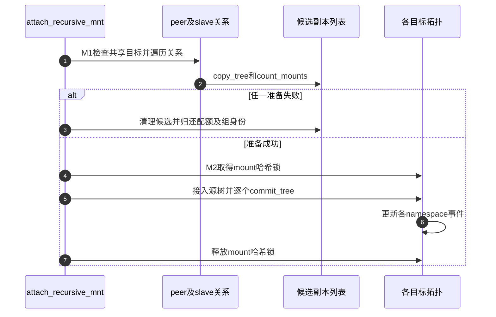
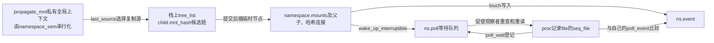

# 第9章\_传播关系与挂载记录

本页承接 [挂载视图导读](../navigation/P06_挂载视图怎样接入传播与退出.md#6.1_先区分视图对象和传播连接)，回答 M1/M2 怎样把一个目标处的子挂载变化带到其他视图，以及 M3 的观察者如何得知记录变化。固定 NXP Linux 6.12.20 提交 `dfaf2136deb2af2e60b994421281ba42f1c087e0`；版本入口为 [VFS 总索引](../navigation/P01_Linux_6.12_VFS源码阅读索引.md)。

## 9.1\_先准备传播副本再提交拓扑

shared 父视图上的接入可能影响多个 peer 与下游位置。若接入第一个位置之后才发现后续副本无法分配，错误恢复会复杂得多。因此本版本先检查数量、准备传播副本，再在 mount 哈希锁保护下提交连接；namespace_lock 由调用者持有，不能把函数中较短的哈希锁误认为全部串行化范围。

```c
/** @brief 仓库补充阅读说明：先准备传播副本，再持哈希锁提交源和传播目标。 */
static int attach_recursive_mnt(struct mount *source_mnt,
                                struct mount *top_mnt,
                                struct mountpoint *dest_mp,
                                enum mnt_tree_flags_t flags)
{
        struct user_namespace *user_ns = current->nsproxy->mnt_ns->user_ns;
        HLIST_HEAD(tree_list);
        struct mnt_namespace *ns = top_mnt->mnt_ns;
        struct mountpoint *smp;
        struct mount *child, *dest_mnt, *p;
        struct hlist_node *n;
        int err = 0;
        bool moving = flags & MNT_TREE_MOVE, beneath = flags & MNT_TREE_BENEATH;

        /* 提前取得必要挂载点，避免提交覆盖关系时再分配。 */
        /* 仓库补充：先准备覆盖关系可能需要的挂载点，后续所有出口须归还。 */
        smp = get_mountpoint(source_mnt->mnt.mnt_root);
        if (IS_ERR(smp))
                return PTR_ERR(smp);

        /* 检查并预留本次新增挂载数量。 */
        if (!moving) {
                /* 仓库补充：新接入才预留增加的数量；移动已有树不重复计算同一批。 */
                err = count_mounts(ns, source_mnt);
                if (err)
                        goto out;
        }

        if (beneath)
                dest_mnt = top_mnt->mnt_parent;
        else
                dest_mnt = top_mnt;

        if (IS_MNT_SHARED(dest_mnt)) {
                /* 仓库补充：共享传播准备组身份，失败需撤销尚未提交的分配。 */
                err = invent_group_ids(source_mnt, true);
                if (err)
                        goto out;
                err = propagate_mnt(dest_mnt, dest_mp, source_mnt, &tree_list);
        }
        /* 仓库补充：准备副本在前，实际拓扑修改在本保护下提交。 */
        lock_mount_hash();
        if (err)
                goto out_cleanup_ids;

        if (IS_MNT_SHARED(dest_mnt)) {
                for (p = source_mnt; p; p = next_mnt(p, source_mnt))
                        set_mnt_shared(p);
        }

        if (moving) {
                if (beneath)
                        dest_mp = smp;
                /* 仓库补充：移动先解除旧查找连接，再接到新位置。 */
                unhash_mnt(source_mnt);
                attach_mnt(source_mnt, top_mnt, dest_mp, beneath);
                touch_mnt_namespace(source_mnt->mnt_ns);
        } else {
                if (source_mnt->mnt_ns) {
                        LIST_HEAD(head);

                        /* 从匿名集合移走，调用者负责原匿名namespace的销毁。 */
                        for (p = source_mnt; p; p = next_mnt(p, source_mnt))
                                /* 仓库补充：从匿名namespace撤销旧归属，不能把候选同时登记到两套集合。 */
                                move_from_ns(p, &head);
                        list_del_init(&head);
                }
                if (beneath)
                        mnt_set_mountpoint_beneath(source_mnt, top_mnt, smp);
                else
                        mnt_set_mountpoint(dest_mnt, dest_mp, source_mnt);
                commit_tree(source_mnt);
        }

        hlist_for_each_entry_safe(child, n, &tree_list, mnt_hash) {
                struct mount *q;
                /* 仓库补充：先从本次临时候选列表移除，才把该节点交给正式拓扑。 */
                hlist_del_init(&child->mnt_hash);
                q = __lookup_mnt(&child->mnt_parent->mnt,
                                 child->mnt_mountpoint);
                if (q)
                        mnt_change_mountpoint(child, smp, q);
                /* 跨用户命名空间传播需要保留管理限制。 */
                if (child->mnt_parent->mnt_ns->user_ns != user_ns)
                        /* 仓库补充：跨用户命名空间传播要限制后续管理，不是赋予对方额外权限。 */
                        lock_mnt_tree(child);
                child->mnt.mnt_flags &= ~MNT_LOCKED;
                commit_tree(child);
        }
        put_mountpoint(smp);
        unlock_mount_hash();

        return 0;

 out_cleanup_ids:
        while (!hlist_empty(&tree_list)) {
                child = hlist_entry(tree_list.first, struct mount, mnt_hash);
                /* 仓库补充：失败回收同时撤销该目标的待提交配额。 */
                child->mnt_parent->mnt_ns->pending_mounts = 0;
                umount_tree(child, UMOUNT_SYNC);
        }
        unlock_mount_hash();
        /* 仓库补充：准备失败归还本次临时组身份。 */
        cleanup_group_ids(source_mnt, NULL);
 out:
        ns->pending_mounts = 0;

        read_seqlock_excl(&mount_lock);
        put_mountpoint(smp);
        read_sequnlock_excl(&mount_lock);

        return err;
}
```

dest 由普通接入或 beneath 关系选择。目标 shared 时 invent_group_ids 与 propagate_mnt 在 lock_mount_hash 之前准备，失败进入配对回收；锁内才设置共享标记、连接源树和准备好的传播树。移动已有树与接入新候选的分支不同：移动要解除旧连接并通知旧 namespace，不能给它再重复登记一份新树。

传播目标可能已有覆盖挂载，代码还处理顶部覆盖关系。图示只表达普通接入的准备/提交边界，不把这些分支压成“所有目标直接写相同父指针”。



## 9.2\_传播沿对象连接行进而不是向进程发命令

传播遍历的输入是目标父 mount 与挂载点。peer 链提供同伴，master/slave 关系提供单向下游；被传播的是新 mount 树。fs/pnode.c 中若干遍历上下文变量由 namespace_sem 串行化的流程使用，不能脱离这个前提把辅助函数并行调用。

```c
/** @brief 仓库补充阅读说明：遍历同伴与下游组，准备待提交副本。 */
int propagate_mnt(struct mount *dest_mnt, struct mountpoint *dest_mp,
                    struct mount *source_mnt, struct hlist_head *tree_list)
{
        struct mount *m, *n;
        int ret = 0;

        /* namespace_sem串行化整个流程，以下私有全局变量只承载本次遍历上下文。 */
        /* 仓库补充：设置本次串行传播的初始目标上下文。 */
        last_dest = dest_mnt;
        /* 仓库补充：保留本次原始源，用来判断后续复制链的关系。 */
        first_source = source_mnt;
        /* 仓库补充：后续各目标可更新当前复制源，不能一直假定只复制原始源。 */
        last_source = source_mnt;
        /* 仓库补充：私有全局指针借用调用者本次候选链，不能越过调用生命周期。 */
        list = tree_list;
        /* 仓库补充：记录初始目标的上游边界供下游遍历判断。 */
        dest_master = dest_mnt->mnt_master;

        /* 先遍历除初始目标外的所有同伴。 */
        for (n = next_peer(dest_mnt); n != dest_mnt; n = next_peer(n)) {
                ret = propagate_one(n, dest_mp);
                if (ret)
                        goto out;
        }

        /* 再遍历下游slave组。 */
        for (m = next_group(dest_mnt, dest_mnt); m;
                        m = next_group(m, dest_mnt)) {
                /* 遍历该下游组的各同伴。 */
                n = m;
                do {
                        ret = propagate_one(n, dest_mp);
                        if (ret)
                                goto out;
                        n = next_peer(n);
                } while (n != m);
        }
out:
        read_seqlock_excl(&mount_lock);
        hlist_for_each_entry(n, tree_list, mnt_hash) {
                m = n->mnt_parent;
                if (m->mnt_master != dest_mnt->mnt_master)
                        CLEAR_MNT_MARK(m->mnt_master);
        }
        read_sequnlock_excl(&mount_lock);
        return ret;
}
```

```c
/** @brief 仓库补充阅读说明：检查目标覆盖范围并按传播关系复制候选。 */
static int propagate_one(struct mount *m, struct mountpoint *dest_mp)
{
        struct mount *child;
        int type;
        /* 排除尚无普通命名空间归属的候选，参见IS_MNT_NEW定义。 */
        /* 仓库补充：该宏检查无namespace或匿名namespace归属，并非记录创建时间。 */
        if (IS_MNT_NEW(m))
                return 0;
        /* 目标根未覆盖挂载点时不传播到这里。 */
        /* 仓库补充：有传播关系还不够，目标视图必须覆盖接入dentry。 */
        if (!is_subdir(dest_mp->m_dentry, m->mnt.mnt_root))
                return 0;
        if (peers(m, last_dest)) {
                /* 仓库补充：同伴目标复制为共享关系。 */
                type = CL_MAKE_SHARED;
        } else {
                struct mount *n, *p;
                bool done;
                for (n = m; ; n = p) {
                        p = n->mnt_master;
                        if (p == dest_master || IS_MNT_MARKED(p))
                                break;
                }
                do {
                        struct mount *parent = last_source->mnt_parent;
                        if (peers(last_source, first_source))
                                break;
                        done = parent->mnt_master == p;
                        if (done && peers(n, parent))
                                break;
                        last_source = last_source->mnt_master;
                } while (!done);

                /* 仓库补充：跨向下游时建立单向接收关系。 */
                type = CL_SLAVE;
                /* 下游目标自身也可能属于shared组。 */
                if (IS_MNT_SHARED(m))
                        type |= CL_MAKE_SHARED;
        }

        child = copy_tree(last_source, last_source->mnt.mnt_root, type);
        if (IS_ERR(child))
                return PTR_ERR(child);
        read_seqlock_excl(&mount_lock);
        mnt_set_mountpoint(m, dest_mp, child);
        if (m->mnt_master != dest_master)
                SET_MNT_MARK(m->mnt_master);
        read_sequnlock_excl(&mount_lock);
        last_dest = m;
        last_source = child;
        /* 仓库补充：候选已建立但尚未公开到正式挂载查找哈希。 */
        hlist_add_head(&child->mnt_hash, list);
        /* 仓库补充：候选登记后仍可能因配额失败，由上层清理整批准备。 */
        return count_mounts(m->mnt_ns, child);
}
```

第一层走目标同伴，随后遍历 slave 分组。propagate_one 会跳过尚未接入普通命名空间的目标（mnt_ns为空或指向匿名命名空间），以及不覆盖接入 dentry 的目标；根据同伴或下游位置选择 CL_MAKE_SHARED、CL_SLAVE 等复制标志，再设置挂载点并登记候选。这解释了为什么“有共享联系”仍不等于每次事件都在任何路径上无条件复制。


普通文件 write 没有出现在这条链中。文件内容共享由共同后端承担，传播只处理挂载拓扑；同样不需要每个 namespace 都启动一个接收线程来兑现共享。

## 9.3\_改变传播类型必须重组已有关系

把 shared 改为 slave/private 时，原有同伴、下游和组 ID 都需要整理。do_make_slave 优先寻找同根的 peer 作为 master，没有同根时可选择其他 peer；若已没有同伴且也没有 master，还需处理原下游。不能只把一个枚举字段改为“slave”就假定关系成立。

```c
/** @brief 仓库补充阅读说明：整理同伴、master及下游连接，为类型变更建立一致关系。 */
static int do_make_slave(struct mount *mnt)
{
        struct mount *master, *slave_mnt;

        if (list_empty(&mnt->mnt_share)) {
                if (IS_MNT_SHARED(mnt)) {
                        /* 仓库补充：最后无同伴时，必要时归还该共享组身份。 */
                        mnt_release_group_id(mnt);
                        CLEAR_MNT_SHARED(mnt);
                }
                master = mnt->mnt_master;
                if (!master) {
                        struct list_head *p = &mnt->mnt_slave_list;
                        while (!list_empty(p)) {
                                slave_mnt = list_first_entry(p,
                                                struct mount, mnt_slave);
                                list_del_init(&slave_mnt->mnt_slave);
                                /* 仓库补充：没有可承接上游时，显式撤销旧下游的master关系。 */
                                slave_mnt->mnt_master = NULL;
                        }
                        return 0;
                }
        } else {
                struct mount *m;
                /* 优先以同根peer承接master，没有同根时使用可用peer。 */
                for (m = master = next_peer(mnt); m != mnt; m = next_peer(m)) {
                        if (m->mnt.mnt_root == mnt->mnt.mnt_root) {
                                master = m;
                                break;
                        }
                }
                list_del_init(&mnt->mnt_share);
                /* 仓库补充：离开原peer组，不能保留旧组身份。 */
                mnt->mnt_group_id = 0;
                CLEAR_MNT_SHARED(mnt);
        }
        list_for_each_entry(slave_mnt, &mnt->mnt_slave_list, mnt_slave)
                /* 仓库补充：把原下游逐个重接到选定上游。 */
                slave_mnt->mnt_master = master;
        list_move(&mnt->mnt_slave, &master->mnt_slave_list);
        list_splice(&mnt->mnt_slave_list, master->mnt_slave_list.prev);
        INIT_LIST_HEAD(&mnt->mnt_slave_list);
        mnt->mnt_master = master;
        return 0;
}
```

```c
/** @brief 仓库补充阅读说明：按目标传播类型重组连接与限制标志。 */
void change_mnt_propagation(struct mount *mnt, int type)
{
        if (type == MS_SHARED) {
                set_mnt_shared(mnt);
                return;
        }
        do_make_slave(mnt);
        if (type != MS_SLAVE) {
                list_del_init(&mnt->mnt_slave);
                /* 仓库补充：目标不是slave时，进一步断开上游接收关系。 */
                mnt->mnt_master = NULL;
                if (type == MS_UNBINDABLE)
                        mnt->mnt.mnt_flags |= MNT_UNBINDABLE;
                else
                        mnt->mnt.mnt_flags &= ~MNT_UNBINDABLE;
        }
}
```

MS_SHARED 直接建立 shared 属性；其他类型先经过 do_make_slave 整理，再按目标是否 slave 决定是否断开 master，按是否 unbindable 维护限制标志。共享与下游关系可组合，图表中的四个常见标签因此不能替代实际连接状态。此辅助层要求调用者持有相应写保护，权限检查和递归范围由上层路径负责。

## 9.4\_记录变化通过事件值与等待队列交接

拓扑提交完成后，观察者需要知道“应重新读取”，却不必在内核写路径上替它格式化所有记录。namespace 的 event 保存变化标记，poll 保存等待队列；序列文件另存观察者上次见到的 poll_event。

```c
/** @brief 仓库补充阅读说明：发布新的事件值并唤醒记录观察者。 */
static void touch_mnt_namespace(struct mnt_namespace *ns)
{
        if (ns) {
                /* 仓库补充：增加全局变化序号，再写入受影响namespace。 */
                ns->event = ++event;
                wake_up_interruptible(&ns->poll);
        }
}
```

```c
/** @brief 仓库补充阅读说明：同批事件尚未反映到该命名空间时更新并唤醒。 */
static void __touch_mnt_namespace(struct mnt_namespace *ns)
{
        if (ns && ns->event != event) {
                /* 仓库补充：同批退出复用已有全局事件值，避免重复通知同一namespace。 */
                ns->event = event;
                wake_up_interruptible(&ns->poll);
        }
}
```

```c
/** @brief 仓库补充阅读说明：登记等待后比较观察者保存的事件值。 */
static __poll_t mounts_poll(struct file *file, poll_table *wait)
{
        struct seq_file *m = file->private_data;
        struct proc_mounts *p = m->private;
        struct mnt_namespace *ns = p->ns;
        __poll_t res = EPOLLIN | EPOLLRDNORM;
        int event;

        /* 仓库补充：先登记等待，再读取当前变化标记。 */
        poll_wait(file, &p->ns->poll, wait);

        /* 仓库补充：这里只取得有限宽度的比较值，不构造完整变化历史。 */
        event = READ_ONCE(ns->event);
        if (m->poll_event != event) {
                /* 仓库补充：更新这个打开观察者自己的已见标记。 */
                m->poll_event = event;
                /* 仓库补充：表示记录有变化，不表示文件系统数据损坏。 */
                res |= EPOLLERR | EPOLLPRI;
        }

        return res;
}
```

touch 增加全局事件值并写入该 namespace；同一批退出用 __touch 避免对相同事件重复通知。poll 先登记等待，再读取事件并比较；不一致时更新本观察者的记录并返回 EPOLLERR/EPOLLPRI。这里的 EPOLLERR 是挂载记录变化协议的一部分，不能解释为文件系统已损坏。event 也不是每个挂载操作的永久编号，观察者可能把多次变化合并成一次重读。

## 9.5\_mountinfo把两个坐标和两层选项分别输出

show_mountinfo 不只打印一个路径。它同时输出 mount 的身份与父身份、实例设备号、实例内部 root、相对proc目标任务 root 的接入路径，以及视图和实例各自的选项。

```c
/** @brief 仓库补充阅读说明：分别输出实例内根、观察者接入路径及两层选项。 */
static int show_mountinfo(struct seq_file *m, struct vfsmount *mnt)
{
        struct proc_mounts *p = m->private;
        struct mount *r = real_mount(mnt);
        struct super_block *sb = mnt->mnt_sb;
        struct path mnt_path = { .dentry = mnt->mnt_root, .mnt = mnt };
        int err;

        seq_printf(m, "%i %i %u:%u ", r->mnt_id, r->mnt_parent->mnt_id,
                   MAJOR(sb->s_dev), MINOR(sb->s_dev));
        err = show_path(m, mnt->mnt_root);
        if (err)
                goto out;
        seq_putc(m, ' ');

        /* proc目标任务根之外的挂载点可能返回SEQ_SKIP。 */
        /* 仓库补充：按proc目标任务根输出路径，超出可见范围可跳过该记录。 */
        err = seq_path_root(m, &mnt_path, &p->root, " \t\n\\");
        if (err)
                goto out;

        seq_puts(m, mnt->mnt_flags & MNT_READONLY ? " ro" : " rw");
        show_vfsmnt_opts(m, mnt);

        /* 可选传播标签，数量随具体关系变化。 */
        if (IS_MNT_SHARED(r))
                seq_printf(m, " shared:%i", r->mnt_group_id);
        if (IS_MNT_SLAVE(r)) {
                int master = r->mnt_master->mnt_group_id;
                int dom = get_dominating_id(r, &p->root);
                seq_printf(m, " master:%i", master);
                if (dom && dom != master)
                        seq_printf(m, " propagate_from:%i", dom);
        }
        if (IS_MNT_UNBINDABLE(r))
                seq_puts(m, " unbindable");

        /* 分隔符之后输出实例与文件系统特有信息。 */
        seq_puts(m, " - ");
        show_type(m, sb);
        seq_putc(m, ' ');
        if (sb->s_op->show_devname) {
                err = sb->s_op->show_devname(m, mnt->mnt_root);
                if (err)
                        goto out;
        } else {
                mangle(m, r->mnt_devname ? r->mnt_devname : "none");
        }
        seq_puts(m, sb_rdonly(sb) ? " ro" : " rw");
        err = show_sb_opts(m, sb);
        if (err)
                goto out;
        if (sb->s_op->show_options)
                err = sb->s_op->show_options(m, mnt->mnt_root);
        seq_putc(m, '\n');
out:
        return err;
}
```

| 输出来源 | 对应字段 | 阅读限制 |
| --- | --- | --- |
| mnt_id、mnt_parent.mnt_id | 前两列 | 传统 ID 可复用，父记录可能不在可见范围 |
| sb.s_dev | major:minor | 实例设备身份，不是传播组身份 |
| show_path 或 mnt_root | root | 文件系统内部坐标 |
| seq_path_root 与proc目标任务 root | mount point | 打开时保存的目标任务根视角；不可表示时可跳过记录 |
| mnt_flags、show_vfsmnt_opts | 分隔符前选项 | 单个视图的属性 |
| mnt_group_id、master 和支配关系 | shared/master/propagate_from | 可选字段数量不固定 |
| show_type、show_devname或mnt_devname | 类型与来源 | 来源可能不是块设备路径 |
| sb_rdonly、show_sb_opts、show_options | 分隔符后选项 | 实例和文件系统专属配置 |

字段讲解例子与解析边界见 [正文 mountinfo 表](../../../../knowledge/kernel_subsystems/vfs/P07_mount与mount_namespace.md#7.5_在mountinfo中区分实例根与视图入口)。此处保留实现依据，原件为 [fs/namespace.c](../../linux/fs/namespace.c)、[fs/pnode.c](../../linux/fs/pnode.c)、[fs/proc_namespace.c](../../linux/fs/proc_namespace.c) 和 [sharedsubtree.rst](../../linux/Documentation/filesystems/sharedsubtree.rst)。未运行跨 namespace 传播测试；固定源码支持方向与条件，不支持假造实际事件顺序。返回 [导读](../navigation/P06_挂载视图怎样接入传播与退出.md#6.2_沿同一周期选择实现入口)。


## 9.6\_把准备上下文与观察者状态分开维护

传播流程的临时状态不在每个用户进程里。attach_recursive_mnt在栈上建立tree_list，fs/pnode.c用一组文件私有全局指针记录本次遍历进度；namespace_sem保证这些指针不会被另一个传播操作同时改写。准备完成后，候选转入正式拓扑；失败则按候选链逐个收回。若把准备阶段改成并行执行，首先必须替换这组共享遍历上下文，不能只给某个copy_tree调用加锁。

| 状态或辅助簇 | 初值、写入与读取 | 修改约束 |
| --- | --- | --- |
| last_dest、first_source、last_source、dest_master、list | pnode.c静态指针，propagate_mnt每次进入重新赋值；propagate_one及退出清标记路径消费 | list借用调用者栈上tree_list；last_source会随传播方向更新，不是永久指向初始源 |
| tree_list与child.mnt_hash | 栈上空hlist；propagate_one把准备副本接入，attach_recursive_mnt在提交前摘下 | mnt_hash此时承担临时列表节点，不能同时留在候选链和正式查找哈希里 |
| pending_mounts与组ID | count_mounts预留各namespace的数量，invent_group_ids准备共享组身份；commit_tree兑现数量 | 任一目标准备失败要回收副本、清pending_mounts及准备的组身份；返回错误不等于没有分配过对象 |
| mnt_share、mnt_master、mnt_slave、mnt_slave_list | peer环与上游/下游链表达传播；clone及change_mnt_propagation维护 | shared与slave可同时成立；MS_PRIVATE必须解除传播联系，不是只改显示标签 |
| IS_MNT_NEW、IS_MNT_SHARED、IS_MNT_SLAVE及MARK辅助 | fs/pnode.h根据namespace、标志或master指针判断；MARK位是遍历辅助状态 | IS_MNT_NEW不是创建时间记录；MARK不替代拓扑锁，结束和错误路径都需清理 |
| event、ns.event、ns.poll | namespace.c全局u64事件与每namespace标记；touch类函数写入并唤醒 | 只提示应重新观察；多个操作可以合并，不能当逐条事件队列 |
| seq_file.poll_event、proc_mounts.ns/root | 打开proc挂载记录时建立观察者上下文，mounts_poll比较并更新本打开的标记 | 每个打开独立观察；共享同一个file的使用者共享该观察进度，不保证每个poll调用都看到一次独立变化 |



观察入口的细节来自 [fs/proc_namespace.c](../../linux/fs/proc_namespace.c) 的mounts_open_common与mounts_poll，以及 [seq_file.h](../../linux/include/linux/seq_file.h) 的字段声明。打开时通过proc inode定位目标任务，取得其namespace和fs.root持有，并初始化poll_event；不是无条件使用读取工具current的root。读取/proc/self时目标才恰好为自身。poll中的局部event和poll_event是int，不能把全局u64计数解释成每个观察者完整保存的单调历史。READ_ONCE也不会把整份mountinfo、多条记录和所有拓扑变化合成一个原子快照。

show_path输出实例内根，seq_path_root按proc目标任务root决定可表示的接入路径；show_vfsmnt_opts消费视图属性，show_sb_opts及文件系统show_options消费实例属性。show_devname与show_options等回调可能返回错误，代码会按相应位置结束，不能把不完整读取或跳过记录当成“对象不存在”的唯一证据。seq_put/printf只承担序列输出，字符转义由相应路径和mangle辅助处理，不能简单按空格固定切出所有可选列。

本页完整保留上述传播、变更、通知与输出函数，但不逐句复制copy_tree、红黑树或seq_file通用实现。copy_tree的接入职责见 [视图复制](P08_挂载视图复制与目录接入.md#8.2_复制视图时取得共享后端的持有)，commit_tree的字段变化见 [拓扑提交](P08_挂载视图复制与目录接入.md#8.5_提交同时更新父连接查找入口和集合)。next_peer/next_group沿现有关系选取下一目标，is_subdir检查dentry覆盖范围；它们不创建用户任务或发送跨进程命令。

修改传播类型时至少检查同伴、纯下游、共享下游、不同根覆盖范围和跨user_ns限制；修改准备/提交时检查多目标中途失败、覆盖挂载及匿名源接入；修改观察接口时检查两个独立打开、共享file、多次变化合并及proc目标任务根外的记录。PROC_FS关闭时这些proc观察入口不可用，不影响挂载拓扑本身的管理。上述是固定源码支持的验证范围，本次未执行跨namespace传播和poll时序实验。
