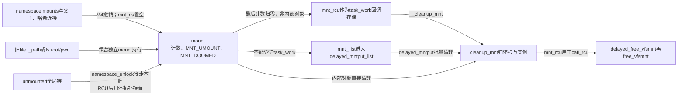
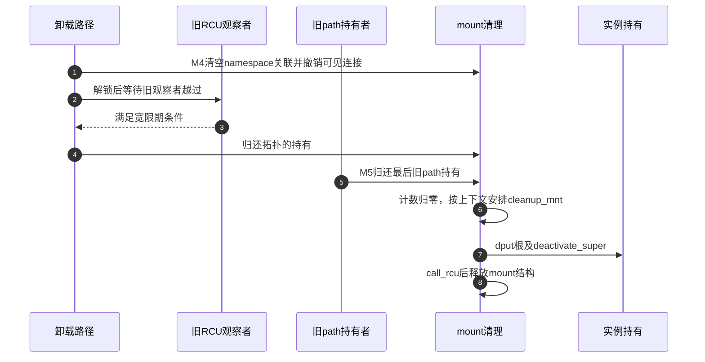

# 第10章\_挂载脱离与最后引用退出

本页承接 [挂载视图导读](../navigation/P06_挂载视图怎样接入传播与退出.md#6.1_先区分视图对象和传播连接) 的 M4/M5。固定 NXP Linux 6.12.20 提交 `dfaf2136deb2af2e60b994421281ba42f1c087e0`，函数来自 fs/namespace.c，忙状态传播检查来自 fs/pnode.c；源码身份见 [VFS 总索引](../navigation/P01_Linux_6.12_VFS源码阅读索引.md)。

## 10.1\_普通卸载先判断是否允许结束可见使用

M3 使用者可能已经把 mount 保存在 path 中。普通卸载不能只看目录是否为空：即使没有任何新查找，旧文件、cwd 等持有也能阻止退出。do_umount 区分过期、强制请求、任务根的特殊处理、普通忙检查和 lazy 分离。

```c
/** @brief 仓库补充阅读说明：选择普通忙检查、分离及其他卸载协议分支。 */
static int do_umount(struct mount *mnt, int flags)
{
        struct super_block *sb = mnt->mnt.mnt_sb;
        int retval;

        /* 仓库补充：安全钩子可先拒绝，拒绝时尚未改变拓扑。 */
        retval = security_sb_umount(&mnt->mnt, flags);
        if (retval)
                return retval;

        /* 过期协议要求已有标记，且只剩父拓扑与本次卸载的基准持有。 */
        if (flags & MNT_EXPIRE) {
                if (&mnt->mnt == current->fs->root.mnt ||
                    flags & (MNT_FORCE | MNT_DETACH))
                        return -EINVAL;

                /* 慢路径在挂载锁内检查汇总引用。 */
                lock_mount_hash();
                /* 仓库补充：此调用关系下检查父拓扑和当前卸载两份基准持有。 */
                if (mnt_get_count(mnt) != 2) {
                        unlock_mount_hash();
                        return -EBUSY;
                }
                unlock_mount_hash();

                /* 仓库补充：第一次只置过期标记并要求重试，不立即卸载。 */
                if (!xchg(&mnt->mnt_expiry_mark, 1))
                        return -EAGAIN;
        }

        /* 后端可先尝试中止活动；其他任务退出和资源归还仍可能尚未完成。 */

        if (flags & MNT_FORCE && sb->s_op->umount_begin) {
                /* 仓库补充：只请求后端中止活动，不取消后面的忙检查和退出协议。 */
                sb->s_op->umount_begin(sb);
        }

        /* 本版本对当前任务根采用特殊处理，不能按普通接入点直接摘除。 */
        if (&mnt->mnt == current->fs->root.mnt && !(flags & MNT_DETACH)) {
                /* 根分支尝试重新配置为只读。 */
                if (!ns_capable(sb->s_user_ns, CAP_SYS_ADMIN))
                        return -EPERM;
                /* 仓库补充：任务根的特殊分支尝试只读重配置，不走普通摘树。 */
                return do_umount_root(sb);
        }

        namespace_lock();
        lock_mount_hash();

        /* 持锁后重查MNT_LOCKED。 */
        retval = -EINVAL;
        /* 仓库补充：锁内复查限制，避免依赖过时的前置观察。 */
        if (mnt->mnt.mnt_flags & MNT_LOCKED)
                goto out;

        /* 仓库补充：本批退出共享一个变化标记，受影响namespace随后按需更新。 */
        event++;
        if (flags & MNT_DETACH) {
                if (mnt_ns_attached(mnt) || !list_empty(&mnt->mnt_list))
                        umount_tree(mnt, UMOUNT_PROPAGATE);
                retval = 0;
        } else {
                shrink_submounts(mnt);
                retval = -EBUSY;
                /* 仓库补充：源与传播目标都需按各自基准判断。 */
                if (!propagate_mount_busy(mnt, 2)) {
                        if (mnt_ns_attached(mnt) || !list_empty(&mnt->mnt_list))
                                umount_tree(mnt, UMOUNT_PROPAGATE|UMOUNT_SYNC);
                        retval = 0;
                }
        }
out:
        unlock_mount_hash();
        namespace_unlock();
        return retval;
}
```

MNT_EXPIRE 要求满足相应引用条件，并通过两次标记检查实现过期协议；MNT_FORCE 只在文件系统提供 umount_begin 时请求它中止相关活动，随后仍走实际退出路径。当前任务根在非 DETACH 时有重配只读的特殊处理，不应把任意目录卸载例子套到这里。

普通分支先尝试收缩子挂载，再检查 propagate_mount_busy(mnt, 2)。这个 2 是该调用关系下的基准持有数，不是“允许任意两个用户继续使用”。DETACH 分支跳过相同的 busy 拒绝，直接请求传播退出，因此需要后面的引用保护继续服务旧使用者。

```c
/** @brief 仓库补充阅读说明：结合子树和传播目标的基准引用检查忙状态。 */
int propagate_mount_busy(struct mount *mnt, int refcnt)
{
        struct mount *m, *child, *topper;
        struct mount *parent = mnt->mnt_parent;

        /* 仓库补充：无外部父关系时只检查自身引用。 */
        if (mnt == parent)
                return do_refcount_check(mnt, refcnt);

        /* 先检查自身子挂载及引用；已忙就不继续遍历其他传播目标。 */
        if (!list_empty(&mnt->mnt_mounts) || do_refcount_check(mnt, refcnt))
                return 1;

        for (m = propagation_next(parent, parent); m;
                        m = propagation_next(m, parent)) {
                int count = 1;
                child = __lookup_mnt(&m->mnt, mnt->mnt_mountpoint);
                if (!child)
                        continue;

                /* 完全覆盖的一个上层挂载可能属于应忽略的内部持有。 */
                /* 仓库补充：完整覆盖的上层挂载会改变应忽略的内部持有数。 */
                topper = find_topper(child);
                if (topper)
                        count += 1;
                else if (!list_empty(&child->mnt_mounts))
                        continue;

                if (do_refcount_check(child, count))
                        return 1;
        }
        return 0;
}
```

do_refcount_check 以 mnt_get_count(mnt) 是否大于基准判断额外引用。源挂载有子挂载或额外持有先判忙；随后沿父挂载的传播关系查对应子挂载，按覆盖关系调整基准。它不是把所有命名空间的任意引用混成一个数字。

## 10.2\_脱离拓扑时分别撤销发现入口与传播关系

M4 要同时退出 namespace 集合、父子连接和传播组，但 lazy 子树可能需要保留某些内部连接。disconnect_mount 明确区分同步退出、无父、父仍挂载、请求保留以及锁定关系。

```c
/** @brief 仓库补充阅读说明：判断退出树中的父子关系能否或必须断开。 */
static bool disconnect_mount(struct mount *mnt, enum umount_tree_flags how)
{
        /* 只有lazy退出可保留部分内部连接。 */
        /* 仓库补充：同步退出要求断开，lazy才可能保留内部关系。 */
        if (how & UMOUNT_SYNC)
                return true;

        /* 没有父对象就无需保留外部连接。 */
        if (!mnt_has_parent(mnt))
                return true;

        /* 退出后计数规则改变，不能保持到正常挂载父对象的连接。 */
        /* 仓库补充：已退出子树不能继续连到正常挂载的父。 */
        if (!(mnt->mnt_parent->mnt.mnt_flags & MNT_UMOUNT))
                return true;

        /* 调用方式可明确要求保留内部连接。 */
        if (how & UMOUNT_CONNECTED)
                return false;

        /* 锁定关系也可能要求保留已退出子树的内部连接。 */
        if (IS_MNT_LOCKED(mnt))
                return false;

        /* 其余情况断开。 */
        return true;
}
```

```c
/** @brief 仓库补充阅读说明：撤销命名空间归属和传播关系，整理待归还拓扑持有。 */
static void umount_tree(struct mount *mnt, enum umount_tree_flags how)
{
        LIST_HEAD(tmp_list);
        struct mount *p;

        if (how & UMOUNT_PROPAGATE)
                propagate_mount_unlock(mnt);

        /* 收集本批退出对象。 */
        for (p = mnt; p; p = next_mnt(p, mnt)) {
                /* 仓库补充：标记正在退出，不能把它当成已最终释放。 */
                p->mnt.mnt_flags |= MNT_UMOUNT;
                if (mnt_ns_attached(p))
                        /* 仓库补充：从namespace集合移到本批待退出列表。 */
                        move_from_ns(p, &tmp_list);
                else
                        list_move(&p->mnt_list, &tmp_list);
        }

        /* 先从正常子挂载枚举连接撤下。 */
        list_for_each_entry(p, &tmp_list, mnt_list) {
                list_del_init(&p->mnt_child);
        }

        /* 补入传播退出目标。 */
        if (how & UMOUNT_PROPAGATE)
                /* 仓库补充：按传播关系补入本批应退出的其他目标。 */
                propagate_umount(&tmp_list);

        while (!list_empty(&tmp_list)) {
                struct mnt_namespace *ns;
                bool disconnect;
                p = list_first_entry(&tmp_list, struct mount, mnt_list);
                list_del_init(&p->mnt_expire);
                list_del_init(&p->mnt_list);
                ns = p->mnt_ns;
                if (ns) {
                        ns->nr_mounts--;
                        __touch_mnt_namespace(ns);
                }
                /* 仓库补充：撤销namespace归属；旧path和旧RCU观察者仍需保护。 */
                p->mnt_ns = NULL;
                /* 仓库补充：同步退出要求断开，lazy才可能保留内部关系。 */
                if (how & UMOUNT_SYNC)
                        p->mnt.mnt_flags |= MNT_SYNC_UMOUNT;

                disconnect = disconnect_mount(p, how);
                if (mnt_has_parent(p)) {
                        /* 仓库补充：退出后内部父子连接按另一套引用规则处理。 */
                        mnt_add_count(p->mnt_parent, -1);
                        if (!disconnect) {
                                /* 保留的内部子对象仍须能被退出父对象找到。 */
                                list_add_tail(&p->mnt_child, &p->mnt_parent->mnt_mounts);
                        } else {
                                umount_mnt(p);
                        }
                }
                /* 仓库补充：解除与正常传播域的关联。 */
                change_mnt_propagation(p, MS_PRIVATE);
                if (disconnect)
                        /* 仓库补充：收集待归还的拓扑持有，解锁后再等待旧观察者。 */
                        hlist_add_head(&p->mnt_umount, &unmounted);
        }
}
```

先把待退出树移到临时列表并标记 MNT_UMOUNT，移除原子树枚举连接；需要时纳入传播退出目标。随后维护 namespace 数量和事件、清空 mnt_ns、调整父持有，并切断传播。disconnect 为假时将内部子关系重新接回已经退出的父；它不能仍然连接到正常挂载的父树。



## 10.3\_退出拓扑的那份持有要等旧观察者安全越过

清空 mnt_ns 不允许立即释放对象。可能有 RCU 读者刚观察到它非空，正在按“拓扑仍持有它”的前提归还自己的引用。namespace_unlock 因此先释放 namespace_sem，再等待相应 RCU 宽限期并归还收集的 mount。

```c
/** @brief 仓库补充阅读说明：解锁后等待旧RCU观察者，再归还收集的拓扑持有。 */
static void namespace_unlock(void)
{
        struct hlist_head head;
        struct hlist_node *p;
        struct mount *m;
        LIST_HEAD(list);

        /* 仓库补充：在锁内接走本批，避免解锁后与下一操作混用全局链。 */
        hlist_move_list(&unmounted, &head);
        list_splice_init(&ex_mountpoints, &list);

        /* 仓库补充：耗时清理和宽限期等待在解拓扑信号量后进行。 */
        up_write(&namespace_sem);

        shrink_dentry_list(&list);

        if (likely(hlist_empty(&head)))
                return;

        /* 仓库补充：让基于旧非空mnt_ns的快速归还者安全越过。 */
        synchronize_rcu_expedited();

        hlist_for_each_entry_safe(m, p, &head, mnt_umount) {
                hlist_del(&m->mnt_umount);
                mntput(&m->mnt);
        }
}
```

顺序是锁内取出待清理对象，解锁后处理可能耗时的工作；不能把 synchronize_rcu_expedited 移进拓扑自旋锁。这里的等待针对旧观察者，不是等待所有旧 fd 自动关闭。旧 fd 仍有自己的持有，之后可以继续操作。

## 10.4\_最后计数归还才选择真正的清理路径

mntput_no_expire 的快速分支在 RCU 保护下看到非空 mnt_ns，就能归还非最后一份引用；依据正是上一节的延迟归还。已经脱离的对象则在 mount 哈希锁保护和相应内存屏障下减计数、检查总数，并以 MNT_DOOMED 避免重复清理。

```c
/** @brief 仓库补充阅读说明：配对拓扑引用保护，最后计数归零才安排清理。 */
static void mntput_no_expire(struct mount *mnt)
{
        LIST_HEAD(list);
        int count;

        rcu_read_lock();
        /* 仓库补充：RCU区间内看到非空时，延后归还的拓扑持有保证本次不是最后一份。 */
        if (likely(READ_ONCE(mnt->mnt_ns))) {
                /* 非空namespace的拓扑持有在清空关联并经过RCU宽限期后才归还，因此本次快速减引用不是最后一份。 */
                mnt_add_count(mnt, -1);
                rcu_read_unlock();
                return;
        }
        lock_mount_hash();
        /* 与查找侧合法化引用的协议配对，确保汇总能看到相关增加。 */
        smp_mb();
        mnt_add_count(mnt, -1);
        /* 仓库补充：取得受保护的总计数，不能只检查某个CPU的局部值。 */
        count = mnt_get_count(mnt);
        if (count != 0) {
                /* 仓库补充：负计数为协议错误；告警不把它修正成合法值。 */
                WARN_ON(count < 0);
                rcu_read_unlock();
                unlock_mount_hash();
                return;
        }
        if (unlikely(mnt->mnt.mnt_flags & MNT_DOOMED)) {
                rcu_read_unlock();
                unlock_mount_hash();
                return;
        }
        /* 仓库补充：只让一个最后归还者进入最终清理。 */
        mnt->mnt.mnt_flags |= MNT_DOOMED;
        rcu_read_unlock();

        /* 仓库补充：最后mount引用结束后撤销实例的视图集合连接。 */
        list_del(&mnt->mnt_instance);

        if (unlikely(!list_empty(&mnt->mnt_mounts))) {
                struct mount *p, *tmp;
                list_for_each_entry_safe(p, tmp, &mnt->mnt_mounts,  mnt_child) {
                        __put_mountpoint(unhash_mnt(p), &list);
                        hlist_add_head(&p->mnt_umount, &mnt->mnt_stuck_children);
                }
        }
        unlock_mount_hash();
        shrink_dentry_list(&list);

        if (likely(!(mnt->mnt.mnt_flags & MNT_INTERNAL))) {
                struct task_struct *task = current;
                if (likely(!(task->flags & PF_KTHREAD))) {
                        /* 仓库补充：此时字段用于task_work，不能仅凭成员名认为已经call_rcu。 */
                        init_task_work(&mnt->mnt_rcu, __cleanup_mnt);
                        /* 仓库补充：登记成功由任务返回路径执行，失败才走延后工作。 */
                        if (!task_work_add(task, &mnt->mnt_rcu, TWA_RESUME))
                                return;
                }
                if (llist_add(&mnt->mnt_llist, &delayed_mntput_list))
                        /* 仓库补充：延迟参数是jiffy单位，不是固定1毫秒完成保证。 */
                        schedule_delayed_work(&delayed_mntput_work, 1);
                return;
        }
        cleanup_mnt(mnt);
}
```

SMP 构建中 mount 引用使用每 CPU 计数，mnt_get_count 在所需保护下汇总；非 SMP 构建使用直接计数。不能把每 CPU 的局部零当成全局最后引用。本次源码基线配置不启用 SMP，正文对 SMP 的说明来自条件编译分支，不是本机运行结果。

计数真正归零后移出实例的 mount 集合，并整理残留子连接。非内部挂载优先把清理挂到当前普通任务的 task_work；无法这样安排时使用 delayed_mntput_list 和延后工作。内部挂载可直接 cleanup_mnt。这些是具体执行上下文的选择，不是承诺用户 close 返回时全部资源都已释放。

```c
/** @brief 仓库补充阅读说明：task_work入口把对象交给公共清理。 */
static void __cleanup_mnt(struct rcu_head *head)
{
        cleanup_mnt(container_of(head, struct mount, mnt_rcu));
}
```

```c
/** @brief 仓库补充阅读说明：工作队列批量取出并清理延后对象。 */
static void delayed_mntput(struct work_struct *unused)
{
        struct llist_node *node = llist_del_all(&delayed_mntput_list);
        struct mount *m, *t;

        llist_for_each_entry_safe(m, t, node, mnt_llist)
                cleanup_mnt(m);
}
```

## 10.5\_归还根与实例之后还有结构体释放阶段

cleanup_mnt 检查写持有、处理 pins 与残留子树、通知 fsnotify，再 dput 根和 deactivate_super。一个视图结束只归还它自己的实例持有；其他视图仍可让 superblock 保持活动。

```c
/** @brief 仓库补充阅读说明：归还根与实例持有，随后安排结构体延迟释放。 */
static void cleanup_mnt(struct mount *mnt)
{
        struct hlist_node *p;
        struct mount *m;
        /* 最后mount引用退出时仍有写持有，说明want/drop_write可能未配对；计数减路径已提供观察所需屏障。 */
        /* 仓库补充：检查写访问取得/归还是否仍未配对，不补做归还。 */
        WARN_ON(mnt_get_writers(mnt));
        if (unlikely(mnt->mnt_pins.first))
                /* 仓库补充：清理挂载pin关联；不是销毁全部用户fd。 */
                mnt_pin_kill(mnt);
        hlist_for_each_entry_safe(m, p, &mnt->mnt_stuck_children, mnt_umount) {
                hlist_del(&m->mnt_umount);
                mntput(&m->mnt);
        }
        /* 仓库补充：通知框架撤销该挂载对象的相关观察关系。 */
        fsnotify_vfsmount_delete(&mnt->mnt);
        /* 仓库补充：归还该视图自己的根dentry持有。 */
        dput(mnt->mnt.mnt_root);
        /* 仓库补充：归还该视图自己的实例活动持有。 */
        deactivate_super(mnt->mnt.mnt_sb);
        /* 仓库补充：传统挂载ID可以回收复用，不能作为永久对象身份。 */
        mnt_free_id(mnt);
        /* 仓库补充：清理后才复用回调存储安排最终结构释放。 */
        call_rcu(&mnt->mnt_rcu, delayed_free_vfsmnt);
}
```

```c
/** @brief 仓库补充阅读说明：RCU回调进入最终内存释放。 */
static void delayed_free_vfsmnt(struct rcu_head *head)
{
        free_vfsmnt(container_of(head, struct mount, mnt_rcu));
}
```

```c
/** @brief 仓库补充阅读说明：释放idmap、名字、条件性每CPU计数和mount内存。 */
static void free_vfsmnt(struct mount *mnt)
{
        /* 仓库补充：最终归还ID映射持有。 */
        mnt_idmap_put(mnt_idmap(&mnt->mnt));
        kfree_const(mnt->mnt_devname);
#ifdef CONFIG_SMP
        /* 仓库补充：只有SMP构建分配了这份每CPU存储。 */
        free_percpu(mnt->mnt_pcp);
#endif
        kmem_cache_free(mnt_cache, mnt);
}
```

归还传统挂载 ID 后通过 call_rcu 安排最终 free_vfsmnt；它清理名字、每 CPU 存储、idmap 和 mount 缓存对象。这与 namespace_unlock 为拓扑持有等待的 RCU 阶段处于不同位置，不能只画一个“RCU 后完成全部卸载”。



图选择旧 path 最后退出的分支；若没有旧持有，拓扑持有归还就可能触发后续清理。实例本身的退出继续见 [最后活动引用](P07_实例关闭通知与最终内存回收.md#7.1_最后活动引用把流程交给关闭回调)。本页未执行并发卸载或故障注入；普通拒绝与 lazy 保留旧 fd 的教学实验位于 [正文完整程序](../../../../knowledge/kernel_subsystems/vfs/P07_mount与mount_namespace.md#7.7_在一个完整程序里观察旧fd与新路径)。返回 [导读](../navigation/P06_挂载视图怎样接入传播与退出.md#6.2_沿同一周期选择实现入口)。


## 10.6\_沿同一挂载对象检查两次RCU和三种清理上下文

字段名不能代替时序。mnt_rcu在非内部挂载的退出中先可作为task_work回调存储，cleanup_mnt完成后才用于call_rcu的最终释放；namespace_unlock中的宽限期又是更早的拓扑引用交接。它们保护不同阶段，不是重复做三次同样的等待。

| 状态或实现簇 | 谁建立、谁消费 | 修改时必须同时检查 |
| --- | --- | --- |
| MNT_UMOUNT、MNT_SYNC_UMOUNT、MNT_DOOMED | umount_tree标记退出及同步策略，mntput_no_expire在最后计数处标记已选中清理者 | 已脱离、同步退出、最终清理选择不能合并成一个位；旧持有与内部子连接仍可能存在 |
| unmounted、ex_mountpoints | namespace.c的全局待清理集合，在namespace_sem保护下收集；namespace_unlock接走本批 | 解锁后只处理本地接走的集合，先越过旧RCU观察，再归还拓扑持有；不能把等待移进mount自旋锁 |
| mnt_count或mnt_pcp.mnt_count | namespace.c的mnt_add_count修改；mnt_get_count在所需保护下汇总 | SMP每CPU总和与本次非SMP直接计数分支均须保持；“局部为零”不是全局最后持有 |
| mnt_stuck_children、mnt_pins | 最后归还路径收集残留内部子关系，cleanup_mnt处理子持有及pin | 不能只释放父内存而遗留仍需归还的子对象，pin也不是可随意跳过的日志附属物 |
| mnt_rcu与task_work | init_task_work设置__cleanup_mnt，task_work_add以TWA_RESUME登记；当前任务退出状态可能使登记失败 | 返回0才转移执行责任；失败必须落到延后工作，不能丢弃对象 |
| delayed_mntput_list与delayed_mntput_work | 静态空llist与绑定delayed_mntput的延后工作；投递者追加，工作取走整批 | llist_add报告从空变为非空时才需要调度；延迟参数1为jiffy，实际完成还取决于调度，不承诺固定时长 |
| cleanup_mnt、delayed_free_vfsmnt、free_vfsmnt | namespace.c私有清理链，先归还根/实例/ID，再过RCU释放idmap、名字、条件性每CPU区和缓存对象 | 对象地址须一直有效到最终回调；同一个mnt_rcu不能并发登记给两种消费者 |

辅助接口的责任也要分开：security_sb_umount可拒绝进入，后端umount_begin只是请求中止；do_refcount_check判断相对基准的额外持有，find_topper识别应计入内部基准的覆盖关系；propagate_umount与change_mnt_propagation维护拓扑联系，不能代替真实引用归还。__put_mountpoint与shrink_dentry_list分开处理挂载点持有及需要解锁后完成的名称清理。WARN_ON检查负计数和未配对写持有，不修复它们，告警也可能受panic策略影响。

本次目标SMP关闭、SECURITY关闭，安全卸载钩子走配置替代；TASK_WORK、RCU和工作队列仍按各自执行条件使用。TWA_RESUME描述的是登记任务的恢复执行路径，不会为每个挂载创建专用线程。工作队列框架入口见 [源码总索引](../../workqueue/navigation/P01_Linux_6.12_工作队列源码总阅读索引.md#1.3_三条模块分支)，本页只负责这份全局工作及挂载节点的生产、消费和清理关系。

修改退出路径时，要把普通EBUSY、EXPIRE首次EAGAIN、根的只读重配置、FORCE后仍受约束、lazy保留旧path、task_work登记失败和内部挂载直接清理分别验证。对于lazy，还要检查旧RCU读者与最后引用减的交错；对于SMP，要检查汇总和合法化引用的配对屏障。一个正常umount或一次close无法覆盖这些条件，本次未执行这些压力和故障实验。
