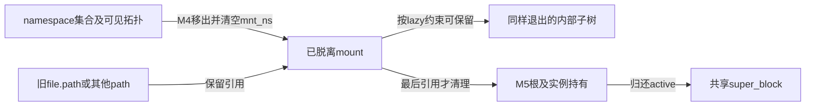
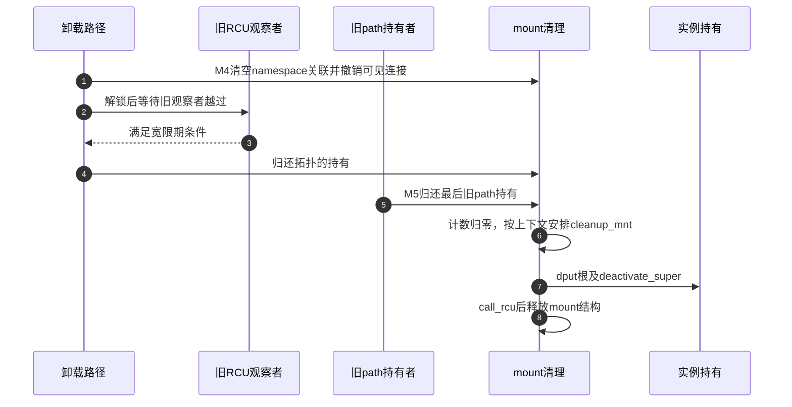

# 第10章\_挂载脱离与最后引用退出

本页承接 [挂载视图导读](../navigation/P06_挂载视图怎样接入传播与退出.md#6.1_先区分视图对象和传播连接) 的 M4/M5。固定 NXP Linux 6.12.20 提交 `dfaf2136deb2af2e60b994421281ba42f1c087e0`，函数来自 fs/namespace.c，忙状态传播检查来自 fs/pnode.c；源码身份见 [VFS 总索引](../navigation/P01_Linux_6.12_VFS源码阅读索引.md)。

## 10.1\_普通卸载先判断是否允许结束可见使用

M3 使用者可能已经把 mount 保存在 path 中。普通卸载不能只看目录是否为空：即使没有任何新查找，旧文件、cwd 等持有也能阻止退出。do_umount 区分过期、强制请求、任务根的特殊处理、普通忙检查和 lazy 分离。

```c
/** @brief 仓库补充阅读说明：选择普通忙检查、分离及其他卸载协议分支。 */
static int do_umount(struct mount *mnt, int flags)
{
        struct super_block *sb = mnt->mnt.mnt_sb;
        int retval;

        retval = security_sb_umount(&mnt->mnt, flags);
        if (retval)
                return retval;

        /*
         * Allow userspace to request a mountpoint be expired rather than
         * unmounting unconditionally. Unmount only happens if:
         *  (1) the mark is already set (the mark is cleared by mntput())
         *  (2) the usage count == 1 [parent vfsmount] + 1 [sys_umount]
         */
        if (flags & MNT_EXPIRE) {
                if (&mnt->mnt == current->fs->root.mnt ||
                    flags & (MNT_FORCE | MNT_DETACH))
                        return -EINVAL;

                /*
                 * probably don't strictly need the lock here if we examined
                 * all race cases, but it's a slowpath.
                 */
                lock_mount_hash();
                if (mnt_get_count(mnt) != 2) {
                        unlock_mount_hash();
                        return -EBUSY;
                }
                unlock_mount_hash();

                if (!xchg(&mnt->mnt_expiry_mark, 1))
                        return -EAGAIN;
        }

        /*
         * If we may have to abort operations to get out of this
         * mount, and they will themselves hold resources we must
         * allow the fs to do things. In the Unix tradition of
         * 'Gee thats tricky lets do it in userspace' the umount_begin
         * might fail to complete on the first run through as other tasks
         * must return, and the like. Thats for the mount program to worry
         * about for the moment.
         */

        if (flags & MNT_FORCE && sb->s_op->umount_begin) {
                sb->s_op->umount_begin(sb);
        }

        /*
         * No sense to grab the lock for this test, but test itself looks
         * somewhat bogus. Suggestions for better replacement?
         * Ho-hum... In principle, we might treat that as umount + switch
         * to rootfs. GC would eventually take care of the old vfsmount.
         * Actually it makes sense, especially if rootfs would contain a
         * /reboot - static binary that would close all descriptors and
         * call reboot(9). Then init(8) could umount root and exec /reboot.
         */
        if (&mnt->mnt == current->fs->root.mnt && !(flags & MNT_DETACH)) {
                /*
                 * Special case for "unmounting" root ...
                 * we just try to remount it readonly.
                 */
                if (!ns_capable(sb->s_user_ns, CAP_SYS_ADMIN))
                        return -EPERM;
                return do_umount_root(sb);
        }

        namespace_lock();
        lock_mount_hash();

        /* Recheck MNT_LOCKED with the locks held */
        retval = -EINVAL;
        if (mnt->mnt.mnt_flags & MNT_LOCKED)
                goto out;

        event++;
        if (flags & MNT_DETACH) {
                if (mnt_ns_attached(mnt) || !list_empty(&mnt->mnt_list))
                        umount_tree(mnt, UMOUNT_PROPAGATE);
                retval = 0;
        } else {
                shrink_submounts(mnt);
                retval = -EBUSY;
                if (!propagate_mount_busy(mnt, 2)) {
                        if (mnt_ns_attached(mnt) || !list_empty(&mnt->mnt_list))
                                umount_tree(mnt, UMOUNT_PROPAGATE|UMOUNT_SYNC);
                        retval = 0;
                }
        }
out:
        unlock_mount_hash();
        namespace_unlock();
        return retval;
}
```

MNT_EXPIRE 要求满足相应引用条件，并通过两次标记检查实现过期协议；MNT_FORCE 只在文件系统提供 umount_begin 时请求它中止相关活动，随后仍走实际退出路径。当前任务根在非 DETACH 时有重配只读的特殊处理，不应把任意目录卸载例子套到这里。

普通分支先尝试收缩子挂载，再检查 propagate_mount_busy(mnt, 2)。这个 2 是该调用关系下的基准持有数，不是“允许任意两个用户继续使用”。DETACH 分支跳过相同的 busy 拒绝，直接请求传播退出，因此需要后面的引用保护继续服务旧使用者。

```c
/** @brief 仓库补充阅读说明：结合子树和传播目标的基准引用检查忙状态。 */
int propagate_mount_busy(struct mount *mnt, int refcnt)
{
        struct mount *m, *child, *topper;
        struct mount *parent = mnt->mnt_parent;

        if (mnt == parent)
                return do_refcount_check(mnt, refcnt);

        /*
         * quickly check if the current mount can be unmounted.
         * If not, we don't have to go checking for all other
         * mounts
         */
        if (!list_empty(&mnt->mnt_mounts) || do_refcount_check(mnt, refcnt))
                return 1;

        for (m = propagation_next(parent, parent); m;
                        m = propagation_next(m, parent)) {
                int count = 1;
                child = __lookup_mnt(&m->mnt, mnt->mnt_mountpoint);
                if (!child)
                        continue;

                /* Is there exactly one mount on the child that covers
                 * it completely whose reference should be ignored?
                 */
                topper = find_topper(child);
                if (topper)
                        count += 1;
                else if (!list_empty(&child->mnt_mounts))
                        continue;

                if (do_refcount_check(child, count))
                        return 1;
        }
        return 0;
}
```

do_refcount_check 以 mnt_get_count(mnt) 是否大于基准判断额外引用。源挂载有子挂载或额外持有先判忙；随后沿父挂载的传播关系查对应子挂载，按覆盖关系调整基准。它不是把所有命名空间的任意引用混成一个数字。

## 10.2\_脱离拓扑时分别撤销发现入口与传播关系

M4 要同时退出 namespace 集合、父子连接和传播组，但 lazy 子树可能需要保留某些内部连接。disconnect_mount 明确区分同步退出、无父、父仍挂载、请求保留以及锁定关系。

```c
/** @brief 仓库补充阅读说明：判断退出树中的父子关系能否或必须断开。 */
static bool disconnect_mount(struct mount *mnt, enum umount_tree_flags how)
{
        /* Leaving mounts connected is only valid for lazy umounts */
        if (how & UMOUNT_SYNC)
                return true;

        /* A mount without a parent has nothing to be connected to */
        if (!mnt_has_parent(mnt))
                return true;

        /* Because the reference counting rules change when mounts are
         * unmounted and connected, umounted mounts may not be
         * connected to mounted mounts.
         */
        if (!(mnt->mnt_parent->mnt.mnt_flags & MNT_UMOUNT))
                return true;

        /* Has it been requested that the mount remain connected? */
        if (how & UMOUNT_CONNECTED)
                return false;

        /* Is the mount locked such that it needs to remain connected? */
        if (IS_MNT_LOCKED(mnt))
                return false;

        /* By default disconnect the mount */
        return true;
}
```

```c
/** @brief 仓库补充阅读说明：撤销命名空间归属和传播关系，整理待归还拓扑持有。 */
static void umount_tree(struct mount *mnt, enum umount_tree_flags how)
{
        LIST_HEAD(tmp_list);
        struct mount *p;

        if (how & UMOUNT_PROPAGATE)
                propagate_mount_unlock(mnt);

        /* Gather the mounts to umount */
        for (p = mnt; p; p = next_mnt(p, mnt)) {
                p->mnt.mnt_flags |= MNT_UMOUNT;
                if (mnt_ns_attached(p))
                        move_from_ns(p, &tmp_list);
                else
                        list_move(&p->mnt_list, &tmp_list);
        }

        /* Hide the mounts from mnt_mounts */
        list_for_each_entry(p, &tmp_list, mnt_list) {
                list_del_init(&p->mnt_child);
        }

        /* Add propagated mounts to the tmp_list */
        if (how & UMOUNT_PROPAGATE)
                propagate_umount(&tmp_list);

        while (!list_empty(&tmp_list)) {
                struct mnt_namespace *ns;
                bool disconnect;
                p = list_first_entry(&tmp_list, struct mount, mnt_list);
                list_del_init(&p->mnt_expire);
                list_del_init(&p->mnt_list);
                ns = p->mnt_ns;
                if (ns) {
                        ns->nr_mounts--;
                        __touch_mnt_namespace(ns);
                }
                p->mnt_ns = NULL;
                if (how & UMOUNT_SYNC)
                        p->mnt.mnt_flags |= MNT_SYNC_UMOUNT;

                disconnect = disconnect_mount(p, how);
                if (mnt_has_parent(p)) {
                        mnt_add_count(p->mnt_parent, -1);
                        if (!disconnect) {
                                /* Don't forget about p */
                                list_add_tail(&p->mnt_child, &p->mnt_parent->mnt_mounts);
                        } else {
                                umount_mnt(p);
                        }
                }
                change_mnt_propagation(p, MS_PRIVATE);
                if (disconnect)
                        hlist_add_head(&p->mnt_umount, &unmounted);
        }
}
```

先把待退出树移到临时列表并标记 MNT_UMOUNT，移除原子树枚举连接；需要时纳入传播退出目标。随后维护 namespace 数量和事件、清空 mnt_ns、调整父持有，并切断传播。disconnect 为假时将内部子关系重新接回已经退出的父；它不能仍然连接到正常挂载的父树。



## 10.3\_退出拓扑的那份持有要等旧观察者安全越过

清空 mnt_ns 不允许立即释放对象。可能有 RCU 读者刚观察到它非空，正在按“拓扑仍持有它”的前提归还自己的引用。namespace_unlock 因此先释放 namespace_sem，再等待相应 RCU 宽限期并归还收集的 mount。

```c
/** @brief 仓库补充阅读说明：解锁后等待旧RCU观察者，再归还收集的拓扑持有。 */
static void namespace_unlock(void)
{
        struct hlist_head head;
        struct hlist_node *p;
        struct mount *m;
        LIST_HEAD(list);

        hlist_move_list(&unmounted, &head);
        list_splice_init(&ex_mountpoints, &list);

        up_write(&namespace_sem);

        shrink_dentry_list(&list);

        if (likely(hlist_empty(&head)))
                return;

        synchronize_rcu_expedited();

        hlist_for_each_entry_safe(m, p, &head, mnt_umount) {
                hlist_del(&m->mnt_umount);
                mntput(&m->mnt);
        }
}
```

顺序是锁内取出待清理对象，解锁后处理可能耗时的工作；不能把 synchronize_rcu_expedited 移进拓扑自旋锁。这里的等待针对旧观察者，不是等待所有旧 fd 自动关闭。旧 fd 仍有自己的持有，之后可以继续操作。

## 10.4\_最后计数归还才选择真正的清理路径

mntput_no_expire 的快速分支在 RCU 保护下看到非空 mnt_ns，就能归还非最后一份引用；依据正是上一节的延迟归还。已经脱离的对象则在 mount 哈希锁保护和相应内存屏障下减计数、检查总数，并以 MNT_DOOMED 避免重复清理。

```c
/** @brief 仓库补充阅读说明：配对拓扑引用保护，最后计数归零才安排清理。 */
static void mntput_no_expire(struct mount *mnt)
{
        LIST_HEAD(list);
        int count;

        rcu_read_lock();
        if (likely(READ_ONCE(mnt->mnt_ns))) {
                /*
                 * Since we don't do lock_mount_hash() here,
                 * ->mnt_ns can change under us.  However, if it's
                 * non-NULL, then there's a reference that won't
                 * be dropped until after an RCU delay done after
                 * turning ->mnt_ns NULL.  So if we observe it
                 * non-NULL under rcu_read_lock(), the reference
                 * we are dropping is not the final one.
                 */
                mnt_add_count(mnt, -1);
                rcu_read_unlock();
                return;
        }
        lock_mount_hash();
        /*
         * make sure that if __legitimize_mnt() has not seen us grab
         * mount_lock, we'll see their refcount increment here.
         */
        smp_mb();
        mnt_add_count(mnt, -1);
        count = mnt_get_count(mnt);
        if (count != 0) {
                WARN_ON(count < 0);
                rcu_read_unlock();
                unlock_mount_hash();
                return;
        }
        if (unlikely(mnt->mnt.mnt_flags & MNT_DOOMED)) {
                rcu_read_unlock();
                unlock_mount_hash();
                return;
        }
        mnt->mnt.mnt_flags |= MNT_DOOMED;
        rcu_read_unlock();

        list_del(&mnt->mnt_instance);

        if (unlikely(!list_empty(&mnt->mnt_mounts))) {
                struct mount *p, *tmp;
                list_for_each_entry_safe(p, tmp, &mnt->mnt_mounts,  mnt_child) {
                        __put_mountpoint(unhash_mnt(p), &list);
                        hlist_add_head(&p->mnt_umount, &mnt->mnt_stuck_children);
                }
        }
        unlock_mount_hash();
        shrink_dentry_list(&list);

        if (likely(!(mnt->mnt.mnt_flags & MNT_INTERNAL))) {
                struct task_struct *task = current;
                if (likely(!(task->flags & PF_KTHREAD))) {
                        init_task_work(&mnt->mnt_rcu, __cleanup_mnt);
                        if (!task_work_add(task, &mnt->mnt_rcu, TWA_RESUME))
                                return;
                }
                if (llist_add(&mnt->mnt_llist, &delayed_mntput_list))
                        schedule_delayed_work(&delayed_mntput_work, 1);
                return;
        }
        cleanup_mnt(mnt);
}
```

SMP 构建中 mount 引用使用每 CPU 计数，mnt_get_count 在所需保护下汇总；非 SMP 构建使用直接计数。不能把每 CPU 的局部零当成全局最后引用。本次源码基线配置不启用 SMP，正文对 SMP 的说明来自条件编译分支，不是本机运行结果。

计数真正归零后移出实例的 mount 集合，并整理残留子连接。非内部挂载优先把清理挂到当前普通任务的 task_work；无法这样安排时使用 delayed_mntput_list 和延后工作。内部挂载可直接 cleanup_mnt。这些是具体执行上下文的选择，不是承诺用户 close 返回时全部资源都已释放。

```c
/** @brief 仓库补充阅读说明：task_work入口把对象交给公共清理。 */
static void __cleanup_mnt(struct rcu_head *head)
{
        cleanup_mnt(container_of(head, struct mount, mnt_rcu));
}
```

```c
/** @brief 仓库补充阅读说明：工作队列批量取出并清理延后对象。 */
static void delayed_mntput(struct work_struct *unused)
{
        struct llist_node *node = llist_del_all(&delayed_mntput_list);
        struct mount *m, *t;

        llist_for_each_entry_safe(m, t, node, mnt_llist)
                cleanup_mnt(m);
}
```

## 10.5\_归还根与实例之后还有结构体释放阶段

cleanup_mnt 检查写持有、处理 pins 与残留子树、通知 fsnotify，再 dput 根和 deactivate_super。一个视图结束只归还它自己的实例持有；其他视图仍可让 superblock 保持活动。

```c
/** @brief 仓库补充阅读说明：归还根与实例持有，随后安排结构体延迟释放。 */
static void cleanup_mnt(struct mount *mnt)
{
        struct hlist_node *p;
        struct mount *m;
        /*
         * The warning here probably indicates that somebody messed
         * up a mnt_want/drop_write() pair.  If this happens, the
         * filesystem was probably unable to make r/w->r/o transitions.
         * The locking used to deal with mnt_count decrement provides barriers,
         * so mnt_get_writers() below is safe.
         */
        WARN_ON(mnt_get_writers(mnt));
        if (unlikely(mnt->mnt_pins.first))
                mnt_pin_kill(mnt);
        hlist_for_each_entry_safe(m, p, &mnt->mnt_stuck_children, mnt_umount) {
                hlist_del(&m->mnt_umount);
                mntput(&m->mnt);
        }
        fsnotify_vfsmount_delete(&mnt->mnt);
        dput(mnt->mnt.mnt_root);
        deactivate_super(mnt->mnt.mnt_sb);
        mnt_free_id(mnt);
        call_rcu(&mnt->mnt_rcu, delayed_free_vfsmnt);
}
```

```c
/** @brief 仓库补充阅读说明：RCU回调进入最终内存释放。 */
static void delayed_free_vfsmnt(struct rcu_head *head)
{
        free_vfsmnt(container_of(head, struct mount, mnt_rcu));
}
```

```c
/** @brief 仓库补充阅读说明：释放idmap、名字、条件性每CPU计数和mount内存。 */
static void free_vfsmnt(struct mount *mnt)
{
        mnt_idmap_put(mnt_idmap(&mnt->mnt));
        kfree_const(mnt->mnt_devname);
#ifdef CONFIG_SMP
        free_percpu(mnt->mnt_pcp);
#endif
        kmem_cache_free(mnt_cache, mnt);
}
```

归还传统挂载 ID 后通过 call_rcu 安排最终 free_vfsmnt；它清理名字、每 CPU 存储、idmap 和 mount 缓存对象。这与 namespace_unlock 为拓扑持有等待的 RCU 阶段处于不同位置，不能只画一个“RCU 后完成全部卸载”。



图选择旧 path 最后退出的分支；若没有旧持有，拓扑持有归还就可能触发后续清理。实例本身的退出继续见 [最后活动引用](P07_实例关闭通知与最终内存回收.md#7.1_最后活动引用把流程交给关闭回调)。本页未执行并发卸载或故障注入；普通拒绝与 lazy 保留旧 fd 的教学实验位于 [正文完整程序](../../../../knowledge/kernel_subsystems/vfs/P07_mount与mount_namespace.md#7.7_在一个完整程序里观察旧fd与新路径)。返回 [导读](../navigation/P06_挂载视图怎样接入传播与退出.md#6.2_沿同一周期选择实现入口)。
