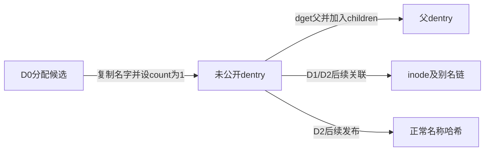
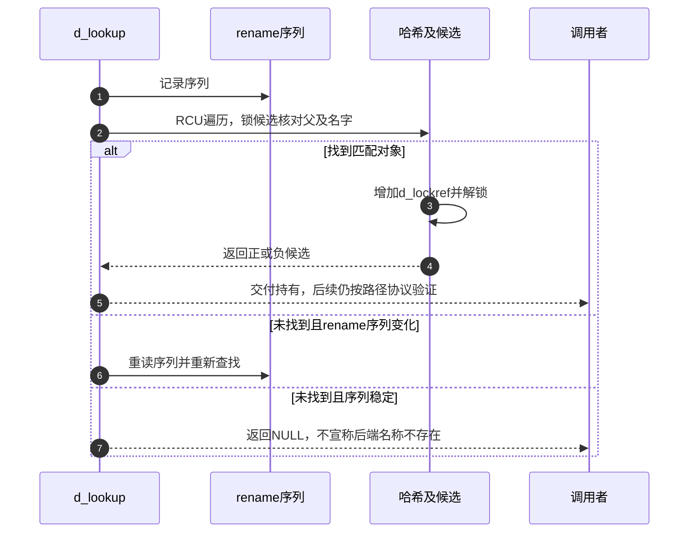

# 第11章\_名称候选的建立发布与持有

本页兑现 [名称缓存导读](../navigation/P07_名称结果怎样发布失效与回收.md#7.1_把名称结果拆成几组可独立变化的状态) 的 D0～D3。固定 NXP Linux 6.12.20 提交 `dfaf2136deb2af2e60b994421281ba42f1c087e0`；下列函数来自 fs/dcache.c，blob `0f6b16ba30d082b7613b084a23f6a01ed6436b1f`。完整身份见 [VFS 总索引](../navigation/P01_Linux_6.12_VFS源码阅读索引.md)。

## 11.1\_分配候选只建立内存身份

D0 需要保存名字、自身引用和同步状态。__d_alloc 按长度选择内联名字或额外名字存储，复制字符串后以相应发布方式设置名字指针；初始计数为1，inode 为空，父暂指自身，正常名称哈希尚未链接。

```c
/** @brief 仓库补充阅读说明：分配名字和候选状态，尚未发布到正常名称哈希。 */
static struct dentry *__d_alloc(struct super_block *sb, const struct qstr *name)
{
        struct dentry *dentry;
        char *dname;
        int err;

        dentry = kmem_cache_alloc_lru(dentry_cache, &sb->s_dentry_lru,
                                      GFP_KERNEL);
        if (!dentry)
                return NULL;

        /*
         * We guarantee that the inline name is always NUL-terminated.
         * This way the memcpy() done by the name switching in rename
         * will still always have a NUL at the end, even if we might
         * be overwriting an internal NUL character
         */
        dentry->d_iname[DNAME_INLINE_LEN-1] = 0;
        if (unlikely(!name)) {
                name = &slash_name;
                dname = dentry->d_iname;
        } else if (name->len > DNAME_INLINE_LEN-1) {
                size_t size = offsetof(struct external_name, name[1]);
                struct external_name *p = kmalloc(size + name->len,
                                                  GFP_KERNEL_ACCOUNT |
                                                  __GFP_RECLAIMABLE);
                if (!p) {
                        kmem_cache_free(dentry_cache, dentry);
                        return NULL;
                }
                atomic_set(&p->u.count, 1);
                dname = p->name;
        } else  {
                dname = dentry->d_iname;
        }

        dentry->d_name.len = name->len;
        dentry->d_name.hash = name->hash;
        memcpy(dname, name->name, name->len);
        dname[name->len] = 0;

        /* Make sure we always see the terminating NUL character */
        smp_store_release(&dentry->d_name.name, dname); /* ^^^ */

        dentry->d_lockref.count = 1;
        dentry->d_flags = 0;
        spin_lock_init(&dentry->d_lock);
        seqcount_spinlock_init(&dentry->d_seq, &dentry->d_lock);
        dentry->d_inode = NULL;
        dentry->d_parent = dentry;
        dentry->d_sb = sb;
        dentry->d_op = NULL;
        dentry->d_fsdata = NULL;
        INIT_HLIST_BL_NODE(&dentry->d_hash);
        INIT_LIST_HEAD(&dentry->d_lru);
        INIT_HLIST_HEAD(&dentry->d_children);
        INIT_HLIST_NODE(&dentry->d_u.d_alias);
        INIT_HLIST_NODE(&dentry->d_sib);
        d_set_d_op(dentry, dentry->d_sb->s_d_op);

        if (dentry->d_op && dentry->d_op->d_init) {
                err = dentry->d_op->d_init(dentry);
                if (err) {
                        if (dname_external(dentry))
                                kfree(external_name(dentry));
                        kmem_cache_free(dentry_cache, dentry);
                        return NULL;
                }
        }

        this_cpu_inc(nr_dentry);

        return dentry;
}
```

继承实例的 dentry 操作并执行可选 d_init 后才交回候选。分配或初始化失败归还已分配资源，不公开半成品。这个空 inode 表示尚未建立关联，不是文件系统已经返回 ENOENT 的证据。

## 11.2\_父子连接与正常名称索引分开建立

普通 d_alloc 在候选创建后取得父 dentry 的持有，把它放入父的 children 链。新子对象尚未并发公开，所以这里锁父而不另锁子；不能将这个条件推广到后续任意改父操作。

```c
/** @brief 仓库补充阅读说明：取得父持有并连接父子关系。 */
struct dentry *d_alloc(struct dentry * parent, const struct qstr *name)
{
        struct dentry *dentry = __d_alloc(parent->d_sb, name);
        if (!dentry)
                return NULL;
        spin_lock(&parent->d_lock);
        /*
         * don't need child lock because it is not subject
         * to concurrency here
         */
        dentry->d_parent = dget_dlock(parent);
        hlist_add_head(&dentry->d_sib, &parent->d_children);
        spin_unlock(&parent->d_lock);

        return dentry;
}
```

d_children 用于目录项树关系，d_hash 用于正常名称查找，二者不同。此函数没有执行 __d_rehash，因此“已经出现在父的子对象集合”不等于“正常查找已能命中”。字段声明只在 [名称字段关系](P02_路径名称与实例的字段关系.md#2.3_dentry的名称关联和存续分开维护) 展开。



## 11.3\_建立inode关联不能代替发布名称索引

d_instantiate 接收调用者准备好的 inode 持有，在 inode 锁与 dentry 锁协议下建立别名链和对象类型。d_seq 包围关联变化；__d_set_inode_and_type 先写 inode，再发布类型标志，供相应读取协议使用。

```c
/** @brief 仓库补充阅读说明：在inode锁保护下把已持有inode交给关联路径。 */
void d_instantiate(struct dentry *entry, struct inode * inode)
{
        BUG_ON(!hlist_unhashed(&entry->d_u.d_alias));
        if (inode) {
                security_d_instantiate(entry, inode);
                spin_lock(&inode->i_lock);
                __d_instantiate(entry, inode);
                spin_unlock(&inode->i_lock);
        }
}
```

```c
/** @brief 仓库补充阅读说明：在dentry锁和序列更新中建立别名及对象关联。 */
static void __d_instantiate(struct dentry *dentry, struct inode *inode)
{
        unsigned add_flags = d_flags_for_inode(inode);
        WARN_ON(d_in_lookup(dentry));

        spin_lock(&dentry->d_lock);
        /*
         * The negative counter only tracks dentries on the LRU. Don't dec if
         * d_lru is on another list.
         */
        if ((dentry->d_flags &
             (DCACHE_LRU_LIST|DCACHE_SHRINK_LIST)) == DCACHE_LRU_LIST)
                this_cpu_dec(nr_dentry_negative);
        hlist_add_head(&dentry->d_u.d_alias, &inode->i_dentry);
        raw_write_seqcount_begin(&dentry->d_seq);
        __d_set_inode_and_type(dentry, inode, add_flags);
        raw_write_seqcount_end(&dentry->d_seq);
        fsnotify_update_flags(dentry);
        spin_unlock(&dentry->d_lock);
}
```

调用者必须已经为这次关联取得 inode 的持有，不能把一个无所有权的裸指针交给它。inode 为空时 d_instantiate 不执行这一关联；__d_instantiate 则要求实际 inode，不能直接用 NULL 调它模拟负结果。

这两个函数不把对象重新加入正常名称哈希。一个已经 hashed 的负对象可在创建路径中建立正关联；一个尚未 hashed 的候选完成关联后，仍需相应发布步骤。只根据函数名“实例化”推断全部状态已经公开会遗漏这个区别。

## 11.4\_发布结果时结束并行查询再供后续查找

d_add 把 inode 关联与正常哈希发布组合起来；inode 为空时也能发布负结果。它不是随意覆盖已有对象的通用 setter，应在所属文件系统查询或创建协议中使用。

```c
/** @brief 仓库补充阅读说明：按是否有inode取得所需保护，再发布结果。 */
void d_add(struct dentry *entry, struct inode *inode)
{
        if (inode) {
                security_d_instantiate(entry, inode);
                spin_lock(&inode->i_lock);
        }
        __d_add(entry, inode);
}
```

```c
/** @brief 仓库补充阅读说明：完成关联、正常哈希发布和进行中查询交接。 */
static inline void __d_add(struct dentry *dentry, struct inode *inode)
{
        wait_queue_head_t *d_wait;
        struct inode *dir = NULL;
        unsigned n;
        spin_lock(&dentry->d_lock);
        if (unlikely(d_in_lookup(dentry))) {
                dir = dentry->d_parent->d_inode;
                n = start_dir_add(dir);
                d_wait = __d_lookup_unhash(dentry);
        }
        if (inode) {
                unsigned add_flags = d_flags_for_inode(inode);
                hlist_add_head(&dentry->d_u.d_alias, &inode->i_dentry);
                raw_write_seqcount_begin(&dentry->d_seq);
                __d_set_inode_and_type(dentry, inode, add_flags);
                raw_write_seqcount_end(&dentry->d_seq);
                fsnotify_update_flags(dentry);
        }
        __d_rehash(dentry);
        if (dir)
                end_dir_add(dir, n, d_wait);
        spin_unlock(&dentry->d_lock);
        if (inode)
                spin_unlock(&inode->i_lock);
}
```

```c
/** @brief 仓库补充阅读说明：在哈希桶锁保护下发布名称节点。 */
static void __d_rehash(struct dentry *entry)
{
        struct hlist_bl_head *b = d_hash(entry->d_name.hash);

        hlist_bl_lock(b);
        hlist_bl_add_head_rcu(&entry->d_hash, b);
        hlist_bl_unlock(b);
}
```

如果对象仍在 in-lookup 状态，__d_add 先通过目录添加协议和 __d_lookup_unhash 退出进行中登记，完成普通哈希发布，再用 end_dir_add 结束对应交接。等待者获得的是已经完成发布的结果；不能把“尚未有 inode”当成足够的完成条件。

目录查询的文件系统回调可能返回替代 dentry，也可能失败，路径层负责接收这些结果。完整并行查询与等待的实现将在路径查找模块展开，本页只固定发布端的责任。它与 d_instantiate 的差别是有无正常哈希发布及 in-lookup 完成衔接，而不是一个“更高级”的同义 API。

## 11.5\_查找候选时在锁内核对身份并取得持有

__d_lookup 用名字哈希定位桶，RCU 保证遍历期间的存续；但哈希相同不是身份相同。它锁住候选后检查父、hashed 状态以及名字比较，再增加 d_lockref 计数。这份引用使返回者能够离开当前 RCU 临界区后继续使用对象。

```c
/** @brief 仓库补充阅读说明：RCU遍历候选，锁内核对身份并增加引用。 */
struct dentry *__d_lookup(const struct dentry *parent, const struct qstr *name)
{
        unsigned int hash = name->hash;
        struct hlist_bl_head *b = d_hash(hash);
        struct hlist_bl_node *node;
        struct dentry *found = NULL;
        struct dentry *dentry;

        /*
         * Note: There is significant duplication with __d_lookup_rcu which is
         * required to prevent single threaded performance regressions
         * especially on architectures where smp_rmb (in seqcounts) are costly.
         * Keep the two functions in sync.
         */

        /*
         * The hash list is protected using RCU.
         *
         * Take d_lock when comparing a candidate dentry, to avoid races
         * with d_move().
         *
         * It is possible that concurrent renames can mess up our list
         * walk here and result in missing our dentry, resulting in the
         * false-negative result. d_lookup() protects against concurrent
         * renames using rename_lock seqlock.
         *
         * See Documentation/filesystems/path-lookup.txt for more details.
         */
        rcu_read_lock();

        hlist_bl_for_each_entry_rcu(dentry, node, b, d_hash) {

                if (dentry->d_name.hash != hash)
                        continue;

                spin_lock(&dentry->d_lock);
                if (dentry->d_parent != parent)
                        goto next;
                if (d_unhashed(dentry))
                        goto next;

                if (!d_same_name(dentry, parent, name))
                        goto next;

                dentry->d_lockref.count++;
                found = dentry;
                spin_unlock(&dentry->d_lock);
                break;
next:
                spin_unlock(&dentry->d_lock);
        }
        rcu_read_unlock();

        return found;
}
```

底层查找可能因并发 rename 导致遗漏。外层 d_lookup 记录 rename_lock 序列，在没有找到候选且序列发生变化时重试；已找到的候选通过局部核对取得引用，不要求每次全局 rename 都让它丢弃结果。

```c
/** @brief 仓库补充阅读说明：对可能因rename遗漏的未命中执行序列重试。 */
struct dentry *d_lookup(const struct dentry *parent, const struct qstr *name)
{
        struct dentry *dentry;
        unsigned seq;

        do {
                seq = read_seqbegin(&rename_lock);
                dentry = __d_lookup(parent, name);
                if (dentry)
                        break;
        } while (read_seqretry(&rename_lock, seq));
        return dentry;
}
```



这里的“持引用查找内部使用 RCU”不等同于完整路径选择了 RCU-walk。后者有自己的无逐项引用快速协议，后续模块单独说明。返回 NULL 表示本次缓存没有可交付候选；返回负 dentry 则有一个被持有的不存在结果，两个返回形态不能混淆。返回 [模块导读](../navigation/P07_名称结果怎样发布失效与回收.md#7.2_按阶段连接唯一实现)。
