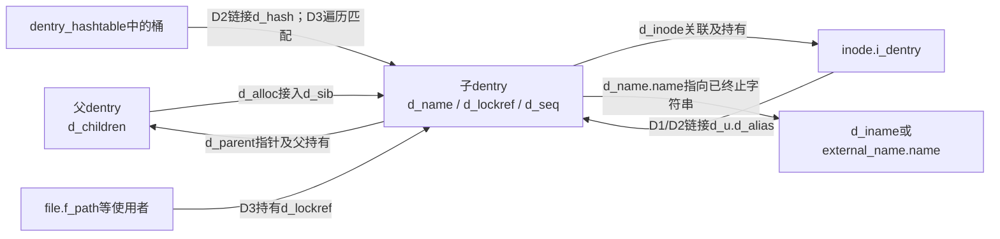
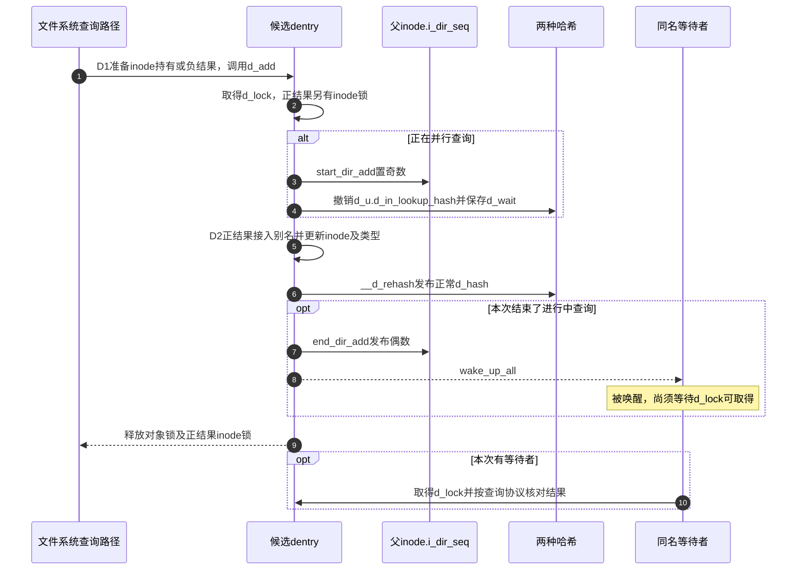
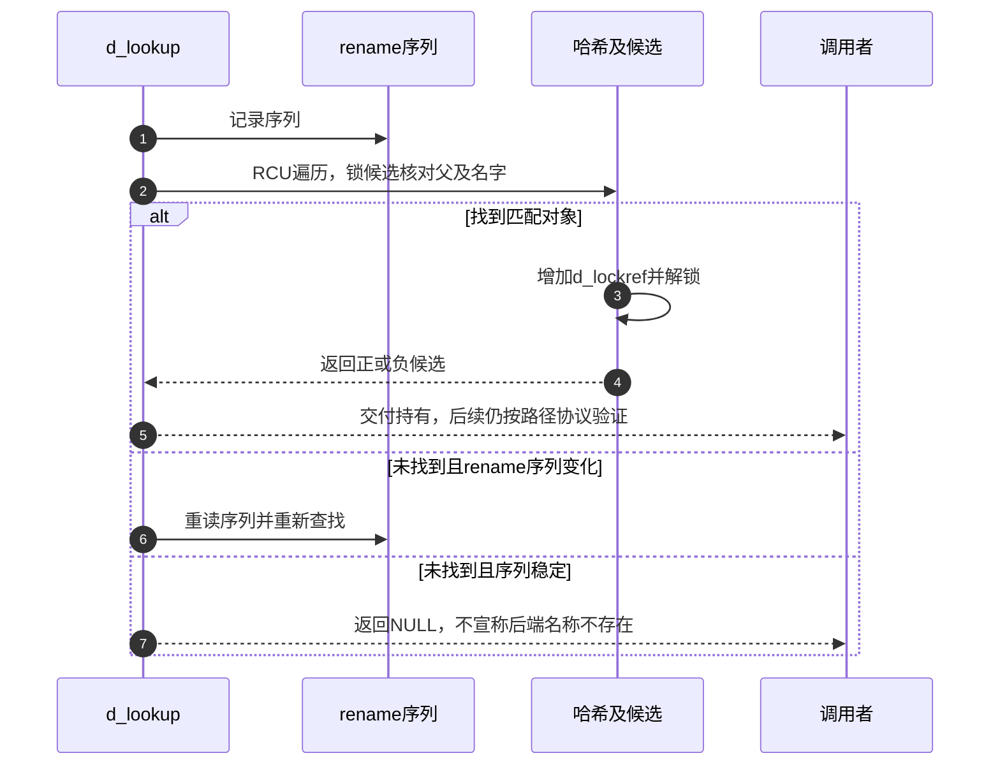

# 第11章\_名称候选的建立发布与持有

本页兑现 [名称缓存导读](../navigation/P07_名称结果怎样发布失效与回收.md#7.1_把名称结果拆成几组可独立变化的状态) 的 D0～D3。固定 NXP Linux 6.12.20 提交 `dfaf2136deb2af2e60b994421281ba42f1c087e0`；下列函数来自 fs/dcache.c，blob `0f6b16ba30d082b7613b084a23f6a01ed6436b1f`。完整身份见 [VFS 总索引](../navigation/P01_Linux_6.12_VFS源码阅读索引.md)。

## 11.1\_分配候选只建立内存身份

D0 需要保存名字、自身引用和同步状态。__d_alloc 按长度选择内联名字或额外名字存储，复制字符串后以相应发布方式设置名字指针；初始计数为1，inode 为空，父暂指自身，正常名称哈希尚未链接。

```c
/** @brief 仓库补充阅读说明：分配名字和候选状态，尚未发布到正常名称哈希。 */
static struct dentry *__d_alloc(struct super_block *sb, const struct qstr *name)
{
        struct dentry *dentry;
        char *dname;
        int err;

        /* 从实例对应的可回收slab分配；尚未进入正常名称索引。 */
        dentry = kmem_cache_alloc_lru(dentry_cache, &sb->s_dentry_lru,
                                      GFP_KERNEL);
        if (!dentry)
                return NULL;

        /* 先保证内联缓冲末尾有NUL，名称交换时也保留终止条件。 */
        dentry->d_iname[DNAME_INLINE_LEN-1] = 0;
        if (unlikely(!name)) {
                /* 无显式名字时使用静态斜杠qstr，不在此查找根。 */
                name = &slash_name;
                dname = dentry->d_iname;
        } else if (name->len > DNAME_INLINE_LEN-1) {
                size_t size = offsetof(struct external_name, name[1]);
                struct external_name *p = kmalloc(size + name->len,
                                                  GFP_KERNEL_ACCOUNT |
                                                  __GFP_RECLAIMABLE);
                if (!p) {
                        kmem_cache_free(dentry_cache, dentry);
                        return NULL;
                }
                /* 外部名字有独立共享计数，不能用dentry计数代替。 */
                atomic_set(&p->u.count, 1);
                dname = p->name;
        } else  {
                dname = dentry->d_iname;
        }

        dentry->d_name.len = name->len;
        dentry->d_name.hash = name->hash;
        memcpy(dname, name->name, name->len);
        dname[name->len] = 0;

        /* 复制字节及NUL之后发布名字指针。 */
        smp_store_release(&dentry->d_name.name, dname);

        /* 初始化候选自己的持有；父持有由d_alloc随后取得。 */
        dentry->d_lockref.count = 1;
        dentry->d_flags = 0;
        spin_lock_init(&dentry->d_lock);
        seqcount_spinlock_init(&dentry->d_seq, &dentry->d_lock);
        dentry->d_inode = NULL;
        dentry->d_parent = dentry;
        dentry->d_sb = sb;
        dentry->d_op = NULL;
        dentry->d_fsdata = NULL;
        INIT_HLIST_BL_NODE(&dentry->d_hash);
        INIT_LIST_HEAD(&dentry->d_lru);
        INIT_HLIST_HEAD(&dentry->d_children);
        INIT_HLIST_NODE(&dentry->d_u.d_alias);
        INIT_HLIST_NODE(&dentry->d_sib);
        /* 继承实例默认回调并设置对应能力标志。 */
        d_set_d_op(dentry, dentry->d_sb->s_d_op);

        /* 初始化回调失败只回收本次候选和外部名字。 */
        if (dentry->d_op && dentry->d_op->d_init) {
                err = dentry->d_op->d_init(dentry);
                if (err) {
                        if (dname_external(dentry))
                                kfree(external_name(dentry));
                        kmem_cache_free(dentry_cache, dentry);
                        return NULL;
                }
        }

        /* 登记统计，不建立额外引用或哈希关系。 */
        this_cpu_inc(nr_dentry);

        return dentry;
}
```

继承实例的 dentry 操作并执行可选 d_init 后才交回候选。分配或初始化失败归还已分配资源，不公开半成品。这个空 inode 表示尚未建立关联，不是文件系统已经返回 ENOENT 的证据。

名字内存和 dentry 内存是两项资源。`slash_name` 是 `QSTR_INIT("/", 1)` 初始化的全局只读名字描述；`d_iname` 在对象内，外部名字则由同文件的 `external_name` 保存 `u.count` 与柔性名字数组。名字快照可增加外部名字计数，因此后续释放不能只看 dentry 的引用。`dentry_cache` 由 `dcache_init` 建立，`kmem_cache_alloc_lru` 接收 `sb->s_dentry_lru` 供分配/回收框架使用，**分配本身不会把新候选登记为零引用缓存**。真正登记见 [保留条件](P12_名称失效与最后使用者退出.md#12.3_零引用保留必须同时满足缓存条件)。

| 本节符号及来源 | 初始化、消费者与修改约束 |
| --- | --- |
| `__d_alloc`，`fs/dcache.c` 内部函数；`d_alloc` 在 `include/linux/dcache.h` 声明 | 候选计数1、父先指自身、inode为空；列表节点初始化不等于加入任何索引 |
| `d_set_d_op`，同文件定义、dcache.h声明 | 写 `d_op` 并按回调是否存在设置 `DCACHE_OP_*`；修改回调表必须同步能力位，不能只换指针 |
| `d_init`，`dentry_operations` 可选回调 | 成功后才交付候选；失败时本函数只归还已分配名字与对象，回调不能遗留自己的失败资源 |
| `DNAME_INLINE_LEN`、`GFP_KERNEL_ACCOUNT`、`__GFP_RECLAIMABLE` | 决定名字存储边界及分配属性；内联长度依架构配置，不能把某台机器的长度写死为接口契约 |
| `nr_dentry`、`nr_dentry_negative`，同文件每CPU统计 | 分配/释放及LRU结果变化更新，供统计消费；不决定一个dentry是否被引用 |

修改名字长度、布局或初始化顺序时，要同时检查长名字分配失败、名字快照与rename交换、终止NUL和释放分支。`memcpy`、列表初始化与简单赋值按这些不变量阅读；本页不重复内存分配器内部算法。固定原件是 [dcache.c](../../linux/fs/dcache.c) 与 [dcache.h](../../linux/include/linux/dcache.h)，不能将新增教学注释当成上游注释。

## 11.2\_父子连接与正常名称索引分开建立

普通 d_alloc 在候选创建后取得父 dentry 的持有，把它放入父的 children 链。新子对象尚未并发公开，所以这里锁父而不另锁子；不能将这个条件推广到后续任意改父操作。

```c
/** @brief 仓库补充阅读说明：取得父持有并连接父子关系。 */
struct dentry *d_alloc(struct dentry * parent, const struct qstr *name)
{
        struct dentry *dentry = __d_alloc(parent->d_sb, name);
        if (!dentry)
                return NULL;
        /* 子对象尚未并发公开，只需保护父的子对象集合。 */
        spin_lock(&parent->d_lock);

        /* 父持有随子对象存活，最终销毁时归还。 */
        dentry->d_parent = dget_dlock(parent);
        /* 建立树关系，仍未执行名称哈希发布。 */
        hlist_add_head(&dentry->d_sib, &parent->d_children);
        spin_unlock(&parent->d_lock);

        return dentry;
}
```

d_children 用于目录项树关系，d_hash 用于正常名称查找，二者不同。此函数没有执行 __d_rehash，因此“已经出现在父的子对象集合”不等于“正常查找已能命中”。字段声明只在 [名称字段关系](P02_路径名称与实例的字段关系.md#2.3_dentry的名称关联和存续分开维护) 展开。



图中的三条集合关系分别由 `d_sib`、`d_hash`、`d_u.d_alias` 承载。前两者不是同一个节点，别名节点又与进行中查询节点共享 `d_u` 存储。因此，改父关系要配对父持有，改发布顺序要考虑查询节点何时让出存储，不能把“加到一个链表”当成已经完成全部关系建立。

## 11.3\_建立inode关联不能代替发布名称索引

d_instantiate 接收调用者准备好的 inode 持有，在 inode 锁与 dentry 锁协议下建立别名链和对象类型。d_seq 包围关联变化；__d_set_inode_and_type 先写 inode，再发布类型标志，供相应读取协议使用。

```c
/** @brief 仓库补充阅读说明：在inode锁保护下把已持有inode交给关联路径。 */
void d_instantiate(struct dentry *entry, struct inode * inode)
{
        /* 别名节点必须空闲；失败是内核不变量破坏，不返回普通错误码。 */
        BUG_ON(!hlist_unhashed(&entry->d_u.d_alias));
        if (inode) {
                /* 安全模块观察关联，SECURITY关闭时为空桩。 */
                security_d_instantiate(entry, inode);
                spin_lock(&inode->i_lock);
                /* 接收调用者提供的inode持有，本函数不再ihold。 */
                __d_instantiate(entry, inode);
                spin_unlock(&inode->i_lock);
        }
}
```

```c
/** @brief 仓库补充阅读说明：在dentry锁和序列更新中建立别名及对象关联。 */
static void __d_instantiate(struct dentry *dentry, struct inode *inode)
{
        unsigned add_flags = d_flags_for_inode(inode);
        /* 进行中查询应使用完成发布协议，告警不自动完成它。 */
        WARN_ON(d_in_lookup(dentry));

        spin_lock(&dentry->d_lock);

        /* 负对象统计只覆盖真实LRU，不把shrink列表算入。 */
        if ((dentry->d_flags &
             (DCACHE_LRU_LIST|DCACHE_SHRINK_LIST)) == DCACHE_LRU_LIST)
                this_cpu_dec(nr_dentry_negative);
        /* 把本名称登记为inode别名，与父子链及名称哈希分开。 */
        hlist_add_head(&dentry->d_u.d_alias, &inode->i_dentry);
        /* 序列覆盖inode和类型关联的变化。 */
        raw_write_seqcount_begin(&dentry->d_seq);
        __d_set_inode_and_type(dentry, inode, add_flags);
        raw_write_seqcount_end(&dentry->d_seq);
        /* 更新本名称的父监视状态，不在这里报告一次用户态打开。 */
        fsnotify_update_flags(dentry);
        spin_unlock(&dentry->d_lock);
}
```

调用者必须已经为这次关联取得 inode 的持有，不能把一个无所有权的裸指针交给它。inode 为空时 d_instantiate 不执行这一关联；__d_instantiate 则要求实际 inode，不能直接用 NULL 调它模拟负结果。

这两个函数不把对象重新加入正常名称哈希。一个已经 hashed 的负对象可在创建路径中建立正关联；一个尚未 hashed 的候选完成关联后，仍需相应发布步骤。只根据函数名“实例化”推断全部状态已经公开会遗漏这个区别。

`d_flags_for_inode` 根据 `i_mode`、`i_op->lookup/get_link` 及自动挂载属性选类型，也缓存 `IOP_LOOKUP/IOP_NOFOLLOW` 能力；类型不是只由“inode指针是否为空”决定。`__d_set_inode_and_type` 先写 `d_inode`，再以 release 写入类型标志；`d_seq` 使读者检测这一组关联是否在观察途中改变。修改时必须保留 inode 持有转交、别名节点与类型三者的一致性，并检查已经 hashed 的负对象转正这一调用场景。

这里的 `BUG_ON` 是不可继续的内部不变量检查，`WARN_ON(d_in_lookup(...))` 是错误使用告警，均不代替锁或完成协议。`CONFIG_SECURITY=n` 时 `security_d_instantiate` 为空桩；开启时调用安全模块 hook。`fsnotify_update_flags` 在 `CONFIG_FSNOTIFY=y` 时更新父目录监视相关的 `DCACHE_FSNOTIFY_PARENT_WATCHED` 状态，关闭时为空桩；这不是发送“新建完成”的通知。声明和桩见 [security.h](../../linux/include/linux/security.h)、[fsnotify_backend.h](../../linux/include/linux/fsnotify_backend.h)，事件派发的所有权见 [通知实现入口](../navigation/P19_事件观察与许可响应的交接.md)。

## 11.4\_发布结果时结束并行查询再供后续查找

d_add 把 inode 关联与正常哈希发布组合起来；inode 为空时也能发布负结果。它不是随意覆盖已有对象的通用 setter，应在所属文件系统查询或创建协议中使用。

```c
/** @brief 仓库补充阅读说明：按是否有inode取得所需保护，再发布结果。 */
void d_add(struct dentry *entry, struct inode *inode)
{
        /* 负结果不需要inode锁；正结果锁由__d_add负责释放。 */
        if (inode) {
                security_d_instantiate(entry, inode);
                spin_lock(&inode->i_lock);
        }
        /* 统一交接普通候选和正在并行查询的候选。 */
        __d_add(entry, inode);
}
```

```c
/** @brief 仓库补充阅读说明：完成关联、正常哈希发布和进行中查询交接。 */
static inline void __d_add(struct dentry *dentry, struct inode *inode)
{
        wait_queue_head_t *d_wait;
        struct inode *dir = NULL;
        unsigned n;
        spin_lock(&dentry->d_lock);
        /* 先结束进行中登记，保存等待队列供发布完成后唤醒。 */
        if (unlikely(d_in_lookup(dentry))) {
                dir = dentry->d_parent->d_inode;
                /* 父inode目录序列进入奇数状态，覆盖两种索引间的空隙。 */
                n = start_dir_add(dir);
                d_wait = __d_lookup_unhash(dentry);
        }
        /* 正结果才接入别名；负结果仍要发布正常哈希。 */
        if (inode) {
                unsigned add_flags = d_flags_for_inode(inode);
                hlist_add_head(&dentry->d_u.d_alias, &inode->i_dentry);
                raw_write_seqcount_begin(&dentry->d_seq);
                __d_set_inode_and_type(dentry, inode, add_flags);
                raw_write_seqcount_end(&dentry->d_seq);
                fsnotify_update_flags(dentry);
        }
        /* 对象锁仍持有；正常名称哈希的桶锁由辅助函数取得。 */
        __d_rehash(dentry);
        if (dir)
                /* 发布偶数目录序列后唤醒等待者，后者仍须重查。 */
                end_dir_add(dir, n, d_wait);
        spin_unlock(&dentry->d_lock);
        /* 与外层d_add取得的inode锁配对。 */
        if (inode)
                spin_unlock(&inode->i_lock);
}
```

```c
/** @brief 仓库补充阅读说明：在哈希桶锁保护下发布名称节点。 */
static void __d_rehash(struct dentry *entry)
{
        /* 名字哈希选择桶，匹配时还要核对父与实际名字。 */
        struct hlist_bl_head *b = d_hash(entry->d_name.hash);

        hlist_bl_lock(b);
        /* 以RCU链表协议发布d_hash节点。 */
        hlist_bl_add_head_rcu(&entry->d_hash, b);
        hlist_bl_unlock(b);
}
```

如果对象仍在 in-lookup 状态，__d_add 先通过目录添加协议和 __d_lookup_unhash 退出进行中登记，完成普通哈希发布，再用 end_dir_add 结束对应交接。等待者获得的是已经完成发布的结果；不能把“尚未有 inode”当成足够的完成条件。

目录查询的文件系统回调可能返回替代 dentry，也可能失败，路径层负责接收这些结果。完整并行查询与等待的实现将在路径查找模块展开，本页只固定发布端的责任。它与 d_instantiate 的差别是有无正常哈希发布及 in-lookup 完成衔接，而不是一个“更高级”的同义 API。

`__d_rehash` 和 `__d_add` 是 `fs/dcache.c` 私有辅助函数；公开 `d_add/d_rehash` 声明在 `dcache.h`。普通名称桶由启动阶段 `dcache_init_early` 或 `dcache_init` 分配，`d_hash_shift` 随分配结果换算为32位右移量；启动后桶指针与位移受 `__ro_after_init` 约束。选桶实现见 [哈希索引的d_hash](../../hash_table/source_explanations/fs/dcache.c.md#1.1_候选匹配与序列交接)，这里不复制它。

| 进行中查询的辅助符号 | 发布端需要维护的作用 |
| --- | --- |
| `d_in_lookup` 与 `DCACHE_PAR_LOOKUP` | 判断本对象是否正在另一套查询索引中；不是普通哈希命中判断 |
| `start_dir_add` / `end_dir_add` | 父inode的 `i_dir_seq` 从稳定偶数转奇数，再release发布后续偶数，覆盖跨索引转换 |
| `__d_lookup_unhash` | 在对象锁及查询桶锁内摘 `d_u.d_in_lookup_hash`，清进行中标志，取出并清 `d_wait`，再初始化别名/LRU节点 |
| 栈变量 `d_wait` 与 `dir` | 保存这次需要唤醒的队列及是否进入转换；它们不是全局完成状态 |

这些函数的完整唯一实现见 [目录序列](P18_并行查询的登记等待与结果发布.md#18.4_目录序列把两个哈希之间的转换连接起来) 与 [查询完成](P18_并行查询的登记等待与结果发布.md#18.5_完成先撤销进行中身份再交付结果或重查机会)。修改 `__d_add` 时至少要同时检查正常查询、负结果、替代dentry、回调错误和等待者重查，不能提前唤醒后再补写正常索引。



## 11.5\_查找候选时在锁内核对身份并取得持有

__d_lookup 用名字哈希定位桶，RCU 保证遍历期间的存续；但哈希相同不是身份相同。它锁住候选后检查父、hashed 状态以及名字比较，再增加 d_lockref 计数。这份引用使返回者能够离开当前 RCU 临界区后继续使用对象。

```c
/** @brief 仓库补充阅读说明：RCU遍历候选，锁内核对身份并增加引用。 */
struct dentry *__d_lookup(const struct dentry *parent, const struct qstr *name)
{
        unsigned int hash = name->hash;
        struct hlist_bl_head *b = d_hash(hash);
        struct hlist_bl_node *node;
        struct dentry *found = NULL;
        struct dentry *dentry;

        /* 保护遍历所见对象存储；成功交付另取普通引用。 */
        rcu_read_lock();

        hlist_bl_for_each_entry_rcu(dentry, node, b, d_hash) {

                /* 先筛哈希，碰撞仍需锁内核对身份。 */
                if (dentry->d_name.hash != hash)
                        continue;

                /* 与改名、摘哈希和关联修改协调。 */
                spin_lock(&dentry->d_lock);
                if (dentry->d_parent != parent)
                        goto next;
                if (d_unhashed(dentry))
                        goto next;

                if (!d_same_name(dentry, parent, name))
                        goto next;

                /* 在锁内取得持有，返回后由调用者配对dput。 */
                dentry->d_lockref.count++;
                found = dentry;
                spin_unlock(&dentry->d_lock);
                break;
next:
                spin_unlock(&dentry->d_lock);
        }
        rcu_read_unlock();

        /* NULL只表示此次缓存扫描无可交付候选。 */
        return found;
}
```

底层查找可能因并发 rename 导致遗漏。外层 d_lookup 记录 rename_lock 序列，在没有找到候选且序列发生变化时重试；已找到的候选通过局部核对取得引用，不要求每次全局 rename 都让它丢弃结果。

```c
/** @brief 仓库补充阅读说明：对可能因rename遗漏的未命中执行序列重试。 */
struct dentry *d_lookup(const struct dentry *parent, const struct qstr *name)
{
        struct dentry *dentry;
        unsigned seq;

        do {
                /* 记录全局改名序列，用于判断未命中是否受移动干扰。 */
                seq = read_seqbegin(&rename_lock);
                dentry = __d_lookup(parent, name);
                /* 成功候选已在局部锁内验证并持有，不因无关改名重试。 */
                if (dentry)
                        break;
        /* 未命中且序列变化才重新扫描。 */
        } while (read_seqretry(&rename_lock, seq));
        return dentry;
}
```



这里的“持引用查找内部使用 RCU”不等同于完整路径选择了 RCU-walk。后者有自己的无逐项引用快速协议，后续模块单独说明。返回 NULL 表示本次缓存没有可交付候选；返回负 dentry 则有一个被持有的不存在结果，两个返回形态不能混淆。返回 [模块导读](../navigation/P07_名称结果怎样发布失效与回收.md#7.2_按阶段连接唯一实现)。


`rename_lock` 在 `fs/dcache.c` 通过 `DEFINE_SEQLOCK` 静态初始化并导出，读者记录序列，写侧在 [缓存名称移动](P22_缓存名称移动与读侧序列交接.md#22.1_全局序列只围绕缓存移动这段短更新) 中更新。`d_same_name` 由同文件定义：父支持自定义比较时调用 `d_compare`，否则先核长度再比较字节。不能改成“哈希相等即命中”，也不能用一次引用冻结后续名字变化。

修改查找时，至少验证不同父目录同名、哈希碰撞、自定义比较、并发rename未命中重试和零引用缓存重新取得；成功结果必须仍配对 `dput`。这里的RCU负责候选存储安全，d_lock负责局部匹配与引用交接，rename序列负责未命中遗漏检测，三者各有责任。本次完成静态源码核对，尚无目标并发压力或分配失败注入的运行记录。
