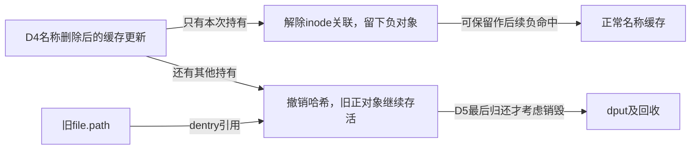
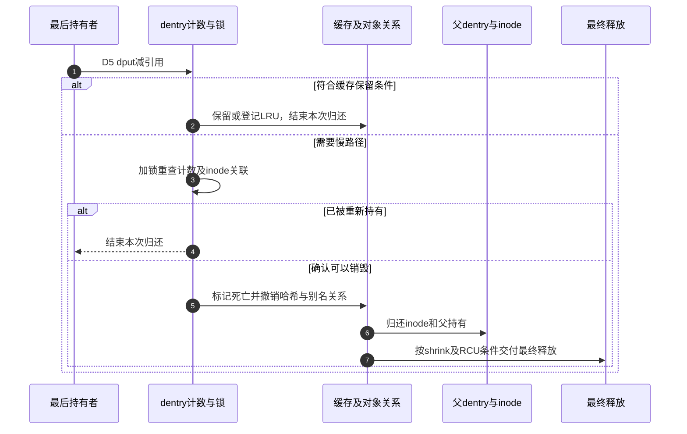

# 第12章\_名称失效与最后使用者退出

本页兑现 [名称缓存导读](../navigation/P07_名称结果怎样发布失效与回收.md#7.1_把名称结果拆成几组可独立变化的状态) 的 D4/D5。固定 NXP Linux 6.12.20 提交 `dfaf2136deb2af2e60b994421281ba42f1c087e0`；函数来自 fs/dcache.c，blob `0f6b16ba30d082b7613b084a23f6a01ed6436b1f`。总入口为 [VFS 源码索引](../navigation/P01_Linux_6.12_VFS源码阅读索引.md)。

## 12.1\_撤销正常名称索引不会自动释放对象

D4 发生后，新的查找不应再通过旧名称哈希找到该候选。d_drop 给 __d_drop 加 dentry 锁；内部从对应桶摘除节点，将 pprev 清空为 unhashed，并使 d_seq 观察失效。inode 关联与引用数并不在这里一并清零。

```c
/** @brief 仓库补充阅读说明：加dentry锁后撤销名称索引。 */
void d_drop(struct dentry *dentry)
{
        spin_lock(&dentry->d_lock);
        __d_drop(dentry);
        spin_unlock(&dentry->d_lock);
}
```

```c
/** @brief 仓库补充阅读说明：摘除哈希并标记unhashed，使旧序列观察失效。 */
void __d_drop(struct dentry *dentry)
{
        if (!d_unhashed(dentry)) {
                ___d_drop(dentry);
                dentry->d_hash.pprev = NULL;
                write_seqcount_invalidate(&dentry->d_seq);
        }
}
```

```c
/** @brief 仓库补充阅读说明：选择正常桶或特殊根桶后摘除节点。 */
static void ___d_drop(struct dentry *dentry)
{
        struct hlist_bl_head *b;
        /*
         * Hashed dentries are normally on the dentry hashtable,
         * with the exception of those newly allocated by
         * d_obtain_root, which are always IS_ROOT:
         */
        if (unlikely(IS_ROOT(dentry)))
                b = &dentry->d_sb->s_roots;
        else
                b = d_hash(dentry->d_name.hash);

        hlist_bl_lock(b);
        __hlist_bl_del(&dentry->d_hash);
        hlist_bl_unlock(b);
}
```

___d_drop 自身只执行链表摘除，未把节点置为正常 unhashed 判定所需的 NULL；完整调用层次很重要。根对象存在使用 s_roots 的特殊情况，不能把全部 d_hash 节点都画成一定在普通父名称桶中。

这套操作撤销缓存发现入口，不执行后端 unlink，也不主动关闭任何 file。旧 path 的持有仍是另一条关系。

## 12.2\_删除后的缓存结果取决于是否还有其他持有

d_delete 由名称删除相关路径使用。它锁 inode 和 dentry，检查当前是否只有本次持有；若是，则可以解除 inode 关联，留下负对象；否则只撤销哈希，使其他持有者继续使用旧关联。

```c
/** @brief 仓库补充阅读说明：按是否有其他持有选择负化或只撤销索引。 */
void d_delete(struct dentry * dentry)
{
        struct inode *inode = dentry->d_inode;

        spin_lock(&inode->i_lock);
        spin_lock(&dentry->d_lock);
        /*
         * Are we the only user?
         */
        if (dentry->d_lockref.count == 1) {
                dentry->d_flags &= ~DCACHE_CANT_MOUNT;
                dentry_unlink_inode(dentry);
        } else {
                __d_drop(dentry);
                spin_unlock(&dentry->d_lock);
                spin_unlock(&inode->i_lock);
        }
}
```

```c
/** @brief 仓库补充阅读说明：在序列更新中解除关联，解锁后归还inode。 */
static void dentry_unlink_inode(struct dentry * dentry)
        __releases(dentry->d_lock)
        __releases(dentry->d_inode->i_lock)
{
        struct inode *inode = dentry->d_inode;

        raw_write_seqcount_begin(&dentry->d_seq);
        __d_clear_type_and_inode(dentry);
        hlist_del_init(&dentry->d_u.d_alias);
        raw_write_seqcount_end(&dentry->d_seq);
        spin_unlock(&dentry->d_lock);
        spin_unlock(&inode->i_lock);
        if (!inode->i_nlink)
                fsnotify_inoderemove(inode);
        if (dentry->d_op && dentry->d_op->d_iput)
                dentry->d_op->d_iput(dentry, inode);
        else
                iput(inode);
}
```

dentry_unlink_inode 在 d_seq 更新区间清除类型和 inode、摘除别名链，随后释放两把锁，再通过 d_iput 或 iput 归还 inode。锁后归还可能进入更深层生命周期，不能随意移动到自旋锁内。它检查 i_nlink 决定通知，但并不是这里直接减少磁盘硬链接数；后端名称修改和本页缓存更新不能倒置。



## 12.3\_零引用保留必须同时满足缓存条件

retain_dentry 判断的是“此时能否将零引用对象继续留作缓存”。unhashed 或 disconnected 没有正常保留价值；文件系统 d_delete 回调、DONTCACHE 标志以及 LRU 登记也会改变决定。它的 false 在无锁调用时还可能只是“必须拿锁后再判断”，不是已经决定销毁。

```c
/** @brief 仓库补充阅读说明：按缓存价值和锁定条件决定能否保留零引用对象。 */
static inline bool retain_dentry(struct dentry *dentry, bool locked)
{
        unsigned int d_flags;

        smp_rmb();
        d_flags = READ_ONCE(dentry->d_flags);

        // Unreachable? Nobody would be able to look it up, no point retaining
        if (unlikely(d_unhashed(dentry)))
                return false;

        // Same if it's disconnected
        if (unlikely(d_flags & DCACHE_DISCONNECTED))
                return false;

        // ->d_delete() might tell us not to bother, but that requires
        // ->d_lock; can't decide without it
        if (unlikely(d_flags & DCACHE_OP_DELETE)) {
                if (!locked || dentry->d_op->d_delete(dentry))
                        return false;
        }

        // Explicitly told not to bother
        if (unlikely(d_flags & DCACHE_DONTCACHE))
                return false;

        // At this point it looks like we ought to keep it.  We also might
        // need to do something - put it on LRU if it wasn't there already
        // and mark it referenced if it was on LRU, but not marked yet.
        // Unfortunately, both actions require ->d_lock, so in lockless
        // case we'd have to punt rather than doing those.
        if (unlikely(!(d_flags & DCACHE_LRU_LIST))) {
                if (!locked)
                        return false;
                d_lru_add(dentry);
        } else if (unlikely(!(d_flags & DCACHE_REFERENCED))) {
                if (!locked)
                        return false;
                dentry->d_flags |= DCACHE_REFERENCED;
        }
        return true;
}
```

注意 dentry_operations.d_delete 是文件系统的保留策略回调，公共 d_delete 则是上一节的缓存更新函数。二者同名片段很容易误导阅读，调用对象和上下文必须同时核对。

锁内需要时加入 LRU，已在 LRU 但未标记 referenced 时设置相应标记；无锁路径不能执行这些修改，因此会转交慢路径。保留不等于给缓存伪造一个使用者引用，计数仍可为零。

## 12.4\_快速归还遇到不确定性时持锁重查

fast_dput 尝试通过 lockref 归还引用。非最后一份直接结束；已经降到零但可无锁决定保留时也结束。否则拿 d_lock 再核对：可能已有另一个查找者重新增加引用，或者对象已被标记死亡。

```c
/** @brief 仓库补充阅读说明：归还引用并在必要时持锁重查最后使用者条件。 */
static inline bool fast_dput(struct dentry *dentry)
{
        int ret;

        /*
         * try to decrement the lockref optimistically.
         */
        ret = lockref_put_return(&dentry->d_lockref);

        /*
         * If the lockref_put_return() failed due to the lock being held
         * by somebody else, the fast path has failed. We will need to
         * get the lock, and then check the count again.
         */
        if (unlikely(ret < 0)) {
                spin_lock(&dentry->d_lock);
                if (WARN_ON_ONCE(dentry->d_lockref.count <= 0)) {
                        spin_unlock(&dentry->d_lock);
                        return true;
                }
                dentry->d_lockref.count--;
                goto locked;
        }

        /*
         * If we weren't the last ref, we're done.
         */
        if (ret)
                return true;

        /*
         * Can we decide that decrement of refcount is all we needed without
         * taking the lock?  There's a very common case when it's all we need -
         * dentry looks like it ought to be retained and there's nothing else
         * to do.
         */
        if (retain_dentry(dentry, false))
                return true;

        /*
         * Either not worth retaining or we can't tell without the lock.
         * Get the lock, then.  We've already decremented the refcount to 0,
         * but we'll need to re-check the situation after getting the lock.
         */
        spin_lock(&dentry->d_lock);

        /*
         * Did somebody else grab a reference to it in the meantime, and
         * we're no longer the last user after all? Alternatively, somebody
         * else could have killed it and marked it dead. Either way, we
         * don't need to do anything else.
         */
locked:
        if (dentry->d_lockref.count || retain_dentry(dentry, true)) {
                spin_unlock(&dentry->d_lock);
                return true;
        }
        return false;
}
```

函数返回 false 时已持有 d_lock，并且计数为零且不值得保留；返回 true 则本次归还已完成。这个返回值不是“dentry 还活着”的通用查询，调用者必须按约定继续，不能再次减一次引用。

## 12.5\_进入销毁前仍要按锁序验证inode与计数

dput 在 RCU 保护下执行快速归还，无法结束时调用 lock_for_kill。后者处理 inode 锁与 dentry 锁的取得顺序：必要时放开 d_lock，先锁 inode，再锁回 dentry，核对关联和计数是否仍符合条件。

```c
/** @brief 仓库补充阅读说明：归还当前对象，必要时沿失去最后持有的父对象继续。 */
void dput(struct dentry *dentry)
{
        if (!dentry)
                return;
        might_sleep();
        rcu_read_lock();
        if (likely(fast_dput(dentry))) {
                rcu_read_unlock();
                return;
        }
        while (lock_for_kill(dentry)) {
                rcu_read_unlock();
                dentry = __dentry_kill(dentry);
                if (!dentry)
                        return;
                if (retain_dentry(dentry, true)) {
                        spin_unlock(&dentry->d_lock);
                        return;
                }
                rcu_read_lock();
        }
        rcu_read_unlock();
        spin_unlock(&dentry->d_lock);
}
```

```c
/** @brief 仓库补充阅读说明：按锁序取得inode保护并复查关联和计数。 */
static bool lock_for_kill(struct dentry *dentry)
{
        struct inode *inode = dentry->d_inode;

        if (unlikely(dentry->d_lockref.count))
                return false;

        if (!inode || likely(spin_trylock(&inode->i_lock)))
                return true;

        do {
                spin_unlock(&dentry->d_lock);
                spin_lock(&inode->i_lock);
                spin_lock(&dentry->d_lock);
                if (likely(inode == dentry->d_inode))
                        break;
                spin_unlock(&inode->i_lock);
                inode = dentry->d_inode;
        } while (inode);
        if (likely(!dentry->d_lockref.count))
                return true;
        if (inode)
                spin_unlock(&inode->i_lock);
        return false;
}
```

释放 d_lock 后不能假定原 inode 仍是当前关联，也不能假定计数仍为零。这是慢路径为什么要重新读取和检查的具体原因。销毁子对象可能使父对象失去最后一份持有，所以 dput 用循环沿父链继续，避免靠递归消耗内核栈。

## 12.6\_销毁同时归还别名父关系和最终内存

__dentry_kill 标记不可恢复的死亡状态，处理 prune/LRU/哈希/inode 关联和 release 回调，之后摘除父子关系并归还父持有。若对象仍在 shrink 列表，内存释放由相应列表处理者收尾；不能从一次 kill 调用推断已经 kfree。

```c
/** @brief 仓库补充阅读说明：标记死亡并退出索引、别名、父子关系及相应资源。 */
static struct dentry *__dentry_kill(struct dentry *dentry)
{
        struct dentry *parent = NULL;
        bool can_free = true;

        /*
         * The dentry is now unrecoverably dead to the world.
         */
        lockref_mark_dead(&dentry->d_lockref);

        /*
         * inform the fs via d_prune that this dentry is about to be
         * unhashed and destroyed.
         */
        if (dentry->d_flags & DCACHE_OP_PRUNE)
                dentry->d_op->d_prune(dentry);

        if (dentry->d_flags & DCACHE_LRU_LIST) {
                if (!(dentry->d_flags & DCACHE_SHRINK_LIST))
                        d_lru_del(dentry);
        }
        /* if it was on the hash then remove it */
        __d_drop(dentry);
        if (dentry->d_inode)
                dentry_unlink_inode(dentry);
        else
                spin_unlock(&dentry->d_lock);
        this_cpu_dec(nr_dentry);
        if (dentry->d_op && dentry->d_op->d_release)
                dentry->d_op->d_release(dentry);

        cond_resched();
        /* now that it's negative, ->d_parent is stable */
        if (!IS_ROOT(dentry)) {
                parent = dentry->d_parent;
                spin_lock(&parent->d_lock);
        }
        spin_lock_nested(&dentry->d_lock, DENTRY_D_LOCK_NESTED);
        dentry_unlist(dentry);
        if (dentry->d_flags & DCACHE_SHRINK_LIST)
                can_free = false;
        spin_unlock(&dentry->d_lock);
        if (likely(can_free))
                dentry_free(dentry);
        if (parent && --parent->d_lockref.count) {
                spin_unlock(&parent->d_lock);
                return NULL;
        }
        return parent;
}
```

```c
/** @brief 仓库补充阅读说明：按外部名字共享与RCU可见性安排最终释放。 */
static void dentry_free(struct dentry *dentry)
{
        WARN_ON(!hlist_unhashed(&dentry->d_u.d_alias));
        if (unlikely(dname_external(dentry))) {
                struct external_name *p = external_name(dentry);
                if (likely(atomic_dec_and_test(&p->u.count))) {
                        call_rcu(&dentry->d_u.d_rcu, __d_free_external);
                        return;
                }
        }
        /* if dentry was never visible to RCU, immediate free is OK */
        if (dentry->d_flags & DCACHE_NORCU)
                __d_free(&dentry->d_u.d_rcu);
        else
                call_rcu(&dentry->d_u.d_rcu, __d_free);
}
```

外部名字有自己的共享计数。最后一份外部名字可与 dentry 一起在 RCU 回调中释放；其他情况根据 NORCU 决定是否可以直接释放 dentry。普通已经公开给 RCU 读者的对象必须延后；从未公开的特殊对象不应为了画统一图而凭空增加等待。



本页说明普通引用归还及最后销毁，不把 shrinker 选择、目录操作与路径快速遍历全部重复展开。没有目标并发 rename、内存压力或回收追踪记录；图示表达代码允许的分支。返回 [导读](../navigation/P07_名称结果怎样发布失效与回收.md#7.2_按阶段连接唯一实现)。
