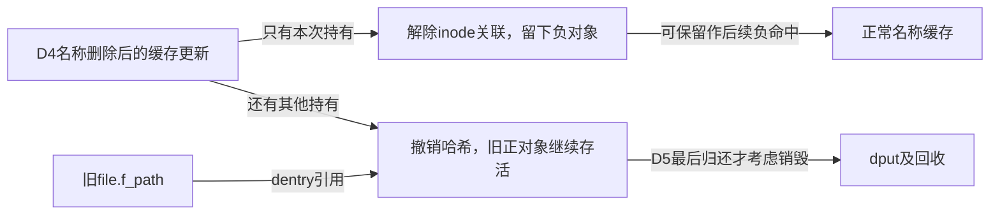
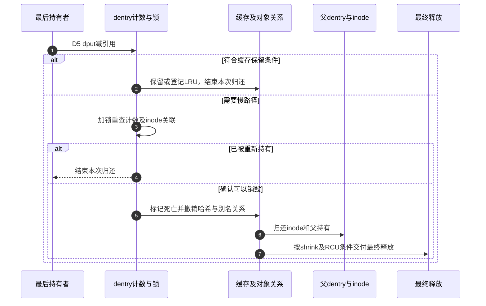
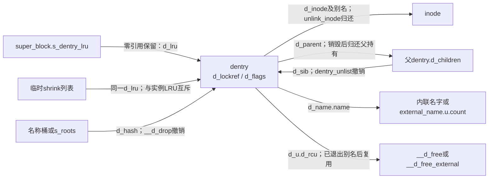

# 第12章\_名称失效与最后使用者退出

本页兑现 [名称缓存导读](../navigation/P07_名称结果怎样发布失效与回收.md#7.1_把名称结果拆成几组可独立变化的状态) 的 D4/D5。固定 NXP Linux 6.12.20 提交 `dfaf2136deb2af2e60b994421281ba42f1c087e0`；函数来自 fs/dcache.c，blob `0f6b16ba30d082b7613b084a23f6a01ed6436b1f`。总入口为 [VFS 源码索引](../navigation/P01_Linux_6.12_VFS源码阅读索引.md)。

## 12.1\_撤销正常名称索引不会自动释放对象

D4 发生后，新的查找不应再通过旧名称哈希找到该候选。d_drop 给 __d_drop 加 dentry 锁；内部从对应桶摘除节点，将 pprev 清空为 unhashed，并使 d_seq 观察失效。inode 关联与引用数并不在这里一并清零。

```c
/** @brief 仓库补充阅读说明：加dentry锁后撤销名称索引。 */
void d_drop(struct dentry *dentry)
{
        /* 保护本对象的哈希状态和序列失效动作。 */
        spin_lock(&dentry->d_lock);
        __d_drop(dentry);
        spin_unlock(&dentry->d_lock);
}
```

```c
/** @brief 仓库补充阅读说明：摘除哈希并标记unhashed，使旧序列观察失效。 */
void __d_drop(struct dentry *dentry)
{
        if (!d_unhashed(dentry)) {
                /* 先摘桶链，再清pprev作为unhashed判定。 */
                ___d_drop(dentry);
                dentry->d_hash.pprev = NULL;
                /* 让旧快速路径样本无法继续作为稳定观察使用。 */
                write_seqcount_invalidate(&dentry->d_seq);
        }
}
```

```c
/** @brief 仓库补充阅读说明：选择正常桶或特殊根桶后摘除节点。 */
static void ___d_drop(struct dentry *dentry)
{
        struct hlist_bl_head *b;

        /* 特殊根索引使用s_roots，其余使用正常名称桶。 */
        if (unlikely(IS_ROOT(dentry)))
                b = &dentry->d_sb->s_roots;
        else
                b = d_hash(dentry->d_name.hash);

        hlist_bl_lock(b);
        /* 仅摘链，本层不清pprev，也不归还inode或引用。 */
        __hlist_bl_del(&dentry->d_hash);
        hlist_bl_unlock(b);
}
```

___d_drop 自身只执行链表摘除，未把节点置为正常 unhashed 判定所需的 NULL；完整调用层次很重要。根对象存在使用 s_roots 的特殊情况，不能把全部 d_hash 节点都画成一定在普通父名称桶中。

这套操作撤销缓存发现入口，不执行后端 unlink，也不主动关闭任何 file。旧 path 的持有仍是另一条关系。

声明与所有权：`d_drop/__d_drop` 是 `include/linux/dcache.h` 对外声明的VFS接口，`___d_drop` 是同文件内部辅助。`d_unhashed` 读取 `d_hash.pprev`，`IS_ROOT` 判断 `d_parent == dentry`，后者描述对象树身份，不等于“这是当前任务的根路径”。修改时必须保留桶链摘除、pprev清空、序列失效这三个动作及锁顺序；只调用最内层会让后续判断仍误以为对象已被索引。

## 12.2\_删除后的缓存结果取决于是否还有其他持有

d_delete 由名称删除相关路径使用。它锁 inode 和 dentry，检查当前是否只有本次持有；若是，则可以解除 inode 关联，留下负对象；否则只撤销哈希，使其他持有者继续使用旧关联。

```c
/** @brief 仓库补充阅读说明：按是否有其他持有选择负化或只撤销索引。 */
void d_delete(struct dentry * dentry)
{
        /* 调用契约要求正关联，不能将任意负对象传入。 */
        struct inode *inode = dentry->d_inode;

        spin_lock(&inode->i_lock);
        spin_lock(&dentry->d_lock);

        /* 只有本次持有时可负化；否则保存旧使用者的inode关联。 */
        if (dentry->d_lockref.count == 1) {
                dentry->d_flags &= ~DCACHE_CANT_MOUNT;
                /* 辅助函数解开两把锁并归还inode。 */
                dentry_unlink_inode(dentry);
        } else {
                /* 旧持有者仍存活，只撤销新查找入口。 */
                __d_drop(dentry);
                spin_unlock(&dentry->d_lock);
                spin_unlock(&inode->i_lock);
        }
}
```

```c
/** @brief 仓库补充阅读说明：在序列更新中解除关联，解锁后归还inode。 */
static void dentry_unlink_inode(struct dentry * dentry)
        /* 静态检查注解描述解锁责任，实际解锁仍由函数体完成。 */
        __releases(dentry->d_lock)
        __releases(dentry->d_inode->i_lock)
{
        struct inode *inode = dentry->d_inode;

        /* 关联清除和别名退出属于同一序列变化。 */
        raw_write_seqcount_begin(&dentry->d_seq);
        __d_clear_type_and_inode(dentry);
        hlist_del_init(&dentry->d_u.d_alias);
        raw_write_seqcount_end(&dentry->d_seq);
        spin_unlock(&dentry->d_lock);
        spin_unlock(&inode->i_lock);
        /* 根据既有链接数发移除通知，不在这里减少硬链接数。 */
        if (!inode->i_nlink)
                fsnotify_inoderemove(inode);
        /* 锁外由文件系统回调接收归还责任，否则走通用iput。 */
        if (dentry->d_op && dentry->d_op->d_iput)
                dentry->d_op->d_iput(dentry, inode);
        else
                iput(inode);
}
```

dentry_unlink_inode 在 d_seq 更新区间清除类型和 inode、摘除别名链，随后释放两把锁，再通过 d_iput 或 iput 归还 inode。锁后归还可能进入更深层生命周期，不能随意移动到自旋锁内。它检查 i_nlink 决定通知，但并不是这里直接减少磁盘硬链接数；后端名称修改和本页缓存更新不能倒置。



`dentry_unlink_inode` 的 `__releases` 是 Sparse 上下文注解，实际解锁仍由 `spin_unlock` 执行。`__d_clear_type_and_inode` 清除 `DCACHE_ENTRY_TYPE`、写NULL关联，并在真实LRU负计数范围内更新统计；`fsnotify_inoderemove` 根据既有零链接状态派发删除自身事件，`CONFIG_FSNOTIFY=n` 时无通知。归还回调 `d_iput` 与通用 `iput` 二选一，不能都调用。

上述负化分支 **不会主动把原本unhashed的对象重新发布**；“留下负缓存”以对象此前仍在正常名称索引中为前提。修改删除策略要检查既有正关联、唯一持有和多人持有两条分支，配对inode持有与两把锁，并检查文件系统回调的上下文。后端unlink操作、`i_nlink`更新、公共 `d_delete` 和 `d_op->d_delete` 分属不同职责。

## 12.3\_零引用保留必须同时满足缓存条件

retain_dentry 判断的是“此时能否将零引用对象继续留作缓存”。unhashed 或 disconnected 没有正常保留价值；文件系统 d_delete 回调、DONTCACHE 标志以及 LRU 登记也会改变决定。它的 false 在无锁调用时还可能只是“必须拿锁后再判断”，不是已经决定销毁。

```c
/** @brief 仓库补充阅读说明：按缓存价值和锁定条件决定能否保留零引用对象。 */
static inline bool retain_dentry(struct dentry *dentry, bool locked)
{
        unsigned int d_flags;

        /* 配合归还后的状态观察；不能据此取消后面的对象锁约束。 */
        smp_rmb();
        d_flags = READ_ONCE(dentry->d_flags);

        /* 无法再通过名称索引发现的对象不保留为此缓存。 */
        if (unlikely(d_unhashed(dentry)))
                return false;

        if (unlikely(d_flags & DCACHE_DISCONNECTED))
                return false;

        /* d_op回调必须在d_lock内调用，未加锁只能回退。 */
        if (unlikely(d_flags & DCACHE_OP_DELETE)) {
                if (!locked || dentry->d_op->d_delete(dentry))
                        return false;
        }

        if (unlikely(d_flags & DCACHE_DONTCACHE))
                return false;

        /* 登记LRU与设置引用观察标志都需要d_lock。 */
        if (unlikely(!(d_flags & DCACHE_LRU_LIST))) {
                if (!locked)
                        return false;
                d_lru_add(dentry);
        } else if (unlikely(!(d_flags & DCACHE_REFERENCED))) {
                if (!locked)
                        return false;
                dentry->d_flags |= DCACHE_REFERENCED;
        }
        /* 保留零使用引用缓存，不伪造一个新使用者。 */
        return true;
}
```

注意 dentry_operations.d_delete 是文件系统的保留策略回调，公共 d_delete 则是上一节的缓存更新函数。二者同名片段很容易误导阅读，调用对象和上下文必须同时核对。

锁内需要时加入 LRU，已在 LRU 但未标记 referenced 时设置相应标记；无锁路径不能执行这些修改，因此会转交慢路径。保留不等于给缓存伪造一个使用者引用，计数仍可为零。

实际保留位置是 `dentry->d_sb->s_dentry_lru`，节点为 `d_lru`。`d_lru_add/d_lru_del` 要在 `d_lock` 下同时更新节点、`DCACHE_LRU_LIST` 与每CPU统计；`DCACHE_SHRINK_LIST` 说明相同节点已转给临时回收列表，不能又加回实例LRU。压力扫描入口见 [实例回收预算](P65_空闲inode扫描与卸载驱逐.md#65.1_压力扫描先估计预算再取得实例访问资格)。本页解释保留与最终销毁；dcache.c中的候选筛选、批量shrink列表遍历不在此展开，不能据本页推导回收顺序或回收量。

这些辅助函数把 `list_lru_add_obj/list_lru_del_obj` 放在 `WARN_ON_ONCE` 的条件中：**条件表达式包含真正的集合修改，不能因为外层是告警就删掉整句**。`D_FLAG_VERIFY` 则只核对标志组合。告警可能受panic策略影响，既不修复错乱的集合，也不替代功能锁。修改保留条件必须同时检查回调锁约束、LRU统计配对和再次命中，不只测“最后一次dput没崩溃”。

## 12.4\_快速归还遇到不确定性时持锁重查

fast_dput 尝试通过 lockref 归还引用。非最后一份直接结束；已经降到零但可无锁决定保留时也结束。否则拿 d_lock 再核对：可能已有另一个查找者重新增加引用，或者对象已被标记死亡。

```c
/** @brief 仓库补充阅读说明：归还引用并在必要时持锁重查最后使用者条件。 */
static inline bool fast_dput(struct dentry *dentry)
{
        int ret;

        /* 尝试递减；无cmpxchg配置或未完成时返回负值且尚未递减。 */
        ret = lockref_put_return(&dentry->d_lockref);

        if (unlikely(ret < 0)) {
                /* 回退时持锁复查，不能沿用之前观察到的计数。 */
                spin_lock(&dentry->d_lock);
                /* 非法重复归还：告警条件同时选择提前返回分支。 */
                if (WARN_ON_ONCE(dentry->d_lockref.count <= 0)) {
                        spin_unlock(&dentry->d_lock);
                        return true;
                }
                /* 快速递减未完成，持锁后在这里完成一次递减。 */
                dentry->d_lockref.count--;
                goto locked;
        }

        /* 正数表示仍有使用者，已经完成本次归还。 */
        if (ret)
                return true;

        /* 零引用且无需修改缓存登记才可无锁结束。 */
        if (retain_dentry(dentry, false))
                return true;

        /* 回退时持锁复查，不能沿用之前观察到的计数。 */
        spin_lock(&dentry->d_lock);

locked:
        /* 已被重新持有、已死亡或可以保留，都不继续销毁。 */
        if (dentry->d_lockref.count || retain_dentry(dentry, true)) {
                spin_unlock(&dentry->d_lock);
                return true;
        }
        /* 交给调用者时d_lock仍持有，不能再减一次引用。 */
        return false;
}
```

函数返回 false 时已持有 d_lock，并且计数为零且不值得保留；返回 true 则本次归还已完成。这个返回值不是“dentry 还活着”的通用查询，调用者必须按约定继续，不能再次减一次引用。

配置会改变哪条路径实际执行。[lockref.h](../../linux/include/linux/lockref.h) 的 `USE_CMPXCHG_LOCKREF` 同时要求架构支持、`CONFIG_SMP=y` 和自旋锁存储大小不超过4字节；[lib/lockref.c](../../linux/lib/lockref.c) 的 `lockref_put_return` 在该条件不成立时直接返回-1，**尚未递减**。当前核对的ARM配置 `CONFIG_SMP=n`，因此由 `fast_dput` 持锁递减。条件成立时，比较交换也可能因锁被占用或重试未成功而回退；返回负值不是“已经成功减到了负数”。

| 返回或状态 | 调用者应怎样理解 |
| --- | --- |
| `lockref_put_return` 返回正数 | 已完成一次递减，仍有使用者 |
| 返回0 | 已完成递减到零，需决定保留或销毁 |
| 返回负值 | 快速递减未完成，转锁内检查；不能直接认定对象已死亡 |
| `fast_dput` 返回true | 本次归还协议结束，不等于可以继续使用对象 |
| `fast_dput` 返回false | 已递减，零计数且不可保留，d_lock仍持有；下一步是销毁前复查 |

`WARN_ON_ONCE(count <= 0)` 的真假直接控制提前返回；无论是否打印告警，这个分支都不能按“纯诊断”删掉。WARN还受 [panic策略](P05_建树与分离挂载的阶段交接.md#5.6_检查动作与资源交接必须一起保留) 影响，不能保证错误条件下继续运行。修改快速路径要保持每次调用只减一次、所有返回的锁状态明确，并覆盖单核退化、成功比较交换、锁竞争和非法重复归还；本次没有伪造这些分支的实测覆盖。

## 12.5\_进入销毁前仍要按锁序验证inode与计数

dput 在 RCU 保护下执行快速归还，无法结束时调用 lock_for_kill。后者处理 inode 锁与 dentry 锁的取得顺序：必要时放开 d_lock，先锁 inode，再锁回 dentry，核对关联和计数是否仍符合条件。

```c
/** @brief 仓库补充阅读说明：归还当前对象，必要时沿失去最后持有的父对象继续。 */
void dput(struct dentry *dentry)
{
        if (!dentry)
                return;
        /* 该接口可能进入可睡眠清理；检查不能把原子上下文变合法。 */
        might_sleep();
        /* 无锁或放锁重查期间保护dentry/inode观察的存储。 */
        rcu_read_lock();
        if (likely(fast_dput(dentry))) {
                rcu_read_unlock();
                return;
        }
        /* 按锁序接住inode并复核零引用，才可离开RCU开始销毁。 */
        while (lock_for_kill(dentry)) {
                rcu_read_unlock();
                /* 返回的可能是计数刚归零且仍持锁的父对象。 */
                dentry = __dentry_kill(dentry);
                if (!dentry)
                        return;
                /* 父对象仍可保留时结束沿父链清理。 */
                if (retain_dentry(dentry, true)) {
                        spin_unlock(&dentry->d_lock);
                        return;
                }
                /* 无锁或放锁重查期间保护dentry/inode观察的存储。 */
                rcu_read_lock();
        }
        rcu_read_unlock();
        spin_unlock(&dentry->d_lock);
}
```

```c
/** @brief 仓库补充阅读说明：按锁序取得inode保护并复查关联和计数。 */
static bool lock_for_kill(struct dentry *dentry)
{
        struct inode *inode = dentry->d_inode;

        /* 计数已变化时拒绝本轮销毁。 */
        if (unlikely(dentry->d_lockref.count))
                return false;

        /* 无inode或成功取得inode锁时可直接交接。 */
        if (!inode || likely(spin_trylock(&inode->i_lock)))
                return true;

        do {
                /* 避免反向锁序死等，先放dentry锁再按inode→dentry重取。 */
                spin_unlock(&dentry->d_lock);
                spin_lock(&inode->i_lock);
                spin_lock(&dentry->d_lock);
                /* 放锁期间关联可能变化，必须与当前对象重新核对。 */
                if (likely(inode == dentry->d_inode))
                        break;
                spin_unlock(&inode->i_lock);
                inode = dentry->d_inode;
        } while (inode);
        /* 锁顺序修复后仍要检查是否有人重新持有。 */
        if (likely(!dentry->d_lockref.count))
                return true;
        if (inode)
                spin_unlock(&inode->i_lock);
        return false;
}
```

释放 d_lock 后不能假定原 inode 仍是当前关联，也不能假定计数仍为零。这是慢路径为什么要重新读取和检查的具体原因。销毁子对象可能使父对象失去最后一份持有，所以 dput 用循环沿父链继续，避免靠递归消耗内核栈。

`lock_for_kill` 依赖调用者已持有d_lock且在RCU读侧；放锁重取期间依靠RCU保护旧指针观察，重取后再验证关联。成功时持有当前inode锁（若有）和d_lock，失败时仍由dput解开d_lock。`might_sleep` 是上下文检查，`cond_resched` 位于稍后的无锁清理中；它们不意味着允许在任意中断上下文调用dput。改变锁顺序时要同时检查查找重新持有、并发关联修改和父链降零，不能只覆盖一条无竞争调用栈。

## 12.6\_销毁同时归还别名父关系和最终内存

__dentry_kill 标记不可恢复的死亡状态，处理 prune/LRU/哈希/inode 关联和 release 回调，之后摘除父子关系并归还父持有。若对象仍在 shrink 列表，内存释放由相应列表处理者收尾；不能从一次 kill 调用推断已经 kfree。

```c
/** @brief 仓库补充阅读说明：标记死亡并退出索引、别名、父子关系及相应资源。 */
static struct dentry *__dentry_kill(struct dentry *dentry)
{
        struct dentry *parent = NULL;
        bool can_free = true;

        /* 持锁把计数设为死亡负值，阻止新的有效持有。 */
        lockref_mark_dead(&dentry->d_lockref);

        /* 文件系统在摘哈希之前获知prune，仍处对象锁上下文。 */
        if (dentry->d_flags & DCACHE_OP_PRUNE)
                dentry->d_op->d_prune(dentry);

        if (dentry->d_flags & DCACHE_LRU_LIST) {
                if (!(dentry->d_flags & DCACHE_SHRINK_LIST))
                        d_lru_del(dentry);
        }

        /* 先退出发现入口，再归还inode别名关系。 */
        __d_drop(dentry);
        if (dentry->d_inode)
                dentry_unlink_inode(dentry);
        else
                spin_unlock(&dentry->d_lock);
        this_cpu_dec(nr_dentry);
        /* 通用索引和关联退出后回收文件系统私有dentry资源。 */
        if (dentry->d_op && dentry->d_op->d_release)
                dentry->d_op->d_release(dentry);

        /* 已离开对象锁和外层RCU，可交出CPU；不是等待固定宽限期。 */
        cond_resched();

        if (!IS_ROOT(dentry)) {
                parent = dentry->d_parent;
                spin_lock(&parent->d_lock);
        }
        /* 实际取得子对象锁；嵌套类别另供Lockdep区分。 */
        spin_lock_nested(&dentry->d_lock, DENTRY_D_LOCK_NESTED);
        dentry_unlist(dentry);
        /* shrink列表仍持有回收责任时，本次不得直接安排释放。 */
        if (dentry->d_flags & DCACHE_SHRINK_LIST)
                can_free = false;
        spin_unlock(&dentry->d_lock);
        if (likely(can_free))
                dentry_free(dentry);
        /* 归还子对象取得的父持有；父降零时带锁交回外层循环。 */
        if (parent && --parent->d_lockref.count) {
                spin_unlock(&parent->d_lock);
                return NULL;
        }
        return parent;
}
```

```c
/** @brief 仓库补充阅读说明：按外部名字共享与RCU可见性安排最终释放。 */
static void dentry_free(struct dentry *dentry)
{
        /* 别名必须已退出；告警不会替调用者摘除别名。 */
        WARN_ON(!hlist_unhashed(&dentry->d_u.d_alias));
        if (unlikely(dname_external(dentry))) {
                struct external_name *p = external_name(dentry);
                /* 外部名字最后一份需与对象一起延后释放。 */
                if (likely(atomic_dec_and_test(&p->u.count))) {
                        call_rcu(&dentry->d_u.d_rcu, __d_free_external);
                        return;
                }
        }

        /* 只有未曾向RCU公开的特殊对象可在此直接释放。 */
        if (dentry->d_flags & DCACHE_NORCU)
                __d_free(&dentry->d_u.d_rcu);
        else
                call_rcu(&dentry->d_u.d_rcu, __d_free);
}
```

外部名字有自己的共享计数。最后一份外部名字可与 dentry 一起在 RCU 回调中释放；其他情况根据 NORCU 决定是否可以直接释放 dentry。普通已经公开给 RCU 读者的对象必须延后；从未公开的特殊对象不应为了画统一图而凭空增加等待。



本页说明普通引用归还及最后销毁，不把 shrinker 选择、目录操作与路径快速遍历全部重复展开。没有目标并发 rename、内存压力或回收追踪记录；图示表达代码允许的分支。返回 [导读](../navigation/P07_名称结果怎样发布失效与回收.md#7.2_按阶段连接唯一实现)。

dentry归还inode关联之后，iput仍会选择保留缓存或进入驱逐，见 [最后inode引用](P63_最后inode引用与缓存保留.md#63.1_最后使用引用先进入缓存或驱逐决策)。这不是每次dput都立即释放inode。


最终退出还有两种不同的“等别人结束”。对象在shrink列表上时，先由列表处理者解除该列表责任；普通已公开对象随后仍要等旧RCU读者退出。两者都不等同于“再睡几个时钟”。



| 最终清理符号 | 必须保留的具体契约 |
| --- | --- |
| `lockref_mark_dead` | 持锁将count设为-128；`assert_spin_locked`是检查，实际负值写入才关闭后续持有资格 |
| `d_prune` / `d_release` | 前者在摘哈希前、对象锁内调用；后者在关联和通用索引清理后释放私有资源，不能任意交换上下文 |
| `dentry_unlist` | 写 `DCACHE_DENTRY_KILLED`，摘父子链并调整残留next以避开可移动目录游标；不是只清一个普通链表指针 |
| `DENTRY_D_LOCK_NESTED` | Lockdep嵌套类别，实际子对象锁仍会取得；关闭锁依赖检查不取消保护 |
| `__d_free` / `__d_free_external` | 前者把dentry归还slab；后者先释放外部名字再归还dentry |
| 外部名字快照 | `take_dentry_name_snapshot` 增加外部名字计数；`release_dentry_name_snapshot` 若最后归还，用名字自身的 `u.head` 延后释放 |

这些辅助的声明/定义和配置依据保存在 [dcache.c](../../linux/fs/dcache.c)、[lockref.h](../../linux/include/linux/lockref.h)、[lockref.c](../../linux/lib/lockref.c)；名字快照与目录游标只说明本清理边界，不在这里展开另一套完整路径算法。`d_u` 在别名、进行中查询和RCU回调间复用存储，修改清理顺序时必须保证旧角色已退出。外部名字最后一份分支总是先走 `__d_free_external` 的RCU安排，不能拿后面的NORCU判断覆盖它。

最小修改面应围绕一个保留/清理条件及其配对资源展开，并检查短名字/长名字、快照共享、shrink接管、父降零与已经重新持有这几种分支。`CONFIG_PROVE_LOCKING` 可检查部分锁序，`CONFIG_SMP` 改变lockref路径，`CONFIG_FSNOTIFY` 改变通知接入；它们都不能替代具体退出路径的执行证据。本次仅完成固定源码与图文核对，没有并发回收或内存压力运行记录。
