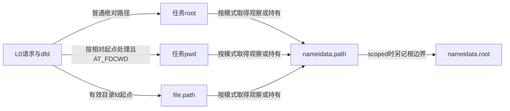
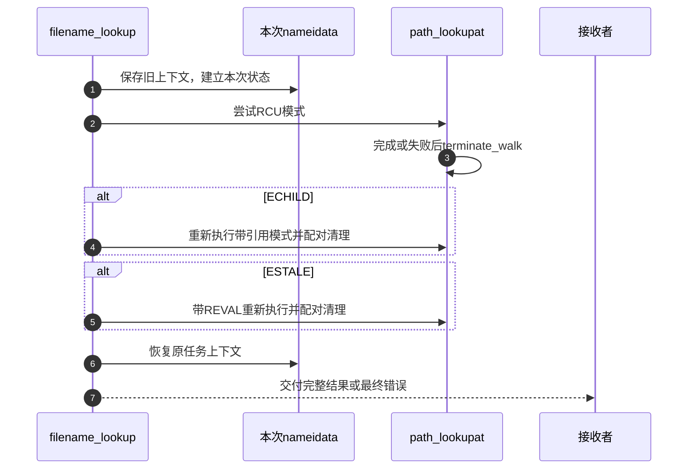

# 第13章\_路径起点与结果持有的交接

本页承接 [路径遍历导读](../navigation/P08_路径怎样从起点推进到结果交付.md#8.1_把位置文本与约束放进同一周期)，追踪 L0 起点、L4 末项及 L5 结果交接。固定 NXP Linux 6.12.20 提交 `dfaf2136deb2af2e60b994421281ba42f1c087e0`；声明和函数来自 fs/namei.c，blob `6795600c5738a56740bdeb2b4ec33f29545d918a`，版本入口为 [VFS 总索引](../navigation/P01_Linux_6.12_VFS源码阅读索引.md)。

## 13.1\_本次遍历状态与任务中的嵌套上下文

nameidata 把当前位置、根、剩余名字、链接栈和观察序列保存在同一操作上下文。对象字段不是全局路径树；同一任务发生嵌套查找时，要保存旧上下文并在结束后恢复。

```c
/** @brief 仓库补充阅读说明：保存本次位置、根、末项、模式与链接恢复状态。 */
struct nameidata {
        struct path     path;
        struct qstr     last;
        struct path     root;
        struct inode    *inode; /* path.dentry.d_inode */
        unsigned int    flags, state;
        unsigned        seq, next_seq, m_seq, r_seq;
        int             last_type;
        unsigned        depth;
        int             total_link_count;
        struct saved {
                struct path link;
                struct delayed_call done;
                const char *name;
                unsigned seq;
        } *stack, internal[EMBEDDED_LEVELS];
        struct filename *name;
        struct nameidata *saved;
        unsigned        root_seq;
        int             dfd;
        vfsuid_t        dir_vfsuid;
        umode_t         dir_mode;
} __randomize_layout;
```

| 字段组 | 本模块的所有权与用途 |
| --- | --- |
| path、inode | 本次当前位置；带引用模式持有path，快速模式按观察协议使用 |
| root、state、root_seq | 区分预设根、自己取得的根持有和相应观察状态 |
| last、last_type | 前导遍历留下的末项，交给具体调用目的处理 |
| flags及各序列值 | 查找约束、模式和一致性凭据 |
| stack、internal、depth | 链接状态与恢复后缀，小规模使用内联数组 |
| total_link_count | 本次及相应嵌套上下文的链接预算，不是当前depth |
| saved、name、dfd | 旧任务上下文、本次路径文本及起点fd |
| dir_vfsuid、dir_mode | 末项处理需要的目录身份和模式记录 |

```c
/** @brief 仓库补充阅读说明：保存旧任务上下文并初始化本次路径和链接状态。 */
static void __set_nameidata(struct nameidata *p, int dfd, struct filename *name)
{
        struct nameidata *old = current->nameidata;
        p->stack = p->internal;
        p->depth = 0;
        p->dfd = dfd;
        p->name = name;
        p->path.mnt = NULL;
        p->path.dentry = NULL;
        p->total_link_count = old ? old->total_link_count : 0;
        p->saved = old;
        current->nameidata = p;
}
```

```c
/** @brief 仓库补充阅读说明：建立上下文并标识调用者预设根。 */
static inline void set_nameidata(struct nameidata *p, int dfd, struct filename *name,
                          const struct path *root)
{
        __set_nameidata(p, dfd, name);
        p->state = 0;
        if (unlikely(root)) {
                p->state = ND_ROOT_PRESET;
                p->root = *root;
        }
}
```

新上下文继承需要累计的链接次数，初始位置清空；可选 root 以 ND_ROOT_PRESET 标识。current->nameidata 是相关回调寻找当前遍历的入口，不是把本次状态交给其他任务任意修改。

## 13.2\_建立起点时同时确立观察或持有协议

path_init 先处理查找模式，再记录 mount 与 rename 序列。预设根、普通绝对路径、cwd 和目录 fd 分别进入不同分支；LOOKUP_IN_ROOT 会改变绝对路径对起点的选择。

```c
/** @brief 仓库补充阅读说明：按输入及约束建立起点，配对观察或路径持有。 */
static const char *path_init(struct nameidata *nd, unsigned flags)
{
        int error;
        const char *s = nd->name->name;

        /* LOOKUP_CACHED requires RCU, ask caller to retry */
        if ((flags & (LOOKUP_RCU | LOOKUP_CACHED)) == LOOKUP_CACHED)
                return ERR_PTR(-EAGAIN);

        if (!*s)
                flags &= ~LOOKUP_RCU;
        if (flags & LOOKUP_RCU)
                rcu_read_lock();
        else
                nd->seq = nd->next_seq = 0;

        nd->flags = flags;
        nd->state |= ND_JUMPED;

        nd->m_seq = __read_seqcount_begin(&mount_lock.seqcount);
        nd->r_seq = __read_seqcount_begin(&rename_lock.seqcount);
        smp_rmb();

        if (nd->state & ND_ROOT_PRESET) {
                struct dentry *root = nd->root.dentry;
                struct inode *inode = root->d_inode;
                if (*s && unlikely(!d_can_lookup(root)))
                        return ERR_PTR(-ENOTDIR);
                nd->path = nd->root;
                nd->inode = inode;
                if (flags & LOOKUP_RCU) {
                        nd->seq = read_seqcount_begin(&nd->path.dentry->d_seq);
                        nd->root_seq = nd->seq;
                } else {
                        path_get(&nd->path);
                }
                return s;
        }

        nd->root.mnt = NULL;

        /* Absolute pathname -- fetch the root (LOOKUP_IN_ROOT uses nd->dfd). */
        if (*s == '/' && !(flags & LOOKUP_IN_ROOT)) {
                error = nd_jump_root(nd);
                if (unlikely(error))
                        return ERR_PTR(error);
                return s;
        }

        /* Relative pathname -- get the starting-point it is relative to. */
        if (nd->dfd == AT_FDCWD) {
                if (flags & LOOKUP_RCU) {
                        struct fs_struct *fs = current->fs;
                        unsigned seq;

                        do {
                                seq = read_seqcount_begin(&fs->seq);
                                nd->path = fs->pwd;
                                nd->inode = nd->path.dentry->d_inode;
                                nd->seq = __read_seqcount_begin(&nd->path.dentry->d_seq);
                        } while (read_seqcount_retry(&fs->seq, seq));
                } else {
                        get_fs_pwd(current->fs, &nd->path);
                        nd->inode = nd->path.dentry->d_inode;
                }
        } else {
                /* Caller must check execute permissions on the starting path component */
                struct fd f = fdget_raw(nd->dfd);
                struct dentry *dentry;

                if (!fd_file(f))
                        return ERR_PTR(-EBADF);

                if (flags & LOOKUP_LINKAT_EMPTY) {
                        if (fd_file(f)->f_cred != current_cred() &&
                            !ns_capable(fd_file(f)->f_cred->user_ns, CAP_DAC_READ_SEARCH)) {
                                fdput(f);
                                return ERR_PTR(-ENOENT);
                        }
                }

                dentry = fd_file(f)->f_path.dentry;

                if (*s && unlikely(!d_can_lookup(dentry))) {
                        fdput(f);
                        return ERR_PTR(-ENOTDIR);
                }

                nd->path = fd_file(f)->f_path;
                if (flags & LOOKUP_RCU) {
                        nd->inode = nd->path.dentry->d_inode;
                        nd->seq = read_seqcount_begin(&nd->path.dentry->d_seq);
                } else {
                        path_get(&nd->path);
                        nd->inode = nd->path.dentry->d_inode;
                }
                fdput(f);
        }

        /* For scoped-lookups we need to set the root to the dirfd as well. */
        if (flags & LOOKUP_IS_SCOPED) {
                nd->root = nd->path;
                if (flags & LOOKUP_RCU) {
                        nd->root_seq = nd->seq;
                } else {
                        path_get(&nd->root);
                        nd->state |= ND_ROOT_GRABBED;
                }
        }
        return s;
}
```

RCU 模式读取 fs_struct 或 dentry 时保存并检查相应序列；带引用模式通过 get_fs_pwd/path_get 取得持有。目录 fd 取到 file 后，带引用路径要在 fdput 前另取 path 持有；不能把临时 fd 访问结束后仍有 file 指针当作所有权证明。

scoped 查找还把起点保存为本次 root，并区分快速观察与独立 root 持有。LOOKUP_CACHED 不允许静默转为任意慢查询，模式不符合时返回 EAGAIN。任何失败出口仍要由外层配对 terminate_walk。



## 13.3\_结束验证把快速观察变成可交付结果

complete_walk 不重新解析全部文本。它在需要时取得稳定持有，对 scoped 结果做最终范围检查，并按 ND_JUMPED 与文件系统能力决定是否执行弱重新验证。弱验证返回0会转为 ESTALE，供上层重试协议识别。

```c
/** @brief 仓库补充阅读说明：完成模式持有交接、范围检查和必要的弱验证。 */
static int complete_walk(struct nameidata *nd)
{
        struct dentry *dentry = nd->path.dentry;
        int status;

        if (nd->flags & LOOKUP_RCU) {
                /*
                 * We don't want to zero nd->root for scoped-lookups or
                 * externally-managed nd->root.
                 */
                if (!(nd->state & ND_ROOT_PRESET))
                        if (!(nd->flags & LOOKUP_IS_SCOPED))
                                nd->root.mnt = NULL;
                nd->flags &= ~LOOKUP_CACHED;
                if (!try_to_unlazy(nd))
                        return -ECHILD;
        }

        if (unlikely(nd->flags & LOOKUP_IS_SCOPED)) {
                /*
                 * While the guarantee of LOOKUP_IS_SCOPED is (roughly) "don't
                 * ever step outside the root during lookup" and should already
                 * be guaranteed by the rest of namei, we want to avoid a namei
                 * BUG resulting in userspace being given a path that was not
                 * scoped within the root at some point during the lookup.
                 *
                 * So, do a final sanity-check to make sure that in the
                 * worst-case scenario (a complete bypass of LOOKUP_IS_SCOPED)
                 * we won't silently return an fd completely outside of the
                 * requested root to userspace.
                 *
                 * Userspace could move the path outside the root after this
                 * check, but as discussed elsewhere this is not a concern (the
                 * resolved file was inside the root at some point).
                 */
                if (!path_is_under(&nd->path, &nd->root))
                        return -EXDEV;
        }

        if (likely(!(nd->state & ND_JUMPED)))
                return 0;

        if (likely(!(dentry->d_flags & DCACHE_OP_WEAK_REVALIDATE)))
                return 0;

        status = dentry->d_op->d_weak_revalidate(dentry, nd->flags);
        if (status > 0)
                return 0;

        if (!status)
                status = -ESTALE;

        return status;
}
```

最终范围检查说明被解析对象在相应时点满足范围要求，不承诺其他任务在返回后永远不能移动它。快速观察取得引用失败则返回 ECHILD；这不是普通应用层“没有子进程”的含义，而是本调用链请求更稳定遍历的内部协议。

## 13.4\_普通全路径与父路径在最后分量处分流

path_lookupat 把 path_init、前导遍历和 lookup_last 串起来；末项链接返回新的文本时继续循环。成功且通过完整验证后，把 nd.path 转给输出并清空原字段，避免 terminate_walk 再次归还已经交付的持有。

```c
/** @brief 仓库补充阅读说明：推进普通全路径，成功转移结果，所有出口清理。 */
static int path_lookupat(struct nameidata *nd, unsigned flags, struct path *path)
{
        const char *s = path_init(nd, flags);
        int err;

        if (unlikely(flags & LOOKUP_DOWN) && !IS_ERR(s)) {
                err = handle_lookup_down(nd);
                if (unlikely(err < 0))
                        s = ERR_PTR(err);
        }

        while (!(err = link_path_walk(s, nd)) &&
               (s = lookup_last(nd)) != NULL)
                ;
        if (!err && unlikely(nd->flags & LOOKUP_MOUNTPOINT)) {
                err = handle_lookup_down(nd);
                nd->state &= ~ND_JUMPED; // no d_weak_revalidate(), please...
        }
        if (!err)
                err = complete_walk(nd);

        if (!err && nd->flags & LOOKUP_DIRECTORY)
                if (!d_can_lookup(nd->path.dentry))
                        err = -ENOTDIR;
        if (!err) {
                *path = nd->path;
                nd->path.mnt = NULL;
                nd->path.dentry = NULL;
        }
        terminate_walk(nd);
        return err;
}
```

父路径请求只处理前导部分，并将父 path 交付；末项仍由调用者按创建、删除或其他目的处理。不能根据两个函数相似就将父查询补上 lookup_last，否则改变了调用契约。

```c
/** @brief 仓库补充阅读说明：只交付前导解析后的父路径，将末项留给上层。 */
static int path_parentat(struct nameidata *nd, unsigned flags,
                                struct path *parent)
{
        const char *s = path_init(nd, flags);
        int err = link_path_walk(s, nd);
        if (!err)
                err = complete_walk(nd);
        if (!err) {
                *parent = nd->path;
                nd->path.mnt = NULL;
                nd->path.dentry = NULL;
        }
        terminate_walk(nd);
        return err;
}
```

两条成功路径都采用“转移结果后清空原持有”的方式；失败则没有完整结果可交付，仍走统一清理。普通打开有另一个末项处理链，本页不把 filename_lookup 声称为所有 open 的唯一入口。

## 13.5\_重试必须在前一次资源清理之后进行

filename_lookup 建立任务上下文，先以 RCU 模式执行；ECHILD 时重新做带引用查询，ESTALE 时再带 LOOKUP_REVAL 重查。这个有限的分支不是对所有错误重试，也不保证所有请求都能从缓存限制中回退成功。

```c
/** @brief 仓库补充阅读说明：建立上下文，按特定错误进行有限的模式或验证重试。 */
int filename_lookup(int dfd, struct filename *name, unsigned flags,
                    struct path *path, struct path *root)
{
        int retval;
        struct nameidata nd;
        if (IS_ERR(name))
                return PTR_ERR(name);
        set_nameidata(&nd, dfd, name, root);
        retval = path_lookupat(&nd, flags | LOOKUP_RCU, path);
        if (unlikely(retval == -ECHILD))
                retval = path_lookupat(&nd, flags, path);
        if (unlikely(retval == -ESTALE))
                retval = path_lookupat(&nd, flags | LOOKUP_REVAL, path);

        if (likely(!retval))
                audit_inode(name, path->dentry,
                            flags & LOOKUP_MOUNTPOINT ? AUDIT_INODE_NOEVAL : 0);
        restore_nameidata();
        return retval;
}
```



## 13.6\_退出要分别处理链接资源路径引用和任务上下文

terminate_walk 先执行剩余链接的延后清理动作，再按当前模式归还 path、链接栈中的 path 和本次取得的 root，或退出 RCU 临界区。成功交付的 nd.path 已清空，不在这里重复归还。

```c
/** @brief 仓库补充阅读说明：按当前模式清理链接资源和临时路径并退出观察。 */
static void terminate_walk(struct nameidata *nd)
{
        drop_links(nd);
        if (!(nd->flags & LOOKUP_RCU)) {
                int i;
                path_put(&nd->path);
                for (i = 0; i < nd->depth; i++)
                        path_put(&nd->stack[i].link);
                if (nd->state & ND_ROOT_GRABBED) {
                        path_put(&nd->root);
                        nd->state &= ~ND_ROOT_GRABBED;
                }
        } else {
                leave_rcu(nd);
        }
        nd->depth = 0;
        nd->path.mnt = NULL;
        nd->path.dentry = NULL;
}
```

```c
/** @brief 仓库补充阅读说明：恢复原任务上下文，回传预算并释放动态栈。 */
static void restore_nameidata(void)
{
        struct nameidata *now = current->nameidata, *old = now->saved;

        current->nameidata = old;
        if (old)
                old->total_link_count = now->total_link_count;
        if (now->stack != now->internal)
                kfree(now->stack);
}
```

restore_nameidata 恢复先前任务上下文、回传累计链接次数，并释放动态栈。链接资源、路径引用和上下文恢复是三个配对责任，不能只释放 nameidata 的内存就算结束。drop_links 的唯一实现见 [链接退出](P15_符号链接的文本栈与路径跳转.md#15.4_完成或失败都要归还链接资源)。本页没有目标并发查找或故障注入记录，返回 [导读](../navigation/P08_路径怎样从起点推进到结果交付.md#8.2_沿阶段查找实现与后续边界)。
