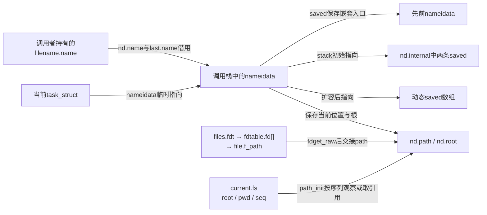
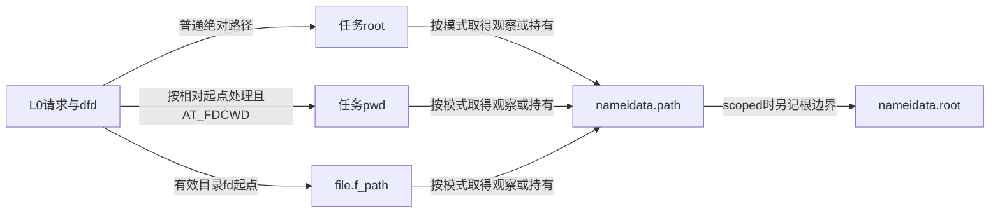
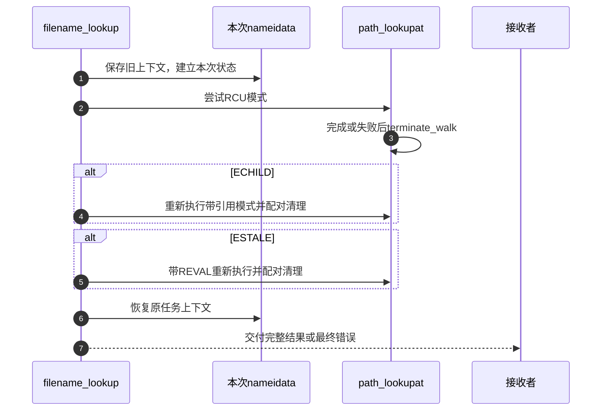

# 第13章\_路径起点与结果持有的交接

本页承接 [路径遍历导读](../navigation/P08_路径怎样从起点推进到结果交付.md#8.1_把位置文本与约束放进同一周期)，追踪 L0 起点、L4 末项及 L5 结果交接。固定 NXP Linux 6.12.20 提交 `dfaf2136deb2af2e60b994421281ba42f1c087e0`；声明和函数来自 fs/namei.c，blob `6795600c5738a56740bdeb2b4ec33f29545d918a`，版本入口为 [VFS 总索引](../navigation/P01_Linux_6.12_VFS源码阅读索引.md)。

## 13.1\_本次遍历状态与任务中的嵌套上下文

nameidata 把当前位置、根、剩余名字、链接栈和观察序列保存在同一操作上下文。对象字段不是全局路径树；同一任务发生嵌套查找时，要保存旧上下文并在结束后恢复。

```c
/** @brief 仓库补充阅读说明：保存本次位置、根、末项、模式与链接恢复状态。 */
struct nameidata {
        /* 当前位置；是否持有引用由LOOKUP_RCU及交接阶段决定。 */
        struct path     path;
        /* 末项名字视图，指向仍有效的路径或链接文本。 */
        struct qstr     last;
        /* 本次根边界，不等同于修改任务永久根。 */
        struct path     root;
        /* 当前位置inode的快捷访问，不是独立取得的inode引用。 */
        struct inode    *inode;
        /* 查找约束/模式与本次资源状态分开保存。 */
        unsigned int    flags, state;
        /* 当前位置、下一候选及挂载/改名序列样本。 */
        unsigned        seq, next_seq, m_seq, r_seq;
        /* 末项普通名、根、点或点点分类。 */
        int             last_type;
        /* 尚未退出的链接栈深度。 */
        unsigned        depth;
        /* 累计跟随预算，包含关联嵌套查找，不等于栈深度。 */
        int             total_link_count;
        struct saved {
                /* 被跟随链接自身的路径，不是目标当前位置。 */
                struct path link;
                /* 文件系统登记的文本资源清理动作。 */
                struct delayed_call done;
                /* 当前链接解释完成后恢复的旧后缀。 */
                const char *name;
                /* 该链接dentry的观察序列。 */
                unsigned seq;
        /* 优先内联存储，容量不足后指向动态数组。 */
        } *stack, internal[EMBEDDED_LEVELS];
        /* 调用者持有的路径文本容器，本上下文借用。 */
        struct filename *name;
        /* 任务先前的嵌套查找上下文。 */
        struct nameidata *saved;
        /* 根dentry的观察序列。 */
        unsigned        root_seq;
        /* 起点描述符或AT_FDCWD。 */
        int             dfd;
        /* 末项父目录经挂载idmap解释后的所有者。 */
        vfsuid_t        dir_vfsuid;
        /* 末项父目录模式，供后续策略使用。 */
        umode_t         dir_mode;
} __randomize_layout;
```

| 字段组 | 本模块的所有权与用途 |
| --- | --- |
| path、inode | 本次当前位置；带引用模式持有path，快速模式按观察协议使用 |
| root、state、root_seq | 区分预设根、自己取得的根持有和相应观察状态 |
| last、last_type | 前导遍历留下的末项，交给具体调用目的处理 |
| flags及各序列值 | 查找约束、模式和一致性凭据 |
| stack、internal、depth | 链接状态与恢复后缀，小规模使用内联数组 |
| total_link_count | 本次及相应嵌套上下文的链接预算，不是当前depth |
| saved、name、dfd | 旧任务上下文、本次路径文本及起点fd |
| dir_vfsuid、dir_mode | 末项处理需要的目录身份和模式记录 |

```c
/** @brief 仓库补充阅读说明：保存旧任务上下文并初始化本次路径和链接状态。 */
static void __set_nameidata(struct nameidata *p, int dfd, struct filename *name)
{
        /* 只挂入当前任务的上下文链，不建立全局共享状态。 */
        struct nameidata *old = current->nameidata;
        p->stack = p->internal;
        p->depth = 0;
        p->dfd = dfd;
        p->name = name;
        /* 位置初始为空；其他字段由进入相应阶段的路径初始化。 */
        p->path.mnt = NULL;
        p->path.dentry = NULL;
        /* 嵌套查找共用累计预算，不能靠另建上下文绕过限制。 */
        p->total_link_count = old ? old->total_link_count : 0;
        p->saved = old;
        /* 发布给本任务内的回调使用。 */
        current->nameidata = p;
}
```

```c
/** @brief 仓库补充阅读说明：建立上下文并标识调用者预设根。 */
static inline void set_nameidata(struct nameidata *p, int dfd, struct filename *name,
                          const struct path *root)
{
        __set_nameidata(p, dfd, name);
        /* 本次资源状态重新开始，flags由path_init写入。 */
        p->state = 0;
        if (unlikely(root)) {
                p->state = ND_ROOT_PRESET;
                /* 记录外部管理的根，本语句不额外path_get。 */
                p->root = *root;
        }
}
```

新上下文继承需要累计的链接次数，初始位置清空；可选 root 以 ND_ROOT_PRESET 标识。current->nameidata 是相关回调寻找当前遍历的入口，不是把本次状态交给其他任务任意修改。

`nameidata`、`saved` 及 `ND_*` 定义只在 `fs/namei.c` 内部使用；公开查找标志在 `include/linux/namei.h`，`filename_lookup` 的内部跨文件声明在 `fs/internal.h`。本函数族并没有“分配后全部清零”的通用前提：`__set_nameidata` 建好栈、空位置和嵌套链，`set_nameidata` 写state，随后 `path_init` 写flags、序列和实际起点。修改入口时必须保留这种先写后读关系，不能让回调读取尚未进入相应阶段的字段。

| 本次状态 | 谁建立，谁消费 | 配对约束 |
| --- | --- | --- |
| `ND_ROOT_PRESET` | `set_nameidata` 标识外部root | root本身由调用者保持有效；当前位置按模式另外取得持有 |
| `ND_ROOT_GRABBED` | `path_init/set_root`或模式交接取得root引用时写入 | `terminate_walk`据此归还，不能与PRESET等同 |
| `ND_JUMPED` | 起点、点点、挂载/链接跳转设置，普通分量可清除 | `complete_walk`结合文件系统能力决定弱验证，不是引用位 |
| `current->nameidata` / `saved` | 进入时挂入当前任务，嵌套时保存旧指针 | `restore_nameidata`恢复，不能把栈上对象指针留到函数返回后 |
| `nd.name`与`last.name` | 借用filename或链接文本中的字符串 | `filename_lookup`不执行putname；调用者必须在末项消费完成后才释放文本 |



这张图表示状态存放关系；RCU模式下的path是受保护的观察，带引用模式下才有相应mount/dentry持有。`inode`快捷字段依赖path的保护，不再独立 `ihold/iput`。改动字段或增加退出分支时，要检查普通进入、嵌套进入、入口文本错误和预设根四种调用现场。

## 13.2\_建立起点时同时确立观察或持有协议

path_init 先处理查找模式，再记录 mount 与 rename 序列。预设根、普通绝对路径、cwd 和目录 fd 分别进入不同分支；LOOKUP_IN_ROOT 会改变绝对路径对起点的选择。

```c
/** @brief 仓库补充阅读说明：按输入及约束建立起点，配对观察或路径持有。 */
static const char *path_init(struct nameidata *nd, unsigned flags)
{
        int error;
        const char *s = nd->name->name;

        /* 仅缓存请求若以非RCU模式进入，立即要求EAGAIN。 */
        if ((flags & (LOOKUP_RCU | LOOKUP_CACHED)) == LOOKUP_CACHED)
                return ERR_PTR(-EAGAIN);

        /* 空文本特殊处理，不启动RCU遍历。 */
        if (!*s)
                flags &= ~LOOKUP_RCU;
        if (flags & LOOKUP_RCU)
                rcu_read_lock();
        else
                nd->seq = nd->next_seq = 0;

        nd->flags = flags;
        nd->state |= ND_JUMPED;

        /* 同时采样两套全局拓扑序列，再建立读侧排序。 */
        nd->m_seq = __read_seqcount_begin(&mount_lock.seqcount);
        nd->r_seq = __read_seqcount_begin(&rename_lock.seqcount);
        smp_rmb();

        /* 预设根的生命期由调用者保证；当前位置另按模式持有。 */
        if (nd->state & ND_ROOT_PRESET) {
                struct dentry *root = nd->root.dentry;
                struct inode *inode = root->d_inode;
                /* 有实际分量才要求起点能搜索目录。 */
                if (*s && unlikely(!d_can_lookup(root)))
                        return ERR_PTR(-ENOTDIR);
                nd->path = nd->root;
                nd->inode = inode;
                if (flags & LOOKUP_RCU) {
                        nd->seq = read_seqcount_begin(&nd->path.dentry->d_seq);
                        nd->root_seq = nd->seq;
                } else {
                        path_get(&nd->path);
                }
                return s;
        }

        nd->root.mnt = NULL;

        /* 普通绝对路径使用任务根，IN_ROOT则使用下面的dfd起点。 */
        if (*s == '/' && !(flags & LOOKUP_IN_ROOT)) {
                error = nd_jump_root(nd);
                if (unlikely(error))
                        return ERR_PTR(error);
                return s;
        }

        if (nd->dfd == AT_FDCWD) {
                if (flags & LOOKUP_RCU) {
                        struct fs_struct *fs = current->fs;
                        unsigned seq;

                        do {
                                /* pwd的mount和dentry作为一对读取，序列变化则重试。 */
                                seq = read_seqcount_begin(&fs->seq);
                                nd->path = fs->pwd;
                                nd->inode = nd->path.dentry->d_inode;
                                nd->seq = __read_seqcount_begin(&nd->path.dentry->d_seq);
                        } while (read_seqcount_retry(&fs->seq, seq));
                } else {
                        /* 在fs锁内复制并取得path持有。 */
                        get_fs_pwd(current->fs, &nd->path);
                        nd->inode = nd->path.dentry->d_inode;
                }
        } else {

                /* 允许O_PATH作为起点；fd返回值还携带归还责任。 */
                struct fd f = fdget_raw(nd->dfd);
                struct dentry *dentry;

                if (!fd_file(f))
                        return ERR_PTR(-EBADF);

                /* 空路径linkat要额外核对打开凭据与能力。 */
                if (flags & LOOKUP_LINKAT_EMPTY) {
                        if (fd_file(f)->f_cred != current_cred() &&
                            !ns_capable(fd_file(f)->f_cred->user_ns, CAP_DAC_READ_SEARCH)) {
                                /* 归还临时file访问责任；真正path持有须已交接。 */
                                fdput(f);
                                return ERR_PTR(-ENOENT);
                        }
                }

                dentry = fd_file(f)->f_path.dentry;

                /* 有实际分量才要求起点能搜索目录。 */
                if (*s && unlikely(!d_can_lookup(dentry))) {
                        /* 归还临时file访问责任；真正path持有须已交接。 */
                        fdput(f);
                        return ERR_PTR(-ENOTDIR);
                }

                nd->path = fd_file(f)->f_path;
                if (flags & LOOKUP_RCU) {
                        nd->inode = nd->path.dentry->d_inode;
                        nd->seq = read_seqcount_begin(&nd->path.dentry->d_seq);
                } else {
                        path_get(&nd->path);
                        nd->inode = nd->path.dentry->d_inode;
                }
                /* 归还临时file访问责任；真正path持有须已交接。 */
                fdput(f);
        }

        /* 受限查找将相对起点同时作为本次根边界。 */
        if (flags & LOOKUP_IS_SCOPED) {
                nd->root = nd->path;
                if (flags & LOOKUP_RCU) {
                        nd->root_seq = nd->seq;
                } else {
                        path_get(&nd->root);
                        /* 记录独立root持有，统一退出时据此归还。 */
                        nd->state |= ND_ROOT_GRABBED;
                }
        }
        return s;
}
```

RCU 模式读取 fs_struct 或 dentry 时保存并检查相应序列；带引用模式通过 get_fs_pwd/path_get 取得持有。目录 fd 取到 file 后，带引用路径要在 fdput 前另取 path 持有；不能把临时 fd 访问结束后仍有 file 指针当作所有权证明。

scoped 查找还把起点保存为本次 root，并区分快速观察与独立 root 持有。LOOKUP_CACHED 不允许静默转为任意慢查询，模式不符合时返回 EAGAIN。任何失败出口仍要由外层配对 terminate_walk。



临时描述符访问的责任位由 `fdget_raw/fdput` 配对，O_PATH不被这个raw入口过滤；具体见 [轻量借用](P28_描述符查询的引用验证与轻量借用.md#28.2_不共享表时的借用有严格使用范围)。`fd_file`取得真正file指针，并不抹去fdput责任。`LOOKUP_LINKAT_EMPTY` 的凭据比较和 `ns_capable(..., CAP_DAC_READ_SEARCH)` 是额外许可检查，拒绝用ENOENT返回；不能按“已有fd就有全部权限”删除它。

`get_fs_pwd` 在fs锁内取得持有，RCU分支则用fs.seq保护mount/dentry成对读取；相关写入与持有配对见 [fs_struct初始化和交接](P02_路径名称与实例的字段关系.md#2.5_从任务起点更新追踪到路径读取)。`d_can_lookup`检查dentry目录类型能力，不在这里执行目录搜索权限检查。根跳转实现见 [nd_jump_root](P15_符号链接的文本栈与路径跳转.md#15.3_根跳转与直接路径跳转不是同一种输入)。

修改起点选择至少要覆盖绝对路径、IN_ROOT、cwd、普通目录fd、O_PATH、坏fd、空路径以及预设root。非空路径的搜索权限在分量推进时检查；路径文本能否为空还受外层接口约束。这里的RCU模式要求不能压成“所有空路径也必须开启RCU”，代码明确对空文本清除此模式。

## 13.3\_结束验证把快速观察变成可交付结果

complete_walk 不重新解析全部文本。它在需要时取得稳定持有，对 scoped 结果做最终范围检查，并按 ND_JUMPED 与文件系统能力决定是否执行弱重新验证。弱验证返回0会转为 ESTALE，供上层重试协议识别。

```c
/** @brief 仓库补充阅读说明：完成模式持有交接、范围检查和必要的弱验证。 */
static int complete_walk(struct nameidata *nd)
{
        struct dentry *dentry = nd->path.dentry;
        int status;

        if (nd->flags & LOOKUP_RCU) {

                /* 普通快速查询不再需要的根观察可丢弃；预设和受限根保留。 */
                if (!(nd->state & ND_ROOT_PRESET))
                        if (!(nd->flags & LOOKUP_IS_SCOPED))
                                nd->root.mnt = NULL;
                /* 允许最后仅做持有交接，不授权重新发起后端慢查找。 */
                nd->flags &= ~LOOKUP_CACHED;
                /* 持有交接失败请求外层重走，不把观察指针交给调用者。 */
                if (!try_to_unlazy(nd))
                        return -ECHILD;
        }

        if (unlikely(nd->flags & LOOKUP_IS_SCOPED)) {

                /* 返回结果前再次核对受限根；不冻结后续外部rename。 */
                if (!path_is_under(&nd->path, &nd->root))
                        return -EXDEV;
        }

        /* 只有跨越类变化并具备回调时才做弱重新验证。 */
        if (likely(!(nd->state & ND_JUMPED)))
                return 0;

        if (likely(!(dentry->d_flags & DCACHE_OP_WEAK_REVALIDATE)))
                return 0;

        status = dentry->d_op->d_weak_revalidate(dentry, nd->flags);
        if (status > 0)
                return 0;

        /* 无效结果改成ESTALE，保留其他负错误。 */
        if (!status)
                status = -ESTALE;

        return status;
}
```

最终范围检查说明被解析对象在相应时点满足范围要求，不承诺其他任务在返回后永远不能移动它。快速观察取得引用失败则返回 ECHILD；这不是普通应用层“没有子进程”的含义，而是本调用链请求更稳定遍历的内部协议。

`try_to_unlazy` 的唯一交接实现见 [全部必要持有](P17_从RCU观察交接到路径引用.md#17.4_全部必要持有取得后才退出RCU)。`complete_walk` 清除LOOKUP_CACHED，是允许把已经解析出的观察结果转换为可交付持有；它没有重新发起后端查询，也不使前面缓存约束失效。普通临时root可在此丢弃，scoped或外部预设root仍参与后续边界判断。

`path_is_under`是挂载/目录层级检查；`DCACHE_OP_WEAK_REVALIDATE`是dentry回调能力标志。弱验证返回正数接受、0转ESTALE、负数按原错误传播。修改结束验证要同时检查普通结果、不需要弱验证的结果、跳转后的弱验证、scoped拒绝和引用交接失败，不能为了少一次检查直接把“走到末项”当成“可交付”。

## 13.4\_普通全路径与父路径在最后分量处分流

path_lookupat 把 path_init、前导遍历和 lookup_last 串起来；末项链接返回新的文本时继续循环。成功且通过完整验证后，把 nd.path 转给输出并清空原字段，避免 terminate_walk 再次归还已经交付的持有。

```c
/** @brief 仓库补充阅读说明：推进普通全路径，成功转移结果，所有出口清理。 */
static int path_lookupat(struct nameidata *nd, unsigned flags, struct path *path)
{
        /* 起点可能返回错误指针，前导解析负责识别。 */
        const char *s = path_init(nd, flags);
        int err;

        /* 按请求在起点向下处理挂载，不跟随链接。 */
        if (unlikely(flags & LOOKUP_DOWN) && !IS_ERR(s)) {
                err = handle_lookup_down(nd);
                if (unlikely(err < 0))
                        s = ERR_PTR(err);
        }

        /* 前导完成后再处理末项；末项链接文本会进入下一轮。 */
        while (!(err = link_path_walk(s, nd)) &&
               (s = lookup_last(nd)) != NULL)
                ;
        if (!err && unlikely(nd->flags & LOOKUP_MOUNTPOINT)) {
                err = handle_lookup_down(nd);
                /* 挂载点查询主动取消最后弱验证要求。 */
                nd->state &= ~ND_JUMPED;
        }
        if (!err)
                err = complete_walk(nd);

        if (!err && nd->flags & LOOKUP_DIRECTORY)
                if (!d_can_lookup(nd->path.dentry))
                        err = -ENOTDIR;
        if (!err) {
                /* 把已经合法化的持有转给输出，随后清空旧责任位置。 */
                *path = nd->path;
                nd->path.mnt = NULL;
                nd->path.dentry = NULL;
        }
        /* 成功和失败都配对释放剩余资源。 */
        terminate_walk(nd);
        return err;
}
```

父路径请求只处理前导部分，并将父 path 交付；末项仍由调用者按创建、删除或其他目的处理。不能根据两个函数相似就将父查询补上 lookup_last，否则改变了调用契约。

```c
/** @brief 仓库补充阅读说明：只交付前导解析后的父路径，将末项留给上层。 */
static int path_parentat(struct nameidata *nd, unsigned flags,
                                struct path *parent)
{
        const char *s = path_init(nd, flags);
        /* 只推进前导，last仍留给创建/删除等调用者处理。 */
        int err = link_path_walk(s, nd);
        if (!err)
                err = complete_walk(nd);
        if (!err) {
                /* 父路径持有转出；不在此调用lookup_last。 */
                *parent = nd->path;
                nd->path.mnt = NULL;
                nd->path.dentry = NULL;
        }
        /* 清理剩余链接/root，已转出的path不再归还。 */
        terminate_walk(nd);
        return err;
}
```

两条成功路径都采用“转移结果后清空原持有”的方式；失败则没有完整结果可交付，仍走统一清理。普通打开有另一个末项处理链，本页不把 filename_lookup 声称为所有 open 的唯一入口。

`LOOKUP_DOWN`要求在起点处理向下挂载，`LOOKUP_MOUNTPOINT`要求在末端处理；辅助 `handle_lookup_down` 在带引用模式先dget当前dentry，将seq交给next_seq，然后以 `WALK_NOFOLLOW` 调用step_into。它把当前位置作为一个需消费的候选交给单步协议，不是在原持有之外凭空多留一个引用。末端挂载点请求还清ND_JUMPED，明确跳过最后弱验证。

前导/末项的唯一实现见 [分量推进](P14_前导分量与单步位置推进.md#14.1_拆分时保留最后名字而不是提前执行末项操作) 和 [普通末项](P14_前导分量与单步位置推进.md#14.2_普通名字查询和点分量走不同的单步入口)。`IS_ERR/ERR_PTR/PTR_ERR`在这些文本返回处承载错误，NULL则可以表示没有更多链接文本；调用者必须先识别返回形态，不能把错误值当字符串扫描。

修改结果交付时以“输出获得原持有，nd.path随即清空”为最小不变量；不能只复制指针而让统一退出再次put。父路径接口保留last的借用文本，普通全路径接口交付最终path，两者的调用方不应合并成一种末项处理。

## 13.5\_重试必须在前一次资源清理之后进行

filename_lookup 建立任务上下文，先以 RCU 模式执行；ECHILD 时重新做带引用查询，ESTALE 时再带 LOOKUP_REVAL 重查。这个有限的分支不是对所有错误重试，也不保证所有请求都能从缓存限制中回退成功。

```c
/** @brief 仓库补充阅读说明：建立上下文，按特定错误进行有限的模式或验证重试。 */
int filename_lookup(int dfd, struct filename *name, unsigned flags,
                    struct path *path, struct path *root)
{
        int retval;
        /* 本次状态在调用栈上，其地址临时挂入current。 */
        struct nameidata nd;
        /* 文本取得失败尚未建立上下文，直接传播错误。 */
        if (IS_ERR(name))
                return PTR_ERR(name);
        set_nameidata(&nd, dfd, name, root);
        /* 每一次尝试内部都完成terminate_walk后才返回。 */
        retval = path_lookupat(&nd, flags | LOOKUP_RCU, path);
        /* 仅此错误要求带引用重新遍历。 */
        if (unlikely(retval == -ECHILD))
                /* 每一次尝试内部都完成terminate_walk后才返回。 */
                retval = path_lookupat(&nd, flags, path);
        /* 旧结果失效才增加强制重新验证，不对所有错误循环。 */
        if (unlikely(retval == -ESTALE))
                /* 每一次尝试内部都完成terminate_walk后才返回。 */
                retval = path_lookupat(&nd, flags | LOOKUP_REVAL, path);

        if (likely(!retval))
                /* 成功后记录审计，不取得输出path的另一份持有。 */
                audit_inode(name, path->dentry,
                            flags & LOOKUP_MOUNTPOINT ? AUDIT_INODE_NOEVAL : 0);
        /* 恢复嵌套上下文并释放动态栈，filename仍由调用者管理。 */
        restore_nameidata();
        return retval;
}
```



`audit_inode`位于成功查找之后，按 `AUDIT_INODE_NOEVAL` 等标记记录本次对象，不负责取得path或准许访问。当前 `CONFIG_AUDIT=n`，相关调用为空桩；开启系统调用审计后仍要看当前任务是否有有效审计上下文，见 [audit.h](../../linux/include/linux/audit.h)。这与可以返回拒绝错误的安全hook不同。

每次 `path_lookupat` 都先清理再返回，但同一个nameidata中的累计链接预算不会在这些有限重试之间重新清零。修改重试规则时要同步考虑LOOKUP_CACHED、ESTALE、ECHILD和预算消耗，避免用无上限重试掩盖持续变化。输入filename的取得和释放由外层负责，不能在某次重试结束后提前释放借用文本。

## 13.6\_退出要分别处理链接资源路径引用和任务上下文

terminate_walk 先执行剩余链接的延后清理动作，再按当前模式归还 path、链接栈中的 path 和本次取得的 root，或退出 RCU 临界区。成功交付的 nd.path 已清空，不在这里重复归还。

```c
/** @brief 仓库补充阅读说明：按当前模式清理链接资源和临时路径并退出观察。 */
static void terminate_walk(struct nameidata *nd)
{
        /* 先清理文本资源，路径引用尚在，可供清理回调使用。 */
        drop_links(nd);
        /* 按实际模式归还持有；不能对未持有的观察指针path_put。 */
        if (!(nd->flags & LOOKUP_RCU)) {
                int i;
                path_put(&nd->path);
                for (i = 0; i < nd->depth; i++)
                        path_put(&nd->stack[i].link);
                /* 只归还本次额外取得的root，外部预设根不在此消费。 */
                if (nd->state & ND_ROOT_GRABBED) {
                        path_put(&nd->root);
                        nd->state &= ~ND_ROOT_GRABBED;
                }
        } else {
                /* 清RCU模式及序列后退出读侧。 */
                leave_rcu(nd);
        }
        /* 清理完后清空本次资源状态，支持外层有限重试。 */
        nd->depth = 0;
        nd->path.mnt = NULL;
        nd->path.dentry = NULL;
}
```

```c
/** @brief 仓库补充阅读说明：恢复原任务上下文，回传预算并释放动态栈。 */
static void restore_nameidata(void)
{
        struct nameidata *now = current->nameidata, *old = now->saved;

        /* 先恢复旧上下文，避免任务仍指向即将退出的栈对象。 */
        current->nameidata = old;
        if (old)
                /* 把嵌套期间消耗的预算交回外层。 */
                old->total_link_count = now->total_link_count;
        /* 只释放动态数组；各条链接资源已由terminate_walk处理。 */
        if (now->stack != now->internal)
                kfree(now->stack);
}
```

restore_nameidata 恢复先前任务上下文、回传累计链接次数，并释放动态栈。链接资源、路径引用和上下文恢复是三个配对责任，不能只释放 nameidata 的内存就算结束。drop_links 的唯一实现见 [链接退出](P15_符号链接的文本栈与路径跳转.md#15.4_完成或失败都要归还链接资源)。本页没有目标并发查找或故障注入记录，返回 [导读](../navigation/P08_路径怎样从起点推进到结果交付.md#8.2_沿阶段查找实现与后续边界)。


`leave_rcu`是同文件私有辅助：清LOOKUP_RCU、把seq/next_seq置零，再执行rcu_read_unlock。它不是“把所有观察自动变成引用”；交接失败时已取得哪些持有由对应合法化函数留下可清理的状态。`restore_nameidata`只处理嵌套链与栈数组，不能代替terminate_walk对每条记录的退出。

因此修改退出应分别验证成功转移、起点失败、半途链接失败、模式交接部分成功、嵌套恢复和动态栈分配。`__randomize_layout`允许布局随机化，但不替代码建立资源顺序；不能根据结构体字段排列推断析构顺序。本页保留完整这组函数，描述符、挂载合法化和链接回调通过精确入口追踪，不复制其框架实现。
