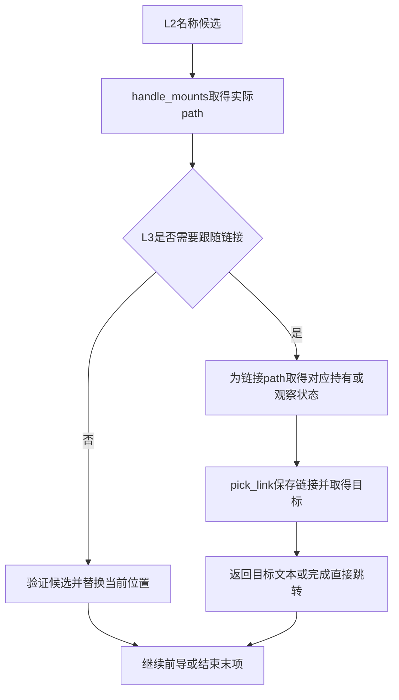
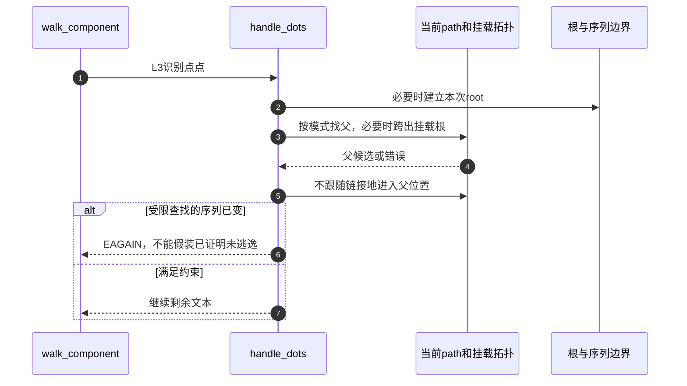

# 第14章\_前导分量与单步位置推进

本页兑现 [路径遍历导读](../navigation/P08_路径怎样从起点推进到结果交付.md#8.1_把位置文本与约束放进同一周期) 的 L1～L4。固定 NXP Linux 6.12.20 提交 `dfaf2136deb2af2e60b994421281ba42f1c087e0`，函数来自 fs/namei.c；版本与原件入口见 [VFS 总索引](../navigation/P01_Linux_6.12_VFS源码阅读索引.md)。

## 14.1\_拆分时保留最后名字而不是提前执行末项操作

link_path_walk 跳过分隔符，检查当前位置的目录搜索权限，再把本分量放入 last，并区分普通名、点与点点。普通名字还可能需要文件系统自己的哈希处理。它主要推进前导部分，最后名称留给调用目的决定。

```c
/** @brief 仓库补充阅读说明：拆分并推进前导分量，保存链接后缀并留下最后名称。 */
static int link_path_walk(const char *name, struct nameidata *nd)
{
        int depth = 0; // depth <= nd->depth
        int err;

        nd->last_type = LAST_ROOT;
        nd->flags |= LOOKUP_PARENT;
        if (IS_ERR(name))
                return PTR_ERR(name);
        while (*name=='/')
                name++;
        if (!*name) {
                nd->dir_mode = 0; // short-circuit the 'hardening' idiocy
                return 0;
        }

        /* At this point we know we have a real path component. */
        for(;;) {
                struct mnt_idmap *idmap;
                const char *link;
                unsigned long lastword;

                idmap = mnt_idmap(nd->path.mnt);
                err = may_lookup(idmap, nd);
                if (err)
                        return err;

                nd->last.name = name;
                name = hash_name(nd, name, &lastword);

                switch(lastword) {
                case LAST_WORD_IS_DOTDOT:
                        nd->last_type = LAST_DOTDOT;
                        nd->state |= ND_JUMPED;
                        break;

                case LAST_WORD_IS_DOT:
                        nd->last_type = LAST_DOT;
                        break;

                default:
                        nd->last_type = LAST_NORM;
                        nd->state &= ~ND_JUMPED;

                        struct dentry *parent = nd->path.dentry;
                        if (unlikely(parent->d_flags & DCACHE_OP_HASH)) {
                                err = parent->d_op->d_hash(parent, &nd->last);
                                if (err < 0)
                                        return err;
                        }
                }

                if (!*name)
                        goto OK;
                /*
                 * If it wasn't NUL, we know it was '/'. Skip that
                 * slash, and continue until no more slashes.
                 */
                do {
                        name++;
                } while (unlikely(*name == '/'));
                if (unlikely(!*name)) {
OK:
                        /* pathname or trailing symlink, done */
                        if (!depth) {
                                nd->dir_vfsuid = i_uid_into_vfsuid(idmap, nd->inode);
                                nd->dir_mode = nd->inode->i_mode;
                                nd->flags &= ~LOOKUP_PARENT;
                                return 0;
                        }
                        /* last component of nested symlink */
                        name = nd->stack[--depth].name;
                        link = walk_component(nd, 0);
                } else {
                        /* not the last component */
                        link = walk_component(nd, WALK_MORE);
                }
                if (unlikely(link)) {
                        if (IS_ERR(link))
                                return PTR_ERR(link);
                        /* a symlink to follow */
                        nd->stack[depth++].name = name;
                        name = link;
                        continue;
                }
                if (unlikely(!d_can_lookup(nd->path.dentry))) {
                        if (nd->flags & LOOKUP_RCU) {
                                if (!try_to_unlazy(nd))
                                        return -ECHILD;
                        }
                        return -ENOTDIR;
                }
        }
}
```

遇到嵌套链接时，局部 depth 配合 nd.stack 保存原后缀；链接目标走完后恢复后缀继续。这两个深度变量承担相关但不同的遍历与资源职责，不能把其中一个当成全局跟随次数。错误文本指针、权限失败、非目录以及链接错误都需要返回上层统一清理。

到末项时记录目录身份与模式，清除本段 LOOKUP_PARENT 并返回；这一步没有无条件进入最终对象。若后面还有普通分量，当前位置必须仍可作为目录搜索，不能因名字里有 `..` 而跳过这一要求。

## 14.2\_普通名字查询和点分量走不同的单步入口

walk_component 先检查 last_type。点分量交给 handle_dots；普通名字先查快速候选，没有可用候选再走慢查找，得到候选后交给 step_into 处理挂载与链接。出错指针直接向上返回，不会拿它当 dentry 解引用。

```c
/** @brief 仓库补充阅读说明：按名字分类选择查询或点分量处理，再进入候选。 */
static const char *walk_component(struct nameidata *nd, int flags)
{
        struct dentry *dentry;
        /*
         * "." and ".." are special - ".." especially so because it has
         * to be able to know about the current root directory and
         * parent relationships.
         */
        if (unlikely(nd->last_type != LAST_NORM)) {
                if (!(flags & WALK_MORE) && nd->depth)
                        put_link(nd);
                return handle_dots(nd, nd->last_type);
        }
        dentry = lookup_fast(nd);
        if (IS_ERR(dentry))
                return ERR_CAST(dentry);
        if (unlikely(!dentry)) {
                dentry = lookup_slow(&nd->last, nd->path.dentry, nd->flags);
                if (IS_ERR(dentry))
                        return ERR_CAST(dentry);
        }
        if (!(flags & WALK_MORE) && nd->depth)
                put_link(nd);
        return step_into(nd, flags, dentry);
}
```

```c
/** @brief 仓库补充阅读说明：为普通末项的尾斜杠补充跟随与目录要求。 */
static inline const char *lookup_last(struct nameidata *nd)
{
        if (nd->last_type == LAST_NORM && nd->last.name[nd->last.len])
                nd->flags |= LOOKUP_FOLLOW | LOOKUP_DIRECTORY;

        return walk_component(nd, WALK_TRAILING);
}
```

lookup_last 给末尾带斜杠的普通名称增加 FOLLOW 与 DIRECTORY 要求，再用 WALK_TRAILING 表明正在处理末项。WALK_MORE、WALK_TRAILING 和 WALK_NOFOLLOW 属于内部单步控制，与公开 openat2 的 RESOLVE_* 不是同一组位值。

lookup_fast/lookup_slow 的并发验证、等待及回退在快速/带引用遍历模块展开。这里的边界是输入一个父位置和 last，取得可按当前模式使用的候选，不能因为名字叫“fast”就跳过验证。

## 14.3\_进入候选前先处理挂载再决定是否跟随链接

step_into 首先调用 handle_mounts，得到实际候选 path。它可能已经跨到另一个挂载根，因此后续 inode 和链接类型必须从新的 path 读取，不能继续使用跨越前的 inode。

```c
/** @brief 仓库补充阅读说明：处理挂载后决定位置替换或链接跟随。 */
static const char *step_into(struct nameidata *nd, int flags,
                     struct dentry *dentry)
{
        struct path path;
        struct inode *inode;
        int err = handle_mounts(nd, dentry, &path);

        if (err < 0)
                return ERR_PTR(err);
        inode = path.dentry->d_inode;
        if (likely(!d_is_symlink(path.dentry)) ||
           ((flags & WALK_TRAILING) && !(nd->flags & LOOKUP_FOLLOW)) ||
           (flags & WALK_NOFOLLOW)) {
                /* not a symlink or should not follow */
                if (nd->flags & LOOKUP_RCU) {
                        if (read_seqcount_retry(&path.dentry->d_seq, nd->next_seq))
                                return ERR_PTR(-ECHILD);
                        if (unlikely(!inode))
                                return ERR_PTR(-ENOENT);
                } else {
                        dput(nd->path.dentry);
                        if (nd->path.mnt != path.mnt)
                                mntput(nd->path.mnt);
                }
                nd->path = path;
                nd->inode = inode;
                nd->seq = nd->next_seq;
                return NULL;
        }
        if (nd->flags & LOOKUP_RCU) {
                /* make sure that d_is_symlink above matches inode */
                if (read_seqcount_retry(&path.dentry->d_seq, nd->next_seq))
                        return ERR_PTR(-ECHILD);
        } else {
                if (path.mnt == nd->path.mnt)
                        mntget(path.mnt);
        }
        return pick_link(nd, &path, inode, flags);
}
```

不需跟随链接时，RCU 模式检查 next_seq 并拒绝无 inode 结果；带引用模式归还旧当前位置的 dentry，以及确实发生 mount 变化时的旧 mount 持有，随后更新 nd.path/inode/seq。

需要跟随链接时，当前位置仍承担解释相对目标的基点，链接自身的 path 另交给 pick_link 保存。若没有换 mount，带引用分支还要补一份 mount 持有给链接栈，避免把当前路径和栈的所有权混为一份。



## 14.4\_向上走需要同时考虑根边界与挂载根

普通 `..` 不能总是读取 d_parent。follow_dotdot 在当前 path 等于本次 root 时处理边界；在 mount 根时先选择外部接入位置，再取得父 dentry，并检查它仍在该挂载根的范围内。

```c
/** @brief 仓库补充阅读说明：带引用地处理根边界和挂载根的向上路径。 */
static struct dentry *follow_dotdot(struct nameidata *nd)
{
        struct dentry *parent;

        if (path_equal(&nd->path, &nd->root))
                goto in_root;
        if (unlikely(nd->path.dentry == nd->path.mnt->mnt_root)) {
                struct path path;

                if (!choose_mountpoint(real_mount(nd->path.mnt),
                                       &nd->root, &path))
                        goto in_root;
                path_put(&nd->path);
                nd->path = path;
                nd->inode = path.dentry->d_inode;
                if (unlikely(nd->flags & LOOKUP_NO_XDEV))
                        return ERR_PTR(-EXDEV);
        }
        /* rare case of legitimate dget_parent()... */
        parent = dget_parent(nd->path.dentry);
        if (unlikely(!path_connected(nd->path.mnt, parent))) {
                dput(parent);
                return ERR_PTR(-ENOENT);
        }
        return parent;

in_root:
        if (unlikely(nd->flags & LOOKUP_BENEATH))
                return ERR_PTR(-EXDEV);
        return dget(nd->path.dentry);
}
```

普通根边界处取得当前位置的持有，不继续向外；LOOKUP_BENEATH 则拒绝越过边界。跨挂载且禁止 NO_XDEV 时返回 EXDEV。原 path 已按具体分支更新或归还，失败后仍由 terminate_walk 清理当前状态，不允许调用者凭猜测再释放旧路径一次。

## 14.5\_受限点点查找还要检测并发拓扑改变

handle_dots 在需要时先建立 root，按当前模式选择向上路径，然后以 WALK_NOFOLLOW 进入所得父位置。scoped 查找在执行 `..` 后检查 mount 与 rename 序列；变化使它无法可靠排除逃出范围时返回 EAGAIN。

```c
/** @brief 仓库补充阅读说明：按模式处理上行，并检查受限解析中的拓扑变化。 */
static const char *handle_dots(struct nameidata *nd, int type)
{
        if (type == LAST_DOTDOT) {
                const char *error = NULL;
                struct dentry *parent;

                if (!nd->root.mnt) {
                        error = ERR_PTR(set_root(nd));
                        if (error)
                                return error;
                }
                if (nd->flags & LOOKUP_RCU)
                        parent = follow_dotdot_rcu(nd);
                else
                        parent = follow_dotdot(nd);
                if (IS_ERR(parent))
                        return ERR_CAST(parent);
                error = step_into(nd, WALK_NOFOLLOW, parent);
                if (unlikely(error))
                        return error;

                if (unlikely(nd->flags & LOOKUP_IS_SCOPED)) {
                        /*
                         * If there was a racing rename or mount along our
                         * path, then we can't be sure that ".." hasn't jumped
                         * above nd->root (and so userspace should retry or use
                         * some fallback).
                         */
                        smp_rmb();
                        if (__read_seqcount_retry(&mount_lock.seqcount, nd->m_seq))
                                return ERR_PTR(-EAGAIN);
                        if (__read_seqcount_retry(&rename_lock.seqcount, nd->r_seq))
                                return ERR_PTR(-EAGAIN);
                }
        }
        return NULL;
}
```



RCU 版本 follow_dotdot_rcu 还有读侧序列及合法性检查，留在模式比较中展开，不能直接拿此带引用版本的代码替换。这里的重试提示不是要求用户等待某个固定时间；它说明本次观察不足以兑现约束。返回 [模块导读](../navigation/P08_路径怎样从起点推进到结果交付.md#8.2_沿阶段查找实现与后续边界)。
