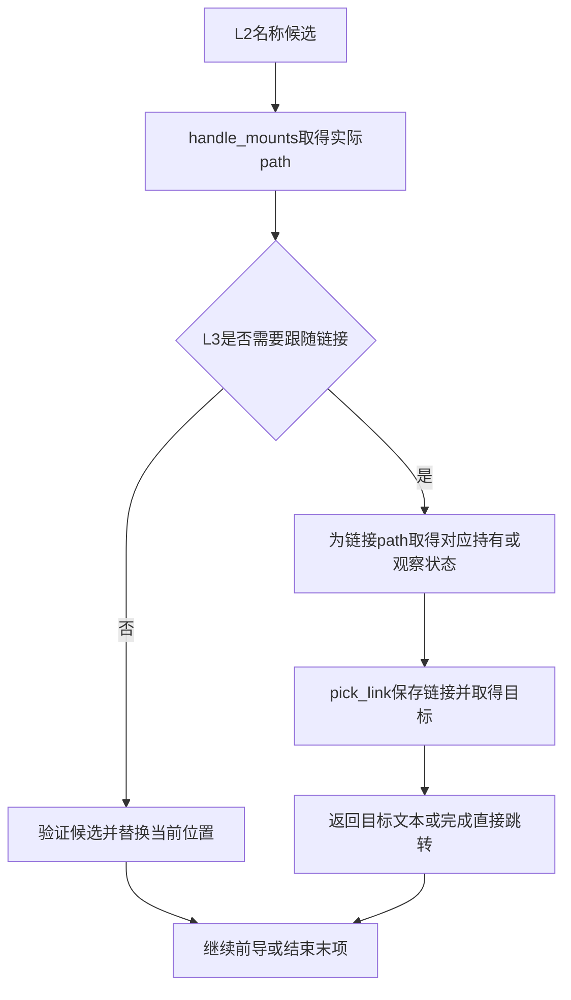
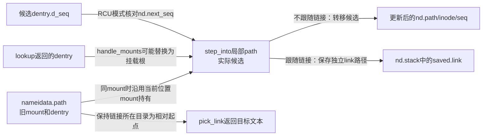
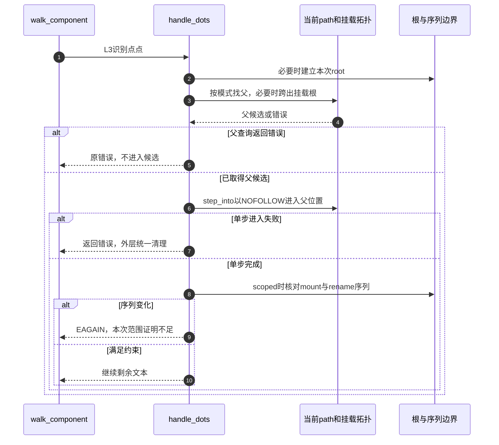

# 第14章\_前导分量与单步位置推进

本页兑现 [路径遍历导读](../navigation/P08_路径怎样从起点推进到结果交付.md#8.1_把位置文本与约束放进同一周期) 的 L1～L4。固定 NXP Linux 6.12.20 提交 `dfaf2136deb2af2e60b994421281ba42f1c087e0`，函数来自 fs/namei.c；版本与原件入口见 [VFS 总索引](../navigation/P01_Linux_6.12_VFS源码阅读索引.md)。

## 14.1\_拆分时保留最后名字而不是提前执行末项操作

link_path_walk 跳过分隔符，检查当前位置的目录搜索权限，再把本分量放入 last，并区分普通名、点与点点。普通名字还可能需要文件系统自己的哈希处理。它主要推进前导部分，最后名称留给调用目的决定。

```c
/** @brief 仓库补充阅读说明：拆分并推进前导分量，保存链接后缀并留下最后名称。 */
static int link_path_walk(const char *name, struct nameidata *nd)
{
        /* 局部后缀恢复深度，可能小于资源栈nd->depth。 */
        int depth = 0;
        int err;

        /* 空路径或纯斜杠尚无普通末项。 */
        nd->last_type = LAST_ROOT;
        nd->flags |= LOOKUP_PARENT;
        /* 上游错误文本指针不参与字符扫描。 */
        if (IS_ERR(name))
                return PTR_ERR(name);
        while (*name=='/')
                name++;
        if (!*name) {
                nd->dir_mode = 0;
                return 0;
        }

        for(;;) {
                struct mnt_idmap *idmap;
                const char *link;
                unsigned long lastword;

                idmap = mnt_idmap(nd->path.mnt);
                /* 先检查当前目录搜索许可，不能把命中缓存当成免权限。 */
                err = may_lookup(idmap, nd);
                if (err)
                        return err;

                nd->last.name = name;
                /* 填充当前last的hash_len，并返回分量末尾位置。 */
                name = hash_name(nd, name, &lastword);

                switch(lastword) {
                case LAST_WORD_IS_DOTDOT:
                        nd->last_type = LAST_DOTDOT;
                        /* 点点可能跨拓扑，需要后续跳转验证。 */
                        nd->state |= ND_JUMPED;
                        break;

                case LAST_WORD_IS_DOT:
                        nd->last_type = LAST_DOT;
                        break;

                default:
                        nd->last_type = LAST_NORM;
                        /* 普通分量重新通过名称查找建立位置。 */
                        nd->state &= ~ND_JUMPED;

                        struct dentry *parent = nd->path.dentry;
                        /* 按文件系统命名规则调整qstr，错误向上传播。 */
                        if (unlikely(parent->d_flags & DCACHE_OP_HASH)) {
                                err = parent->d_op->d_hash(parent, &nd->last);
                                if (err < 0)
                                        return err;
                        }
                }

                if (!*name)
                        goto OK;

                do {
                        name++;
                } while (unlikely(*name == '/'));
                if (unlikely(!*name)) {
OK:

                        /* 没有待恢复的本轮链接后缀时，将末项留给上层。 */
                        if (!depth) {
                                nd->dir_vfsuid = i_uid_into_vfsuid(idmap, nd->inode);
                                nd->dir_mode = nd->inode->i_mode;
                                nd->flags &= ~LOOKUP_PARENT;
                                return 0;
                        }

                        /* 恢复被链接目标暂时打断的旧文本。 */
                        name = nd->stack[--depth].name;
                        link = walk_component(nd, 0);
                } else {

                        link = walk_component(nd, WALK_MORE);
                }
                if (unlikely(link)) {
                        if (IS_ERR(link))
                                return PTR_ERR(link);

                        /* 保存后缀；链接自身资源已由pick_link登记到栈。 */
                        nd->stack[depth++].name = name;
                        name = link;
                        continue;
                }
                /* 仍有后续分量时当前位置必须可作为目录。 */
                if (unlikely(!d_can_lookup(nd->path.dentry))) {
                        if (nd->flags & LOOKUP_RCU) {
                                if (!try_to_unlazy(nd))
                                        return -ECHILD;
                        }
                        return -ENOTDIR;
                }
        }
}
```

遇到嵌套链接时，局部 depth 配合 nd.stack 保存原后缀；链接目标走完后恢复后缀继续。这两个深度变量承担相关但不同的遍历与资源职责，不能把其中一个当成全局跟随次数。错误文本指针、权限失败、非目录以及链接错误都需要返回上层统一清理。

到末项时记录目录身份与模式，清除本段 LOOKUP_PARENT 并返回；这一步没有无条件进入最终对象。若后面还有普通分量，当前位置必须仍可作为目录搜索，不能因名字里有 `..` 而跳过这一要求。

本页函数均为 `fs/namei.c` 私有实现，消费 [nameidata字段与初始化](P13_路径起点与结果持有的交接.md#13.1_本次遍历状态与任务中的嵌套上下文)。`LAST_NORM/ROOT/DOT/DOTDOT`在namei.h定义，是末项分类；`WALK_MORE/TRAILING/NOFOLLOW`在namei.c定义，是内部单步要求。两组枚举和位标志不能混用。

| 拆分辅助 | 此调用点必须理解的作用与边界 |
| --- | --- |
| `mnt_idmap` / `i_uid_into_vfsuid` | 用当前位置挂载的身份映射解释目录所有者，结果供末项安全策略消费，非字符串处理 |
| `may_lookup` | 对当前目录执行搜索许可，RCU不能完成时按协议回退，见 [权限检查](P16_候选读取与快速路径验证.md#16.5_权限检查也必须说明能否阻塞) |
| `hash_name` | 用父dentry作为盐，写last.hash/len并返回分隔符位置；last.name已指向本分量开头 |
| `LAST_WORD_IS_DOT/DOTDOT` | 对应hash_name返回的短分量编码；大端的字访问版本有移位定义，不能硬写0x2e适用于全部配置 |
| `d_op->d_hash` | 普通名字按文件系统规则调整qstr，负错误立即中止；不是普通名称哈希桶锁 |
| `dir_mode=0`的空文本分支 | 没有实际末项父目录需要执行那组受保护链接策略，清该快照避免沿用先前值 |

`CONFIG_DCACHE_WORD_ACCESS=y`时hash_name按机器字扫描，关闭时逐字节扫描；两者都在斜杠或NUL结束，碰到点/点点提供相应编码。当前ARM配置开启字访问且非大端。本页只核对扫描的输入输出契约，字装载和混合算法不在此重新展开；修改分隔符、末项分类或qstr格式时必须连同两套配置与自定义d_hash一起检查。

局部 `depth` 管后缀恢复，`nd.depth` 管活跃链接资源，它们在循环中不必每时每刻相等。修改循环要覆盖纯斜杠、尾斜杠、连续斜杠、嵌套链接目标和错误文本指针，不能在后缀尚未消费时释放链接文本。

## 14.2\_普通名字查询和点分量走不同的单步入口

walk_component 先检查 last_type。点分量交给 handle_dots；普通名字先查快速候选，没有可用候选再走慢查找，得到候选后交给 step_into 处理挂载与链接。出错指针直接向上返回，不会拿它当 dentry 解引用。

```c
/** @brief 仓库补充阅读说明：按名字分类选择查询或点分量处理，再进入候选。 */
static const char *walk_component(struct nameidata *nd, int flags)
{
        struct dentry *dentry;

        /* 特殊分量按根边界处理，不走普通名称哈希。 */
        if (unlikely(nd->last_type != LAST_NORM)) {
                /* 退出当前已解析链接，下一步候选另有保护。 */
                if (!(flags & WALK_MORE) && nd->depth)
                        put_link(nd);
                return handle_dots(nd, nd->last_type);
        }
        /* 返回形态区分错误、无可用结果和可用候选。 */
        dentry = lookup_fast(nd);
        if (IS_ERR(dentry))
                return ERR_CAST(dentry);
        /* 只有无可用候选才进入慢查询。 */
        if (unlikely(!dentry)) {
                dentry = lookup_slow(&nd->last, nd->path.dentry, nd->flags);
                if (IS_ERR(dentry))
                        return ERR_CAST(dentry);
        }
        /* 退出当前已解析链接，下一步候选另有保护。 */
        if (!(flags & WALK_MORE) && nd->depth)
                put_link(nd);
        /* 处理挂载及可能的链接，把结果交给位置推进。 */
        return step_into(nd, flags, dentry);
}
```

```c
/** @brief 仓库补充阅读说明：为普通末项的尾斜杠补充跟随与目录要求。 */
static inline const char *lookup_last(struct nameidata *nd)
{
        /* 普通末项后还有斜杠时同时要求跟随与目录。 */
        if (nd->last_type == LAST_NORM && nd->last.name[nd->last.len])
                nd->flags |= LOOKUP_FOLLOW | LOOKUP_DIRECTORY;

        /* 末项标记让后续策略区别前导处理。 */
        return walk_component(nd, WALK_TRAILING);
}
```

lookup_last 给末尾带斜杠的普通名称增加 FOLLOW 与 DIRECTORY 要求，再用 WALK_TRAILING 表明正在处理末项。WALK_MORE、WALK_TRAILING 和 WALK_NOFOLLOW 属于内部单步控制，与公开 openat2 的 RESOLVE_* 不是同一组位值。

lookup_fast/lookup_slow 的并发验证、等待及回退在快速/带引用遍历模块展开。这里的边界是输入一个父位置和 last，取得可按当前模式使用的候选，不能因为名字叫“fast”就跳过验证。

快速查询、慢查询和链接退出的唯一实现分别见 [lookup_fast](P16_候选读取与快速路径验证.md#16.2_快速查询按当前模式解释同一个返回形态)、[lookup_slow](P18_并行查询的登记等待与结果发布.md#18.1_目录共享锁不排除两个同名查询) 与 [put_link](P15_符号链接的文本栈与路径跳转.md#15.4_完成或失败都要归还链接资源)。`ERR_CAST`只保持错误指针的错误值并改变静态类型，不能把它当成新引用。

修改单步分派要保持三种返回形态：错误指针中止、NULL表示无需继续解释链接文本、普通字符串表示新的链接目标。候选dentry还另有错误/缺失/成功三态，不要把不同层的NULL含义混在一起；末项尾斜杠引出的FOLLOW和DIRECTORY必须一起验证。

## 14.3\_进入候选前先处理挂载再决定是否跟随链接

step_into 首先调用 handle_mounts，得到实际候选 path。它可能已经跨到另一个挂载根，因此后续 inode 和链接类型必须从新的 path 读取，不能继续使用跨越前的 inode。

```c
/** @brief 仓库补充阅读说明：处理挂载后决定位置替换或链接跟随。 */
static const char *step_into(struct nameidata *nd, int flags,
                     struct dentry *dentry)
{
        struct path path;
        struct inode *inode;
        /* 实际候选可能已跨挂载；之后重新读取inode。 */
        int err = handle_mounts(nd, dentry, &path);

        if (err < 0)
                return ERR_PTR(err);
        inode = path.dentry->d_inode;
        /* 非链接、禁止末项跟随或内部NOFOLLOW均直接进入候选。 */
        if (likely(!d_is_symlink(path.dentry)) ||
           ((flags & WALK_TRAILING) && !(nd->flags & LOOKUP_FOLLOW)) ||
           (flags & WALK_NOFOLLOW)) {

                if (nd->flags & LOOKUP_RCU) {
                        /* 验证类型与inode来自同一稳定观察。 */
                        if (read_seqcount_retry(&path.dentry->d_seq, nd->next_seq))
                                return ERR_PTR(-ECHILD);
                        if (unlikely(!inode))
                                return ERR_PTR(-ENOENT);
                } else {
                        /* 新dentry持有已接住，归还旧当前位置的持有。 */
                        dput(nd->path.dentry);
                        /* 同一mount持有继续沿用；换mount才归还旧持有。 */
                        if (nd->path.mnt != path.mnt)
                                mntput(nd->path.mnt);
                }
                /* 当前位置、inode及序列同步推进。 */
                nd->path = path;
                nd->inode = inode;
                nd->seq = nd->next_seq;
                return NULL;
        }
        if (nd->flags & LOOKUP_RCU) {

                /* 验证类型与inode来自同一稳定观察。 */
                if (read_seqcount_retry(&path.dentry->d_seq, nd->next_seq))
                        return ERR_PTR(-ECHILD);
        } else {
                /* 链接栈需独立mount持有，不能借用当前位置那一份。 */
                if (path.mnt == nd->path.mnt)
                        mntget(path.mnt);
        }
        /* 保留原目录作为相对目标起点，链接自身交给栈。 */
        return pick_link(nd, &path, inode, flags);
}
```

不需跟随链接时，RCU 模式检查 next_seq 并拒绝无 inode 结果；带引用模式归还旧当前位置的 dentry，以及确实发生 mount 变化时的旧 mount 持有，随后更新 nd.path/inode/seq。

需要跟随链接时，当前位置仍承担解释相对目标的基点，链接自身的 path 另交给 pick_link 保存。若没有换 mount，带引用分支还要补一份 mount 持有给链接栈，避免把当前路径和栈的所有权混为一份。



以下对象图说明为什么同一mount与跨mount不能用完全相同的put/get序列。`handle_mounts`提供的候选path是否已经有独立mount持有，要结合它是否沿用当前位置理解；具体实现见 [候选跨挂载](P16_候选读取与快速路径验证.md#16.3_跨挂载失败后先恢复候选再交接模式)。



修改step_into时最容易漏掉的组合是“同mount＋符号链接”：旧目录仍要继续用，而链接栈也要拥有完整path，因此额外mntget有实际配对责任。至少并列核对同mount普通项、跨mount普通项、同mount链接、跨mount链接及RCU序列失败；只看最终路径字符串无法发现少取或多还引用。

## 14.4\_向上走需要同时考虑根边界与挂载根

普通 `..` 不能总是读取 d_parent。follow_dotdot 在当前 path 等于本次 root 时处理边界；在 mount 根时先选择外部接入位置，再取得父 dentry，并检查它仍在该挂载根的范围内。

```c
/** @brief 仓库补充阅读说明：带引用地处理根边界和挂载根的向上路径。 */
static struct dentry *follow_dotdot(struct nameidata *nd)
{
        struct dentry *parent;

        /* 比较mount和dentry组成的完整位置。 */
        if (path_equal(&nd->path, &nd->root))
                goto in_root;
        /* 到挂载根时先找可用的外部接入位置。 */
        if (unlikely(nd->path.dentry == nd->path.mnt->mnt_root)) {
                struct path path;

                if (!choose_mountpoint(real_mount(nd->path.mnt),
                                       &nd->root, &path))
                        goto in_root;
                /* choose_mountpoint已交付新path持有，释放旧位置。 */
                path_put(&nd->path);
                nd->path = path;
                nd->inode = path.dentry->d_inode;
                /* 拒绝跨挂载；新的当前位置仍由统一退出清理。 */
                if (unlikely(nd->flags & LOOKUP_NO_XDEV))
                        return ERR_PTR(-EXDEV);
        }

        /* 取父同时取得dentry持有。 */
        parent = dget_parent(nd->path.dentry);
        /* 绑定子树可能受rename影响，不能返回挂载根之外的父。 */
        if (unlikely(!path_connected(nd->path.mnt, parent))) {
                dput(parent);
                return ERR_PTR(-ENOENT);
        }
        return parent;

in_root:
        /* 在根继续向上时BENEATH拒绝，普通/IN_ROOT停在根。 */
        if (unlikely(nd->flags & LOOKUP_BENEATH))
                return ERR_PTR(-EXDEV);
        return dget(nd->path.dentry);
}
```

普通根边界处取得当前位置的持有，不继续向外；LOOKUP_BENEATH 则拒绝越过边界。设置 LOOKUP_NO_XDEV 时，跨挂载返回 EXDEV。原 path 已按具体分支更新或归还，失败后仍由 terminate_walk 清理当前状态，不允许调用者凭猜测再释放旧路径一次。

`choose_mountpoint`在RCU保护内读取挂载关系，以mount_lock样本验证，并通过 `__legitimize_path` 接住选中接入点；失败的临时持有会放到读侧外归还后再试。其输出已经持有，后续 `path_put(old)` 才合法。合法化细节见 [路径持有交接](P17_从RCU观察交接到路径引用.md#17.2_路径合法化保留足够的信息供失败清理)。

`path_connected`对完整实例根直接接受，对绑定子树用is_subdir验证仍位于mnt_root之下；它不证明全路径没有变化。`dget_parent`在取父时取得引用，`path_equal`则比较mount和dentry两个指针。本页只展开这些辅助在上行操作中的契约，挂载树遍历算法不另复制。修改上行至少检查绑定子树被rename移出、多个叠加挂载、根边界和NO_XDEV拒绝之后的清理。

## 14.5\_受限点点查找还要检测并发拓扑改变

handle_dots 在需要时先建立 root，按当前模式选择向上路径，然后以 WALK_NOFOLLOW 进入所得父位置。scoped 查找在执行 `..` 后检查 mount 与 rename 序列；变化使它无法可靠排除逃出范围时返回 EAGAIN。

```c
/** @brief 仓库补充阅读说明：按模式处理上行，并检查受限解析中的拓扑变化。 */
static const char *handle_dots(struct nameidata *nd, int type)
{
        if (type == LAST_DOTDOT) {
                const char *error = NULL;
                struct dentry *parent;

                /* 尚未建立根时取得或观察任务根。 */
                if (!nd->root.mnt) {
                        error = ERR_PTR(set_root(nd));
                        if (error)
                                return error;
                }
                if (nd->flags & LOOKUP_RCU)
                        /* 快速模式有独立序列协议，不直接套用带引用版本。 */
                        parent = follow_dotdot_rcu(nd);
                else
                        parent = follow_dotdot(nd);
                if (IS_ERR(parent))
                        return ERR_CAST(parent);
                /* 父候选按NOFOLLOW进入，仍处理挂载关系。 */
                error = step_into(nd, WALK_NOFOLLOW, parent);
                if (unlikely(error))
                        return error;

                if (unlikely(nd->flags & LOOKUP_IS_SCOPED)) {

                        /* 向上操作后再验证两套初始拓扑样本。 */
                        smp_rmb();
                        /* 拓扑变化使本次受限证明失效，要求调用者处理EAGAIN。 */
                        if (__read_seqcount_retry(&mount_lock.seqcount, nd->m_seq))
                                return ERR_PTR(-EAGAIN);
                        /* 拓扑变化使本次受限证明失效，要求调用者处理EAGAIN。 */
                        if (__read_seqcount_retry(&rename_lock.seqcount, nd->r_seq))
                                return ERR_PTR(-EAGAIN);
                }
        }
        return NULL;
}
```



RCU 版本 follow_dotdot_rcu 还有读侧序列及合法性检查，留在模式比较中展开，不能直接拿此带引用版本的代码替换。这里的重试提示不是要求用户等待某个固定时间；它说明本次观察不足以兑现约束。返回 [模块导读](../navigation/P08_路径怎样从起点推进到结果交付.md#8.2_沿阶段查找实现与后续边界)。


`set_root`从current.fs取得根观察或持有；scoped查找应已经有自己的root，若反而调用此辅助，它会在WARN条件成立后返回ENOTRECOVERABLE以防误用任务根。具体根建立责任见 [根跳转辅助](P15_符号链接的文本栈与路径跳转.md#15.3_根跳转与直接路径跳转不是同一种输入)。WARN既是诊断，又控制这个错误返回，不能按日志删除。

`LOOKUP_IS_SCOPED`是BENEATH和IN_ROOT的掩码组合，并非第三种独立范围模式。两个全局序列比较在上行后执行，任何一个变化都使这次范围证明不足；EAGAIN不由本页无限重试。RCU上行的唯一实现见 [快速向上观察](P16_候选读取与快速路径验证.md#16.4_向上观察需要串联旧位置父位置和挂载序列)。修改时必须保持两个模式对范围的同等保证，不能只在带引用路径补检查。本次没有并发rename与跨挂载压力结果。
