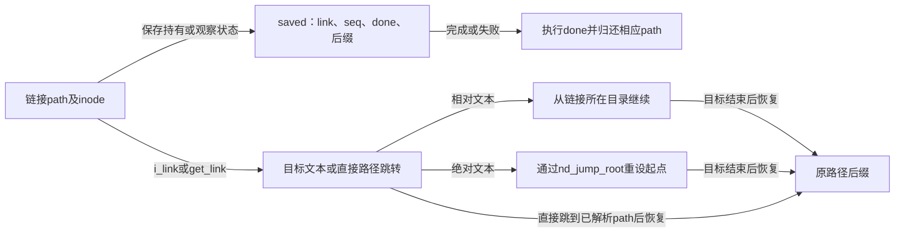
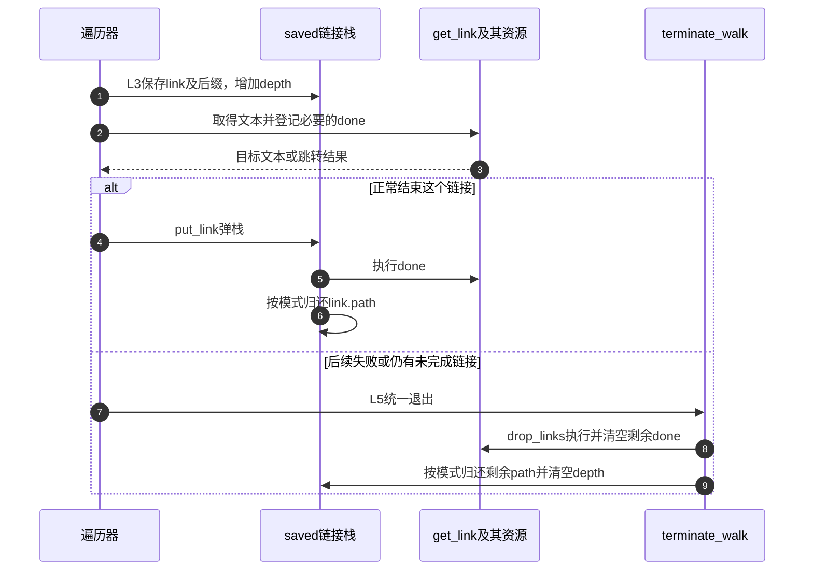

# 第15章\_符号链接的文本栈与路径跳转

本页承接 [路径遍历导读](../navigation/P08_路径怎样从起点推进到结果交付.md#8.1_把位置文本与约束放进同一周期) 的 L3 转向与 L5 清理。固定 NXP Linux 6.12.20 提交 `dfaf2136deb2af2e60b994421281ba42f1c087e0`，函数来自 fs/namei.c，MAXSYMLINKS 来自 include/linux/namei.h；版本入口见 [VFS 总索引](../navigation/P01_Linux_6.12_VFS源码阅读索引.md)。

## 15.1\_跟随预算与保存后缀需要两种状态

每跟随一个链接都需要消耗预算，但只有尚未完成的链接才占当前栈深度。reserve_stack 先检查累计数，再决定内联栈是否足够；固定版本 MAXSYMLINKS 为40，EMBEDDED_LEVELS 为2，二者分别限制总工作和优化小栈，不能交换理解。

```c
/** @brief 仓库补充阅读说明：消耗链接预算并在需要时扩展栈，正确处理模式回退。 */
static int reserve_stack(struct nameidata *nd, struct path *link)
{
        if (unlikely(nd->total_link_count++ >= MAXSYMLINKS))
                return -ELOOP;

        if (likely(nd->depth != EMBEDDED_LEVELS))
                return 0;
        if (likely(nd->stack != nd->internal))
                return 0;
        if (likely(nd_alloc_stack(nd)))
                return 0;

        if (nd->flags & LOOKUP_RCU) {
                // we need to grab link before we do unlazy.  And we can't skip
                // unlazy even if we fail to grab the link - cleanup needs it
                bool grabbed_link = legitimize_path(nd, link, nd->next_seq);

                if (!try_to_unlazy(nd) || !grabbed_link)
                        return -ECHILD;

                if (nd_alloc_stack(nd))
                        return 0;
        }
        return -ENOMEM;
}
```

```c
/** @brief 仓库补充阅读说明：按当前模式分配动态链接栈并复制内联记录。 */
static bool nd_alloc_stack(struct nameidata *nd)
{
        struct saved *p;

        p= kmalloc_array(MAXSYMLINKS, sizeof(struct saved),
                         nd->flags & LOOKUP_RCU ? GFP_ATOMIC : GFP_KERNEL);
        if (unlikely(!p))
                return false;
        memcpy(p, nd->internal, sizeof(nd->internal));
        nd->stack = p;
        return true;
}
```

RCU 模式分配使用相应不可睡眠约束；失败时先按协议固定 link，并尝试转为带引用模式后重新分配。即使取得 link 持有失败，也不能跳过其他状态的模式转换与清理，否则调用者将不知道已经取得哪些资源。最终返回 ECHILD 或 ENOMEM 各有不同含义。

## 15.2\_取得目标时把链接本身和清理动作保留下来

pick_link 将 link、观察序列和 delayed_call 放入 saved 记录，之后检查末项跟随规则、NO_SYMLINKS、挂载 NOSYMFOLLOW、时间戳更新及安全钩子。取得文本优先使用 inode.i_link，否则调用文件系统 get_link。

```c
/** @brief 仓库补充阅读说明：保留链接资源，检查约束并取得目标文本或跳转结果。 */
static const char *pick_link(struct nameidata *nd, struct path *link,
                     struct inode *inode, int flags)
{
        struct saved *last;
        const char *res;
        int error = reserve_stack(nd, link);

        if (unlikely(error)) {
                if (!(nd->flags & LOOKUP_RCU))
                        path_put(link);
                return ERR_PTR(error);
        }
        last = nd->stack + nd->depth++;
        last->link = *link;
        clear_delayed_call(&last->done);
        last->seq = nd->next_seq;

        if (flags & WALK_TRAILING) {
                error = may_follow_link(nd, inode);
                if (unlikely(error))
                        return ERR_PTR(error);
        }

        if (unlikely(nd->flags & LOOKUP_NO_SYMLINKS) ||
                        unlikely(link->mnt->mnt_flags & MNT_NOSYMFOLLOW))
                return ERR_PTR(-ELOOP);

        if (!(nd->flags & LOOKUP_RCU)) {
                touch_atime(&last->link);
                cond_resched();
        } else if (atime_needs_update(&last->link, inode)) {
                if (!try_to_unlazy(nd))
                        return ERR_PTR(-ECHILD);
                touch_atime(&last->link);
        }

        error = security_inode_follow_link(link->dentry, inode,
                                           nd->flags & LOOKUP_RCU);
        if (unlikely(error))
                return ERR_PTR(error);

        res = READ_ONCE(inode->i_link);
        if (!res) {
                const char * (*get)(struct dentry *, struct inode *,
                                struct delayed_call *);
                get = inode->i_op->get_link;
                if (nd->flags & LOOKUP_RCU) {
                        res = get(NULL, inode, &last->done);
                        if (res == ERR_PTR(-ECHILD) && try_to_unlazy(nd))
                                res = get(link->dentry, inode, &last->done);
                } else {
                        res = get(link->dentry, inode, &last->done);
                }
                if (!res)
                        goto all_done;
                if (IS_ERR(res))
                        return res;
        }
        if (*res == '/') {
                error = nd_jump_root(nd);
                if (unlikely(error))
                        return ERR_PTR(error);
                while (unlikely(*++res == '/'))
                        ;
        }
        if (*res)
                return res;
all_done: // pure jump
        put_link(nd);
        return NULL;
}
```

RCU 调用 get_link 时可传 NULL dentry 表明相应上下文；如果回调要求 ECHILD 且能转为带引用模式，再带实际 dentry 调用。get_link 可能安排一个延后清理动作，所以不能拿到字符串就立即丢弃 saved 记录。

相对文本返回给遍历器，以当前链接所在位置继续；绝对文本先跳到本次 root 并略过前导斜杠。没有剩余文本或纯路径跳转时在此结束当前链接。原路径尚未走完的后缀由 link_path_walk 保存在栈中，目标走完后恢复。



## 15.3\_根跳转与直接路径跳转不是同一种输入

nd_jump_root 处理文本中的根跳转，先拒绝 BENEATH 等不允许的变化，再取得或观察 root；带引用模式归还原当前位置并另取 root 持有。它不修改任务的永久 fs_struct.root。

```c
/** @brief 仓库补充阅读说明：在允许的情况下切换到本次根，配对旧新路径持有。 */
static int nd_jump_root(struct nameidata *nd)
{
        if (unlikely(nd->flags & LOOKUP_BENEATH))
                return -EXDEV;
        if (unlikely(nd->flags & LOOKUP_NO_XDEV)) {
                /* Absolute path arguments to path_init() are allowed. */
                if (nd->path.mnt != NULL && nd->path.mnt != nd->root.mnt)
                        return -EXDEV;
        }
        if (!nd->root.mnt) {
                int error = set_root(nd);
                if (error)
                        return error;
        }
        if (nd->flags & LOOKUP_RCU) {
                struct dentry *d;
                nd->path = nd->root;
                d = nd->path.dentry;
                nd->inode = d->d_inode;
                nd->seq = nd->root_seq;
                if (read_seqcount_retry(&d->d_seq, nd->seq))
                        return -ECHILD;
        } else {
                path_put(&nd->path);
                nd->path = nd->root;
                path_get(&nd->path);
                nd->inode = nd->path.dentry->d_inode;
        }
        nd->state |= ND_JUMPED;
        return 0;
}
```

nd_jump_link 则供 get_link 直接交付已解析 path。调用者必须已经取得该 path 的持有；函数在允许时转移给 nameidata，拒绝时也必须归还。NO_MAGICLINKS、NO_XDEV 和 scoped 查找会限制这种跳转。

```c
/** @brief 仓库补充阅读说明：接收已持有的直接路径，拒绝时也归还输入持有。 */
int nd_jump_link(const struct path *path)
{
        int error = -ELOOP;
        struct nameidata *nd = current->nameidata;

        if (unlikely(nd->flags & LOOKUP_NO_MAGICLINKS))
                goto err;

        error = -EXDEV;
        if (unlikely(nd->flags & LOOKUP_NO_XDEV)) {
                if (nd->path.mnt != path->mnt)
                        goto err;
        }
        /* Not currently safe for scoped-lookups. */
        if (unlikely(nd->flags & LOOKUP_IS_SCOPED))
                goto err;

        path_put(&nd->path);
        nd->path = *path;
        nd->inode = nd->path.dentry->d_inode;
        nd->state |= ND_JUMPED;
        return 0;

err:
        path_put(path);
        return error;
}
```

因此 magic link 不能通用地画成“先读一段目标字符串再拼接”。两条路径共享约束检查目标，却有不同输入和所有权契约。公开 RESOLVE_* 到内部 LOOKUP_* 的映射见 fs/open.c；本页不把内部位值当作系统调用参数。

## 15.4\_完成或失败都要归还链接资源

put_link 退出一个已完成链接，执行 delayed_call，再在带引用模式下归还该链接 path。全流程失败或最终结束时，drop_links 对仍在栈中的链接执行剩余清理动作并清空；path 引用则由 terminate_walk 的模式分支负责。

```c
/** @brief 仓库补充阅读说明：结束一个链接并执行清理及对应路径归还。 */
static inline void put_link(struct nameidata *nd)
{
        struct saved *last = nd->stack + --nd->depth;
        do_delayed_call(&last->done);
        if (!(nd->flags & LOOKUP_RCU))
                path_put(&last->link);
}
```

```c
/** @brief 仓库补充阅读说明：执行并清空所有尚未结束链接的延后清理动作。 */
static void drop_links(struct nameidata *nd)
{
        int i = nd->depth;
        while (i--) {
                struct saved *last = nd->stack + i;
                do_delayed_call(&last->done);
                clear_delayed_call(&last->done);
        }
}
```



延后清理动作不必等于释放 dentry；它由文件系统提供，可能释放承载链接文本的资源。完整退出实现见 [路径退出](P13_路径起点与结果持有的交接.md#13.6_退出要分别处理链接资源路径引用和任务上下文)。未执行链接循环、分配失败或并发跳转注入，返回 [导读](../navigation/P08_路径怎样从起点推进到结果交付.md#8.2_沿阶段查找实现与后续边界)。
