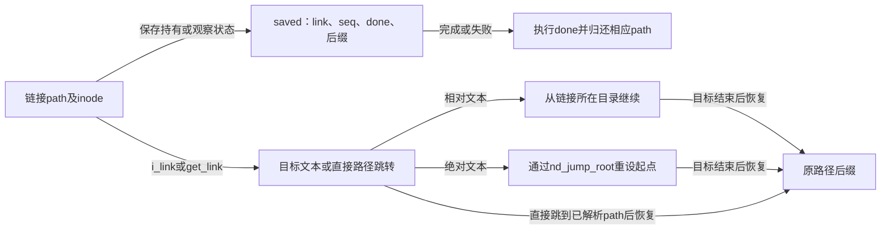
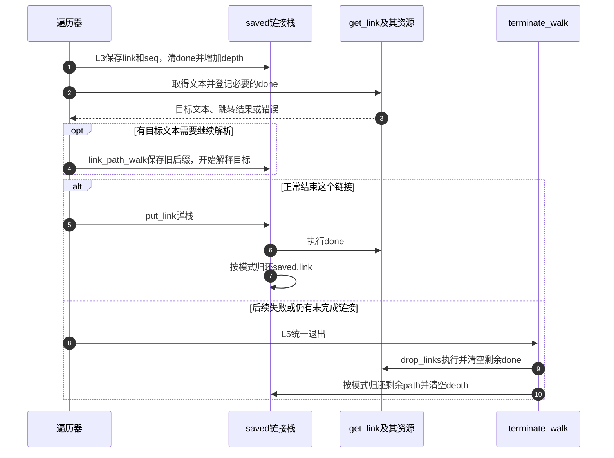
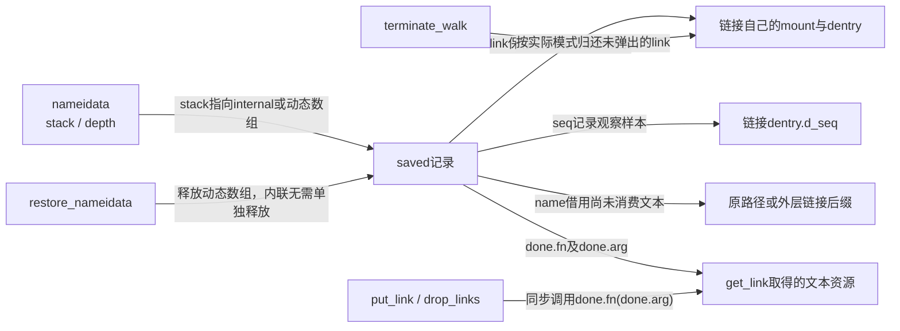

# 第15章\_符号链接的文本栈与路径跳转

本页承接 [路径遍历导读](../navigation/P08_路径怎样从起点推进到结果交付.md#8.1_把位置文本与约束放进同一周期) 的 L3 转向与 L5 清理。固定 NXP Linux 6.12.20 提交 `dfaf2136deb2af2e60b994421281ba42f1c087e0`，函数来自 fs/namei.c，MAXSYMLINKS 来自 include/linux/namei.h；版本入口见 [VFS 总索引](../navigation/P01_Linux_6.12_VFS源码阅读索引.md)。

## 15.1\_跟随预算与保存后缀需要两种状态

每跟随一个链接都需要消耗预算，但只有尚未完成的链接才占当前栈深度。reserve_stack 先检查累计数，再决定内联栈是否足够；固定版本 MAXSYMLINKS 为40，EMBEDDED_LEVELS 为2，二者分别限制总工作和优化小栈，不能交换理解。

```c
/** @brief 仓库补充阅读说明：消耗链接预算并在需要时扩展栈，正确处理模式回退。 */
static int reserve_stack(struct nameidata *nd, struct path *link)
{
        /* 先消耗累计预算，超限返回ELOOP，不等于栈深度溢出。 */
        if (unlikely(nd->total_link_count++ >= MAXSYMLINKS))
                return -ELOOP;

        /* 只有内联容量将被用尽时才需要扩容。 */
        if (likely(nd->depth != EMBEDDED_LEVELS))
                return 0;
        if (likely(nd->stack != nd->internal))
                return 0;
        if (likely(nd_alloc_stack(nd)))
                return 0;

        if (nd->flags & LOOKUP_RCU) {

                /* 即使新link未接住，仍须完成已有状态的模式交接以便清理。 */
                bool grabbed_link = legitimize_path(nd, link, nd->next_seq);

                /* 先执行unlazy，不能交换成grabbed_link为假就短路。 */
                if (!try_to_unlazy(nd) || !grabbed_link)
                        return -ECHILD;

                if (nd_alloc_stack(nd))
                        return 0;
        }
        /* 允许睡眠的分配仍失败才报告内存不足。 */
        return -ENOMEM;
}
```

```c
/** @brief 仓库补充阅读说明：按当前模式分配动态链接栈并复制内联记录。 */
static bool nd_alloc_stack(struct nameidata *nd)
{
        struct saved *p;

        /* RCU模式不可睡眠；动态栈一次分配总预算容量。 */
        p= kmalloc_array(MAXSYMLINKS, sizeof(struct saved),
                         nd->flags & LOOKUP_RCU ? GFP_ATOMIC : GFP_KERNEL);
        if (unlikely(!p))
                return false;
        /* 复制已有内联记录，不重复取得其持有。 */
        memcpy(p, nd->internal, sizeof(nd->internal));
        /* 数组所有权交给上下文，restore_nameidata归还。 */
        nd->stack = p;
        return true;
}
```

RCU 模式分配使用相应不可睡眠约束；失败时先按协议固定 link，并尝试转为带引用模式后重新分配。即使取得 link 持有失败，也不能跳过其他状态的模式转换与清理，否则调用者将不知道已经取得哪些资源。最终返回 ECHILD 或 ENOMEM 各有不同含义。

这里的三个分配结果不能合并：第一次原子分配失败只是需要尝试模式交接；交接不能成立返回ECHILD；已经处于允许睡眠的模式仍分配失败返回ENOMEM。`legitimize_path`可能留下部分已取得资源的清理状态，因此 `try_to_unlazy` 必须先执行，不能改成 `!grabbed_link || !try_to_unlazy(...)` 后让短路跳过它。实现依据见 [路径合法化](P17_从RCU观察交接到路径引用.md#17.2_路径合法化保留足够的信息供失败清理) 和 [整组状态接住](P17_从RCU观察交接到路径引用.md#17.4_全部必要持有取得后才退出RCU)。

`MAXSYMLINKS`为namei.h中的累计预算，`EMBEDDED_LEVELS`和 `struct saved` 在namei.c内部。数组扩容只搬移已有记录，不为每条记录再取引用；动态数组最终由restore_nameidata释放。修改容量或分配策略要同步检查第二条转第三条记录、已在动态栈、不停嵌套但反复弹栈、预算超限、原子失败和睡眠分配失败，不能只测试链接链长等于栈深度的单一例子。

## 15.2\_取得目标时把链接本身和清理动作保留下来

pick_link 将 link、观察序列和 delayed_call 放入 saved 记录，之后检查末项跟随规则、NO_SYMLINKS、挂载 NOSYMFOLLOW、时间戳更新及安全钩子。取得文本优先使用 inode.i_link，否则调用文件系统 get_link。

```c
/** @brief 仓库补充阅读说明：保留链接资源，检查约束并取得目标文本或跳转结果。 */
static const char *pick_link(struct nameidata *nd, struct path *link,
                     struct inode *inode, int flags)
{
        struct saved *last;
        const char *res;
        int error = reserve_stack(nd, link);

        /* 尚未压栈，按当前模式直接归还输入link。 */
        if (unlikely(error)) {
                if (!(nd->flags & LOOKUP_RCU))
                        path_put(link);
                return ERR_PTR(error);
        }
        /* 成功压栈后，后续错误由统一退出接管记录。 */
        last = nd->stack + nd->depth++;
        last->link = *link;
        /* 先清空动作，get_link需要时再登记。 */
        clear_delayed_call(&last->done);
        last->seq = nd->next_seq;

        /* 末项链接先执行对应受保护链接策略。 */
        if (flags & WALK_TRAILING) {
                error = may_follow_link(nd, inode);
                /* 尚未压栈，按当前模式直接归还输入link。 */
                if (unlikely(error))
                        return ERR_PTR(error);
        }

        /* 路径请求与挂载属性任一禁止都拒绝跟随。 */
        if (unlikely(nd->flags & LOOKUP_NO_SYMLINKS) ||
                        unlikely(link->mnt->mnt_flags & MNT_NOSYMFOLLOW))
                return ERR_PTR(-ELOOP);

        if (!(nd->flags & LOOKUP_RCU)) {
                touch_atime(&last->link);
                cond_resched();
        /* 时间戳更新可能要求退出快速模式。 */
        } else if (atime_needs_update(&last->link, inode)) {
                if (!try_to_unlazy(nd))
                        return ERR_PTR(-ECHILD);
                touch_atime(&last->link);
        }

        /* 安全hook是可返回错误的许可检查，非纯日志。 */
        error = security_inode_follow_link(link->dentry, inode,
                                           nd->flags & LOOKUP_RCU);
        /* 尚未压栈，按当前模式直接归还输入link。 */
        if (unlikely(error))
                return ERR_PTR(error);

        /* 优先读取inode中已有的目标文本。 */
        res = READ_ONCE(inode->i_link);
        /* NULL表示回调已完成直接路径跳转，不是ENOENT。 */
        if (!res) {
                const char * (*get)(struct dentry *, struct inode *,
                                struct delayed_call *);
                get = inode->i_op->get_link;
                if (nd->flags & LOOKUP_RCU) {
                        /* NULL dentry告知回调处于RCU查找，不能睡眠。 */
                        res = get(NULL, inode, &last->done);
                        /* 回调要求慢上下文时先接住资源，再重新调用。 */
                        if (res == ERR_PTR(-ECHILD) && try_to_unlazy(nd))
                                res = get(link->dentry, inode, &last->done);
                } else {
                        res = get(link->dentry, inode, &last->done);
                }
                /* NULL表示回调已完成直接路径跳转，不是ENOENT。 */
                if (!res)
                        goto all_done;
                if (IS_ERR(res))
                        return res;
        }
        /* 绝对目标重设本次起点；不会修改任务永久root。 */
        if (*res == '/') {
                error = nd_jump_root(nd);
                /* 尚未压栈，按当前模式直接归还输入link。 */
                if (unlikely(error))
                        return ERR_PTR(error);
                while (unlikely(*++res == '/'))
                        ;
        }
        if (*res)
                return res;
all_done:
        /* 纯跳转或只剩根分隔符时立即结束当前链接记录。 */
        put_link(nd);
        return NULL;
}
```

RCU 调用 get_link 时可传 NULL dentry 表明相应上下文；如果回调要求 ECHILD 且能转为带引用模式，再带实际 dentry 调用。get_link 可能安排一个延后清理动作，所以不能拿到字符串就立即丢弃 saved 记录。

相对文本返回给遍历器，以当前链接所在位置继续；绝对文本先跳到本次 root 并略过前导斜杠。没有剩余文本或纯路径跳转时在此结束当前链接。原路径尚未走完的后缀由 link_path_walk 保存在栈中，目标走完后恢复。



`get_link`声明在inode_operations中，返回文本、错误指针或完成直接跳转的NULL。它可通过 `last.done`登记资源归还；RCU模式用NULL dentry通知回调上下文，回调不能因拿到inode就任意睡眠。`inode.i_link`是可直接读取的目标，依赖inode与链接路径的生命期保护，READ_ONCE本身不产生持有。

| 跟随前的辅助或配置 | 功能责任与修改边界 |
| --- | --- |
| `may_follow_link` | `sysctl_protected_symlinks`控制受保护链接策略；根据当前身份、挂载idmap、父目录sticky/可写属性和所有者判定。无法在RCU路径完成拒绝记录时先返回ECHILD，带引用路径最终EACCES |
| `LOOKUP_NO_SYMLINKS` / `MNT_NOSYMFOLLOW` | 分别属于本次请求和挂载属性，任一禁止都会拒绝本次跟随 |
| `atime_needs_update` / `touch_atime` | 前者判断是否需更新时间，后者执行尝试；需要更新时先退出RCU。时间更新不是后台线程自动替本路径完成 |
| `security_inode_follow_link` | 开启SECURITY时是能返回拒绝错误的hook；当前配置关闭，头文件桩返回0。不能把开启后的路径当成无副作用日志 |
| `audit_inode` / `audit_log_path_denied` | may_follow_link拒绝路径的审计接入；当前AUDIT关闭不取消EACCES许可结果 |
| `cond_resched` | 带引用路径允许调度让出CPU，不是链接完成通知，也不替代引用协议 |

`may_follow_link`中的完整身份策略不是本页的新增权限框架；本页保留它的输入、调用时点、回退和拒绝结果，原件在 [namei.c](../../linux/fs/namei.c)、[security.h](../../linux/include/linux/security.h) 与 [audit.h](../../linux/include/linux/audit.h)。修改pick_link时必须以压栈为资源责任切换点：此前失败直接归还输入，之后失败由统一退出清理；不能在两个位置同时path_put。

## 15.3\_根跳转与直接路径跳转不是同一种输入

nd_jump_root 处理文本中的根跳转，先拒绝 BENEATH 等不允许的变化，再取得或观察 root；带引用模式归还原当前位置并另取 root 持有。它不修改任务的永久 fs_struct.root。

```c
/** @brief 仓库补充阅读说明：在允许的情况下切换到本次根，配对旧新路径持有。 */
static int nd_jump_root(struct nameidata *nd)
{
        /* BENEATH拒绝绝对根跳转。 */
        if (unlikely(nd->flags & LOOKUP_BENEATH))
                return -EXDEV;
        if (unlikely(nd->flags & LOOKUP_NO_XDEV)) {

                /* 首次绝对起点尚无旧mount；后续跨mount根跳转受限。 */
                if (nd->path.mnt != NULL && nd->path.mnt != nd->root.mnt)
                        return -EXDEV;
        }
        /* 只在尚无本次root时取得任务根。 */
        if (!nd->root.mnt) {
                int error = set_root(nd);
                if (error)
                        return error;
        }
        if (nd->flags & LOOKUP_RCU) {
                struct dentry *d;
                nd->path = nd->root;
                d = nd->path.dentry;
                nd->inode = d->d_inode;
                /* 恢复根的观察样本并核对，失败由外层清理。 */
                nd->seq = nd->root_seq;
                if (read_seqcount_retry(&d->d_seq, nd->seq))
                        return -ECHILD;
        } else {
                /* 带引用模式释放旧位置，再另取根作当前位置的持有。 */
                path_put(&nd->path);
                nd->path = nd->root;
                path_get(&nd->path);
                nd->inode = nd->path.dentry->d_inode;
        }
        /* 后续完整验证知道本轮发生过跳转。 */
        nd->state |= ND_JUMPED;
        return 0;
}
```

nd_jump_link 则供 get_link 直接交付已解析 path。调用者必须已经取得该 path 的持有；函数在允许时转移给 nameidata，拒绝时也必须归还。NO_MAGICLINKS、NO_XDEV 和 scoped 查找会限制这种跳转。

```c
/** @brief 仓库补充阅读说明：接收已持有的直接路径，拒绝时也归还输入持有。 */
int nd_jump_link(const struct path *path)
{
        int error = -ELOOP;
        /* 由当前任务上下文找到正在解析的请求。 */
        struct nameidata *nd = current->nameidata;

        /* 直接路径跳转单独受此限制。 */
        if (unlikely(nd->flags & LOOKUP_NO_MAGICLINKS))
                goto err;

        error = -EXDEV;
        if (unlikely(nd->flags & LOOKUP_NO_XDEV)) {
                if (nd->path.mnt != path->mnt)
                        goto err;
        }

        /* 本版本不允许用此路径兑现scoped查找。 */
        if (unlikely(nd->flags & LOOKUP_IS_SCOPED))
                goto err;

        path_put(&nd->path);
        /* 接收输入持有，不再次path_get。 */
        nd->path = *path;
        nd->inode = nd->path.dentry->d_inode;
        nd->state |= ND_JUMPED;
        return 0;

err:
        /* 拒绝也消费输入持有，调用者不能重复归还。 */
        path_put(path);
        return error;
}
```

因此 magic link 不能通用地画成“先读一段目标字符串再拼接”。两条路径共享约束检查目标，却有不同输入和所有权契约。公开 RESOLVE_* 到内部 LOOKUP_* 的映射见 fs/open.c；本页不把内部位值当作系统调用参数。

`set_root`是namei.c私有辅助：RCU模式在fs.seq检查范围内读取fs.root并保存root_seq，带引用模式通过get_fs_root取得root并设置ND_ROOT_GRABBED。它对意外的scoped调用先WARN，再返回ENOTRECOVERABLE；这条分支防止把本次dirfd根换成任务根，不能去掉返回只保留打印。`ND_ROOT_PRESET`由外层调用者管理，相关生命周期见 [起点资源状态](P13_路径起点与结果持有的交接.md#13.1_本次遍历状态与任务中的嵌套上下文)。

`nd_jump_link`在 `include/linux/namei.h` 声明并供get_link实现使用。它没有RCU资源合法化代码，提供直接跳转的回调须先按契约取得path持有，并处于允许消费持有的上下文；RCU回调不能直接把观察指针交给它。`nd_jump_root`则内部区分观察与持有。修改二者时分别覆盖BENEATH、IN_ROOT、NO_XDEV、NO_MAGICLINKS及失败消费输入的责任，不能抽成一个忽略输入所有权的“设置path”函数。

公开限制位到内部标志的唯一映射见 [打开参数拆分](P23_打开参数与描述符发布的外层事务.md#23.1_先把用户请求分成访问创建与解析意图)。本页不重复该函数体，也不把内部WALK位暴露给用户态。

## 15.4\_完成或失败都要归还链接资源

put_link 退出一个已完成链接，执行 delayed_call，再在带引用模式下归还该链接 path。全流程失败或最终结束时，drop_links 对仍在栈中的链接执行剩余清理动作并清空；path 引用则由 terminate_walk 的模式分支负责。

```c
/** @brief 仓库补充阅读说明：结束一个链接并执行清理及对应路径归还。 */
static inline void put_link(struct nameidata *nd)
{
        /* 先弹出一条活跃记录。 */
        struct saved *last = nd->stack + --nd->depth;
        /* 同步调用登记的清理函数，不是投递后台任务。 */
        do_delayed_call(&last->done);
        /* 仅带引用模式归还该记录的path。 */
        if (!(nd->flags & LOOKUP_RCU))
                path_put(&last->link);
}
```

```c
/** @brief 仓库补充阅读说明：执行并清空所有尚未结束链接的延后清理动作。 */
static void drop_links(struct nameidata *nd)
{
        /* 倒序处理尚未弹出的链接。 */
        int i = nd->depth;
        while (i--) {
                struct saved *last = nd->stack + i;
                /* 先执行文件系统文本清理。 */
                do_delayed_call(&last->done);
                /* 清空动作防止后续清理再次执行；path由外层按模式归还。 */
                clear_delayed_call(&last->done);
        }
}
```



延后清理动作不必等于释放 dentry；它由文件系统提供，可能释放承载链接文本的资源。完整退出实现见 [路径退出](P13_路径起点与结果持有的交接.md#13.6_退出要分别处理链接资源路径引用和任务上下文)。未执行链接循环、分配失败或并发跳转注入，返回 [导读](../navigation/P08_路径怎样从起点推进到结果交付.md#8.2_沿阶段查找实现与后续边界)。


`delayed_call`在 [include/linux/delayed_call.h](../../linux/include/linux/delayed_call.h) 定义，只有 `fn` 与 `arg` 两个字段。`set_delayed_call`保存函数和参数，`do_delayed_call`检查fn非空后 **在当前调用栈同步执行** `fn(arg)`，`clear_delayed_call`只把fn置NULL。这里的“延后”指取得文本之后、消费完毕或退出时才调用，不是工作队列、定时器或RCU回调。



普通put_link已降低depth，后续统一退出不再遍历那条记录，因此无需再清fn来避免同一记录重复执行；drop_links仍保留depth供后续path_put使用，必须清掉已执行的动作。两条退出路径合起来维持“文本清理一次、路径归还一次、数组释放一次”，三者不能互相代替。修改时要用含临时文本资源的get_link、纯跳转、空目标文本、后续解析失败和动态栈失败分别检验，不能只看永久i_link字符串的成功情况。
