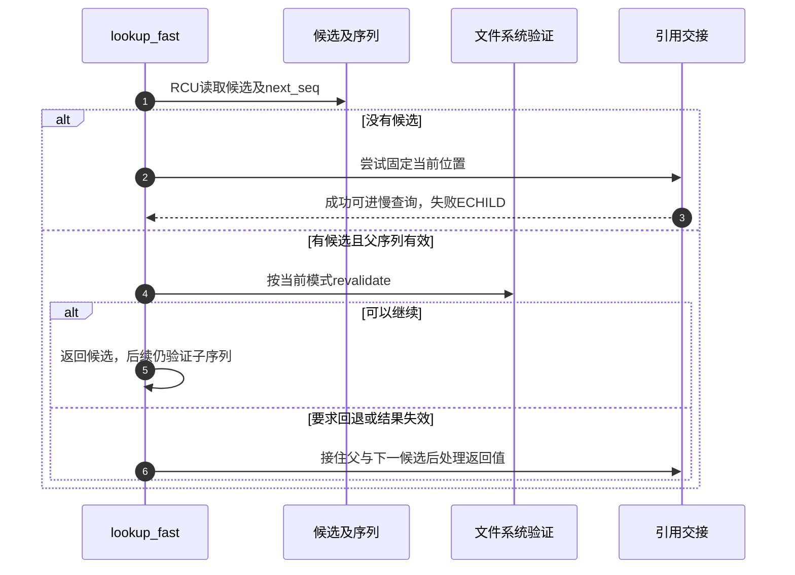
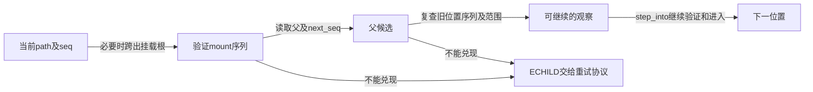

# 第16章\_候选读取与快速路径验证

本页承接 [快慢遍历导读](../navigation/P09_快速观察怎样转为引用并协调慢查询.md#9.1_把观察凭据与持有交接分开)，解释 L1～L3 中无逐项引用的观察与验证。固定 NXP Linux 6.12.20 提交 `dfaf2136deb2af2e60b994421281ba42f1c087e0`；候选读取来自 fs/dcache.c，其余来自 fs/namei.c，版本见 [总索引](../navigation/P01_Linux_6.12_VFS源码阅读索引.md)。

## 16.1\_返回候选时同时交出尚待验证的序列

__d_lookup_rcu 按父和名字寻找候选，不增加普通 dentry 引用。它返回的 seqp 是后续验证的凭据；调用者不能只取指针而丢弃序列。

```c
/** @brief 仓库补充阅读说明：返回不带普通引用的名称候选及验证序列。 */
struct dentry *__d_lookup_rcu(const struct dentry *parent,
                                const struct qstr *name,
                                unsigned *seqp)
{
        u64 hashlen = name->hash_len;
        const unsigned char *str = name->name;
        struct hlist_bl_head *b = d_hash(hashlen);
        struct hlist_bl_node *node;
        struct dentry *dentry;

        /*
         * Note: There is significant duplication with __d_lookup_rcu which is
         * required to prevent single threaded performance regressions
         * especially on architectures where smp_rmb (in seqcounts) are costly.
         * Keep the two functions in sync.
         */

        if (unlikely(parent->d_flags & DCACHE_OP_COMPARE))
                return __d_lookup_rcu_op_compare(parent, name, seqp);

        /*
         * The hash list is protected using RCU.
         *
         * Carefully use d_seq when comparing a candidate dentry, to avoid
         * races with d_move().
         *
         * It is possible that concurrent renames can mess up our list
         * walk here and result in missing our dentry, resulting in the
         * false-negative result. d_lookup() protects against concurrent
         * renames using rename_lock seqlock.
         *
         * See Documentation/filesystems/path-lookup.txt for more details.
         */
        hlist_bl_for_each_entry_rcu(dentry, node, b, d_hash) {
                unsigned seq;

                /*
                 * The dentry sequence count protects us from concurrent
                 * renames, and thus protects parent and name fields.
                 *
                 * The caller must perform a seqcount check in order
                 * to do anything useful with the returned dentry.
                 *
                 * NOTE! We do a "raw" seqcount_begin here. That means that
                 * we don't wait for the sequence count to stabilize if it
                 * is in the middle of a sequence change. If we do the slow
                 * dentry compare, we will do seqretries until it is stable,
                 * and if we end up with a successful lookup, we actually
                 * want to exit RCU lookup anyway.
                 *
                 * Note that raw_seqcount_begin still *does* smp_rmb(), so
                 * we are still guaranteed NUL-termination of ->d_name.name.
                 */
                seq = raw_seqcount_begin(&dentry->d_seq);
                if (dentry->d_parent != parent)
                        continue;
                if (d_unhashed(dentry))
                        continue;
                if (dentry->d_name.hash_len != hashlen)
                        continue;
                if (dentry_cmp(dentry, str, hashlen_len(hashlen)) != 0)
                        continue;
                *seqp = seq;
                return dentry;
        }
        return NULL;
}
```

普通比较路径读取父、hashed 状态、名字哈希及长度，再比较名称。特殊 d_compare 分支进入 __d_lookup_rcu_op_compare，它还要保证名字指针与长度的成对观察；该辅助分支仍把序列交给调用者验证，不能把文件系统名称比较回调当成取消并发协议的理由。

这里可能因 rename 遗漏候选，允许调用者退到不会接受这种遗漏的查询。源码注释中历史性的“持有vfsmount锁”措辞不能覆盖本版本实际的序列与RCU协议；判断同步前提要结合调用链，而不是将一段旧注释直接当成函数内取得了某把锁。

## 16.2\_快速查询按当前模式解释同一个返回形态

lookup_fast 在 RCU 模式调用无引用查找，没有候选时先 try_to_unlazy，再返回 NULL 让调用者进入慢查询；找到候选则检查父序列并重新验证。ref 模式调用的是带引用 __d_lookup，因此同一个成功指针的所有权取决于 nd.flags。

```c
/** @brief 仓库补充阅读说明：按当前模式查询并处理候选验证和持有交接。 */
static struct dentry *lookup_fast(struct nameidata *nd)
{
        struct dentry *dentry, *parent = nd->path.dentry;
        int status = 1;

        /*
         * Rename seqlock is not required here because in the off chance
         * of a false negative due to a concurrent rename, the caller is
         * going to fall back to non-racy lookup.
         */
        if (nd->flags & LOOKUP_RCU) {
                dentry = __d_lookup_rcu(parent, &nd->last, &nd->next_seq);
                if (unlikely(!dentry)) {
                        if (!try_to_unlazy(nd))
                                return ERR_PTR(-ECHILD);
                        return NULL;
                }

                /*
                 * This sequence count validates that the parent had no
                 * changes while we did the lookup of the dentry above.
                 */
                if (read_seqcount_retry(&parent->d_seq, nd->seq))
                        return ERR_PTR(-ECHILD);

                status = d_revalidate(dentry, nd->flags);
                if (likely(status > 0))
                        return dentry;
                if (!try_to_unlazy_next(nd, dentry))
                        return ERR_PTR(-ECHILD);
                if (status == -ECHILD)
                        /* we'd been told to redo it in non-rcu mode */
                        status = d_revalidate(dentry, nd->flags);
        } else {
                dentry = __d_lookup(parent, &nd->last);
                if (unlikely(!dentry))
                        return NULL;
                status = d_revalidate(dentry, nd->flags);
        }
        if (unlikely(status <= 0)) {
                if (!status)
                        d_invalidate(dentry);
                dput(dentry);
                return ERR_PTR(status);
        }
        return dentry;
}
```

```c
/** @brief 仓库补充阅读说明：有验证操作时调用文件系统，否则接受缓存候选。 */
static inline int d_revalidate(struct dentry *dentry, unsigned int flags)
{
        if (unlikely(dentry->d_flags & DCACHE_OP_REVALIDATE))
                return dentry->d_op->d_revalidate(dentry, flags);
        else
                return 1;
}
```

revalidate 大于0表示可以继续；0表示失效，负数表示错误或特定回退请求。RCU 路径遇到非正结果先尝试接住父和下一候选；只有原状态为 ECHILD 才按相应分支再次调用验证。之后0会失效并归还候选，ERR_PTR(0)表现为NULL，调用者由此进入慢查询；其他错误不能都吞成未命中。



带引用 __d_lookup 的唯一实现见 [名称查找](P11_名称候选的建立发布与持有.md#11.5_查找候选时在锁内核对身份并取得持有)。不要在本页再次复制同一函数，也不要把内部使用RCU与整次路径选择RCU-walk混为一谈。

## 16.3\_跨挂载失败后先恢复候选再交接模式

__follow_mount_rcu 尝试跳过已有挂载栈，并检查管理回调、NO_XDEV、mount序列和是否需要自动挂载。需要阻塞的管理工作不能在这里假装完成。

```c
/** @brief 仓库补充阅读说明：在快速观察条件允许时跨越已有挂载。 */
static bool __follow_mount_rcu(struct nameidata *nd, struct path *path)
{
        struct dentry *dentry = path->dentry;
        unsigned int flags = dentry->d_flags;

        if (likely(!(flags & DCACHE_MANAGED_DENTRY)))
                return true;

        if (unlikely(nd->flags & LOOKUP_NO_XDEV))
                return false;

        for (;;) {
                /*
                 * Don't forget we might have a non-mountpoint managed dentry
                 * that wants to block transit.
                 */
                if (unlikely(flags & DCACHE_MANAGE_TRANSIT)) {
                        int res = dentry->d_op->d_manage(path, true);
                        if (res)
                                return res == -EISDIR;
                        flags = dentry->d_flags;
                }

                if (flags & DCACHE_MOUNTED) {
                        struct mount *mounted = __lookup_mnt(path->mnt, dentry);
                        if (mounted) {
                                path->mnt = &mounted->mnt;
                                dentry = path->dentry = mounted->mnt.mnt_root;
                                nd->state |= ND_JUMPED;
                                nd->next_seq = read_seqcount_begin(&dentry->d_seq);
                                flags = dentry->d_flags;
                                // makes sure that non-RCU pathwalk could reach
                                // this state.
                                if (read_seqretry(&mount_lock, nd->m_seq))
                                        return false;
                                continue;
                        }
                        if (read_seqretry(&mount_lock, nd->m_seq))
                                return false;
                }
                return !(flags & DCACHE_NEED_AUTOMOUNT);
        }
}
```

```c
/** @brief 仓库补充阅读说明：恢复失败的快速候选后转换模式并处理挂载。 */
static inline int handle_mounts(struct nameidata *nd, struct dentry *dentry,
                          struct path *path)
{
        bool jumped;
        int ret;

        path->mnt = nd->path.mnt;
        path->dentry = dentry;
        if (nd->flags & LOOKUP_RCU) {
                unsigned int seq = nd->next_seq;
                if (likely(__follow_mount_rcu(nd, path)))
                        return 0;
                // *path and nd->next_seq might've been clobbered
                path->mnt = nd->path.mnt;
                path->dentry = dentry;
                nd->next_seq = seq;
                if (!try_to_unlazy_next(nd, dentry))
                        return -ECHILD;
        }
        ret = traverse_mounts(path, &jumped, &nd->total_link_count, nd->flags);
        if (jumped) {
                if (unlikely(nd->flags & LOOKUP_NO_XDEV))
                        ret = -EXDEV;
                else
                        nd->state |= ND_JUMPED;
        }
        if (unlikely(ret)) {
                dput(path->dentry);
                if (path->mnt != nd->path.mnt)
                        mntput(path->mnt);
        }
        return ret;
}
```

尝试过程中 path 与 next_seq 可能已被修改；handle_mounts 在回退前把它们恢复为原候选，再调用 try_to_unlazy_next。随后带引用 traverse_mounts 处理实际跨越，失败时配对归还当前候选及新增 mount 持有。若不恢复就拿一半推进的状态交给转换，会把两个观察位置混在一起。

普通名称的 step_into 已在 [单步进入](P14_前导分量与单步位置推进.md#14.3_进入候选前先处理挂载再决定是否跟随链接) 展开，它继续消费这里交付的 path，不重复这两层责任。

## 16.4\_向上观察需要串联旧位置父位置和挂载序列

follow_dotdot_rcu 先检查根边界；在挂载根处选择外部挂载点并验证 mount 序列。再读取父 dentry 的序列，复查旧位置的序列，检查父仍在本视图内，最后把父候选交给后续进入步骤。

```c
/** @brief 仓库补充阅读说明：串联旧位置、父位置和挂载序列以验证向上移动。 */
static struct dentry *follow_dotdot_rcu(struct nameidata *nd)
{
        struct dentry *parent, *old;

        if (path_equal(&nd->path, &nd->root))
                goto in_root;
        if (unlikely(nd->path.dentry == nd->path.mnt->mnt_root)) {
                struct path path;
                unsigned seq;
                if (!choose_mountpoint_rcu(real_mount(nd->path.mnt),
                                           &nd->root, &path, &seq))
                        goto in_root;
                if (unlikely(nd->flags & LOOKUP_NO_XDEV))
                        return ERR_PTR(-ECHILD);
                nd->path = path;
                nd->inode = path.dentry->d_inode;
                nd->seq = seq;
                // makes sure that non-RCU pathwalk could reach this state
                if (read_seqretry(&mount_lock, nd->m_seq))
                        return ERR_PTR(-ECHILD);
                /* we know that mountpoint was pinned */
        }
        old = nd->path.dentry;
        parent = old->d_parent;
        nd->next_seq = read_seqcount_begin(&parent->d_seq);
        // makes sure that non-RCU pathwalk could reach this state
        if (read_seqcount_retry(&old->d_seq, nd->seq))
                return ERR_PTR(-ECHILD);
        if (unlikely(!path_connected(nd->path.mnt, parent)))
                return ERR_PTR(-ECHILD);
        return parent;
in_root:
        if (read_seqretry(&mount_lock, nd->m_seq))
                return ERR_PTR(-ECHILD);
        if (unlikely(nd->flags & LOOKUP_BENEATH))
                return ERR_PTR(-ECHILD);
        nd->next_seq = nd->seq;
        return nd->path.dentry;
}
```



这组检查证明的是按协议可以接受的相邻移动，不是冻结整个目录树。带引用版本和scoped额外检查见 [向上路径](P14_前导分量与单步位置推进.md#14.4_向上走需要同时考虑根边界与挂载根) 及其下一节。

## 16.5\_权限检查也必须说明能否阻塞

may_lookup 在 RCU 模式给 inode_permission 增加 MAY_NOT_BLOCK。若需要退出快速模式，先交接已有状态；只有适当的 ECHILD 情况才重新以可阻塞条件执行权限检查，真正硬错误仍要返回。

```c
/** @brief 仓库补充阅读说明：按模式设置权限检查的不可阻塞要求并处理回退。 */
static inline int may_lookup(struct mnt_idmap *idmap,
                             struct nameidata *restrict nd)
{
        int err, mask;

        mask = nd->flags & LOOKUP_RCU ? MAY_NOT_BLOCK : 0;
        err = inode_permission(idmap, nd->inode, mask | MAY_EXEC);
        if (likely(!err))
                return 0;

        // If we failed, and we weren't in LOOKUP_RCU, it's final
        if (!(nd->flags & LOOKUP_RCU))
                return err;

        // Drop out of RCU mode to make sure it wasn't transient
        if (!try_to_unlazy(nd))
                return -ECHILD; // redo it all non-lazy

        if (err != -ECHILD)     // hard error
                return err;

        return inode_permission(idmap, nd->inode, MAY_EXEC);
}
```

所以“名称在缓存里”不保证剩下所有步骤都能在快速模式完成。权限、重新验证、管理挂载和链接取得都有自己的上下文要求。本页未运行目标快速路径追踪，返回 [导读](../navigation/P09_快速观察怎样转为引用并协调慢查询.md#9.2_用实现入口区分读取转换与等待)。
