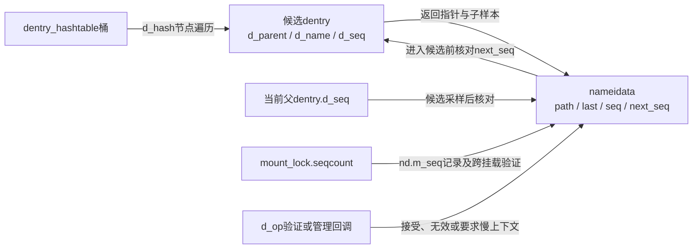
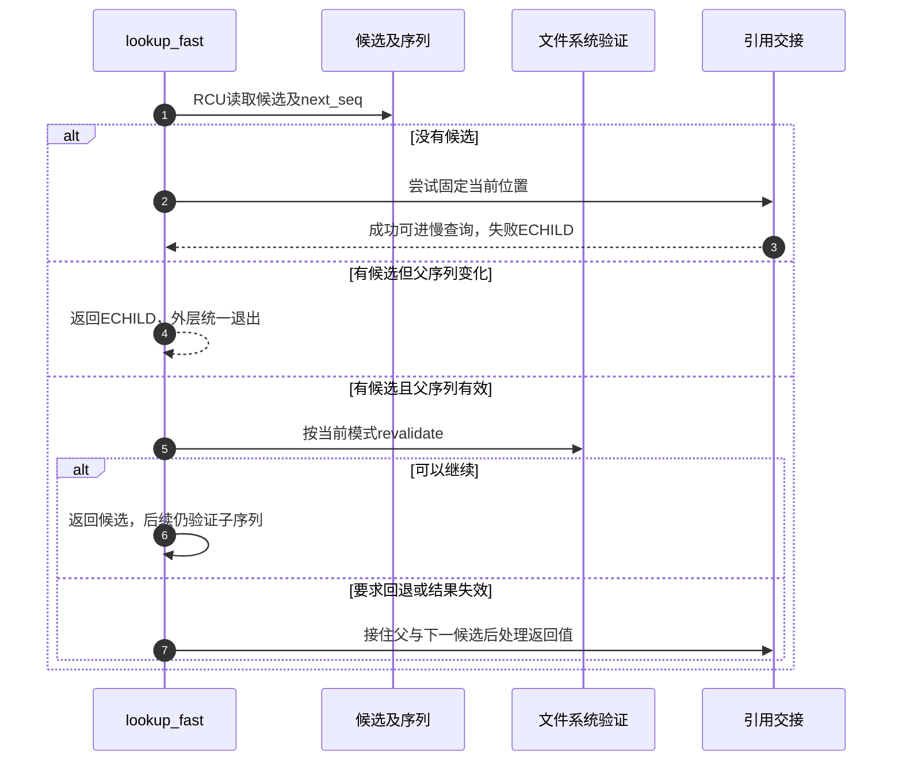
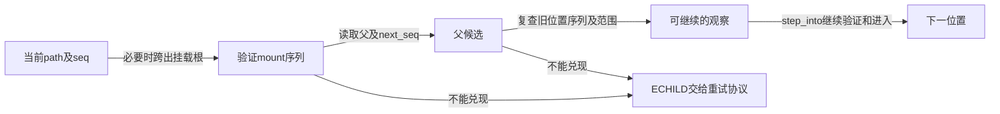

# 第16章\_候选读取与快速路径验证

本页承接 [快慢遍历导读](../navigation/P09_快速观察怎样转为引用并协调慢查询.md#9.1_把观察凭据与持有交接分开)，解释 L1～L3 中无逐项引用的观察与验证。固定 NXP Linux 6.12.20 提交 `dfaf2136deb2af2e60b994421281ba42f1c087e0`；候选读取来自 fs/dcache.c，其余来自 fs/namei.c，版本见 [总索引](../navigation/P01_Linux_6.12_VFS源码阅读索引.md)。

## 16.1\_返回候选时同时交出尚待验证的序列

__d_lookup_rcu 按父和名字寻找候选，不增加普通 dentry 引用。它返回的 seqp 是后续验证的凭据；调用者不能只取指针而丢弃序列。

```c
/** @brief 仓库补充阅读说明：返回不带普通引用的名称候选及验证序列。 */
struct dentry *__d_lookup_rcu(const struct dentry *parent,
                                const struct qstr *name,
                                unsigned *seqp)
{
        /* 一次携带哈希与长度，不表示名字已经匹配。 */
        u64 hashlen = name->hash_len;
        const unsigned char *str = name->name;
        struct hlist_bl_head *b = d_hash(hashlen);
        struct hlist_bl_node *node;
        struct dentry *dentry;

        /* 自定义比较另走成对名称观察，仍需交付序列。 */
        if (unlikely(parent->d_flags & DCACHE_OP_COMPARE))
                return __d_lookup_rcu_op_compare(parent, name, seqp);

        /* 调用者已有RCU保护；本函数不取普通引用。 */
        hlist_bl_for_each_entry_rcu(dentry, node, b, d_hash) {
                unsigned seq;

                /* 不等写侧稳定，样本必须由上层后续核对。 */
                seq = raw_seqcount_begin(&dentry->d_seq);
                /* 父目录是名称身份的一部分。 */
                if (dentry->d_parent != parent)
                        continue;
                if (d_unhashed(dentry))
                        continue;
                if (dentry->d_name.hash_len != hashlen)
                        continue;
                /* 哈希/长度筛选后仍要核对完整名字。 */
                if (dentry_cmp(dentry, str, hashlen_len(hashlen)) != 0)
                        continue;
                /* 把子序列交给调用者，不能只返回裸指针。 */
                *seqp = seq;
                return dentry;
        }
        return NULL;
}
```

普通比较路径读取父、hashed 状态、名字哈希及长度，再比较名称。特殊 d_compare 分支进入 __d_lookup_rcu_op_compare，它还要保证名字指针与长度的成对观察；该辅助分支仍把序列交给调用者验证，不能把文件系统名称比较回调当成取消并发协议的理由。

这里可能因 rename 遗漏候选，允许调用者退到不会接受这种遗漏的查询。源码注释中历史性的“持有vfsmount锁”措辞不能覆盖本版本实际的序列与RCU协议；判断同步前提要结合调用链，而不是将一段旧注释直接当成函数内取得了某把锁。

`__d_lookup_rcu`在dcache.h声明，调用者必须已进入RCU读侧；本函数没有自行rcu_read_lock，也没有在返回前完成对子序列的最终验证。`d_hash`和 `__d_lookup_rcu_op_compare` 的唯一实现见 [桶定位与自定义比较](../../hash_table/source_explanations/fs/dcache.c.md#1.1_候选匹配与序列交接)。后者在调用文件系统d_compare前复核名字指针/长度样本，之后仍交回seqp。

`dentry_cmp`读取名字指针并比较指定长度的字节，`hashlen_len`从qstr的组合值取长度；哈希匹配不能代替字节或文件系统比较。`raw_seqcount_begin`不等待正在更新的序列稳定，但有读侧排序，配合名字指针的release发布保证相应读取前提。改此函数必须同时检查普通比较、自定义比较、碰撞、rename造成的遗漏，以及调用者是否仍消费seqp；不能只测返回指针非NULL。



## 16.2\_快速查询按当前模式解释同一个返回形态

lookup_fast 在 RCU 模式调用无引用查找，没有候选时先 try_to_unlazy，再返回 NULL 让调用者进入慢查询；找到候选则检查父序列并重新验证。ref 模式调用的是带引用 __d_lookup，因此同一个成功指针的所有权取决于 nd.flags。

```c
/** @brief 仓库补充阅读说明：按当前模式查询并处理候选验证和持有交接。 */
static struct dentry *lookup_fast(struct nameidata *nd)
{
        struct dentry *dentry, *parent = nd->path.dentry;
        int status = 1;

        if (nd->flags & LOOKUP_RCU) {
                /* 取得候选和子序列，还没有普通引用。 */
                dentry = __d_lookup_rcu(parent, &nd->last, &nd->next_seq);
                if (unlikely(!dentry)) {
                        /* 无候选时先接住当前位置，才可进入可睡眠慢查找。 */
                        if (!try_to_unlazy(nd))
                                return ERR_PTR(-ECHILD);
                        return NULL;
                }

                /* 子序列采样后再验证父，建立相邻观察的顺序。 */
                if (read_seqcount_retry(&parent->d_seq, nd->seq))
                        return ERR_PTR(-ECHILD);

                /* 验证按当前模式执行，返回值不只是布尔值。 */
                status = d_revalidate(dentry, nd->flags);
                if (likely(status > 0))
                        return dentry;
                /* 非正验证结果先接住父和下一候选再处理。 */
                if (!try_to_unlazy_next(nd, dentry))
                        return ERR_PTR(-ECHILD);
                /* 只有要求慢上下文的结果才重新执行验证。 */
                if (status == -ECHILD)

                        /* 验证按当前模式执行，返回值不只是布尔值。 */
                        status = d_revalidate(dentry, nd->flags);
        } else {
                /* 带引用模式取得的候选由调用者或本失败路径dput。 */
                dentry = __d_lookup(parent, &nd->last);
                if (unlikely(!dentry))
                        return NULL;
                /* 验证按当前模式执行，返回值不只是布尔值。 */
                status = d_revalidate(dentry, nd->flags);
        }
        if (unlikely(status <= 0)) {
                /* 0代表缓存结果无效，需要失效后重新查询。 */
                if (!status)
                        d_invalidate(dentry);
                dput(dentry);
                /* status为0时是NULL，负数保持错误指针。 */
                return ERR_PTR(status);
        }
        return dentry;
}
```

```c
/** @brief 仓库补充阅读说明：有验证操作时调用文件系统，否则接受缓存候选。 */
static inline int d_revalidate(struct dentry *dentry, unsigned int flags)
{
        /* 能力位决定有无回调；缺省返回1不表示进行了后端I/O。 */
        if (unlikely(dentry->d_flags & DCACHE_OP_REVALIDATE))
                return dentry->d_op->d_revalidate(dentry, flags);
        else
                return 1;
}
```

revalidate 大于0表示可以继续；0表示失效，负数表示错误或特定回退请求。RCU 路径遇到非正结果先尝试接住父和下一候选；只有原状态为 ECHILD 才按相应分支再次调用验证。之后0会失效并归还候选，ERR_PTR(0)表现为NULL，调用者由此进入慢查询；其他错误不能都吞成未命中。



带引用 __d_lookup 的唯一实现见 [名称查找](P11_名称候选的建立发布与持有.md#11.5_查找候选时在锁内核对身份并取得持有)。不要在本页再次复制同一函数，也不要把内部使用RCU与整次路径选择RCU-walk混为一谈。

`d_revalidate`是namei.c的内部包装，能力位来自dentry操作初始化；回调的flags包含当前LOOKUP_RCU，回调不能自行假设允许睡眠。`d_invalidate`则是dcache.c中的VFS操作，声明在dcache.h：先撤销本对象哈希，正对象还会收缩子缓存并处理子挂载。它既不是仅清一个有效位，也不是后端unlink。这里解释其失效责任，具体子树回收算法不复制到查询页。

| 查询结果 | 已取得的资源及下一步 |
| --- | --- |
| RCU模式无候选、转换成功 | 当前path已持有；NULL让调用者进入慢查询 |
| RCU模式候选有效 | 返回观察指针，子序列仍在进入候选等位置验证 |
| 回调非正结果且下一候选转换失败 | 返回ECHILD，不再继续使用该观察 |
| 转换后回调为0 | 失效、归还候选，ERR_PTR(0)即NULL，重新查询 |
| 转换后回调为负 | 归还候选并保留错误；仅原来的ECHILD触发一次可阻塞重新验证 |
| ref模式命中 | 持引用候选；验证失败由本函数dput，成功交调用者 |

修改返回形态、回调时点或失效策略时必须同时覆盖此表，尤其不能把0与所有负错误合并。向下游转交失败后的额外子持有见 [下一候选交接](P17_从RCU观察交接到路径引用.md#17.5_已经选出的下一候选需要额外持有)。

## 16.3\_跨挂载失败后先恢复候选再交接模式

__follow_mount_rcu 尝试跳过已有挂载栈，并检查管理回调、NO_XDEV、mount序列和是否需要自动挂载。需要阻塞的管理工作不能在这里假装完成。

```c
/** @brief 仓库补充阅读说明：在快速观察条件允许时跨越已有挂载。 */
static bool __follow_mount_rcu(struct nameidata *nd, struct path *path)
{
        struct dentry *dentry = path->dentry;
        unsigned int flags = dentry->d_flags;

        /* 普通候选没有管理工作，可以继续快速路径。 */
        if (likely(!(flags & DCACHE_MANAGED_DENTRY)))
                return true;

        /* 先回退；带引用路径再确定是否确实跨mount及最终错误。 */
        if (unlikely(nd->flags & LOOKUP_NO_XDEV))
                return false;

        for (;;) {

                if (unlikely(flags & DCACHE_MANAGE_TRANSIT)) {
                        /* true说明RCU上下文，回调不能阻塞。 */
                        int res = dentry->d_op->d_manage(path, true);
                        if (res)
                                /* EISDIR在此是停止向下管理的接受结果，其他非零要求回退。 */
                                return res == -EISDIR;
                        flags = dentry->d_flags;
                }

                if (flags & DCACHE_MOUNTED) {
                        /* 无普通引用地查已有挂载，随后必须核对mount序列。 */
                        struct mount *mounted = __lookup_mnt(path->mnt, dentry);
                        if (mounted) {
                                /* 推进局部候选；失败时外层必须恢复原位置。 */
                                path->mnt = &mounted->mnt;
                                dentry = path->dentry = mounted->mnt.mnt_root;
                                nd->state |= ND_JUMPED;
                                nd->next_seq = read_seqcount_begin(&dentry->d_seq);
                                flags = dentry->d_flags;

                                /* 保证接受的挂载观察与样本一致。 */
                                if (read_seqretry(&mount_lock, nd->m_seq))
                                        return false;
                                continue;
                        }
                        /* 保证接受的挂载观察与样本一致。 */
                        if (read_seqretry(&mount_lock, nd->m_seq))
                                return false;
                }
                /* 需要新建自动挂载时不能在这里假装已经完成。 */
                return !(flags & DCACHE_NEED_AUTOMOUNT);
        }
}
```

```c
/** @brief 仓库补充阅读说明：恢复失败的快速候选后转换模式并处理挂载。 */
static inline int handle_mounts(struct nameidata *nd, struct dentry *dentry,
                          struct path *path)
{
        bool jumped;
        int ret;

        /* 开始或回退时使用原当前位置mount。 */
        path->mnt = nd->path.mnt;
        path->dentry = dentry;
        if (nd->flags & LOOKUP_RCU) {
                /* 保留下一候选的原样本，以便撤销部分推进。 */
                unsigned int seq = nd->next_seq;
                if (likely(__follow_mount_rcu(nd, path)))
                        return 0;

                /* 开始或回退时使用原当前位置mount。 */
                path->mnt = nd->path.mnt;
                path->dentry = dentry;
                /* 恢复到同一原候选后再取得引用。 */
                nd->next_seq = seq;
                if (!try_to_unlazy_next(nd, dentry))
                        return -ECHILD;
        }
        /* 带引用路径可处理管理及自动挂载工作。 */
        ret = traverse_mounts(path, &jumped, &nd->total_link_count, nd->flags);
        /* 实际发生跨越时兑现NO_XDEV或记录ND_JUMPED。 */
        if (jumped) {
                if (unlikely(nd->flags & LOOKUP_NO_XDEV))
                        ret = -EXDEV;
                else
                        nd->state |= ND_JUMPED;
        }
        /* 失败归还候选；同mount时不归还当前位置那份mount持有。 */
        if (unlikely(ret)) {
                dput(path->dentry);
                if (path->mnt != nd->path.mnt)
                        mntput(path->mnt);
        }
        return ret;
}
```

尝试过程中 path 与 next_seq 可能已被修改；handle_mounts 在回退前把它们恢复为原候选，再调用 try_to_unlazy_next。随后带引用 traverse_mounts 处理实际跨越，失败时配对归还当前候选及新增 mount 持有。若不恢复就拿一半推进的状态交给转换，会把两个观察位置混在一起。

普通名称的 step_into 已在 [单步进入](P14_前导分量与单步位置推进.md#14.3_进入候选前先处理挂载再决定是否跟随链接) 展开，它继续消费这里交付的 path，不重复这两层责任。

`DCACHE_MANAGED_DENTRY`组合管理通行、已有挂载及需自动挂载的能力；`d_manage(path, true)`要求不阻塞。在这一协议里-EISDIR表示可停在当前位置，其他非零结果使快速跨越返回false。false仅表示不能在该快速尝试继续，不是统一的“路径不存在”。

`__lookup_mnt`由namespace.c提供，以原mount和dentry查挂载哈希；这里不取得普通mount引用，因此依赖RCU与mount序列。`traverse_mounts`是namei.c的带引用入口，使用acquire读取d_flags，必要时调用管理/自动挂载方法，更新局部path与jumped，失败由handle_mounts归还；自动挂载还可消耗total_link_count预算。其详细挂载服务实现不在本查询页展开，原件可从 [namei.c](../../linux/fs/namei.c) 与 [namespace.c](../../linux/fs/namespace.c) 追踪。

修改这里应把“快速尝试前的候选”作为回退基准，同时恢复path.mnt、path.dentry和next_seq；只恢复指针或只恢复序列都不完整。验证至少覆盖叠加挂载、管理回调要求慢上下文、自动挂载、NO_XDEV、负结果以及跨越后失败；不得对沿用的当前位置mount多做一次mntput。

## 16.4\_向上观察需要串联旧位置父位置和挂载序列

follow_dotdot_rcu 先检查根边界；在挂载根处选择外部挂载点并验证 mount 序列。再读取父 dentry 的序列，复查旧位置的序列，检查父仍在本视图内，最后把父候选交给后续进入步骤。

```c
/** @brief 仓库补充阅读说明：串联旧位置、父位置和挂载序列以验证向上移动。 */
static struct dentry *follow_dotdot_rcu(struct nameidata *nd)
{
        struct dentry *parent, *old;

        /* 先按完整path判断本次根边界。 */
        if (path_equal(&nd->path, &nd->root))
                goto in_root;
        if (unlikely(nd->path.dentry == nd->path.mnt->mnt_root)) {
                struct path path;
                unsigned seq;
                /* 必要时跨出挂载根，返回的是观察而非引用。 */
                if (!choose_mountpoint_rcu(real_mount(nd->path.mnt),
                                           &nd->root, &path, &seq))
                        goto in_root;
                /* 快速路径先请求重走，带引用路径再兑现明确拒绝。 */
                if (unlikely(nd->flags & LOOKUP_NO_XDEV))
                        return ERR_PTR(-ECHILD);
                nd->path = path;
                nd->inode = path.dentry->d_inode;
                /* 旧当前位置已经推进，须同步其inode与序列。 */
                nd->seq = seq;

                if (read_seqretry(&mount_lock, nd->m_seq))
                        return ERR_PTR(-ECHILD);

        }
        old = nd->path.dentry;
        parent = old->d_parent;
        /* 先采父样本，再确认旧子位置未变化。 */
        nd->next_seq = read_seqcount_begin(&parent->d_seq);

        /* 旧位置关系变化则不能接受刚读出的父。 */
        if (read_seqcount_retry(&old->d_seq, nd->seq))
                return ERR_PTR(-ECHILD);
        /* 检查绑定子树范围，不把d_parent直接当成合法父。 */
        if (unlikely(!path_connected(nd->path.mnt, parent)))
                return ERR_PTR(-ECHILD);
        return parent;
in_root:
        if (read_seqretry(&mount_lock, nd->m_seq))
                return ERR_PTR(-ECHILD);
        /* 边界上的上行要求按外层协议重走。 */
        if (unlikely(nd->flags & LOOKUP_BENEATH))
                return ERR_PTR(-ECHILD);
        /* 根边界停留时当前对象就是下一候选。 */
        nd->next_seq = nd->seq;
        return nd->path.dentry;
}
```



这组检查证明的是按协议可以接受的相邻移动，不是冻结整个目录树。带引用版本和scoped额外检查见 [向上路径](P14_前导分量与单步位置推进.md#14.4_向上走需要同时考虑根边界与挂载根) 及其下一节。

快速上行在NO_XDEV、BENEATH或范围观察不充分时可返回ECHILD，让外层带引用路径重新判定；不能把这里的内部错误直接改写成系统调用最终EXDEV。`choose_mountpoint_rcu`只交观察与序列，`path_connected`核对绑定子树；带引用对应实现的辅助契约见 [向上路径](P14_前导分量与单步位置推进.md#14.4_向上走需要同时考虑根边界与挂载根)。修改时需把“读父样本后再验旧子样本”的顺序与step_into后续验证一起保留，否则可能把两个时间点的拓扑拼成不存在的路径。

## 16.5\_权限检查也必须说明能否阻塞

may_lookup 在 RCU 模式给 inode_permission 增加 MAY_NOT_BLOCK。若需要退出快速模式，先交接已有状态；只有适当的 ECHILD 情况才重新以可阻塞条件执行权限检查，真正硬错误仍要返回。

```c
/** @brief 仓库补充阅读说明：按模式设置权限检查的不可阻塞要求并处理回退。 */
static inline int may_lookup(struct mnt_idmap *idmap,
                             struct nameidata *restrict nd)
{
        int err, mask;

        /* MAY_NOT_BLOCK约束检查过程，MAY_EXEC表达目录搜索权限。 */
        mask = nd->flags & LOOKUP_RCU ? MAY_NOT_BLOCK : 0;
        err = inode_permission(idmap, nd->inode, mask | MAY_EXEC);
        if (likely(!err))
                return 0;

        /* 带引用路径的错误直接返回。 */
        if (!(nd->flags & LOOKUP_RCU))
                return err;

        /* RCU错误先通过持有交接判断观察能否继续使用。 */
        if (!try_to_unlazy(nd))
                return -ECHILD;

        /* 真实拒绝保持原错误，只为ECHILD重做可阻塞检查。 */
        if (err != -ECHILD)
                return err;

        return inode_permission(idmap, nd->inode, MAY_EXEC);
}
```

所以“名称在缓存里”不保证剩下所有步骤都能在快速模式完成。权限、重新验证、管理挂载和链接取得都有自己的上下文要求。本页未运行目标快速路径追踪，返回 [导读](../navigation/P09_快速观察怎样转为引用并协调慢查询.md#9.2_用实现入口区分读取转换与等待)。


`MAY_EXEC`在目录场景表达搜索许可，`MAY_NOT_BLOCK`表达检查上下文；后者不是少检查一项权限。`inode_permission`的只读、不可变、基本类别、ACL和安全hook职责见 [权限分派](P52_inode权限的基本检查与分派.md#52.1_先检查写入限制再选择权限实现)；ACL未缓存的快速拒绝见 [ACL缓存边界](P53_挂载身份换算与ACL判断.md#53.2_读取ACL时区分不存在与尚未缓存)。当前SECURITY关闭但目录权限检查仍存在，不能把空安全hook理解为全部许可都省略。修改may_lookup需要覆盖快速成功、硬错误、ECHILD、模式交接失败与再次权限检查失败。本轮未取得这些分支的目标运行覆盖。
