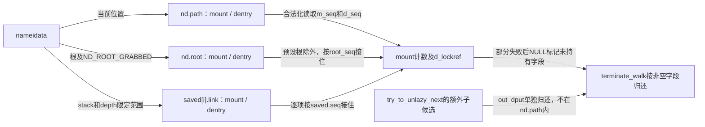
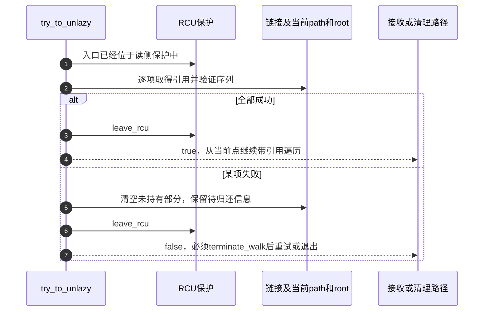
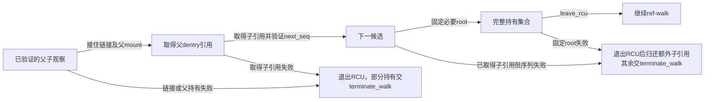

# 第17章\_从RCU观察交接到路径引用

本页沿 [快慢遍历导读](../navigation/P09_快速观察怎样转为引用并协调慢查询.md#9.1_把观察凭据与持有交接分开) 解释 L1～L5 中观察与引用的交接。固定提交 `dfaf2136deb2af2e60b994421281ba42f1c087e0`；mount转换来自fs/namespace.c，其余路径转换来自fs/namei.c，版本见 [VFS总索引](../navigation/P01_Linux_6.12_VFS源码阅读索引.md)。

## 17.1\_挂载引用的取得与序列检查必须配对

增加mount计数只能说明有一次计数写入，不能单独证明这份持有对应原来观察的拓扑。__legitimize_mnt 先检查mount序列，取持有后经屏障再次检查；它与挂载最后引用路径的屏障相配合。

```c
/** @brief 仓库补充阅读说明：取得挂载持有并验证序列，区分失败后的归还责任。 */
int __legitimize_mnt(struct vfsmount *bastard, unsigned seq)
{
        struct mount *mnt;
        /* 取得引用前后都验证同一挂载序列。 */
        if (read_seqretry(&mount_lock, seq))
                return 1;
        /* 空mount是无须取得持有的成功情形。 */
        if (bastard == NULL)
                return 0;
        mnt = real_mount(bastard);
        /* 在RCU观察仍有效时增加计数。 */
        mnt_add_count(mnt, 1);
        /* 与最后mount归还的屏障配对，不能仅保留计数加法。 */
        smp_mb();
        if (likely(!read_seqretry(&mount_lock, seq)))
                return 0;
        /* 同步卸载分支直接撤销刚加的计数。 */
        if (bastard->mnt_flags & MNT_SYNC_UMOUNT) {
                mnt_add_count(mnt, -1);
                return 1;
        }
        /* 与死亡判定序列化，确认能否直接减回。 */
        lock_mount_hash();
        if (unlikely(bastard->mnt_flags & MNT_DOOMED)) {
                mnt_add_count(mnt, -1);
                unlock_mount_hash();
                return 1;
        }
        unlock_mount_hash();

        /* 仍有一份mount持有交给调用者在安全上下文mntput。 */
        return -1;
}
```

| 返回值 | 此调用的资源结果 | 调用者责任 |
| --- | --- | --- |
| 0 | 验证成功；非空mount取得持有 | 按成功path持有继续 |
| 1 | 失败，未保留需要调用者归还的新增mount引用 | 不可额外mntput这份不存在的持有 |
| -1 | 失败，但仍有一份已增加的mount引用 | 退出相应观察后按规定归还 |

MNT_SYNC_UMOUNT或MNT_DOOMED分支决定能否立即减回。不能把非零返回统一处理为“什么都没取得”。对应最后归还实现见 [mount引用退出](P10_挂载脱离与最后引用退出.md#10.4_最后计数归还才选择真正的清理路径)。

`mount_lock`在namespace.c静态DEFINE_SEQLOCK初始化；`lock_mount_hash/unlock_mount_hash`就是它的写侧锁包装，既序列化检查又推进序列，不是第二把互不相关的锁。`__legitimize_mnt`在fs/mount.h声明，调用时观察仍受RCU保护。`real_mount`从内嵌vfsmount找回mount，不能把任意指针强转后当成合法对象。

`mnt_add_count`在SMP配置更新每CPU计数，当前非SMP配置使用对应直接计数路径；最后归还的汇总及屏障见 [mount清理](P10_挂载脱离与最后引用退出.md#10.4_最后计数归还才选择真正的清理路径)。修改合法化时必须同步那一侧的配对协议，并按返回0、1、-1分别检查调用者，不能用“非零就是失败”抹去仍须归还的持有。

## 17.2\_路径合法化保留足够的信息供失败清理

__legitimize_path 先接住mount，再尝试dentry的lockref持有并核对d_seq。根据失败发生在哪一步清空不同字段，让后续path_put仅归还真正取得的资源。

```c
/** @brief 仓库补充阅读说明：取得路径持有并为部分失败保留准确清理状态。 */
static bool __legitimize_path(struct path *path, unsigned seq, unsigned mseq)
{
        int res = __legitimize_mnt(path->mnt, mseq);
        if (unlikely(res)) {
                /* mount失败且没有残留持有时才清mount。 */
                if (res > 0)
                        path->mnt = NULL;
                /* 尚未取得dentry持有，避免统一清理误put。 */
                path->dentry = NULL;
                return false;
        }
        /* 允许零引用缓存重新取得；dead负计数拒绝。 */
        if (unlikely(!lockref_get_not_dead(&path->dentry->d_lockref))) {
                /* 尚未取得dentry持有，避免统一清理误put。 */
                path->dentry = NULL;
                return false;
        }
        /* 序列失败时已取得的两份持有保留给清理。 */
        return !read_seqcount_retry(&path->dentry->d_seq, seq);
}
```

```c
/** @brief 仓库补充阅读说明：传入本次挂载序列，保留路径转换结果供调用者处理。 */
static inline bool legitimize_path(struct nameidata *nd,
                            struct path *path, unsigned seq)
{
        /* 使用本轮mount样本，成功/部分失败状态均交给调用者。 */
        return __legitimize_path(path, seq, nd->m_seq);
}
```

这里使用lockref_get_not_dead，不是“计数非零才增加”。零引用但仍合法保留的缓存dentry可以重新取得引用；已标记dead的负计数对象才应拒绝。[lib/lockref.c](../../linux/lib/lockref.c) 与 [include/linux/lockref.h](../../linux/include/linux/lockref.h) 同时给出条件性cmpxchg与锁路径，不能把它统一写成一个无条件无锁原子加法。

`__legitimize_path`与包装legitimize_path是namei.c私有函数。path的非空字段在进入时是观察指针，返回失败后则被整理为 **只含已取得资源的清理记录**，这个语义变化是统一path_put能够工作的前提。

| 失败位置 | 返回时mount字段 | 返回时dentry字段 | 后续清理 |
| --- | --- | --- | --- |
| mount返回1 | NULL | NULL | 本path没有新增持有 |
| mount返回-1 | 保留已加引用 | NULL | 归还mount |
| mount成功、dentry已dead | 保留mount引用 | NULL | 归还mount |
| 两者已取得、d_seq变化 | 保留mount引用 | 保留dentry引用 | 两份都归还，不能继续遍历 |

`lockref_get_not_dead`允许count为0的缓存对象重新持有，但拒绝dead负计数。`USE_CMPXCHG_LOCKREF`不成立时走自旋锁实现，当前非SMP配置正是此边界；它与总返回-1请求上层持锁递减的lockref_put_return不是同一行为。死亡标记及零引用保留见 [引用退出](P12_名称失效与最后使用者退出.md#12.4_快速归还遇到不确定性时持锁重查)。修改NULL标记时必须逐行核对上表，不能把“返回false”变成“随意清空所有指针”。



## 17.3\_链接栈与根也必须一起接住

当前位置之外，链接栈和本次取得的根都可能仍处在RCU观察状态。legitimize_links逐项转换，失败时调整depth使清理只覆盖已尝试的部分；root则用ND_ROOT_GRABBED记录归还责任。调用者预设管理的root不重复取得同样的持有。

```c
/** @brief 仓库补充阅读说明：逐项固定链接栈并在失败时限定清理深度。 */
static bool legitimize_links(struct nameidata *nd)
{
        int i;
        /* 此处拒绝进入慢处理，先清文本动作但不制造path引用。 */
        if (unlikely(nd->flags & LOOKUP_CACHED)) {
                /* 执行全部残留文本清理；path仍按已尝试范围交给外层。 */
                drop_links(nd);
                nd->depth = 0;
                return false;
        }
        /* 从第一条记录开始接住，不能跳过尚未完成的链接。 */
        for (i = 0; i < nd->depth; i++) {
                struct saved *last = nd->stack + i;
                if (unlikely(!legitimize_path(nd, &last->link, last->seq))) {
                        /* 执行全部残留文本清理；path仍按已尝试范围交给外层。 */
                        drop_links(nd);
                        /* 包含本次部分失败记录，其NULL字段准确表达清理责任。 */
                        nd->depth = i + 1;
                        return false;
                }
        }
        return true;
}
```

```c
/** @brief 仓库补充阅读说明：按根的所有权取得需要归还的路径持有。 */
static bool legitimize_root(struct nameidata *nd)
{

        /* 不存在或外部管理的根无须重复取得持有。 */
        if (!nd->root.mnt || (nd->state & ND_ROOT_PRESET))
                return true;
        /* 先登记清理责任，合法化失败也可能留下部分root持有。 */
        nd->state |= ND_ROOT_GRABBED;
        return legitimize_path(nd, &nd->root, nd->root_seq);
}
```

LOOKUP_CACHED限制在这里阻止进入不允许的慢处理，并先执行剩余链接清理动作。成功完成阶段对该标志的处理已在 [complete_walk](P13_路径起点与结果持有的交接.md#13.3_结束验证把快速观察变成可交付结果) 展开：最后结果合法化与缺失后的慢查询不是同一件事。

链接失败时先drop_links处理 **全部尚未结束文本动作**，再把depth限为i+1，让path_put只走已经尝试合法化的记录，包括本次可能只取得mount的那一条。后续记录只有RCU观察，不得对其path_put。root在调用合法化前设置ND_ROOT_GRABBED，同样是为了让失败后的部分root资源被清理；该位不能只在全部成功后才设置。

文本清理与路径持有是两项责任，具体见 [链接退出](P15_符号链接的文本栈与路径跳转.md#15.4_完成或失败都要归还链接资源)。修改循环范围时至少覆盖首条失败、中间失败、全部成功、缓存限制拒绝、没有root与外部预设root，检查每项资源恰好归还一次。

## 17.4\_全部必要持有取得后才退出RCU

try_to_unlazy依次转换链接、当前位置和root。成功分支到leave_rcu之前已经完成必要取引用与验证；失败分支也先把部分资源状态整理成可清理形式，不能返回一个可以继续推进的半成品。

```c
/** @brief 仓库补充阅读说明：在RCU内完成必要持有与验证后退出。 */
static bool try_to_unlazy(struct nameidata *nd)
{
        struct dentry *parent = nd->path.dentry;

        /* 入口必须处于RCU模式，断言不替调用者建立保护。 */
        BUG_ON(!(nd->flags & LOOKUP_RCU));

        /* 先固定所有活跃链接，再处理当前位置和根。 */
        if (unlikely(!legitimize_links(nd)))
                goto out1;
        if (unlikely(!legitimize_path(nd, &nd->path, nd->seq)))
                goto out;
        if (unlikely(!legitimize_root(nd)))
                goto out;
        /* 必要持有已接住，或失败责任已整理，才可退出读侧。 */
        leave_rcu(nd);
        /* 成功后核对当前位置inode一致性，不是再取一个引用。 */
        BUG_ON(nd->inode != parent->d_inode);
        return true;

out1:
        /* 链接转换失败时当前位置从未接住，清空避免误归还。 */
        nd->path.mnt = NULL;
        nd->path.dentry = NULL;
out:
        /* 必要持有已接住，或失败责任已整理，才可退出读侧。 */
        leave_rcu(nd);
        return false;
}
```

```c
/** @brief 仓库补充阅读说明：清除快速观察标志和序列并退出RCU读侧。 */
static void leave_rcu(struct nameidata *nd)
{
        /* 只退出观察模式，不替任何裸指针取得持有。 */
        nd->flags &= ~LOOKUP_RCU;
        nd->seq = nd->next_seq = 0;
        rcu_read_unlock();
}
```



读者应注意不是“先退出RCU，再把刚才指针加引用”。那样会使观察与持有之间出现释放窗口。失败后也不能自行重新调用一次转换碰碰运气，契约要求先结束当前walk。

本实现的BUG_ON检查模式前提及成功后的inode一致性，是内部不变量诊断，不能当作取得引用或校正状态的动作；错误命中可能终止执行。`leave_rcu`本身仅清模式/序列并解读侧锁。改动调用先后必须同时检查两个失败出口：链接失败的out1清空未持有当前位置，位置或root失败的out保留其部分清理记录。任何返回false的nd都只可退出，不能因几个字段非空就继续解析。

## 17.5\_已经选出的下一候选需要额外持有

try_to_unlazy_next还接住下一dentry。父与子序列的配对来自此前查找先获得子序列、随后验证父的顺序；转换仍要取得两者引用并复查子序列，而不是只固定一个父对象就假设子不会退出。

```c
/** @brief 仓库补充阅读说明：同时接住当前位置与下一候选并处理部分失败。 */
static bool try_to_unlazy_next(struct nameidata *nd, struct dentry *dentry)
{
        int res;
        BUG_ON(!(nd->flags & LOOKUP_RCU));

        /* 先转换链接；失败时父路径尚未取得引用。 */
        if (unlikely(!legitimize_links(nd)))
                goto out2;
        /* 根据三态返回安排父mount清理。 */
        res = __legitimize_mnt(nd->path.mnt, nd->m_seq);
        if (unlikely(res)) {
                if (res > 0)
                        goto out2;
                goto out1;
        }
        /* 先取得父dentry，随后接住独立的子候选。 */
        if (unlikely(!lockref_get_not_dead(&nd->path.dentry->d_lockref)))
                goto out1;

        /* 这份子引用不在nd.path中，失败标签需要单独处理。 */
        if (unlikely(!lockref_get_not_dead(&dentry->d_lockref)))
                goto out;
        /* 使用先采子后验父形成的样本链核对子序列。 */
        if (read_seqcount_retry(&dentry->d_seq, nd->next_seq))
                goto out_dput;

        /* 子已持有，根失败仍要额外归还子。 */
        if (unlikely(!legitimize_root(nd)))
                goto out_dput;
        leave_rcu(nd);
        return true;

out2:
        /* out2没有需要归还的父mount。 */
        nd->path.mnt = NULL;
out1:
        /* out1没有需要归还的父dentry。 */
        nd->path.dentry = NULL;
out:
        leave_rcu(nd);
        return false;
out_dput:
        leave_rcu(nd);
        /* 额外子引用在离开RCU之后单独归还。 */
        dput(dentry);
        return false;
}
```



out_dput分支明确在退出RCU后归还额外的子引用；父路径、root和链接的残留持有由统一清理处理。不能对所有失败标签都执行相同的dput列表，否则会重复归还或漏掉已经取得的部分。本页没有目标故障注入，返回 [导读](../navigation/P09_快速观察怎样转为引用并协调慢查询.md#9.2_用实现入口区分读取转换与等待)。


| try_to_unlazy_next出口 | 已取得资源如何交接 |
| --- | --- |
| out2 | 父mount尚未保留，连同父dentry清空；链接中已取得的部分由terminate_walk归还 |
| out1 | 父mount有归还责任，父dentry尚未持有，清后者 |
| out | 父path已接住，额外子未接住，退出读侧后由统一退出清理父及链接 |
| out_dput | 子已接住但验证或root失败；先leave_rcu，再单独dput子，其余留给统一退出 |
| 成功返回 | 父path、额外子、必要root及链接均可按带引用协议消费 |

父子样本的正确性来自lookup_fast先取得子序列再核对父的前置顺序，以及此处引用取得与子序列复查的配合；不能把该函数当成“给任意两个指针加引用”的工具。最小修改面需同时审计lookup_fast、handle_mounts和退出分支，检查额外子引用不会被nd.path的清理重复消费。锁依赖未报警并不证明上述跨函数采样顺序正确，本次也没有故障注入覆盖。
