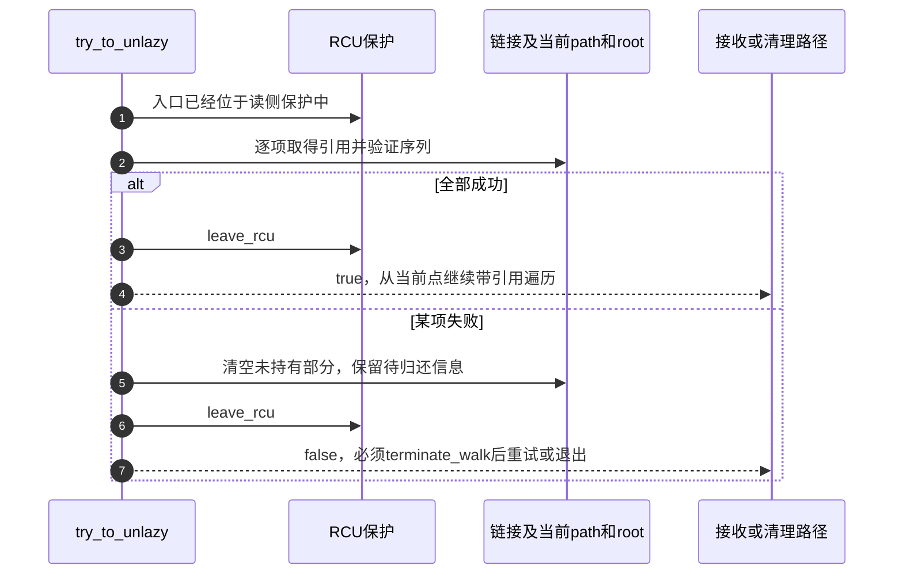
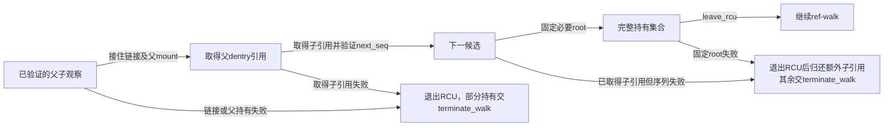

# 第17章\_从RCU观察交接到路径引用

本页沿 [快慢遍历导读](../navigation/P09_快速观察怎样转为引用并协调慢查询.md#9.1_把观察凭据与持有交接分开) 解释 L1～L5 中观察与引用的交接。固定提交 `dfaf2136deb2af2e60b994421281ba42f1c087e0`；mount转换来自fs/namespace.c，其余路径转换来自fs/namei.c，版本见 [VFS总索引](../navigation/P01_Linux_6.12_VFS源码阅读索引.md)。

## 17.1\_挂载引用的取得与序列检查必须配对

增加mount计数只能说明有一次计数写入，不能单独证明这份持有对应原来观察的拓扑。__legitimize_mnt 先检查mount序列，取持有后经屏障再次检查；它与挂载最后引用路径的屏障相配合。

```c
/** @brief 仓库补充阅读说明：取得挂载持有并验证序列，区分失败后的归还责任。 */
int __legitimize_mnt(struct vfsmount *bastard, unsigned seq)
{
        struct mount *mnt;
        if (read_seqretry(&mount_lock, seq))
                return 1;
        if (bastard == NULL)
                return 0;
        mnt = real_mount(bastard);
        mnt_add_count(mnt, 1);
        smp_mb();                       // see mntput_no_expire()
        if (likely(!read_seqretry(&mount_lock, seq)))
                return 0;
        if (bastard->mnt_flags & MNT_SYNC_UMOUNT) {
                mnt_add_count(mnt, -1);
                return 1;
        }
        lock_mount_hash();
        if (unlikely(bastard->mnt_flags & MNT_DOOMED)) {
                mnt_add_count(mnt, -1);
                unlock_mount_hash();
                return 1;
        }
        unlock_mount_hash();
        /* caller will mntput() */
        return -1;
}
```

| 返回值 | 此调用的资源结果 | 调用者责任 |
| --- | --- | --- |
| 0 | 验证成功；非空mount取得持有 | 按成功path持有继续 |
| 1 | 失败，未保留需要调用者归还的新增mount引用 | 不可额外mntput这份不存在的持有 |
| -1 | 失败，但仍有一份已增加的mount引用 | 退出相应观察后按规定归还 |

MNT_SYNC_UMOUNT或MNT_DOOMED分支决定能否立即减回。不能把非零返回统一处理为“什么都没取得”。对应最后归还实现见 [mount引用退出](P10_挂载脱离与最后引用退出.md#10.4_最后计数归还才选择真正的清理路径)。

## 17.2\_路径合法化保留足够的信息供失败清理

__legitimize_path 先接住mount，再尝试dentry的lockref持有并核对d_seq。根据失败发生在哪一步清空不同字段，让后续path_put仅归还真正取得的资源。

```c
/** @brief 仓库补充阅读说明：取得路径持有并为部分失败保留准确清理状态。 */
static bool __legitimize_path(struct path *path, unsigned seq, unsigned mseq)
{
        int res = __legitimize_mnt(path->mnt, mseq);
        if (unlikely(res)) {
                if (res > 0)
                        path->mnt = NULL;
                path->dentry = NULL;
                return false;
        }
        if (unlikely(!lockref_get_not_dead(&path->dentry->d_lockref))) {
                path->dentry = NULL;
                return false;
        }
        return !read_seqcount_retry(&path->dentry->d_seq, seq);
}
```

```c
/** @brief 仓库补充阅读说明：传入本次挂载序列，保留路径转换结果供调用者处理。 */
static inline bool legitimize_path(struct nameidata *nd,
                            struct path *path, unsigned seq)
{
        return __legitimize_path(path, seq, nd->m_seq);
}
```

这里使用lockref_get_not_dead，不是“计数非零才增加”。零引用但仍合法保留的缓存dentry可以重新取得引用；已标记dead的负计数对象才应拒绝。[lib/lockref.c](../../linux/lib/lockref.c) 与 [include/linux/lockref.h](../../linux/include/linux/lockref.h) 同时给出条件性cmpxchg与锁路径，不能把它统一写成一个无条件无锁原子加法。

## 17.3\_链接栈与根也必须一起接住

当前位置之外，链接栈和本次取得的根都可能仍处在RCU观察状态。legitimize_links逐项转换，失败时调整depth使清理只覆盖已尝试的部分；root则用ND_ROOT_GRABBED记录归还责任。调用者预设管理的root不重复取得同样的持有。

```c
/** @brief 仓库补充阅读说明：逐项固定链接栈并在失败时限定清理深度。 */
static bool legitimize_links(struct nameidata *nd)
{
        int i;
        if (unlikely(nd->flags & LOOKUP_CACHED)) {
                drop_links(nd);
                nd->depth = 0;
                return false;
        }
        for (i = 0; i < nd->depth; i++) {
                struct saved *last = nd->stack + i;
                if (unlikely(!legitimize_path(nd, &last->link, last->seq))) {
                        drop_links(nd);
                        nd->depth = i + 1;
                        return false;
                }
        }
        return true;
}
```

```c
/** @brief 仓库补充阅读说明：按根的所有权取得需要归还的路径持有。 */
static bool legitimize_root(struct nameidata *nd)
{
        /* Nothing to do if nd->root is zero or is managed by the VFS user. */
        if (!nd->root.mnt || (nd->state & ND_ROOT_PRESET))
                return true;
        nd->state |= ND_ROOT_GRABBED;
        return legitimize_path(nd, &nd->root, nd->root_seq);
}
```

LOOKUP_CACHED限制在这里阻止进入不允许的慢处理，并先执行剩余链接清理动作。成功完成阶段对该标志的处理已在 [complete_walk](P13_路径起点与结果持有的交接.md#13.3_结束验证把快速观察变成可交付结果) 展开：最后结果合法化与缺失后的慢查询不是同一件事。

## 17.4\_全部必要持有取得后才退出RCU

try_to_unlazy依次转换链接、当前位置和root。成功分支到leave_rcu之前已经完成必要取引用与验证；失败分支也先把部分资源状态整理成可清理形式，不能返回一个可以继续推进的半成品。

```c
/** @brief 仓库补充阅读说明：在RCU内完成必要持有与验证后退出。 */
static bool try_to_unlazy(struct nameidata *nd)
{
        struct dentry *parent = nd->path.dentry;

        BUG_ON(!(nd->flags & LOOKUP_RCU));

        if (unlikely(!legitimize_links(nd)))
                goto out1;
        if (unlikely(!legitimize_path(nd, &nd->path, nd->seq)))
                goto out;
        if (unlikely(!legitimize_root(nd)))
                goto out;
        leave_rcu(nd);
        BUG_ON(nd->inode != parent->d_inode);
        return true;

out1:
        nd->path.mnt = NULL;
        nd->path.dentry = NULL;
out:
        leave_rcu(nd);
        return false;
}
```

```c
/** @brief 仓库补充阅读说明：清除快速观察标志和序列并退出RCU读侧。 */
static void leave_rcu(struct nameidata *nd)
{
        nd->flags &= ~LOOKUP_RCU;
        nd->seq = nd->next_seq = 0;
        rcu_read_unlock();
}
```



读者应注意不是“先退出RCU，再把刚才指针加引用”。那样会使观察与持有之间出现释放窗口。失败后也不能自行重新调用一次转换碰碰运气，契约要求先结束当前walk。

## 17.5\_已经选出的下一候选需要额外持有

try_to_unlazy_next还接住下一dentry。父与子序列的配对来自此前查找先获得子序列、随后验证父的顺序；转换仍要取得两者引用并复查子序列，而不是只固定一个父对象就假设子不会退出。

```c
/** @brief 仓库补充阅读说明：同时接住当前位置与下一候选并处理部分失败。 */
static bool try_to_unlazy_next(struct nameidata *nd, struct dentry *dentry)
{
        int res;
        BUG_ON(!(nd->flags & LOOKUP_RCU));

        if (unlikely(!legitimize_links(nd)))
                goto out2;
        res = __legitimize_mnt(nd->path.mnt, nd->m_seq);
        if (unlikely(res)) {
                if (res > 0)
                        goto out2;
                goto out1;
        }
        if (unlikely(!lockref_get_not_dead(&nd->path.dentry->d_lockref)))
                goto out1;

        /*
         * We need to move both the parent and the dentry from the RCU domain
         * to be properly refcounted. And the sequence number in the dentry
         * validates *both* dentry counters, since we checked the sequence
         * number of the parent after we got the child sequence number. So we
         * know the parent must still be valid if the child sequence number is
         */
        if (unlikely(!lockref_get_not_dead(&dentry->d_lockref)))
                goto out;
        if (read_seqcount_retry(&dentry->d_seq, nd->next_seq))
                goto out_dput;
        /*
         * Sequence counts matched. Now make sure that the root is
         * still valid and get it if required.
         */
        if (unlikely(!legitimize_root(nd)))
                goto out_dput;
        leave_rcu(nd);
        return true;

out2:
        nd->path.mnt = NULL;
out1:
        nd->path.dentry = NULL;
out:
        leave_rcu(nd);
        return false;
out_dput:
        leave_rcu(nd);
        dput(dentry);
        return false;
}
```



out_dput分支明确在退出RCU后归还额外的子引用；父路径、root和链接的残留持有由统一清理处理。不能对所有失败标签都执行相同的dput列表，否则会重复归还或漏掉已经取得的部分。本页没有目标故障注入，返回 [导读](../navigation/P09_快速观察怎样转为引用并协调慢查询.md#9.2_用实现入口区分读取转换与等待)。
