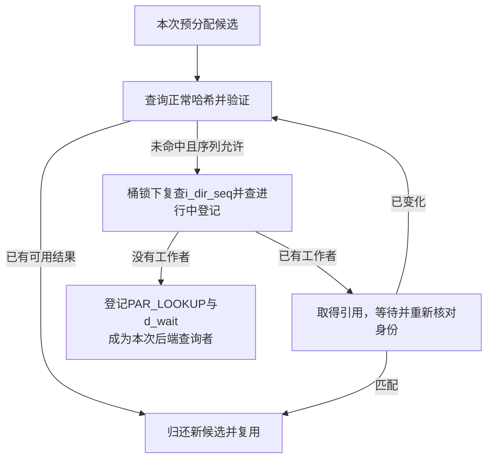
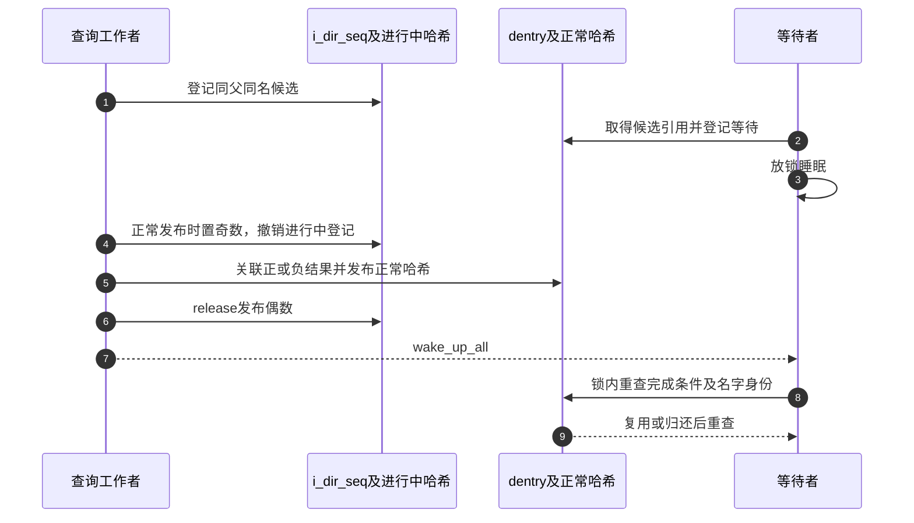

# 第18章\_并行查询的登记等待与结果发布

本页继续 [快慢遍历导读](../navigation/P09_快速观察怎样转为引用并协调慢查询.md#9.1_把观察凭据与持有交接分开) 中 L2 的慢查询。固定 NXP Linux 6.12.20 提交 `dfaf2136deb2af2e60b994421281ba42f1c087e0`；慢查询入口来自fs/namei.c，登记与发布来自fs/dcache.c，完成包装来自include/linux/dcache.h，身份见 [总索引](../navigation/P01_Linux_6.12_VFS源码阅读索引.md)。

## 18.1\_目录共享锁不排除两个同名查询

lookup_slow取得父inode共享锁，允许不同查询并发；__lookup_slow在栈上建立等待队列，交给d_alloc_parallel决定复用现有结果、等待已有工作者，还是由本次负责查询。不能因函数名叫slow就假定它会无条件再次调用后端。

```c
/** @brief 仓库补充阅读说明：取得父目录共享锁后执行慢查询。 */
static struct dentry *lookup_slow(const struct qstr *name,
                                  struct dentry *dir,
                                  unsigned int flags)
{
        struct inode *inode = dir->d_inode;
        struct dentry *res;
        inode_lock_shared(inode);
        res = __lookup_slow(name, dir, flags);
        inode_unlock_shared(inode);
        return res;
}
```

```c
/** @brief 仓库补充阅读说明：协调同名查询，执行后端并完成或替换候选。 */
static struct dentry *__lookup_slow(const struct qstr *name,
                                    struct dentry *dir,
                                    unsigned int flags)
{
        struct dentry *dentry, *old;
        struct inode *inode = dir->d_inode;
        DECLARE_WAIT_QUEUE_HEAD_ONSTACK(wq);

        /* Don't go there if it's already dead */
        if (unlikely(IS_DEADDIR(inode)))
                return ERR_PTR(-ENOENT);
again:
        dentry = d_alloc_parallel(dir, name, &wq);
        if (IS_ERR(dentry))
                return dentry;
        if (unlikely(!d_in_lookup(dentry))) {
                int error = d_revalidate(dentry, flags);
                if (unlikely(error <= 0)) {
                        if (!error) {
                                d_invalidate(dentry);
                                dput(dentry);
                                goto again;
                        }
                        dput(dentry);
                        dentry = ERR_PTR(error);
                }
        } else {
                old = inode->i_op->lookup(inode, dentry, flags);
                d_lookup_done(dentry);
                if (unlikely(old)) {
                        dput(dentry);
                        dentry = old;
                }
        }
        return dentry;
}
```

拿到已完成对象时仍可能需要revalidate；结果无效就失效并重查，硬错误归还持有后返回。拿到自己负责的in-lookup候选时才调用inode.lookup，之后配对d_lookup_done。文件系统还可能返回替代dentry或错误，原候选要按协议归还。

## 18.2\_先查正常结果再争取进行中登记

d_alloc_parallel预分配自己的候选，但不急于宣布成为工作者。它先在RCU下读取父i_dir_seq并查询正常名称哈希；若找到可取得引用且序列有效的对象，就放弃自己的候选并复用。

```c
/** @brief 仓库补充阅读说明：复用正常结果、等待同名查询或登记本次工作者。 */
struct dentry *d_alloc_parallel(struct dentry *parent,
                                const struct qstr *name,
                                wait_queue_head_t *wq)
{
        unsigned int hash = name->hash;
        struct hlist_bl_head *b = in_lookup_hash(parent, hash);
        struct hlist_bl_node *node;
        struct dentry *new = d_alloc(parent, name);
        struct dentry *dentry;
        unsigned seq, r_seq, d_seq;

        if (unlikely(!new))
                return ERR_PTR(-ENOMEM);

retry:
        rcu_read_lock();
        seq = smp_load_acquire(&parent->d_inode->i_dir_seq);
        r_seq = read_seqbegin(&rename_lock);
        dentry = __d_lookup_rcu(parent, name, &d_seq);
        if (unlikely(dentry)) {
                if (!lockref_get_not_dead(&dentry->d_lockref)) {
                        rcu_read_unlock();
                        goto retry;
                }
                if (read_seqcount_retry(&dentry->d_seq, d_seq)) {
                        rcu_read_unlock();
                        dput(dentry);
                        goto retry;
                }
                rcu_read_unlock();
                dput(new);
                return dentry;
        }
        if (unlikely(read_seqretry(&rename_lock, r_seq))) {
                rcu_read_unlock();
                goto retry;
        }

        if (unlikely(seq & 1)) {
                rcu_read_unlock();
                goto retry;
        }

        hlist_bl_lock(b);
        if (unlikely(READ_ONCE(parent->d_inode->i_dir_seq) != seq)) {
                hlist_bl_unlock(b);
                rcu_read_unlock();
                goto retry;
        }
        /*
         * No changes for the parent since the beginning of d_lookup().
         * Since all removals from the chain happen with hlist_bl_lock(),
         * any potential in-lookup matches are going to stay here until
         * we unlock the chain.  All fields are stable in everything
         * we encounter.
         */
        hlist_bl_for_each_entry(dentry, node, b, d_u.d_in_lookup_hash) {
                if (dentry->d_name.hash != hash)
                        continue;
                if (dentry->d_parent != parent)
                        continue;
                if (!d_same_name(dentry, parent, name))
                        continue;
                hlist_bl_unlock(b);
                /* now we can try to grab a reference */
                if (!lockref_get_not_dead(&dentry->d_lockref)) {
                        rcu_read_unlock();
                        goto retry;
                }

                rcu_read_unlock();
                /*
                 * somebody is likely to be still doing lookup for it;
                 * wait for them to finish
                 */
                spin_lock(&dentry->d_lock);
                d_wait_lookup(dentry);
                /*
                 * it's not in-lookup anymore; in principle we should repeat
                 * everything from dcache lookup, but it's likely to be what
                 * d_lookup() would've found anyway.  If it is, just return it;
                 * otherwise we really have to repeat the whole thing.
                 */
                if (unlikely(dentry->d_name.hash != hash))
                        goto mismatch;
                if (unlikely(dentry->d_parent != parent))
                        goto mismatch;
                if (unlikely(d_unhashed(dentry)))
                        goto mismatch;
                if (unlikely(!d_same_name(dentry, parent, name)))
                        goto mismatch;
                /* OK, it *is* a hashed match; return it */
                spin_unlock(&dentry->d_lock);
                dput(new);
                return dentry;
        }
        rcu_read_unlock();
        /* we can't take ->d_lock here; it's OK, though. */
        new->d_flags |= DCACHE_PAR_LOOKUP;
        new->d_wait = wq;
        hlist_bl_add_head(&new->d_u.d_in_lookup_hash, b);
        hlist_bl_unlock(b);
        return new;
mismatch:
        spin_unlock(&dentry->d_lock);
        dput(dentry);
        goto retry;
}
```

正常哈希未命中后检查rename序列、目录发布序列的奇偶，再取得in-lookup桶锁并复查i_dir_seq。这两次观察覆盖结果从进行中哈希移到正常哈希的窗口；否则可能两边都没看到，就错误登记第二个工作者。

若进行中桶已有同父同名候选，先取得引用，再退出RCU并在候选锁下等待。醒来后重新核对hash、parent、hashed和名字，匹配才复用；不匹配则归还并重试。只有确实没有已有工作者时，才给自己的候选设置PAR_LOOKUP、登记d_wait并加入进行中哈希。



## 18.3\_等待者睡眠前登记并在醒来后重查

d_wait_lookup在d_lock保护下检查进行中标志，把当前任务等待项加入候选记录的队列；设置不可中断睡眠状态，放开d_lock后schedule，再锁回并检查条件。状态登记与完成者的锁协议避免把一次完成唤醒错过成永久等待。

```c
/** @brief 仓库补充阅读说明：持候选锁登记等待，放锁睡眠后重新检查进行中状态。 */
static void d_wait_lookup(struct dentry *dentry)
{
        if (d_in_lookup(dentry)) {
                DECLARE_WAITQUEUE(wait, current);
                add_wait_queue(dentry->d_wait, &wait);
                do {
                        set_current_state(TASK_UNINTERRUPTIBLE);
                        spin_unlock(&dentry->d_lock);
                        schedule();
                        spin_lock(&dentry->d_lock);
                } while (d_in_lookup(dentry));
        }
}
```

这里的队列头来自发起者__lookup_slow的栈，仅服务本次查询；完成路径在候选中清空队列指针并执行完成唤醒。DECLARE_WAITQUEUE采用default_wake_function，这段局部代码并不是使用autoremove模板。不要从此函数省略通用等待队列的清理责任，或把它复制到可反复复用的长期队列中；它依赖本次查询的完整生命周期。

等待者持有候选，唤醒只是请求重新检查。若查询失败、候选被替代或名字变化，等待者可能再次成为查询者，而不是收到原工作者一份可盲用的返回值。

## 18.4\_目录序列把两个哈希之间的转换连接起来

start_dir_add以奇数标记发布正在进行；通过cmpxchg争取该父目录的发布区间。end_dir_add用release发布下一偶数，恢复相应抢占状态并唤醒本次等待者。它们只保护结果发布这段协议，不将整个可能睡眠的文件系统lookup包进不可抢占区间。

```c
/** @brief 仓库补充阅读说明：以奇数标记目录结果发布区间。 */
static inline unsigned start_dir_add(struct inode *dir)
{
        preempt_disable_nested();
        for (;;) {
                unsigned n = dir->i_dir_seq;
                if (!(n & 1) && cmpxchg(&dir->i_dir_seq, n, n + 1) == n)
                        return n;
                cpu_relax();
        }
}
```

```c
/** @brief 仓库补充阅读说明：发布下一偶数并唤醒等待者。 */
static inline void end_dir_add(struct inode *dir, unsigned int n,
                               wait_queue_head_t *d_wait)
{
        smp_store_release(&dir->i_dir_seq, n + 2);
        preempt_enable_nested();
        wake_up_all(d_wait);
}
```

读取者用acquire取得i_dir_seq，并在进行中桶锁下复查。它若跨过了“撤销旧登记、发布正常结果”的转换，就不能接受之前的双重未命中，必须重来。这是增加目录序列的具体用途，不是用一个计数器替代所有目录锁。

## 18.5\_完成先撤销进行中身份再交付结果或重查机会

__d_lookup_unhash要求d_lock，取得进行中桶锁后清标志、摘除临时节点，取出并清空d_wait，重新初始化此后将用于别名或LRU的连接。d_add发布路径随后建立正常哈希，再通过end_dir_add交接。

```c
/** @brief 仓库补充阅读说明：撤销进行中身份并取出等待队列。 */
static wait_queue_head_t *__d_lookup_unhash(struct dentry *dentry)
{
        wait_queue_head_t *d_wait;
        struct hlist_bl_head *b;

        lockdep_assert_held(&dentry->d_lock);

        b = in_lookup_hash(dentry->d_parent, dentry->d_name.hash);
        hlist_bl_lock(b);
        dentry->d_flags &= ~DCACHE_PAR_LOOKUP;
        __hlist_bl_del(&dentry->d_u.d_in_lookup_hash);
        d_wait = dentry->d_wait;
        dentry->d_wait = NULL;
        hlist_bl_unlock(b);
        INIT_HLIST_NODE(&dentry->d_u.d_alias);
        INIT_LIST_HEAD(&dentry->d_lru);
        return d_wait;
}
```

```c
/** @brief 仓库补充阅读说明：在候选锁下撤销登记并唤醒本次等待者。 */
void __d_lookup_unhash_wake(struct dentry *dentry)
{
        spin_lock(&dentry->d_lock);
        wake_up_all(__d_lookup_unhash(dentry));
        spin_unlock(&dentry->d_lock);
}
```

```c
/** @brief 仓库补充阅读说明：仅在候选仍处于查询中时结束登记。 */
static inline void d_lookup_done(struct dentry *dentry)
{
        if (unlikely(d_in_lookup(dentry)))
                __d_lookup_unhash_wake(dentry);
}
```

如果文件系统已经通过d_add完成发布，d_lookup_done看到进行中标志清除，不再重复完成；否则调用包装撤销登记并唤醒，使错误或替代结果也不会把等待者留下。正常哈希发布本身的唯一实现见 [结果发布](P11_名称候选的建立发布与持有.md#11.4_发布结果时结束并行查询再供后续查找)。



上图选择正常发布；只完成登记而未发布可复用结果的错误分支，使等待者回到重查。没有本次目标并发缺失、后端失败或睡眠唤醒追踪，不能凭源码图给出性能数字。返回 [导读](../navigation/P09_快速观察怎样转为引用并协调慢查询.md#9.2_用实现入口区分读取转换与等待)。
