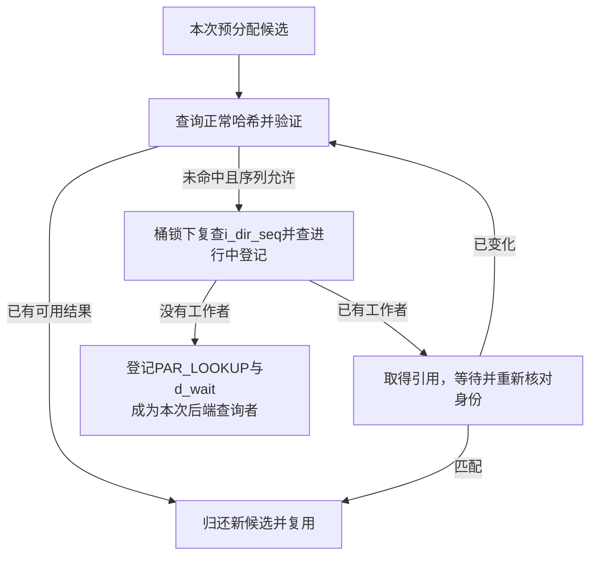
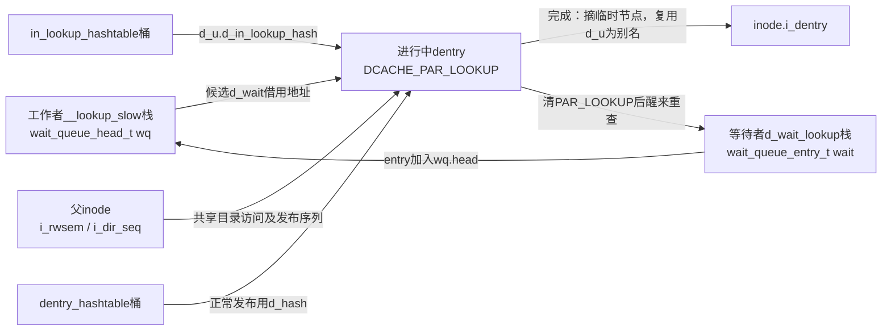
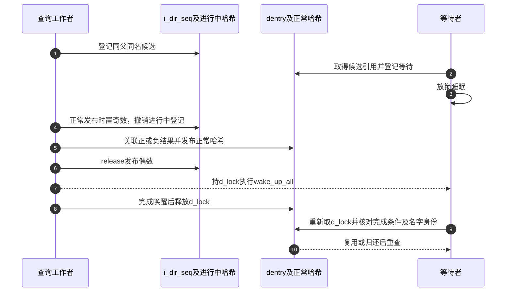

# 第18章\_并行查询的登记等待与结果发布

本页继续 [快慢遍历导读](../navigation/P09_快速观察怎样转为引用并协调慢查询.md#9.1_把观察凭据与持有交接分开) 中 L2 的慢查询。固定 NXP Linux 6.12.20 提交 `dfaf2136deb2af2e60b994421281ba42f1c087e0`；慢查询入口来自fs/namei.c，登记与发布来自fs/dcache.c，完成包装来自include/linux/dcache.h，身份见 [总索引](../navigation/P01_Linux_6.12_VFS源码阅读索引.md)。

## 18.1\_目录共享锁不排除两个同名查询

lookup_slow取得父inode共享锁，允许不同查询并发；__lookup_slow在栈上建立等待队列，交给d_alloc_parallel决定复用现有结果、等待已有工作者，还是由本次负责查询。不能因函数名叫slow就假定它会无条件再次调用后端。

```c
/** @brief 仓库补充阅读说明：取得父目录共享锁后执行慢查询。 */
static struct dentry *lookup_slow(const struct qstr *name,
                                  struct dentry *dir,
                                  unsigned int flags)
{
        struct inode *inode = dir->d_inode;
        struct dentry *res;
        /* 允许并发读查询，单一名字仍需in-lookup协调。 */
        inode_lock_shared(inode);
        res = __lookup_slow(name, dir, flags);
        /* 后端查询及完成交接返回后归还共享锁。 */
        inode_unlock_shared(inode);
        return res;
}
```

```c
/** @brief 仓库补充阅读说明：协调同名查询，执行后端并完成或替换候选。 */
static struct dentry *__lookup_slow(const struct qstr *name,
                                    struct dentry *dir,
                                    unsigned int flags)
{
        struct dentry *dentry, *old;
        struct inode *inode = dir->d_inode;
        /* 本调用栈上的一次查询队列；只有成为工作者才发布地址。 */
        DECLARE_WAIT_QUEUE_HEAD_ONSTACK(wq);

        /* 死亡目录拒绝继续查名称。 */
        if (unlikely(IS_DEADDIR(inode)))
                return ERR_PTR(-ENOENT);
again:
        /* 复用结果、等待他人或取得本次工作者身份。 */
        dentry = d_alloc_parallel(dir, name, &wq);
        if (IS_ERR(dentry))
                return dentry;
        /* 复用对象仍要按文件系统要求重新验证。 */
        if (unlikely(!d_in_lookup(dentry))) {
                int error = d_revalidate(dentry, flags);
                if (unlikely(error <= 0)) {
                        if (!error) {
                                d_invalidate(dentry);
                                dput(dentry);
                                /* 结果失效，已归还旧候选后重试；自己的队列尚未发布。 */
                                goto again;
                        }
                        dput(dentry);
                        dentry = ERR_PTR(error);
                }
        } else {
                /* 仅本次工作者调用后端；NULL表示使用输入候选。 */
                old = inode->i_op->lookup(inode, dentry, flags);
                /* 成功、替代或错误都必须结束尚未完成的进行中身份。 */
                d_lookup_done(dentry);
                if (unlikely(old)) {
                        dput(dentry);
                        /* 接收替代dentry或错误指针，原候选已归还。 */
                        dentry = old;
                }
        }
        return dentry;
}
```

拿到已完成对象时仍可能需要revalidate；结果无效就失效并重查，硬错误归还持有后返回。拿到自己负责的in-lookup候选时才调用inode.lookup，之后配对d_lookup_done。文件系统还可能返回替代dentry或错误，原候选要按协议归还。

`lookup_slow/__lookup_slow`是namei.c内部入口；`inode_lock_shared`取得父inode的i_rwsem读侧。它防止与不兼容的目录修改并行，却不排斥第二个读查询，所以同名工作者身份仍由dcache协调。`IS_DEADDIR`读取inode的死亡目录标志，错误返回不能以缓存未命中替代。

后端 `inode->i_op->lookup` 返回NULL表示使用传入候选；非NULL可能是带持有的替代dentry，也可能是错误指针。无论哪种结果，先d_lookup_done结束原候选仍存在的登记，再必要时归还原候选。`d_revalidate`的唯一实现见 [候选验证](P16_候选读取与快速路径验证.md#16.2_快速查询按当前模式解释同一个返回形态)。修改调用框架要覆盖正常正/负结果、别名替代、错误和已完成缓存失效；不能把完成通知放到只在成功时才到达的出口。

## 18.2\_先查正常结果再争取进行中登记

d_alloc_parallel预分配自己的候选，但不急于宣布成为工作者。它先在RCU下读取父i_dir_seq并查询正常名称哈希；若找到可取得引用且序列有效的对象，就放弃自己的候选并复用。

```c
/** @brief 仓库补充阅读说明：复用正常结果、等待同名查询或登记本次工作者。 */
struct dentry *d_alloc_parallel(struct dentry *parent,
                                const struct qstr *name,
                                wait_queue_head_t *wq)
{
        unsigned int hash = name->hash;
        struct hlist_bl_head *b = in_lookup_hash(parent, hash);
        struct hlist_bl_node *node;
        /* 先分配自己的候选，最后复用他人时必须归还它。 */
        struct dentry *new = d_alloc(parent, name);
        struct dentry *dentry;
        unsigned seq, r_seq, d_seq;

        if (unlikely(!new))
                return ERR_PTR(-ENOMEM);

retry:
        rcu_read_lock();
        /* 记录父目录发布序列，避免漏掉两套哈希间的转换。 */
        seq = smp_load_acquire(&parent->d_inode->i_dir_seq);
        r_seq = read_seqbegin(&rename_lock);
        /* 先查正常结果；这里取得引用后还要验证d_seq。 */
        dentry = __d_lookup_rcu(parent, name, &d_seq);
        if (unlikely(dentry)) {
                if (!lockref_get_not_dead(&dentry->d_lockref)) {
                        rcu_read_unlock();
                        goto retry;
                }
                if (read_seqcount_retry(&dentry->d_seq, d_seq)) {
                        rcu_read_unlock();
                        dput(dentry);
                        goto retry;
                }
                rcu_read_unlock();
                dput(new);
                return dentry;
        }
        /* rename可能使正常哈希扫描遗漏，未命中须重试。 */
        if (unlikely(read_seqretry(&rename_lock, r_seq))) {
                rcu_read_unlock();
                goto retry;
        }

        /* 发布尚未结束，不能据双重未命中登记新工作者。 */
        if (unlikely(seq & 1)) {
                rcu_read_unlock();
                goto retry;
        }

        hlist_bl_lock(b);
        /* 取得进行中桶锁后复查父序列，关闭转换窗口。 */
        if (unlikely(READ_ONCE(parent->d_inode->i_dir_seq) != seq)) {
                hlist_bl_unlock(b);
                rcu_read_unlock();
                goto retry;
        }

        /* 桶锁下核对同父同名进行中候选。 */
        hlist_bl_for_each_entry(dentry, node, b, d_u.d_in_lookup_hash) {
                if (dentry->d_name.hash != hash)
                        continue;
                if (dentry->d_parent != parent)
                        continue;
                if (!d_same_name(dentry, parent, name))
                        continue;
                hlist_bl_unlock(b);

                if (!lockref_get_not_dead(&dentry->d_lockref)) {
                        rcu_read_unlock();
                        goto retry;
                }

                rcu_read_unlock();

                spin_lock(&dentry->d_lock);
                /* 已取引用并退出RCU，在对象锁协议内等待完成。 */
                d_wait_lookup(dentry);

                /* 醒来后对象可能变化，必须重新核对全部身份条件。 */
                if (unlikely(dentry->d_name.hash != hash))
                        goto mismatch;
                if (unlikely(dentry->d_parent != parent))
                        goto mismatch;
                if (unlikely(d_unhashed(dentry)))
                        goto mismatch;
                if (unlikely(!d_same_name(dentry, parent, name)))
                        goto mismatch;

                spin_unlock(&dentry->d_lock);
                dput(new);
                return dentry;
        }
        rcu_read_unlock();

        /* 只在确认没有工作者后发布本次候选。 */
        new->d_flags |= DCACHE_PAR_LOOKUP;
        /* 借用发起者队列地址，完成前该栈必须保持有效。 */
        new->d_wait = wq;
        /* 临时节点使用d_u存储，尚不能同时作为inode别名。 */
        hlist_bl_add_head(&new->d_u.d_in_lookup_hash, b);
        hlist_bl_unlock(b);
        return new;
/* 已取得候选但身份失配，归还它后从正常哈希重查。 */
mismatch:
        spin_unlock(&dentry->d_lock);
        dput(dentry);
        goto retry;
}
```

正常哈希未命中后检查rename序列、目录发布序列的奇偶，再取得in-lookup桶锁并复查i_dir_seq。这两次观察覆盖结果从进行中哈希移到正常哈希的窗口；否则可能两边都没看到，就错误登记第二个工作者。

若进行中桶已有同父同名候选，先取得引用，再退出RCU并在候选锁下等待。醒来后重新核对hash、parent、hashed和名字，匹配才复用；不匹配则归还并重试。只有确实没有已有工作者时，才给自己的候选设置PAR_LOOKUP、登记d_wait并加入进行中哈希。



`in_lookup_hashtable`是dcache.c的静态1024桶数组（IN_LOOKUP_SHIFT=10），启动时vfs_caches_init_early初始化各桶。`in_lookup_hash`将父地址按缓存行尺度混入名字hash，再选桶；桶碰撞仍必须核对父和名字。正常结果则在另一套dentry_hashtable中，两个索引不能合并成同一地址。

| 本实例符号 | 建立与消费位置 |
| --- | --- |
| 父 `inode.i_dir_seq` | inode初始化为0；start/end_dir_add写奇偶，d_alloc_parallel以acquire及桶锁内复查消费 |
| `new->d_u.d_in_lookup_hash` | 只有本次成为工作者时链接；完成先摘除，再复用同一存储作d_alias |
| `new->d_wait` | 借用工作者栈上的wq；完成取出指针后复用该联合体为d_lru |
| `new->d_lockref`与父持有 | d_alloc建立；复用别人结果或错误时归还自己的候选，见 [候选分配](P11_名称候选的建立发布与持有.md#11.2_父子连接与正常名称索引分开建立) |
| `d_seq`与`r_seq`样本 | 正常命中取得引用后验d_seq；正常未命中验rename样本，不能删掉其中一条 |



本次候选尚未公开时可在桶锁下设置进行中字段，无须反向再取d_lock；这不能推广到已公开对象的任意更新。修改登记顺序要覆盖双重未命中、发布正在进行、正常命中后序列变化、等待后改名/摘哈希和两个名字落同桶，不能只测串行后端查询。

## 18.3\_等待者睡眠前登记并在醒来后重查

d_wait_lookup在d_lock保护下检查进行中标志，把当前任务等待项加入候选记录的队列；设置不可中断睡眠状态，放开d_lock后schedule，再锁回并检查条件。状态登记与完成者的锁协议避免把一次完成唤醒错过成永久等待。

```c
/** @brief 仓库补充阅读说明：持候选锁登记等待，放锁睡眠后重新检查进行中状态。 */
static void d_wait_lookup(struct dentry *dentry)
{
        if (d_in_lookup(dentry)) {
                /* 等待项在当前等待者栈上，使用default_wake_function。 */
                DECLARE_WAITQUEUE(wait, current);
                /* 仍持d_lock，完成者不能在登记与设置睡眠状态之间清标志。 */
                add_wait_queue(dentry->d_wait, &wait);
                do {
                        /* 设置不可中断等待，再解对象锁进入调度。 */
                        set_current_state(TASK_UNINTERRUPTIBLE);
                        spin_unlock(&dentry->d_lock);
                        schedule();
                        /* 醒来后重取同一锁，必须重查PAR_LOOKUP。 */
                        spin_lock(&dentry->d_lock);
                } while (d_in_lookup(dentry));
        }
}
```

这里的队列头来自发起者__lookup_slow的栈，仅服务本次查询。DECLARE_WAITQUEUE采用default_wake_function，既不是autoremove模板，也没有在此调用remove_wait_queue。这个特例必须沿完成路径解释：完成者持d_lock清PAR_LOOKUP并摘进行中节点，保存原wq指针，仍持d_lock执行全部唤醒；等待者需重新取得同一d_lock才能看到完成并返回。因此完成者的队列遍历结束之前，等待项不会因该完成路径返回而退出栈；标志清除之后，也不会再有新等待者借旧d_wait登记。

同一__lookup_slow若复用结果后验证无效可以goto again，但那时自己的wq尚未被发布。只有本次成为工作者才发布自己的队列，之后后端完成即返回，不会把已有等待项的旧队列再次用于第二次查询。队列完成后没有后续遍历，才能让残留链随这次栈生命周期结束；这不能复制成通用长期队列模板。框架的普通清理规则见 [等待项定义](../../waiting_notification/source_explanations/include/linux/wait.h.md#1.2_队列头与等待项) 与 [唤醒回调扫描](../../waiting_notification/source_explanations/kernel/sched/wait.c.md#1.4_wake_up_common按回调与exclusive额度扫描)。

等待者持有候选，唤醒只是请求重新检查。若查询失败、候选被替代或名字变化，等待者可能再次成为查询者，而不是收到原工作者一份可盲用的返回值。

修改这段等待时必须同时审查声明宏、唤醒函数、完成者锁范围和队列是否被复用；仅看到schedule与wake_up_all配对还不够。TASK_UNINTERRUPTIBLE表示普通信号不会把本等待直接中止；唤醒也不承诺立刻调度。初始化的锁类key用于Lockdep观察队列锁，不能替代d_lock与wq.lock各自的实际保护。

## 18.4\_目录序列把两个哈希之间的转换连接起来

start_dir_add以奇数标记发布正在进行；通过cmpxchg争取该父目录的发布区间。end_dir_add用release发布下一偶数，恢复相应抢占状态并唤醒本次等待者。它们只保护结果发布这段协议，不将整个可能睡眠的文件系统lookup包进不可抢占区间。

```c
/** @brief 仓库补充阅读说明：以奇数标记目录结果发布区间。 */
static inline unsigned start_dir_add(struct inode *dir)
{
        /* RT显式禁止抢占；非RT检查已有禁抢占条件。 */
        preempt_disable_nested();
        for (;;) {
                unsigned n = dir->i_dir_seq;
                /* 用cmpxchg争取稳定偶数到奇数转换，同父发布串行。 */
                if (!(n & 1) && cmpxchg(&dir->i_dir_seq, n, n + 1) == n)
                        return n;
                /* 竞争发布区间时自旋提示，不是完成通知或固定延时。 */
                cpu_relax();
        }
}
```

```c
/** @brief 仓库补充阅读说明：发布下一偶数并唤醒等待者。 */
static inline void end_dir_add(struct inode *dir, unsigned int n,
                               wait_queue_head_t *d_wait)
{
        /* 正常结果已发布，再以偶数交付本次目录变化。 */
        smp_store_release(&dir->i_dir_seq, n + 2);
        /* 只撤销nested在相应配置中增加的抢占责任。 */
        preempt_enable_nested();
        /* 唤醒当前查询队列；不保证每个等待者直接接受原结果。 */
        wake_up_all(d_wait);
}
```

读取者用acquire取得i_dir_seq，并在进行中桶锁下复查。它若跨过了“撤销旧登记、发布正常结果”的转换，就不能接受之前的双重未命中，必须重来。这是增加目录序列的具体用途，不是用一个计数器替代所有目录锁。

`preempt_disable_nested/preempt_enable_nested`在 [preempt.h](../../linux/include/linux/preempt.h) 定义：PREEMPT_RT开启时显式禁止/恢复抢占；非RT时前者检查已经禁止抢占的前提，后者不增加新的恢复动作。当前配置为PREEMPT_NONE，发布时已有d_lock保护，不能声称这里又无条件增加了一层抢占计数。LOCKDEP关闭时相应前提检查退化，功能上的奇偶与cmpxchg协议仍必须保留。

修改发布区间要同时检查非RT和RT、同父不同名同时发布、等待者在撤销旧索引后到达、偶数发布与唤醒顺序。`cpu_relax`不是睡眠，也没有固定完成时间；区间必须保持短且不能把后端lookup等可阻塞工作塞进来。

## 18.5\_完成先撤销进行中身份再交付结果或重查机会

__d_lookup_unhash要求d_lock，取得进行中桶锁后清标志、摘除临时节点，取出并清空d_wait，重新初始化此后将用于别名或LRU的连接。d_add发布路径随后建立正常哈希，再通过end_dir_add交接。

```c
/** @brief 仓库补充阅读说明：撤销进行中身份并取出等待队列。 */
static wait_queue_head_t *__d_lookup_unhash(struct dentry *dentry)
{
        wait_queue_head_t *d_wait;
        struct hlist_bl_head *b;

        /* 仅检查调用前提，不替代实际d_lock。 */
        lockdep_assert_held(&dentry->d_lock);

        b = in_lookup_hash(dentry->d_parent, dentry->d_name.hash);
        hlist_bl_lock(b);
        /* 先结束进行中身份并摘临时哈希。 */
        dentry->d_flags &= ~DCACHE_PAR_LOOKUP;
        __hlist_bl_del(&dentry->d_u.d_in_lookup_hash);
        /* 取出队列后清空指针，完成者仍在栈变量中保留它。 */
        d_wait = dentry->d_wait;
        dentry->d_wait = NULL;
        hlist_bl_unlock(b);
        /* 临时查询角色退出后，复用存储供别名和LRU使用。 */
        INIT_HLIST_NODE(&dentry->d_u.d_alias);
        INIT_LIST_HEAD(&dentry->d_lru);
        return d_wait;
}
```

```c
/** @brief 仓库补充阅读说明：在候选锁下撤销登记并唤醒本次等待者。 */
void __d_lookup_unhash_wake(struct dentry *dentry)
{
        /* 持锁覆盖清标志与全部唤醒，等待者返回前会重取此锁。 */
        spin_lock(&dentry->d_lock);
        /* 没有正常结果发布时，也要结束登记并提供重查机会。 */
        wake_up_all(__d_lookup_unhash(dentry));
        spin_unlock(&dentry->d_lock);
}
```

```c
/** @brief 仓库补充阅读说明：仅在候选仍处于查询中时结束登记。 */
static inline void d_lookup_done(struct dentry *dentry)
{
        /* d_add已完成发布时不再重复唤醒；否则结束登记。 */
        if (unlikely(d_in_lookup(dentry)))
                __d_lookup_unhash_wake(dentry);
}
```

如果文件系统已经通过d_add完成发布，d_lookup_done看到进行中标志清除，不再重复完成；否则调用包装撤销登记并唤醒，使错误或替代结果也不会把等待者留下。正常哈希发布本身的唯一实现见 [结果发布](P11_名称候选的建立发布与持有.md#11.4_发布结果时结束并行查询再供后续查找)。



上图选择正常发布；只完成登记而未发布可复用结果的错误分支，使等待者回到重查。没有本次目标并发缺失、后端失败或睡眠唤醒追踪，不能凭源码图给出性能数字。返回 [导读](../navigation/P09_快速观察怎样转为引用并协调慢查询.md#9.2_用实现入口区分读取转换与等待)。


`__d_lookup_unhash`是dcache.c私有函数，`__d_lookup_unhash_wake`在dcache.h声明，`d_lookup_done`是该头的内联包装。`lockdep_assert_held`只检查d_lock前提，hlist_bl_lock和节点修改才是实际同步/状态推进。`INIT_HLIST_NODE(d_alias)`与 `INIT_LIST_HEAD(d_lru)`会覆盖此前查询节点和队列指针所在的联合体，必须先保存队列并确保旧索引退出；不能按“初始化语句无关紧要”移到函数开头。

错误或替代结果通常只撤销查询身份，并不需要假装发布原候选的正常哈希；等待者若看到unhashed就归还后重查。正常发布则走d_add的目录奇偶交接。修改完成包装必须同时覆盖这两类路径，以及文件系统已完成后包装不重复唤醒的情形。以上为固定版本静态分析，没有把队列生命周期推导冒充并发测试结论。
