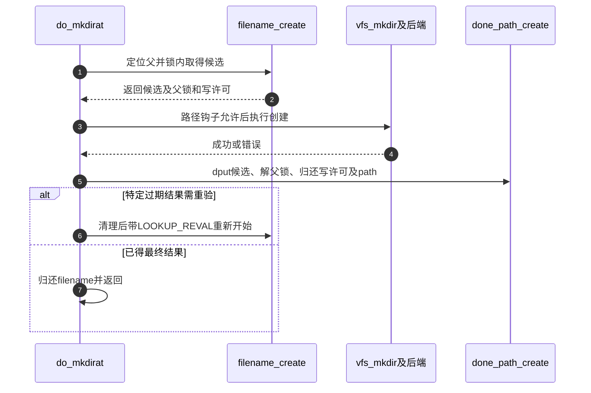

# 第19章\_末项创建的检查与资源交接

本页沿 [名称修改导读](../navigation/P10_名称修改怎样锁定检查与交付.md#10.1_沿修改周期区分保护与结果) 的W0～W5解释fs/namei.c中的创建入口与公共资格检查。固定提交为 `dfaf2136deb2af2e60b994421281ba42f1c087e0`，身份见 [VFS总索引](../navigation/P01_Linux_6.12_VFS源码阅读索引.md#1.1_先固定源码身份与运行证据)。这里的函数不是供用户态直接调用的接口。

## 19.1\_父路径到手还不代表可以建立最后名称

filename_create先通过filename_parentat取得父路径和最后qstr；前导遍历与末项分流见 [路径交接](P13_路径起点与结果持有的交接.md#13.4_普通全路径与父路径在最后分量处分流)。它拒绝非普通末项，再申请写入许可并锁父目录，最后在锁内查询候选。

```c
/** @brief 仓库补充阅读说明：取得父路径、写许可与父锁，在锁内检查可创建末项。 */
static struct dentry *filename_create(int dfd, struct filename *name,
                                      struct path *path, unsigned int lookup_flags)
{
        struct dentry *dentry = ERR_PTR(-EEXIST);
        struct qstr last;
        bool want_dir = lookup_flags & LOOKUP_DIRECTORY;
        unsigned int reval_flag = lookup_flags & LOOKUP_REVAL;
        unsigned int create_flags = LOOKUP_CREATE | LOOKUP_EXCL;
        int type;
        int err2;
        int error;

        error = filename_parentat(dfd, name, reval_flag, path, &last, &type);
        if (error)
                return ERR_PTR(error);

        /*
         * Yucky last component or no last component at all?
         * (foo/., foo/.., /////)
         */
        if (unlikely(type != LAST_NORM))
                goto out;

        /* don't fail immediately if it's r/o, at least try to report other errors */
        err2 = mnt_want_write(path->mnt);
        /*
         * Do the final lookup.  Suppress 'create' if there is a trailing
         * '/', and a directory wasn't requested.
         */
        if (last.name[last.len] && !want_dir)
                create_flags = 0;
        inode_lock_nested(path->dentry->d_inode, I_MUTEX_PARENT);
        dentry = lookup_one_qstr_excl(&last, path->dentry,
                                      reval_flag | create_flags);
        if (IS_ERR(dentry))
                goto unlock;

        error = -EEXIST;
        if (d_is_positive(dentry))
                goto fail;

        /*
         * Special case - lookup gave negative, but... we had foo/bar/
         * From the vfs_mknod() POV we just have a negative dentry -
         * all is fine. Let's be bastards - you had / on the end, you've
         * been asking for (non-existent) directory. -ENOENT for you.
         */
        if (unlikely(!create_flags)) {
                error = -ENOENT;
                goto fail;
        }
        if (unlikely(err2)) {
                error = err2;
                goto fail;
        }
        return dentry;
fail:
        dput(dentry);
        dentry = ERR_PTR(error);
unlock:
        inode_unlock(path->dentry->d_inode);
        if (!err2)
                mnt_drop_write(path->mnt);
out:
        path_put(path);
        return dentry;
}
```

mnt_want_write的错误先存入err2，而非立即退出，使最后名称的存在性与尾斜杠错误可以按此实现的顺序返回；这不代表只读状态被忽略，成功返回前仍必须检查err2。LOOKUP_DIRECTORY只表达本次要创建目录的要求，普通名字后有尾斜杠但未请求目录时，不能把负候选当成普通文件创建许可。

| 返回形态 | 资源状态 | 后续责任 |
| --- | --- | --- |
| 错误指针 | 本函数已按路径归还所取得的父path、写许可、锁及候选 | 不得再调用成功配对清理 |
| 候选dentry | 父path仍持有，写许可和父独占锁仍有效，候选引用交给调用者 | 调用操作后必须done_path_create |

## 19.2\_资格检查分别回答可建与可删

may_create检查候选是否已关联inode、父是否已死、当前身份能否表示及父目录写和搜索权限。它不是分配函数，也不负责在内部取得父目录锁；调用上下文必须已经满足修改协议。

```c
/** @brief 仓库补充阅读说明：检查候选为空、父存活、身份映射与目录权限。 */
static inline int may_create(struct mnt_idmap *idmap,
                             struct inode *dir, struct dentry *child)
{
        audit_inode_child(dir, child, AUDIT_TYPE_CHILD_CREATE);
        if (child->d_inode)
                return -EEXIST;
        if (IS_DEADDIR(dir))
                return -ENOENT;
        if (!fsuidgid_has_mapping(dir->i_sb, idmap))
                return -EOVERFLOW;

        return inode_permission(idmap, dir, MAY_WRITE | MAY_EXEC);
}
```

may_delete检查现存目标和父关系、身份映射、父权限、append/immutable、sticky等限制，再区分删除目录与非目录。mountpoint的实际检查还在具体vfs操作里，不能把may_delete的一次成功当成整个删除已经获得许可。

```c
/** @brief 仓库补充阅读说明：检查现存目标、删除类型与父和目标限制。 */
static int may_delete(struct mnt_idmap *idmap, struct inode *dir,
                      struct dentry *victim, bool isdir)
{
        struct inode *inode = d_backing_inode(victim);
        int error;

        if (d_is_negative(victim))
                return -ENOENT;
        BUG_ON(!inode);

        BUG_ON(victim->d_parent->d_inode != dir);

        /* Inode writeback is not safe when the uid or gid are invalid. */
        if (!vfsuid_valid(i_uid_into_vfsuid(idmap, inode)) ||
            !vfsgid_valid(i_gid_into_vfsgid(idmap, inode)))
                return -EOVERFLOW;

        audit_inode_child(dir, victim, AUDIT_TYPE_CHILD_DELETE);

        error = inode_permission(idmap, dir, MAY_WRITE | MAY_EXEC);
        if (error)
                return error;
        if (IS_APPEND(dir))
                return -EPERM;

        if (check_sticky(idmap, dir, inode) || IS_APPEND(inode) ||
            IS_IMMUTABLE(inode) || IS_SWAPFILE(inode) ||
            HAS_UNMAPPED_ID(idmap, inode))
                return -EPERM;
        if (isdir) {
                if (!d_is_dir(victim))
                        return -ENOTDIR;
                if (IS_ROOT(victim))
                        return -EBUSY;
        } else if (d_is_dir(victim))
                return -EISDIR;
        if (IS_DEADDIR(dir))
                return -ENOENT;
        if (victim->d_flags & DCACHE_NFSFS_RENAMED)
                return -EBUSY;
        return 0;
}
```

idmap是该挂载使用的身份映射，参与将inode所有者解释到本次访问语境；这里不展开完整用户命名空间策略。路径安全钩子与inode安全钩子也各有位置，不能用“检查过权限”一句话省掉后续钩子和错误出口。

## 19.3\_VFS建立方法契约并由后端完成对象关联

vfs_create先做公共检查、准备mode并执行inode安全钩子，然后调用文件系统create；成功才fsnotify_create。新inode的实际分配、元数据初始化和dentry关联由后端按契约兑现，不在这层凭空完成。

```c
/** @brief 仓库补充阅读说明：完成VFS创建检查后调用后端，成功才发送创建通知。 */
int vfs_create(struct mnt_idmap *idmap, struct inode *dir,
               struct dentry *dentry, umode_t mode, bool want_excl)
{
        int error;

        error = may_create(idmap, dir, dentry);
        if (error)
                return error;

        if (!dir->i_op->create)
                return -EACCES; /* shouldn't it be ENOSYS? */

        mode = vfs_prepare_mode(idmap, dir, mode, S_IALLUGO, S_IFREG);
        error = security_inode_create(dir, dentry, mode);
        if (error)
                return error;
        error = dir->i_op->create(idmap, dir, dentry, mode, want_excl);
        if (!error)
                fsnotify_create(dir, dentry);
        return error;
}
```

vfs_mkdir同样先检查，但还核对父目录最大链接数等条件，准备的mode类型处理也不同。不能因为两者都“创建名称”就将方法签名、mode和错误分支合并成一个伪接口。

```c
/** @brief 仓库补充阅读说明：核对目录创建条件与链接上限后交给文件系统。 */
int vfs_mkdir(struct mnt_idmap *idmap, struct inode *dir,
              struct dentry *dentry, umode_t mode)
{
        int error;
        unsigned max_links = dir->i_sb->s_max_links;

        error = may_create(idmap, dir, dentry);
        if (error)
                return error;

        if (!dir->i_op->mkdir)
                return -EPERM;

        mode = vfs_prepare_mode(idmap, dir, mode, S_IRWXUGO | S_ISVTX, 0);
        error = security_inode_mkdir(dir, dentry, mode);
        if (error)
                return error;

        if (max_links && dir->i_nlink >= max_links)
                return -EMLINK;

        error = dir->i_op->mkdir(idmap, dir, dentry, mode);
        if (!error)
                fsnotify_mkdir(dir, dentry);
        return error;
}
```


mode准备由vfs_prepare_mode依次处理setgid和umask语义并应用允许位，不应在调用者旁再用未经核对的简单位运算替代。具体文件系统的创建示例留在接入章节；本页专注VFS的检查和交付责任。

## 19.4\_mkdir调用者把成功和失败都送入配对清理

do_mkdirat通过filename_create获得资源集合，再经过路径安全钩子和vfs_mkdir。只要filename_create成功，不论后续结果如何，都调用done_path_create；特定ESTALE重试发生在清理之后。

```c
/** @brief 仓库补充阅读说明：配对创建准备与清理，并按特定错误重新验证。 */
int do_mkdirat(int dfd, struct filename *name, umode_t mode)
{
        struct dentry *dentry;
        struct path path;
        int error;
        unsigned int lookup_flags = LOOKUP_DIRECTORY;

retry:
        dentry = filename_create(dfd, name, &path, lookup_flags);
        error = PTR_ERR(dentry);
        if (IS_ERR(dentry))
                goto out_putname;

        error = security_path_mkdir(&path, dentry,
                        mode_strip_umask(path.dentry->d_inode, mode));
        if (!error) {
                error = vfs_mkdir(mnt_idmap(path.mnt), path.dentry->d_inode,
                                  dentry, mode);
        }
        done_path_create(&path, dentry);
        if (retry_estale(error, lookup_flags)) {
                lookup_flags |= LOOKUP_REVAL;
                goto retry;
        }
out_putname:
        putname(name);
        return error;
}
```

```c
/** @brief 仓库补充阅读说明：归还候选、父锁、挂载写许可和父路径。 */
void done_path_create(struct path *path, struct dentry *dentry)
{
        dput(dentry);
        inode_unlock(path->dentry->d_inode);
        mnt_drop_write(path->mnt);
        path_put(path);
}
```



成功配对中dput发生在父锁归还之前，而父path归还在写许可释放之后。阅读者应按真实顺序核对资源，不把这些动作视为可任意排序的列表。本次没有mkdir并发或错误注入；返回 [导读](../navigation/P10_名称修改怎样锁定检查与交付.md#10.2_按对象变化选择唯一实现入口)。
