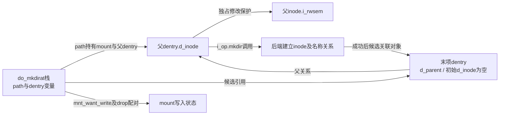
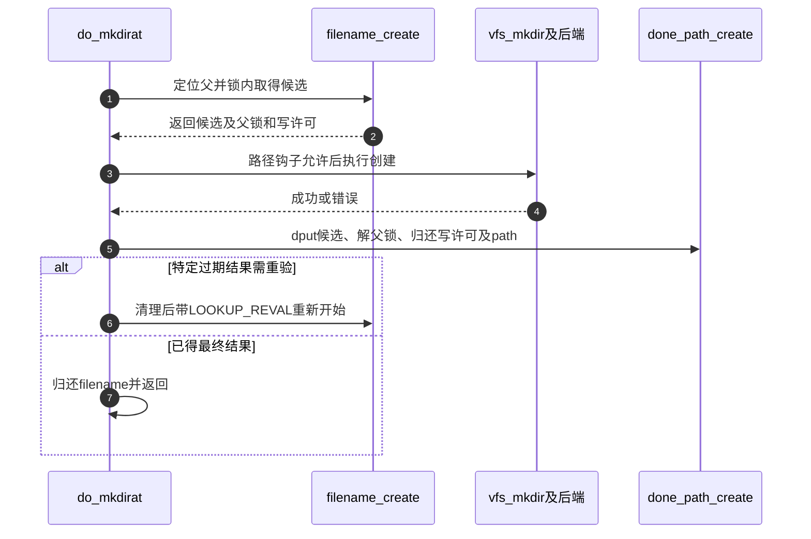

# 第19章\_末项创建的检查与资源交接

本页沿 [名称修改导读](../navigation/P10_名称修改怎样锁定检查与交付.md#10.1_沿修改周期区分保护与结果) 的W0～W5解释fs/namei.c中的创建入口与公共资格检查。固定提交为 `dfaf2136deb2af2e60b994421281ba42f1c087e0`，身份见 [VFS总索引](../navigation/P01_Linux_6.12_VFS源码阅读索引.md#1.1_先固定源码身份与运行证据)。这里的函数不是供用户态直接调用的接口。

## 19.1\_父路径到手还不代表可以建立最后名称

filename_create先通过filename_parentat取得父路径和最后qstr；前导遍历与末项分流见 [路径交接](P13_路径起点与结果持有的交接.md#13.4_普通全路径与父路径在最后分量处分流)。它拒绝非普通末项，再申请写入许可并锁父目录，最后在锁内查询候选。

```c
/** @brief 仓库补充阅读说明：取得父路径、写许可与父锁，在锁内检查可创建末项。 */
static struct dentry *filename_create(int dfd, struct filename *name,
                                      struct path *path, unsigned int lookup_flags)
{
        struct dentry *dentry = ERR_PTR(-EEXIST);
        struct qstr last;
        bool want_dir = lookup_flags & LOOKUP_DIRECTORY;
        unsigned int reval_flag = lookup_flags & LOOKUP_REVAL;
        unsigned int create_flags = LOOKUP_CREATE | LOOKUP_EXCL;
        int type;
        int err2;
        int error;

        /* 取得父path持有；last借用name文本，整个操作结束前不能putname。 */
        error = filename_parentat(dfd, name, reval_flag, path, &last, &type);
        if (error)
                return ERR_PTR(error);

        /* 这里只接受普通末项，其他形态走父path归还。 */
        if (unlikely(type != LAST_NORM))
                goto out;

        /* 先保存写许可错误，仍按名称条件决定最终错误次序。 */
        err2 = mnt_want_write(path->mnt);

        /* 尾斜杠而未请求目录时禁止把负候选当普通创建目标。 */
        if (last.name[last.len] && !want_dir)
                create_flags = 0;
        /* 独占父inode的i_rwsem；嵌套类别供Lockdep识别。 */
        inode_lock_nested(path->dentry->d_inode, I_MUTEX_PARENT);
        dentry = lookup_one_qstr_excl(&last, path->dentry,
                                      reval_flag | create_flags);
        if (IS_ERR(dentry))
                goto unlock;

        error = -EEXIST;
        /* 锁内仍存在就拒绝排他创建。 */
        if (d_is_positive(dentry))
                goto fail;

        if (unlikely(!create_flags)) {
                error = -ENOENT;
                goto fail;
        }
        /* 名称检查通过后也必须兑现写许可失败。 */
        if (unlikely(err2)) {
                error = err2;
                goto fail;
        }
        /* 成功把候选、父path、父锁及写许可一起交给调用者。 */
        return dentry;
fail:
        /* 失败只归还已取得的候选；继续归还其他资源。 */
        dput(dentry);
        dentry = ERR_PTR(error);
unlock:
        inode_unlock(path->dentry->d_inode);
        /* 只有确实取得写许可才配对归还。 */
        if (!err2)
                mnt_drop_write(path->mnt);
out:
        path_put(path);
        /* 成功把候选、父path、父锁及写许可一起交给调用者。 */
        return dentry;
}
```

mnt_want_write的错误先存入err2，而非立即退出，使最后名称的存在性与尾斜杠错误可以按此实现的顺序返回；这不代表只读状态被忽略，成功返回前仍必须检查err2。LOOKUP_DIRECTORY只表达本次要创建目录的要求，普通名字后有尾斜杠但未请求目录时，不能把负候选当成普通文件创建许可。

| 返回形态 | 资源状态 | 后续责任 |
| --- | --- | --- |
| 错误指针 | 本函数已按路径归还所取得的父path、写许可、锁及候选 | 不得再调用成功配对清理 |
| 候选dentry | 父path仍持有，写许可和父独占锁仍有效，候选引用交给调用者 | 调用操作后必须done_path_create |

成功资源不是藏在一个全局事务中，而是由调用者栈上的path与返回dentry承载。父目录inode的i_rwsem保护最终检查和创建；mount写入计数负责挂载写入协议。两个资源不能互换，负候选的引用本身也不阻止别人创建同名项。



修改filename_create时要按失败标签核对四种资源：定位失败没有父path；非法末项只有父path；锁内查询失败还可能有写许可；得到负候选后的失败再多一个dentry引用。不能统一执行done_path_create处理所有错误，因为它要求成功取得完整资源集合。更改尾斜杠策略也会改变错误优先级，应同时覆盖已存在、负候选、只读挂载和目录请求。

## 19.2\_资格检查分别回答可建与可删

may_create检查候选是否已关联inode、父是否已死、当前身份能否表示及父目录写和搜索权限。它不是分配函数，也不负责在内部取得父目录锁；调用上下文必须已经满足修改协议。

```c
/** @brief 仓库补充阅读说明：检查候选为空、父存活、身份映射与目录权限。 */
static inline int may_create(struct mnt_idmap *idmap,
                             struct inode *dir, struct dentry *child)
{
        /* 审计观察创建尝试，不能代替后面的许可判断。 */
        audit_inode_child(dir, child, AUDIT_TYPE_CHILD_CREATE);
        /* 父锁下核对候选仍为空。 */
        if (child->d_inode)
                return -EEXIST;
        if (IS_DEADDIR(dir))
                return -ENOENT;
        /* 新inode所有者必须能在文件系统与挂载身份语境中表达。 */
        if (!fsuidgid_has_mapping(dir->i_sb, idmap))
                return -EOVERFLOW;

        /* 创建修改父目录内容，还需要搜索目录的许可。 */
        return inode_permission(idmap, dir, MAY_WRITE | MAY_EXEC);
}
```

may_delete检查现存目标和父关系、身份映射、父权限、append/immutable、sticky等限制，再区分删除目录与非目录。mountpoint的实际检查还在具体vfs操作里，不能把may_delete的一次成功当成整个删除已经获得许可。

```c
/** @brief 仓库补充阅读说明：检查现存目标、删除类型与父和目标限制。 */
static int may_delete(struct mnt_idmap *idmap, struct inode *dir,
                      struct dentry *victim, bool isdir)
{
        struct inode *inode = d_backing_inode(victim);
        int error;

        /* 不存在是正常错误，与下面内部不变量破坏不同。 */
        if (d_is_negative(victim))
                return -ENOENT;
        /* 正候选必须有后端inode，违反不是用户可恢复的ENOENT。 */
        BUG_ON(!inode);

        /* 调用者传入的父必须与候选父一致。 */
        BUG_ON(victim->d_parent->d_inode != dir);

        /* 无法正确解释所有者时不能继续写回元数据。 */
        if (!vfsuid_valid(i_uid_into_vfsuid(idmap, inode)) ||
            !vfsgid_valid(i_gid_into_vfsgid(idmap, inode)))
                return -EOVERFLOW;

        audit_inode_child(dir, victim, AUDIT_TYPE_CHILD_DELETE);

        /* 先检查父目录的写与搜索权。 */
        error = inode_permission(idmap, dir, MAY_WRITE | MAY_EXEC);
        if (error)
                return error;
        if (IS_APPEND(dir))
                return -EPERM;

        /* 粘滞位、对象属性和身份映射分别限制删除。 */
        if (check_sticky(idmap, dir, inode) || IS_APPEND(inode) ||
            IS_IMMUTABLE(inode) || IS_SWAPFILE(inode) ||
            HAS_UNMAPPED_ID(idmap, inode))
                return -EPERM;
        /* 调用操作的类型必须与现有目标匹配。 */
        if (isdir) {
                if (!d_is_dir(victim))
                        return -ENOTDIR;
                if (IS_ROOT(victim))
                        return -EBUSY;
        } else if (d_is_dir(victim))
                return -EISDIR;
        if (IS_DEADDIR(dir))
                return -ENOENT;
        /* 延迟删除中的特殊名称不能当普通目标重复处理。 */
        if (victim->d_flags & DCACHE_NFSFS_RENAMED)
                return -EBUSY;
        return 0;
}
```

idmap是该挂载使用的身份映射，参与将inode所有者解释到本次访问语境；这里不展开完整用户命名空间策略。路径安全钩子与inode安全钩子也各有位置，不能用“检查过权限”一句话省掉后续钩子和错误出口。

`BUG_ON`对应正候选有inode、父子身份一致这类内部不变量，不能改成面向用户的权限拒绝；BUG配置关闭也不授权调用者破坏前提。`audit_inode_child`记录尝试，当前AUDIT关闭时退化不影响后续权限判断。`security_path_*`与`security_inode_*`则是可拒绝操作的安全检查，SECURITY关闭时对应包装返回允许，普通DAC、只读、类型和对象属性检查仍执行。

这里的辅助判断各管一层：IS_DEADDIR读取父inode的S_DEAD；IS_APPEND/IS_IMMUTABLE/IS_SWAPFILE读取对象属性；HAS_UNMAPPED_ID与vfsuid/vfsgid有效性阻止无法正确写回的身份组合；check_sticky只在父目录S_ISVTX有效时检查当前fsuid是否等于目标或父目录所有者，或是否有适用CAP_FOWNER。身份换算入口见 [挂载身份](P53_挂载身份换算与ACL判断.md#53.1_先把文件身份放到当前挂载视图)，权限分派见 [inode_permission](P52_inode权限的基本检查与分派.md#52.1_先检查写入限制再选择权限实现)。这些都发生在后端方法之前，不能由成功通知补做。

## 19.3\_VFS建立方法契约并由后端完成对象关联

vfs_create先做公共检查、准备mode并执行inode安全钩子，然后调用文件系统create；成功才fsnotify_create。新inode的实际分配、元数据初始化和dentry关联由后端按契约兑现，不在这层凭空完成。

```c
/** @brief 仓库补充阅读说明：完成VFS创建检查后调用后端，成功才发送创建通知。 */
int vfs_create(struct mnt_idmap *idmap, struct inode *dir,
               struct dentry *dentry, umode_t mode, bool want_excl)
{
        int error;

        /* 调用者已持父目录锁，本函数不替代该前提。 */
        error = may_create(idmap, dir, dentry);
        if (error)
                return error;

        if (!dir->i_op->create)
                return -EACCES;

        /* 按创建普通文件的类型和允许位准备模式。 */
        mode = vfs_prepare_mode(idmap, dir, mode, S_IALLUGO, S_IFREG);
        /* 安全钩子可以拒绝操作，不是成功后的日志。 */
        error = security_inode_create(dir, dentry, mode);
        if (error)
                return error;
        /* 实际对象建立与关联交给后端。 */
        error = dir->i_op->create(idmap, dir, dentry, mode, want_excl);
        /* 仅在后端成功后生成通知。 */
        if (!error)
                fsnotify_create(dir, dentry);
        return error;
}
```

vfs_mkdir同样先检查，但还核对父目录最大链接数等条件，准备的mode类型处理也不同。不能因为两者都“创建名称”就将方法签名、mode和错误分支合并成一个伪接口。

```c
/** @brief 仓库补充阅读说明：核对目录创建条件与链接上限后交给文件系统。 */
int vfs_mkdir(struct mnt_idmap *idmap, struct inode *dir,
              struct dentry *dentry, umode_t mode)
{
        int error;
        unsigned max_links = dir->i_sb->s_max_links;

        /* 复用公共资格检查，尚未创建目录。 */
        error = may_create(idmap, dir, dentry);
        if (error)
                return error;

        if (!dir->i_op->mkdir)
                return -EPERM;

        /* 目录后端处理类型；这里筛选允许的权限与粘滞位。 */
        mode = vfs_prepare_mode(idmap, dir, mode, S_IRWXUGO | S_ISVTX, 0);
        error = security_inode_mkdir(dir, dentry, mode);
        if (error)
                return error;

        /* 零表示该字段不施加此上限，不是最大链接数为零。 */
        if (max_links && dir->i_nlink >= max_links)
                return -EMLINK;

        /* 后端承担目录对象与名称关联。 */
        error = dir->i_op->mkdir(idmap, dir, dentry, mode);
        /* 失败不发送成功创建通知。 */
        if (!error)
                fsnotify_mkdir(dir, dentry);
        return error;
}
```


mode准备由vfs_prepare_mode依次处理setgid和umask语义并应用允许位，不应在调用者旁再用未经核对的简单位运算替代。具体文件系统的创建示例留在接入章节；本页专注VFS的检查和交付责任。

## 19.4\_mkdir调用者把成功和失败都送入配对清理

do_mkdirat通过filename_create获得资源集合，再经过路径安全钩子和vfs_mkdir。只要filename_create成功，不论后续结果如何，都调用done_path_create；特定ESTALE重试发生在清理之后。

```c
/** @brief 仓库补充阅读说明：配对创建准备与清理，并按特定错误重新验证。 */
int do_mkdirat(int dfd, struct filename *name, umode_t mode)
{
        struct dentry *dentry;
        struct path path;
        int error;
        unsigned int lookup_flags = LOOKUP_DIRECTORY;

retry:
        /* 成功返回仍持有一整组创建资源。 */
        dentry = filename_create(dfd, name, &path, lookup_flags);
        error = PTR_ERR(dentry);
        if (IS_ERR(dentry))
                goto out_putname;

        /* 路径钩子先于vfs_mkdir中的inode钩子。 */
        error = security_path_mkdir(&path, dentry,
                        mode_strip_umask(path.dentry->d_inode, mode));
        if (!error) {
                error = vfs_mkdir(mnt_idmap(path.mnt), path.dentry->d_inode,
                                  dentry, mode);
        }
        /* 无论方法成功或失败，均归还本轮成功取得的资源。 */
        done_path_create(&path, dentry);
        /* 仅首次ESTALE可带REVAL重试，不能无限重复。 */
        if (retry_estale(error, lookup_flags)) {
                lookup_flags |= LOOKUP_REVAL;
                goto retry;
        }
out_putname:
        /* 最后才结束借给last的名称文本寿命。 */
        putname(name);
        return error;
}
```

```c
/** @brief 仓库补充阅读说明：归还候选、父锁、挂载写许可和父路径。 */
void done_path_create(struct path *path, struct dentry *dentry)
{
        /* 候选归还时父目录仍受独占保护。 */
        dput(dentry);
        /* 先解锁，再归还写许可与父path持有。 */
        inode_unlock(path->dentry->d_inode);
        mnt_drop_write(path->mnt);
        path_put(path);
}
```



成功配对中dput发生在父锁归还之前，而父path归还在写许可释放之后。阅读者应按真实顺序核对资源，不把这些动作视为可任意排序的列表。本次没有mkdir并发或错误注入；返回 [导读](../navigation/P10_名称修改怎样锁定检查与交付.md#10.2_按对象变化选择唯一实现入口)。


## 19.5\_沿声明与调用者限定修改范围

上述公共vfs方法及done_path_create由include/linux/namei.h或include/linux/fs.h声明，filename_create、may_create、may_delete与vfs_prepare_mode是fs/namei.c内部实现；do_mkdirat由系统调用包装消费。本文保留七个完整函数体，只将原注释换为中文阅读说明。ERR_PTR/IS_ERR/PTR_ERR负责错误与有效指针编码转换，unlikely只提示分支，不改变是否应清理。

| 实现簇 | 定义、状态及消费 | 改动时必须同时审查 |
| --- | --- | --- |
| 父路径与末项 | filename_parentat返回path持有，qstr借用filename文本；末项查询在父i_rwsem独占区内 | putname不可提前；查找、负候选、尾斜杠及重试错误次序 |
| 写入与清理 | mnt_want_write/mnt_drop_write；done_path_create解开成功资源集合 | 冻结/只读协议见 [写许可](P66_冻结写入的分级准入.md#66.1_修改者在冻结门上取得读侧)；不能只配锁不配写许可 |
| 模式准备 | vfs_prepare_mode先mode_strip_sgid，再mode_strip_umask，最后应用mask_perms与type；vfs_prepare_mode定义在namei.c，mode_strip_sgid在inode.c，mode_strip_umask在namei.h | 父目录支持POSIX ACL时umask处理与后端继承配合，不能无条件再减一次umask；目录和普通文件类型参数不同 |
| 复查与通知 | retry_estale在namei.h只接受ESTALE且尚无LOOKUP_REVAL；fsnotify包装见fsnotify.h | 清理后最多增加这一轮REVAL，不把任意后端错误当暂时失败；失败不生成成功事件 |

mode_strip_sgid仅在请求模式同时有S_ISGID与S_IXGRP、不是目录模式、父存在且父有S_ISGID时继续检查；调用者不在父组且无适用能力才清SGID。mode_strip_umask只有在父不支持POSIX ACL且superblock未设置SB_I_NOUMASK时扣除current_umask；其余情况保留给后端约定。不能把“先处理SGID和umask”理解为无条件删除这些位。

锁辅助的nested参数给Lockdep标注层级，实际i_rwsem锁仍由同步接口取得；关闭LOCKDEP只减少检查，不取消锁。fsnotify创建包装把后端成功转换成事件，具体分派见 [事件对象](P58_fsnotify事件匹配与分派.md#58.1_操作路径先确定事件对象与父目录名字)。本页不复制ACL、锁框架、身份映射或通知框架的实现。

若调整创建策略，最小改动应落在负责该策略的检查或后端契约处，并复核mkdir、普通create及其他may_create调用者；验证至少包括竞争创建、尾斜杠、只读、权限拒绝、后端错误和ESTALE路径的资源平衡。这里给出验证边界，本次未执行这些内核运行测试。
