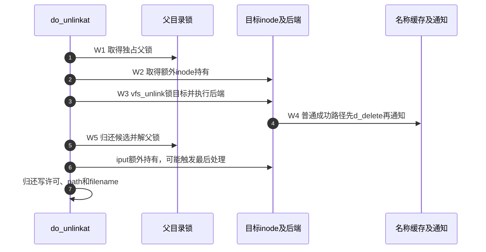
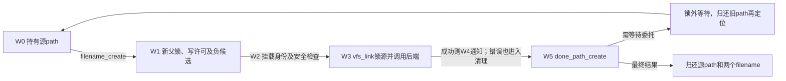

# 第20章\_名称链接的增加撤销与通知

本页承接 [名称修改导读](../navigation/P10_名称修改怎样锁定检查与交付.md#10.1_沿修改周期区分保护与结果)，解释W2～W5的链接数、目标持有和通知。固定提交 `dfaf2136deb2af2e60b994421281ba42f1c087e0`，四个入口来自fs/namei.c，删除通知包装来自include/linux/fsnotify.h，版本见 [总索引](../navigation/P01_Linux_6.12_VFS源码阅读索引.md)。

## 20.1\_删除方法成功后仍要兑现缓存和通知契约

vfs_unlink先复用 [删除资格检查](P19_末项创建的检查与资源交接.md#19.2_资格检查分别回答可建与可删)，再锁目标inode，拒绝交换文件和本地挂载点等情况。安全钩子和委托处理允许后才调用后端unlink；成功时禁止新挂载并处理相关挂载脱离。

```c
/** @brief 仓库补充阅读说明：锁目标执行删除方法，成功后兑现对应缓存及通知责任。 */
int vfs_unlink(struct mnt_idmap *idmap, struct inode *dir,
               struct dentry *dentry, struct inode **delegated_inode)
{
        struct inode *target = dentry->d_inode;
        int error = may_delete(idmap, dir, dentry, 0);

        if (error)
                return error;

        if (!dir->i_op->unlink)
                return -EPERM;

        inode_lock(target);
        if (IS_SWAPFILE(target))
                error = -EPERM;
        else if (is_local_mountpoint(dentry))
                error = -EBUSY;
        else {
                error = security_inode_unlink(dir, dentry);
                if (!error) {
                        error = try_break_deleg(target, delegated_inode);
                        if (error)
                                goto out;
                        error = dir->i_op->unlink(dir, dentry);
                        if (!error) {
                                dont_mount(dentry);
                                detach_mounts(dentry);
                        }
                }
        }
out:
        inode_unlock(target);

        /* We don't d_delete() NFS sillyrenamed files--they still exist. */
        if (!error && dentry->d_flags & DCACHE_NFSFS_RENAMED) {
                fsnotify_unlink(dir, dentry);
        } else if (!error) {
                fsnotify_link_count(target);
                d_delete_notify(dir, dentry);
        }

        return error;
}
```

普通成功分支通知链接数变化并调用d_delete_notify；DCACHE_NFSFS_RENAMED分支仍保留其特殊名称状态，不能执行同样的d_delete。该标志不是本地文件“删完了”的通用标志。

## 20.2\_删除通知之前先撤销对应缓存名称

d_delete_notify临时ihold目标inode，d_delete后再发送事件，最后iput。d_delete的唯一实现见 [名称失效](P12_名称失效与最后使用者退出.md#12.2_删除后的缓存结果取决于是否还有其他持有)。这里不复制它的分支。

```c
/** @brief 仓库补充阅读说明：持有inode，先删除名称缓存关系再通知并归还。 */
static inline void d_delete_notify(struct inode *dir, struct dentry *dentry)
{
        struct inode *inode = d_inode(dentry);

        ihold(inode);
        d_delete(dentry);
        fsnotify_delete(dir, inode, dentry);
        iput(inode);
}
```

这保证对应普通删除路径的名称失效先于通知交付，不能推导消费者稍后再次查名字一定为空；新的创建可以已经发生。inode临时持有保证通知使用的对象信息仍有效，不会把事件变成长期对象引用。

## 20.3\_最后inode归还放到父锁之外

do_unlinkat取得父path和写许可，锁父目录后解析末项，再额外ihold目标。普通尾斜杠和负候选按具体条件返回不同错误；正常路径执行安全钩子及vfs_unlink，之后先dput和解父锁，再iput额外持有。

```c
/** @brief 仓库补充阅读说明：锁内解析删除末项，并将额外inode归还放到父锁之外。 */
int do_unlinkat(int dfd, struct filename *name)
{
        int error;
        struct dentry *dentry;
        struct path path;
        struct qstr last;
        int type;
        struct inode *inode = NULL;
        struct inode *delegated_inode = NULL;
        unsigned int lookup_flags = 0;
retry:
        error = filename_parentat(dfd, name, lookup_flags, &path, &last, &type);
        if (error)
                goto exit1;

        error = -EISDIR;
        if (type != LAST_NORM)
                goto exit2;

        error = mnt_want_write(path.mnt);
        if (error)
                goto exit2;
retry_deleg:
        inode_lock_nested(path.dentry->d_inode, I_MUTEX_PARENT);
        dentry = lookup_one_qstr_excl(&last, path.dentry, lookup_flags);
        error = PTR_ERR(dentry);
        if (!IS_ERR(dentry)) {

                /* Why not before? Because we want correct error value */
                if (last.name[last.len] || d_is_negative(dentry))
                        goto slashes;
                inode = dentry->d_inode;
                ihold(inode);
                error = security_path_unlink(&path, dentry);
                if (error)
                        goto exit3;
                error = vfs_unlink(mnt_idmap(path.mnt), path.dentry->d_inode,
                                   dentry, &delegated_inode);
exit3:
                dput(dentry);
        }
        inode_unlock(path.dentry->d_inode);
        if (inode)
                iput(inode);    /* truncate the inode here */
        inode = NULL;
        if (delegated_inode) {
                error = break_deleg_wait(&delegated_inode);
                if (!error)
                        goto retry_deleg;
        }
        mnt_drop_write(path.mnt);
exit2:
        path_put(&path);
        if (retry_estale(error, lookup_flags)) {
                lookup_flags |= LOOKUP_REVAL;
                inode = NULL;
                goto retry;
        }
exit1:
        putname(name);
        return error;

slashes:
        if (d_is_negative(dentry))
                error = -ENOENT;
        else if (d_is_dir(dentry))
                error = -EISDIR;
        else
                error = -ENOTDIR;
        goto exit3;
}
```



委托分支是另一条退出：先解相关锁、归还临时目标持有，再break_deleg_wait，成功后回到锁内重新解析。它不能在持有目录锁的情况下无限等远端完成。普通ESTALE重试则先结束本次路径资源，再以REVAL重新定位。

## 20.4\_增加硬链接要同时检查新父与旧对象

vfs_link先检查源inode存在、新名称可建立和superblock相同，再检查不可变、身份映射、方法存在与禁止目录硬链接等条件。源inode锁保护链接数限制及I_LINKABLE状态，后端成功才发出链接通知。

```c
/** @brief 仓库补充阅读说明：检查新名称和旧对象，锁源后增加名称关联。 */
int vfs_link(struct dentry *old_dentry, struct mnt_idmap *idmap,
             struct inode *dir, struct dentry *new_dentry,
             struct inode **delegated_inode)
{
        struct inode *inode = old_dentry->d_inode;
        unsigned max_links = dir->i_sb->s_max_links;
        int error;

        if (!inode)
                return -ENOENT;

        error = may_create(idmap, dir, new_dentry);
        if (error)
                return error;

        if (dir->i_sb != inode->i_sb)
                return -EXDEV;

        /*
         * A link to an append-only or immutable file cannot be created.
         */
        if (IS_APPEND(inode) || IS_IMMUTABLE(inode))
                return -EPERM;
        /*
         * Updating the link count will likely cause i_uid and i_gid to
         * be writen back improperly if their true value is unknown to
         * the vfs.
         */
        if (HAS_UNMAPPED_ID(idmap, inode))
                return -EPERM;
        if (!dir->i_op->link)
                return -EPERM;
        if (S_ISDIR(inode->i_mode))
                return -EPERM;

        error = security_inode_link(old_dentry, dir, new_dentry);
        if (error)
                return error;

        inode_lock(inode);
        /* Make sure we don't allow creating hardlink to an unlinked file */
        if (inode->i_nlink == 0 && !(inode->i_state & I_LINKABLE))
                error =  -ENOENT;
        else if (max_links && inode->i_nlink >= max_links)
                error = -EMLINK;
        else {
                error = try_break_deleg(inode, delegated_inode);
                if (!error)
                        error = dir->i_op->link(old_dentry, dir, new_dentry);
        }

        if (!error && (inode->i_state & I_LINKABLE)) {
                spin_lock(&inode->i_lock);
                inode->i_state &= ~I_LINKABLE;
                spin_unlock(&inode->i_lock);
        }
        inode_unlock(inode);
        if (!error)
                fsnotify_link(dir, inode, new_dentry);
        return error;
}
```

零链接对象只有符合I_LINKABLE条件才可继续，这是特定对象创建协议的入口，不是允许任意已删除文件复活。inode引用保证存续，i_nlink表达名称数量，两者不能互相代替。

## 20.5\_用户路径还要维持挂载和重试边界

do_linkat先查源路径，再通过filename_create接住新父与候选。它要求两边path.mnt相同，之后执行may_linkat及路径安全钩子，再进入vfs_link；因此只核对vfs_link的superblock比较会漏掉用户入口的更外层限制。

```c
/** @brief 仓库补充阅读说明：连接源查找与新名称准备，维持挂载和重试边界。 */
int do_linkat(int olddfd, struct filename *old, int newdfd,
              struct filename *new, int flags)
{
        struct mnt_idmap *idmap;
        struct dentry *new_dentry;
        struct path old_path, new_path;
        struct inode *delegated_inode = NULL;
        int how = 0;
        int error;

        if ((flags & ~(AT_SYMLINK_FOLLOW | AT_EMPTY_PATH)) != 0) {
                error = -EINVAL;
                goto out_putnames;
        }
        /*
         * To use null names we require CAP_DAC_READ_SEARCH or
         * that the open-time creds of the dfd matches current.
         * This ensures that not everyone will be able to create
         * a hardlink using the passed file descriptor.
         */
        if (flags & AT_EMPTY_PATH)
                how |= LOOKUP_LINKAT_EMPTY;

        if (flags & AT_SYMLINK_FOLLOW)
                how |= LOOKUP_FOLLOW;
retry:
        error = filename_lookup(olddfd, old, how, &old_path, NULL);
        if (error)
                goto out_putnames;

        new_dentry = filename_create(newdfd, new, &new_path,
                                        (how & LOOKUP_REVAL));
        error = PTR_ERR(new_dentry);
        if (IS_ERR(new_dentry))
                goto out_putpath;

        error = -EXDEV;
        if (old_path.mnt != new_path.mnt)
                goto out_dput;
        idmap = mnt_idmap(new_path.mnt);
        error = may_linkat(idmap, &old_path);
        if (unlikely(error))
                goto out_dput;
        error = security_path_link(old_path.dentry, &new_path, new_dentry);
        if (error)
                goto out_dput;
        error = vfs_link(old_path.dentry, idmap, new_path.dentry->d_inode,
                         new_dentry, &delegated_inode);
out_dput:
        done_path_create(&new_path, new_dentry);
        if (delegated_inode) {
                error = break_deleg_wait(&delegated_inode);
                if (!error) {
                        path_put(&old_path);
                        goto retry;
                }
        }
        if (retry_estale(error, how)) {
                path_put(&old_path);
                how |= LOOKUP_REVAL;
                goto retry;
        }
out_putpath:
        path_put(&old_path);
out_putnames:
        putname(old);
        putname(new);

        return error;
}
```



AT_SYMLINK_FOLLOW决定源路径是否跟随链接，AT_EMPTY_PATH通过专门的查找限制处理；新名称不会被当成需要跟随的目标链接。完整访问控制留给权限章节。本页未执行硬链接权限、委托等待或后端失败测试，返回 [导读](../navigation/P10_名称修改怎样锁定检查与交付.md#10.2_按对象变化选择唯一实现入口)。
