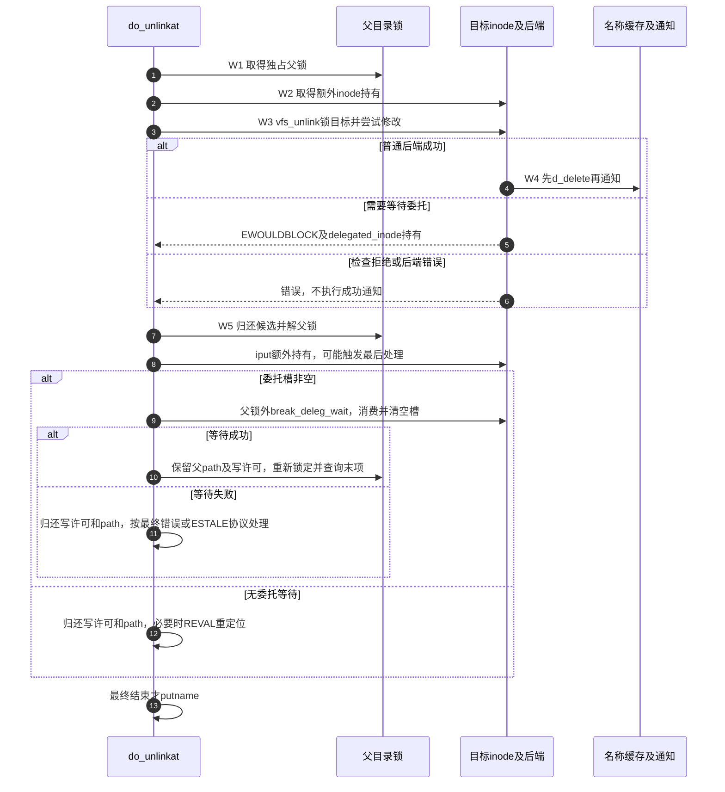
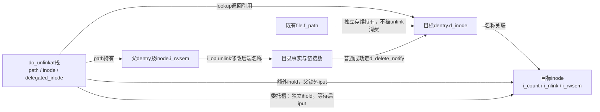
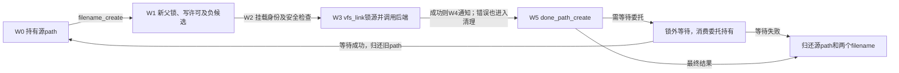

# 第20章\_名称链接的增加撤销与通知

本页承接 [名称修改导读](../navigation/P10_名称修改怎样锁定检查与交付.md#10.1_沿修改周期区分保护与结果)，解释W2～W5的链接数、目标持有和通知。固定提交 `dfaf2136deb2af2e60b994421281ba42f1c087e0`，四个入口来自fs/namei.c，删除通知包装来自include/linux/fsnotify.h，版本见 [总索引](../navigation/P01_Linux_6.12_VFS源码阅读索引.md)。

## 20.1\_删除方法成功后仍要兑现缓存和通知契约

vfs_unlink先复用 [删除资格检查](P19_末项创建的检查与资源交接.md#19.2_资格检查分别回答可建与可删)，再锁目标inode，拒绝交换文件和本地挂载点等情况。安全钩子和委托处理允许后才调用后端unlink；成功时禁止新挂载并处理相关挂载脱离。

```c
/** @brief 仓库补充阅读说明：锁目标执行删除方法，成功后兑现对应缓存及通知责任。 */
int vfs_unlink(struct mnt_idmap *idmap, struct inode *dir,
               struct dentry *dentry, struct inode **delegated_inode)
{
        struct inode *target = dentry->d_inode;
        int error = may_delete(idmap, dir, dentry, 0);

        if (error)
                return error;

        if (!dir->i_op->unlink)
                return -EPERM;

        /* 父锁由调用者持有，这里再保护目标对象。 */
        inode_lock(target);
        if (IS_SWAPFILE(target))
                error = -EPERM;
        /* 本地挂载点拒绝；不要把后面的挂载清理当作此检查的替代。 */
        else if (is_local_mountpoint(dentry))
                error = -EBUSY;
        else {
                error = security_inode_unlink(dir, dentry);
                if (!error) {
                        /* 不能在此锁集合内阻塞等待委托，必要时交还持有供上层等待。 */
                        error = try_break_deleg(target, delegated_inode);
                        if (error)
                                goto out;
                        /* 后端修改目录事实与链接数。 */
                        error = dir->i_op->unlink(dir, dentry);
                        if (!error) {
                                /* 后端成功后标记不能再挂载，并处理相应挂载。 */
                                dont_mount(dentry);
                                detach_mounts(dentry);
                        }
                }
        }
out:
        /* 通知阶段已退出目标inode锁，但父锁仍在调用者。 */
        inode_unlock(target);

        /* NFS特殊延迟删除不走普通d_delete。 */
        if (!error && dentry->d_flags & DCACHE_NFSFS_RENAMED) {
                fsnotify_unlink(dir, dentry);
        } else if (!error) {
                fsnotify_link_count(target);
                /* 普通成功路径先撤销名称缓存关系，再发送删除通知。 */
                d_delete_notify(dir, dentry);
        }

        return error;
}
```

普通成功分支通知链接数变化并调用d_delete_notify；DCACHE_NFSFS_RENAMED分支仍保留其特殊名称状态，不能执行同样的d_delete。该标志不是本地文件“删完了”的通用标志。

`dont_mount`在dcache.h内锁住d_lock并设置DCACHE_CANT_MOUNT，阻止此dentry成为新的挂载目标；`detach_mounts`负责相关挂载脱离，不是把调用者当前path持有一起释放。挂载关系和名称关系是不同集合。`try_break_deleg`也不直接删除对象：它尝试处理可能阻止修改的委托，必要时把目标持有交回上层，等锁外等待后再尝试操作。

## 20.2\_删除通知之前先撤销对应缓存名称

d_delete_notify临时ihold目标inode，d_delete后再发送事件，最后iput。d_delete的唯一实现见 [名称失效](P12_名称失效与最后使用者退出.md#12.2_删除后的缓存结果取决于是否还有其他持有)。这里不复制它的分支。

```c
/** @brief 仓库补充阅读说明：持有inode，先删除名称缓存关系再通知并归还。 */
static inline void d_delete_notify(struct inode *dir, struct dentry *dentry)
{
        struct inode *inode = d_inode(dentry);

        /* d_delete可能解除dentry与inode关联，先单独持有通知目标。 */
        ihold(inode);
        /* 先完成对应缓存变化，不能把通知移到前面。 */
        d_delete(dentry);
        fsnotify_delete(dir, inode, dentry);
        /* 通知结束归还临时持有。 */
        iput(inode);
}
```

这保证对应普通删除路径的名称失效先于通知交付，不能推导消费者稍后再次查名字一定为空；新的创建可以已经发生。inode临时持有保证通知使用的对象信息仍有效，不会把事件变成长期对象引用。

## 20.3\_最后inode归还放到父锁之外

do_unlinkat取得父path和写许可，锁父目录后解析末项，再额外ihold目标。普通尾斜杠和负候选按具体条件返回不同错误；正常路径执行安全钩子及vfs_unlink，之后先dput和解父锁，再iput额外持有。

```c
/** @brief 仓库补充阅读说明：锁内解析删除末项，并将额外inode归还放到父锁之外。 */
int do_unlinkat(int dfd, struct filename *name)
{
        int error;
        struct dentry *dentry;
        struct path path;
        struct qstr last;
        int type;
        struct inode *inode = NULL;
        struct inode *delegated_inode = NULL;
        unsigned int lookup_flags = 0;
retry:
        /* 父path取得持有，last文本仍由name保活。 */
        error = filename_parentat(dfd, name, lookup_flags, &path, &last, &type);
        if (error)
                goto exit1;

        error = -EISDIR;
        if (type != LAST_NORM)
                goto exit2;

        /* 写许可失败不会进入父目录修改。 */
        error = mnt_want_write(path.mnt);
        if (error)
                goto exit2;
retry_deleg:
        /* 每次委托重试均重取父锁并重查末项。 */
        inode_lock_nested(path.dentry->d_inode, I_MUTEX_PARENT);
        dentry = lookup_one_qstr_excl(&last, path.dentry, lookup_flags);
        error = PTR_ERR(dentry);
        if (!IS_ERR(dentry)) {

                /* 查询后再区分尾斜杠与不存在，保持错误优先次序。 */
                if (last.name[last.len] || d_is_negative(dentry))
                        goto slashes;
                inode = dentry->d_inode;
                /* 额外持有把可能的最后inode处理推迟到父锁外。 */
                ihold(inode);
                error = security_path_unlink(&path, dentry);
                if (error)
                        goto exit3;
                error = vfs_unlink(mnt_idmap(path.mnt), path.dentry->d_inode,
                                   dentry, &delegated_inode);
exit3:
                /* 仍在父锁内归还候选。 */
                dput(dentry);
        }
        inode_unlock(path.dentry->d_inode);
        /* 父锁已释放，才归还额外inode引用。 */
        if (inode)
                iput(inode);
        inode = NULL;
        /* 委托另有一份持有，不与上面的临时持有混用。 */
        if (delegated_inode) {
                /* 等待消耗委托持有并清空指针，成功再查末项。 */
                error = break_deleg_wait(&delegated_inode);
                if (!error)
                        goto retry_deleg;
        }
        mnt_drop_write(path.mnt);
exit2:
        path_put(&path);
        /* 完整路径重试与保留父path的委托重试不同。 */
        if (retry_estale(error, lookup_flags)) {
                lookup_flags |= LOOKUP_REVAL;
                inode = NULL;
                goto retry;
        }
exit1:
        putname(name);
        return error;

slashes:
        /* 尾斜杠错误仍按真实候选类型决定。 */
        if (d_is_negative(dentry))
                error = -ENOENT;
        else if (d_is_dir(dentry))
                error = -EISDIR;
        else
                error = -ENOTDIR;
        goto exit3;
}
```



委托分支是另一条退出：先解相关锁、归还临时目标持有，再break_deleg_wait，成功后回到锁内重新解析。它不能在持有目录锁的情况下无限等远端完成。普通ESTALE重试则先结束本次路径资源，再以REVAL重新定位。



委托槽并非“对象被锁住”的布尔标志。固定 [filelock.h](../../linux/include/linux/filelock.h) 中，CONFIG_FILE_LOCKING开启时try_break_deleg使用O_WRONLY加O_NONBLOCK；只有得到EWOULDBLOCK且调用者提供输出槽，才ihold并填入delegated_inode。break_deleg_wait改用可等待模式，结束后无论结果如何都iput并清空槽。当前配置开启FILE_LOCKING；关闭时尝试包装直接成功，不会产生委托槽，等待包装中的BUG表示此配置下不应到达，不能主动填槽后调用它。

这使两条重试具有不同资源边界：do_unlinkat的retry_deleg仍持父path和写许可，但已归还候选、父锁与额外inode持有；ESTALE重试则连父path与写许可也归还。调整等待位置时，必须把候选可能改变这一事实纳入重新查询，不能只在睡醒后重用旧dentry。

## 20.4\_增加硬链接要同时检查新父与旧对象

vfs_link先检查源inode存在、新名称可建立和superblock相同，再检查不可变、身份映射、方法存在与禁止目录硬链接等条件。源inode锁保护链接数限制及I_LINKABLE状态，后端成功才发出链接通知。

```c
/** @brief 仓库补充阅读说明：检查新名称和旧对象，锁源后增加名称关联。 */
int vfs_link(struct dentry *old_dentry, struct mnt_idmap *idmap,
             struct inode *dir, struct dentry *new_dentry,
             struct inode **delegated_inode)
{
        struct inode *inode = old_dentry->d_inode;
        unsigned max_links = dir->i_sb->s_max_links;
        int error;

        /* 旧名称必须有对象。 */
        if (!inode)
                return -ENOENT;

        error = may_create(idmap, dir, new_dentry);
        if (error)
                return error;

        /* 同superblock是内部入口前提；用户入口还有同mount检查。 */
        if (dir->i_sb != inode->i_sb)
                return -EXDEV;

        if (IS_APPEND(inode) || IS_IMMUTABLE(inode))
                return -EPERM;

        if (HAS_UNMAPPED_ID(idmap, inode))
                return -EPERM;
        if (!dir->i_op->link)
                return -EPERM;
        if (S_ISDIR(inode->i_mode))
                return -EPERM;

        error = security_inode_link(old_dentry, dir, new_dentry);
        if (error)
                return error;

        /* 序列化源对象的链接数与I_LINKABLE处理。 */
        inode_lock(inode);

        /* 零链接只有专门允许再链接的对象才可进入后端。 */
        if (inode->i_nlink == 0 && !(inode->i_state & I_LINKABLE))
                error =  -ENOENT;
        else if (max_links && inode->i_nlink >= max_links)
                error = -EMLINK;
        else {
                /* 要求上层锁外处理可能阻塞的委托。 */
                error = try_break_deleg(inode, delegated_inode);
                /* 解源锁后发送成功通知。 */
                if (!error)
                        error = dir->i_op->link(old_dentry, dir, new_dentry);
        }

        /* 后端成功才消耗I_LINKABLE资格；i_lock保护状态位写入。 */
        if (!error && (inode->i_state & I_LINKABLE)) {
                spin_lock(&inode->i_lock);
                inode->i_state &= ~I_LINKABLE;
                spin_unlock(&inode->i_lock);
        }
        inode_unlock(inode);
        /* 解源锁后发送成功通知。 */
        if (!error)
                fsnotify_link(dir, inode, new_dentry);
        return error;
}
```

零链接对象只有符合I_LINKABLE条件才可继续，这是特定对象创建协议的入口，不是允许任意已删除文件复活。inode引用保证存续，i_nlink表达名称数量，两者不能互相代替。

## 20.5\_用户路径还要维持挂载和重试边界

do_linkat先查源路径，再通过filename_create接住新父与候选。它要求两边path.mnt相同，之后执行may_linkat及路径安全钩子，再进入vfs_link；因此只核对vfs_link的superblock比较会漏掉用户入口的更外层限制。

```c
/** @brief 仓库补充阅读说明：连接源查找与新名称准备，维持挂载和重试边界。 */
int do_linkat(int olddfd, struct filename *old, int newdfd,
              struct filename *new, int flags)
{
        struct mnt_idmap *idmap;
        struct dentry *new_dentry;
        struct path old_path, new_path;
        struct inode *delegated_inode = NULL;
        int how = 0;
        int error;

        /* 未识别标志先拒绝，仍消费两个filename。 */
        if ((flags & ~(AT_SYMLINK_FOLLOW | AT_EMPTY_PATH)) != 0) {
                error = -EINVAL;
                goto out_putnames;
        }

        /* 专门查找标志让path_init执行空路径身份检查。 */
        if (flags & AT_EMPTY_PATH)
                how |= LOOKUP_LINKAT_EMPTY;

        if (flags & AT_SYMLINK_FOLLOW)
                how |= LOOKUP_FOLLOW;
retry:
        error = filename_lookup(olddfd, old, how, &old_path, NULL);
        if (error)
                goto out_putnames;

        /* 新父与候选资源由done_path_create统一归还。 */
        new_dentry = filename_create(newdfd, new, &new_path,
                                        (how & LOOKUP_REVAL));
        error = PTR_ERR(new_dentry);
        if (IS_ERR(new_dentry))
                goto out_putpath;

        error = -EXDEV;
        /* 用户接口要求同一挂载入口，不止同superblock。 */
        if (old_path.mnt != new_path.mnt)
                goto out_dput;
        idmap = mnt_idmap(new_path.mnt);
        /* 源对象硬链接保护策略在此检查。 */
        error = may_linkat(idmap, &old_path);
        if (unlikely(error))
                goto out_dput;
        error = security_path_link(old_path.dentry, &new_path, new_dentry);
        if (error)
                goto out_dput;
        error = vfs_link(old_path.dentry, idmap, new_path.dentry->d_inode,
                         new_dentry, &delegated_inode);
out_dput:
        /* 先结束新父修改保护，再可能等待委托。 */
        done_path_create(&new_path, new_dentry);
        /* 等待后重试还需归还旧path，重新定位双方。 */
        if (delegated_inode) {
                error = break_deleg_wait(&delegated_inode);
                if (!error) {
                        /* 只归还当前轮确实取得的源path。 */
                        path_put(&old_path);
                        goto retry;
                }
        }
        if (retry_estale(error, how)) {
                /* 只归还当前轮确实取得的源path。 */
                path_put(&old_path);
                how |= LOOKUP_REVAL;
                goto retry;
        }
out_putpath:
        /* 只归还当前轮确实取得的源path。 */
        path_put(&old_path);
out_putnames:
        putname(old);
        putname(new);

        return error;
}
```



AT_SYMLINK_FOLLOW决定源路径是否跟随链接，AT_EMPTY_PATH通过专门的查找限制处理；新名称不会被当成需要跟随的目标链接。完整访问控制留给权限章节。本页未执行硬链接权限、委托等待或后端失败测试，返回 [导读](../navigation/P10_名称修改怎样锁定检查与交付.md#10.2_按对象变化选择唯一实现入口)。


## 20.6\_链接数量变化不等于引用生命期结束

vfs_unlink/vfs_link和do_unlinkat/do_linkat在fs/namei.c定义，公共声明见namei.h与fs.h；d_delete_notify是fsnotify.h的内联包装。本页五段完整实现的中文注释不改变控制流。i_count维护内存对象持有，i_nlink反映后端名称链接数，I_LINKABLE是特定未命名对象可增加链接的资格位；三者不能用一个“使用计数”概括。

| 辅助或状态 | 本实例中的作用与初值/消费 | 修改边界 |
| --- | --- | --- |
| delegated_inode | 各do入口初始化NULL；不可阻塞尝试填持有，锁外等待消费并清空 | 检查FILE_LOCKING两种配置、等待错误和重新查找；不能漏掉额外持有 |
| may_linkat | namei.c读取protected_hardlinks策略，先验证映射，再接受安全源或所有者/适用能力，否则拒绝 | 该sysctl初值为0，但运行值可改变；关闭保护也不跳过映射有效性与vfs_link检查 |
| I_LINKABLE | 未命名文件创建协议设置，vfs_link在后端成功后于i_lock下清除 | 后端失败不得消耗资格；不由任意普通unlink设置该位 |
| d_delete与通知 | 临时ihold跨越可能解除关联的d_delete，最后fsnotify_delete及iput | 不能交换删除与通知；NFS特殊分支不能改走普通删除 |
| 参数与重试 | AT_SYMLINK_FOLLOW控制源末项；AT_EMPTY_PATH交给path_init身份检查；retry_estale限制REVAL重试 | 旧path、新候选、两个filename和委托引用分别配对，拒绝路径也要完整消费 |

safe_hardlink_source要求普通文件，排除setuid及具组执行位的setgid，并要求读写访问；inode_owner_or_capable提供另一条接受路径。这是may_linkat的运行策略，后端link仍可能失败。空路径身份限制见 [path_init](P13_路径起点与结果持有的交接.md#13.2_建立起点时同时确立观察或持有协议)。FSNOTIFY关闭时事件包装可退化，但名称和引用动作不因此消失；AUDIT关闭不取消may_linkat的拒绝。

若修改最后iput位置，必须证明不会把潜在销毁重新塞进父目录锁；若修改链接资格，应同时检查未命名对象创建、已删除但仍打开的普通文件、跨挂载、链接上限以及委托重试。用户层串行实验只能观察名称与旧fd，不足以证明这些并发和错误分支。
