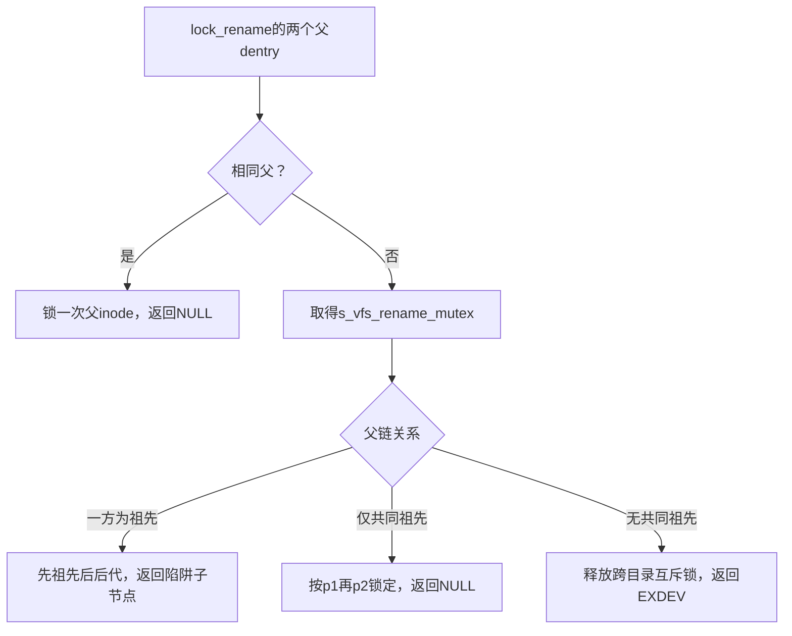
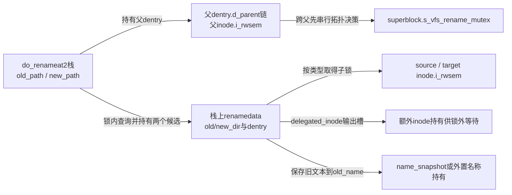
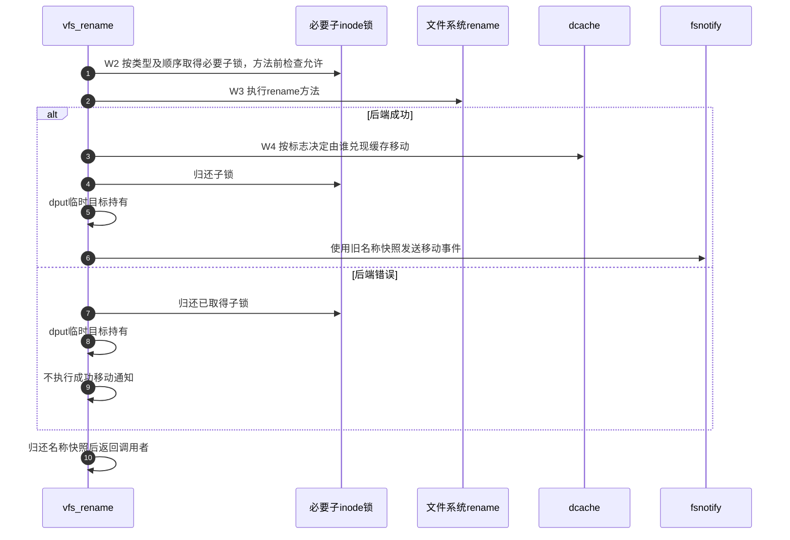

# 第21章\_重命名的拓扑检查与锁顺序

本页沿 [名称修改导读](../navigation/P10_名称修改怎样锁定检查与交付.md#10.1_沿修改周期区分保护与结果) 的W0～W5解释rename。固定提交 `dfaf2136deb2af2e60b994421281ba42f1c087e0`；父锁与操作来自fs/namei.c，非目录锁辅助来自fs/inode.c。身份见 [总索引](../navigation/P01_Linux_6.12_VFS源码阅读索引.md)，契约参照同提交 [directory-locking.rst](../../linux/Documentation/filesystems/directory-locking.rst)。

## 21.1\_父目录锁序在稳定拓扑下决定

lock_rename在同父情况下只取一把父锁；不同父时先取得s_vfs_rename_mutex，再进入lock_two_directories。后者沿父链确定祖先优先顺序、共同祖先以及可能阻止成环的陷阱节点。

```c
/** @brief 仓库补充阅读说明：同父锁一次，不同父先取得跨目录互斥保护。 */
struct dentry *lock_rename(struct dentry *p1, struct dentry *p2)
{
        /* 同父只取一把锁，避免自己再次等待。 */
        if (p1 == p2) {
                inode_lock_nested(p1->d_inode, I_MUTEX_PARENT);
                return NULL;
        }

        /* 不同父先稳定拓扑，随后才能决定祖先和锁序。 */
        mutex_lock(&p1->d_sb->s_vfs_rename_mutex);
        return lock_two_directories(p1, p2);
}
```

```c
/** @brief 仓库补充阅读说明：按祖先关系锁父目录，返回陷阱或无共同祖先错误。 */
static struct dentry *lock_two_directories(struct dentry *p1, struct dentry *p2)
{
        struct dentry *p = p1, *q = p2, *r;

        /* 先判断p2是否在p1的祖先链。 */
        while ((r = p->d_parent) != p2 && r != p)
                p = r;
        /* 祖先p2先锁，返回其通往p1的直接子节点作为陷阱。 */
        if (r == p2) {

                inode_lock_nested(p2->d_inode, I_MUTEX_PARENT);
                inode_lock_nested(p1->d_inode, I_MUTEX_PARENT2);
                return p;
        }

        /* 再检查相反祖先关系或共同连通根。 */
        while ((r = q->d_parent) != p1 && r != p && r != q)
                q = r;
        /* p1为祖先时先锁p1。 */
        if (r == p1) {

                inode_lock_nested(p1->d_inode, I_MUTEX_PARENT);
                inode_lock_nested(p2->d_inode, I_MUTEX_PARENT2);
                return q;
        /* 只有共同祖先而互不为祖先时，按传入参数顺序。 */
        } else if (likely(r == p)) {

                inode_lock_nested(p1->d_inode, I_MUTEX_PARENT);
                inode_lock_nested(p2->d_inode, I_MUTEX_PARENT2);
                return NULL;
        } else {
                /* 失败没有留下父锁集合，并已归还拓扑互斥锁。 */
                mutex_unlock(&p1->d_sb->s_vfs_rename_mutex);
                return ERR_PTR(-EXDEV);
        }
}
```

无共同祖先时返回EXDEV并已经释放s_vfs_rename_mutex；调用者不能再走成功锁集合的unlock_rename。无祖先关系但有共同祖先时，本实现按p1、p2锁定，而do_renameat2传入新父、旧父；随树文档中的“source first”概括与此具体参数顺序并不一致。这里保留两份证据的粒度，执行解释以固定函数体和调用点为准，不凭注释替换代码。

```c
/** @brief 仓库补充阅读说明：归还成功取得的父锁及必要跨目录互斥锁。 */
void unlock_rename(struct dentry *p1, struct dentry *p2)
{
        /* 成功路径至少持p1锁。 */
        inode_unlock(p1->d_inode);
        /* 不同父才有第二把父锁和跨目录互斥锁。 */
        if (p1 != p2) {
                inode_unlock(p2->d_inode);
                mutex_unlock(&p1->d_sb->s_vfs_rename_mutex);
        }
}
```



锁对象有各自存储和寿命：superblock的s_vfs_rename_mutex在superblock分配初始化，活到该实例退出；每个inode的i_rwsem在inode初始化，供目录操作与必要子对象操作保护。lock_two_directories只读取受拓扑保护的d_parent链，不分配新“锁序表”。锁类I_MUTEX_PARENT、PARENT2、CHILD、NONDIR2是检查器区分上下文的标记，关闭Lockdep仍必须遵循相同的实际加锁顺序。



“无共同祖先”错误出口不能调用unlock_rename，因为lock_two_directories此时已经释放跨目录互斥锁，也未取得两把父锁。更改父关系检查时应同时审查无共同祖先、同父、互为祖先与仅共同祖先四类输入；把错误出口并入成功出口会造成未持锁解锁。

## 21.2\_父锁内解析末项并拒绝成环或非法组合

do_renameat2先拒绝未知标志和EXCHANGE与NOREPLACE/WHITEOUT的冲突组合，取得两个父path并检查同一mount。锁父目录以后才查源、目标，检查源必须存在、NOREPLACE不覆盖、EXCHANGE两边存在以及尾斜杠类型条件。

```c
/** @brief 仓库补充阅读说明：锁父后查末项并检查模式，执行重命名及分阶段退出。 */
int do_renameat2(int olddfd, struct filename *from, int newdfd,
                 struct filename *to, unsigned int flags)
{
        struct renamedata rd;
        struct dentry *old_dentry, *new_dentry;
        struct dentry *trap;
        struct path old_path, new_path;
        struct qstr old_last, new_last;
        int old_type, new_type;
        struct inode *delegated_inode = NULL;
        unsigned int lookup_flags = 0, target_flags = LOOKUP_RENAME_TARGET;
        bool should_retry = false;
        int error = -EINVAL;

        /* 只接受本版本定义的三种标志。 */
        if (flags & ~(RENAME_NOREPLACE | RENAME_EXCHANGE | RENAME_WHITEOUT))
                goto put_names;

        /* 交换不能同时请求不覆盖或whiteout。 */
        if ((flags & (RENAME_NOREPLACE | RENAME_WHITEOUT)) &&
            (flags & RENAME_EXCHANGE))
                goto put_names;

        if (flags & RENAME_EXCHANGE)
                target_flags = 0;

retry:
        error = filename_parentat(olddfd, from, lookup_flags, &old_path,
                                  &old_last, &old_type);
        if (error)
                goto put_names;

        error = filename_parentat(newdfd, to, lookup_flags, &new_path, &new_last,
                                  &new_type);
        if (error)
                goto exit1;

        error = -EXDEV;
        /* 路径入口拒绝跨挂载。 */
        if (old_path.mnt != new_path.mnt)
                goto exit2;

        error = -EBUSY;
        if (old_type != LAST_NORM)
                goto exit2;

        if (flags & RENAME_NOREPLACE)
                error = -EEXIST;
        if (new_type != LAST_NORM)
                goto exit2;

        error = mnt_want_write(old_path.mnt);
        if (error)
                goto exit2;

retry_deleg:
        /* 新父作为p1、旧父作为p2，不能按变量名猜锁序。 */
        trap = lock_rename(new_path.dentry, old_path.dentry);
        /* 失败时没有成功锁集合，跳过unlock_rename。 */
        if (IS_ERR(trap)) {
                error = PTR_ERR(trap);
                goto exit_lock_rename;
        }

        /* 父锁内重新确认源末项。 */
        old_dentry = lookup_one_qstr_excl(&old_last, old_path.dentry,
                                          lookup_flags);
        error = PTR_ERR(old_dentry);
        if (IS_ERR(old_dentry))
                goto exit3;

        error = -ENOENT;
        if (d_is_negative(old_dentry))
                goto exit4;
        /* 随后查询目标，交换不使用普通替换目标提示。 */
        new_dentry = lookup_one_qstr_excl(&new_last, new_path.dentry,
                                          lookup_flags | target_flags);
        error = PTR_ERR(new_dentry);
        if (IS_ERR(new_dentry))
                goto exit4;
        error = -EEXIST;
        /* 交换不能同时请求不覆盖或whiteout。 */
        if ((flags & RENAME_NOREPLACE) && d_is_positive(new_dentry))
                goto exit5;
        if (flags & RENAME_EXCHANGE) {
                error = -ENOENT;
                if (d_is_negative(new_dentry))
                        goto exit5;

                if (!d_is_dir(new_dentry)) {
                        error = -ENOTDIR;
                        if (new_last.name[new_last.len])
                                goto exit5;
                }
        }

        if (!d_is_dir(old_dentry)) {
                error = -ENOTDIR;
                if (old_last.name[old_last.len])
                        goto exit5;
                if (!(flags & RENAME_EXCHANGE) && new_last.name[new_last.len])
                        goto exit5;
        }

        error = -EINVAL;
        /* 禁止把源祖先搬到其后代内部。 */
        if (old_dentry == trap)
                goto exit5;

        if (!(flags & RENAME_EXCHANGE))
                error = -ENOTEMPTY;
        /* 目标陷阱同样拒绝；普通替换与交换错误码不同。 */
        if (new_dentry == trap)
                goto exit5;

        error = security_path_rename(&old_path, old_dentry,
                                     &new_path, new_dentry, flags);
        if (error)
                goto exit5;

        /* 把本轮借用对象与委托输出槽组成调用参数。 */
        rd.old_dir         = old_path.dentry->d_inode;
        rd.old_dentry      = old_dentry;
        rd.old_mnt_idmap   = mnt_idmap(old_path.mnt);
        rd.new_dir         = new_path.dentry->d_inode;
        rd.new_dentry      = new_dentry;
        rd.new_mnt_idmap   = mnt_idmap(new_path.mnt);
        rd.delegated_inode = &delegated_inode;
        rd.flags           = flags;
        error = vfs_rename(&rd);
exit5:
        /* 逐层标签只归还确实已取得的候选。 */
        dput(new_dentry);
exit4:
        dput(old_dentry);
exit3:
        /* 候选归还后退出父目录和拓扑保护。 */
        unlock_rename(new_path.dentry, old_path.dentry);
exit_lock_rename:
        /* 保留父path与写许可，但先锁外等待，再重新锁查候选。 */
        if (delegated_inode) {
                error = break_deleg_wait(&delegated_inode);
                if (!error)
                        goto retry_deleg;
        }
        mnt_drop_write(old_path.mnt);
exit2:
        if (retry_estale(error, lookup_flags))
                should_retry = true;
        path_put(&new_path);
exit1:
        path_put(&old_path);
        /* ESTALE重试要先归还两个旧父path。 */
        if (should_retry) {
                should_retry = false;
                lookup_flags |= LOOKUP_REVAL;
                goto retry;
        }
put_names:
        putname(from);
        putname(to);
        return error;
}
```

old_dentry或new_dentry等于trap时拒绝成环情况。renamedata把两个父inode、两个末项dentry、各自idmap、flags和委托输出地址传给vfs_rename。成功锁集合、候选引用和写许可在标签上分层归还；等待委托发生在unlock_rename之后，之后重新锁并查末项。ESTALE路径会重新定位父path，不能保留上一轮候选作为新一轮输入。

| 请求 | 末项要求 | 先决拒绝 |
| --- | --- | --- |
| 普通rename | 源存在，目标可不存在或按类型替换 | 跨mount、祖先陷阱、尾斜杠等 |
| NOREPLACE | 目标不能已存在 | 不能与EXCHANGE组合 |
| EXCHANGE | 源目标都存在，可在支持规则下不同类型 | 不能与NOREPLACE或WHITEOUT组合 |
| WHITEOUT | 后端需支持相应语义和权限 | 此入口接纳标志不等于后端承诺成功 |

renamedata的定义位于 [fs.h](../../linux/include/linux/fs.h)，字段借用本次调用持有的对象，并不因赋值再取引用；delegated_inode字段指向调用者栈上的输出槽。flags由参数校验后传入，old/new_mnt_idmap来自各path的挂载。结构体不需要先全部清零，是因为这条路径在vfs_rename前填入实际使用的所有成员，不能将其作为“不必初始化结构体”的通例。

| 出口 | 已完成的资源归还 | 后续动作 |
| --- | --- | --- |
| exit5 / exit4 / exit3 | 依次归还新候选、旧候选，再解父锁和必要拓扑锁 | 进入委托等待或归还写许可 |
| exit_lock_rename | 父锁未取得，或已由成功路径归还 | 委托等待在锁外；成功回retry_deleg重新查两末项 |
| exit2 / exit1 | 归还新父path再旧父path | 需要REVAL才重新定位两父路径 |
| put_names | 已无本轮路径资源 | 消费两个filename并返回 |

若第二次父路径定位失败，代码直接exit1，不能声称任何地方返回ESTALE都必然重试；retry_estale只在实际调用点生效。标志表表达本层接纳条件，WHITEOUT能否执行还取决于具体文件系统和权限。

## 21.3\_子对象按类型和地址顺序进一步加锁

父目录已经锁住不代表所有目标inode状态均被冻结。vfs_rename根据是否跨目录、是否交换和两边是否目录，决定哪些子目录要锁；非目录对象在目录之后，双非目录通过以下辅助按inode地址排序。

```c
/** @brief 仓库补充阅读说明：按地址顺序锁非空且不同的非目录inode。 */
void lock_two_nondirectories(struct inode *inode1, struct inode *inode2)
{
        /* 目录类型告警检查调用前提，不代替实际锁。 */
        if (inode1)
                WARN_ON_ONCE(S_ISDIR(inode1->i_mode));
        if (inode2)
                WARN_ON_ONCE(S_ISDIR(inode2->i_mode));
        /* 以地址建立一致的非目录锁序。 */
        if (inode1 > inode2)
                swap(inode1, inode2);
        /* 排序后先取得非空的第一把对象锁。 */
        if (inode1)
                inode_lock(inode1);
        /* 相同对象只锁一次。 */
        if (inode2 && inode2 != inode1)
                inode_lock_nested(inode2, I_MUTEX_NONDIR2);
}
```

NULL参数可忽略，相同inode不会重复锁。地址顺序是本实现对同层非目录锁的排序规则，不表示可用地址大小判断目录祖先。源与目标inode相同的rename会更早直接成功返回，不能把这个分支描述成做了一次真实移动。

## 21.4\_后端成功后才执行对应缓存交接

vfs_rename先检查删除或创建资格、方法、跨父目录权限和安全钩子。保存旧名称快照并持有目标dentry后，取得必要子对象锁，处理交换文件、挂载点、链接数上限和委托，再调用后端rename。

```c
/** @brief 仓库补充阅读说明：按类型锁必要子对象，执行后端并按责任更新缓存和通知。 */
int vfs_rename(struct renamedata *rd)
{
        int error;
        struct inode *old_dir = rd->old_dir, *new_dir = rd->new_dir;
        struct dentry *old_dentry = rd->old_dentry;
        struct dentry *new_dentry = rd->new_dentry;
        struct inode **delegated_inode = rd->delegated_inode;
        unsigned int flags = rd->flags;
        bool is_dir = d_is_dir(old_dentry);
        struct inode *source = old_dentry->d_inode;
        struct inode *target = new_dentry->d_inode;
        bool new_is_dir = false;
        unsigned max_links = new_dir->i_sb->s_max_links;
        struct name_snapshot old_name;
        bool lock_old_subdir, lock_new_subdir;

        /* 同一inode直接成功，无后端移动及移动通知。 */
        if (source == target)
                return 0;

        error = may_delete(rd->old_mnt_idmap, old_dir, old_dentry, is_dir);
        if (error)
                return error;

        /* 空目标检查可建，已有目标检查可删及交换类型。 */
        if (!target) {
                error = may_create(rd->new_mnt_idmap, new_dir, new_dentry);
        } else {
                new_is_dir = d_is_dir(new_dentry);

                if (!(flags & RENAME_EXCHANGE))
                        error = may_delete(rd->new_mnt_idmap, new_dir,
                                           new_dentry, is_dir);
                else
                        error = may_delete(rd->new_mnt_idmap, new_dir,
                                           new_dentry, new_is_dir);
        }
        if (error)
                return error;

        if (!old_dir->i_op->rename)
                return -EPERM;

        /* 目录跨父改变点点关系，需对被移动目录核对写权限。 */
        if (new_dir != old_dir) {
                /* 目录在非目录之前，两个非目录交由地址排序辅助。 */
                if (is_dir) {
                        error = inode_permission(rd->old_mnt_idmap, source,
                                                 MAY_WRITE);
                        if (error)
                                return error;
                }
                if ((flags & RENAME_EXCHANGE) && new_is_dir) {
                        error = inode_permission(rd->new_mnt_idmap, target,
                                                 MAY_WRITE);
                        if (error)
                                return error;
                }
        }

        error = security_inode_rename(old_dir, old_dentry, new_dir, new_dentry,
                                      flags);
        if (error)
                return error;

        /* 缓存移动会改变旧名字，先独立保留通知所需文本。 */
        take_dentry_name_snapshot(&old_name, old_dentry);
        /* 本函数额外持有目标，调用者的候选持有仍独立存在。 */
        dget(new_dentry);

        /* 根据类型与跨父条件锁子目录，非目录总要保护。 */
        lock_old_subdir = new_dir != old_dir;
        lock_new_subdir = new_dir != old_dir || !(flags & RENAME_EXCHANGE);
        /* 目录在非目录之前，两个非目录交由地址排序辅助。 */
        if (is_dir) {
                if (lock_old_subdir)
                        inode_lock_nested(source, I_MUTEX_CHILD);
                if (target && (!new_is_dir || lock_new_subdir))
                        inode_lock(target);
        } else if (new_is_dir) {
                if (lock_new_subdir)
                        inode_lock_nested(target, I_MUTEX_CHILD);
                inode_lock(source);
        } else {
                lock_two_nondirectories(source, target);
        }

        error = -EPERM;
        /* 锁内再次核对会阻止后端操作的状态。 */
        if (IS_SWAPFILE(source) || (target && IS_SWAPFILE(target)))
                goto out;

        error = -EBUSY;
        if (is_local_mountpoint(old_dentry) || is_local_mountpoint(new_dentry))
                goto out;

        if (max_links && new_dir != old_dir) {
                error = -EMLINK;
                if (is_dir && !new_is_dir && new_dir->i_nlink >= max_links)
                        goto out;
                if ((flags & RENAME_EXCHANGE) && !is_dir && new_is_dir &&
                    old_dir->i_nlink >= max_links)
                        goto out;
        }
        /* 非目录的委托先用不可阻塞尝试，错误交上层等待。 */
        if (!is_dir) {
                error = try_break_deleg(source, delegated_inode);
                if (error)
                        goto out;
        }
        if (target && !new_is_dir) {
                error = try_break_deleg(target, delegated_inode);
                if (error)
                        goto out;
        }
        /* 所有方法前检查通过后才进入后端。 */
        error = old_dir->i_op->rename(rd->new_mnt_idmap, old_dir, old_dentry,
                                      new_dir, new_dentry, flags);
        if (error)
                goto out;

        /* 普通覆盖才清理被替换对象，交换不让目标消失。 */
        if (!(flags & RENAME_EXCHANGE) && target) {
                /* 目录在非目录之前，两个非目录交由地址排序辅助。 */
                if (is_dir) {
                        shrink_dcache_parent(new_dentry);
                        target->i_flags |= S_DEAD;
                }
                dont_mount(new_dentry);
                detach_mounts(new_dentry);
        }
        /* 只由契约指定的一方兑现dcache移动。 */
        if (!(old_dir->i_sb->s_type->fs_flags & FS_RENAME_DOES_D_MOVE)) {
                if (!(flags & RENAME_EXCHANGE))
                        d_move(old_dentry, new_dentry);
                else
                        d_exchange(old_dentry, new_dentry);
        }
out:
        /* 按与取锁相同的条件逐项归还。 */
        if (!is_dir || lock_old_subdir)
                inode_unlock(source);
        if (target && (!new_is_dir || lock_new_subdir))
                inode_unlock(target);
        /* 归还本函数额外持有，调用者仍持候选供通知引用。 */
        dput(new_dentry);
        /* 成功才根据普通或交换语义发通知。 */
        if (!error) {
                fsnotify_move(old_dir, new_dir, &old_name.name, is_dir,
                              !(flags & RENAME_EXCHANGE) ? target : NULL, old_dentry);
                if (flags & RENAME_EXCHANGE) {
                        fsnotify_move(new_dir, old_dir, &old_dentry->d_name,
                                      new_is_dir, NULL, new_dentry);
                }
        }
        /* 通知结束才释放旧名称快照。 */
        release_dentry_name_snapshot(&old_name);

        return error;
}
```

普通覆盖目标目录时还处理其缓存子项及S_DEAD，成功覆盖也禁止新挂载并脱离相关挂载。缓存移动由FS_RENAME_DOES_D_MOVE决定责任：默认调用d_move或d_exchange，声明自行完成的后端不能重复移动。实现入口见 [缓存名称移动](P22_缓存名称移动与读侧序列交接.md#22.1_全局序列只围绕缓存移动这段短更新)。



图选择方法前检查已经允许调用后端的路径；try_break_deleg提出等待请求时更早跳到out，不执行后端rename。实际代码在通知前已经dput临时目标，调用者仍有其自身持有；名称快照则到通知完成才释放。图中W4不是“后端写入持久介质完成”的证据，也不是面向全部观察者的一份目录树快照。本页没有跨目录压力、锁依赖或断电测试，返回 [导读](../navigation/P10_名称修改怎样锁定检查与交付.md#10.2_按对象变化选择唯一实现入口)。

改名完成后的fsnotify_move如何生成FROM/TO、共享cookie和对象自身事件，见 [改名通知](P58_fsnotify事件匹配与分派.md#58.4_改名为何产生有关联而不相邻的消息)。通知记录不保证名字在用户读取时仍指向同一对象。


## 21.5\_修改锁与缓存责任时保持两层契约

lock_rename/unlock_rename与do_renameat2在fs/namei.c定义，声明位于namei.h或fs.h；lock_two_directories只在namei.c内部使用。lock_two_nondirectories在fs/inode.c定义并由fs.h声明，只有非目录对象才适用。它的WARN_ON_ONCE检查误传目录，正常告警并不替调用者返回错误；panic_on_warn等策略可能中止执行，不能靠“有告警”弥补错误锁序。

| 实现簇 | 当前不变量与实际消费者 | 最小修改及验证边界 |
| --- | --- | --- |
| 同对象快速成功 | source等于target时直接返回，不进行后端、缓存移动或fsnotify_move | 测试两个硬链接指向同inode；不能强行补出一次并不存在的移动 |
| 子对象锁 | 跨父源目录需要锁；目标目录跨父交换或普通覆盖需要锁；非目录总受保护 | 取锁与out解锁条件成对修改，并覆盖同父/跨父及普通/交换的类型组合 |
| 名称快照 | take_dentry_name_snapshot保留旧文本，直到两方向通知完成后释放 | 修改通知位置须保留旧文本及调用者的目标持有，见 [名称存储](P12_名称失效与最后使用者退出.md#12.6_销毁同时归还别名父关系和最终内存) |
| 后端责任 | i_op.rename成功后，FS_RENAME_DOES_D_MOVE决定dcache由后端还是VFS兑现 | 该位是file_system_type.fs_flags运行契约，不是Kconfig；变更须检查后端和VFS，避免漏做或重复做 |
| 拒绝与重试 | 方法前检查或委托错误进入out，只清理；成功才覆盖目标、移动及通知 | 覆盖目标目录S_DEAD、挂载点、交换文件、最大链接数和委托等待路径 |

本页保留六个完整函数体，未展开每种后端rename、通用mutex/rwsem、LSM或通知后端。对应检查或框架入口由前两篇和通知章节承接；名称快照辅助在dcache.c，负责内联复制或外置名称持有，不把普通dget当成文本快照。修改后应在LOCKDEP启用和关闭配置下核对功能一致性，再以跨目录双向改名、祖先陷阱、同对象和后端错误注入验证；本次未运行这些负载。
