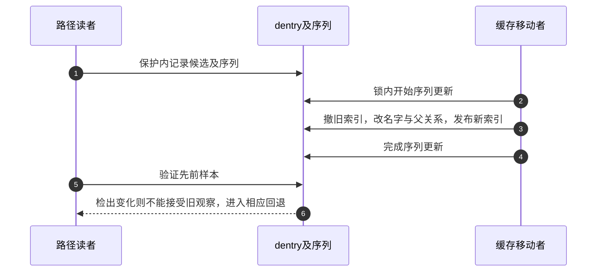

# 第22章\_缓存名称移动与读侧序列交接

本页把 [名称修改导读](../navigation/P10_名称修改怎样锁定检查与交付.md#10.1_沿修改周期区分保护与结果) 的W4落到fs/dcache.c。固定提交 `dfaf2136deb2af2e60b994421281ba42f1c087e0`；版本见 [总索引](../navigation/P01_Linux_6.12_VFS源码阅读索引.md)。这里解释缓存关系的兑现，不把d_move当成替用户执行文件系统rename的接口。

## 22.1\_全局序列只围绕缓存移动这段短更新

d_move持有rename_lock写侧后执行普通移动；d_exchange检查两边为已有非根对象，再用同一内部函数执行交换。该锁与跨目录的s_vfs_rename_mutex不同，不能将其临界区延伸到可能睡眠的文件系统方法。

```c
/** @brief 仓库补充阅读说明：用rename写序列保护普通缓存移动。 */
void d_move(struct dentry *dentry, struct dentry *target)
{
        write_seqlock(&rename_lock);
        __d_move(dentry, target, false);
        write_sequnlock(&rename_lock);
}
```

```c
/** @brief 仓库补充阅读说明：验证交换前提并用rename写序列保护缓存交换。 */
void d_exchange(struct dentry *dentry1, struct dentry *dentry2)
{
        write_seqlock(&rename_lock);

        WARN_ON(!dentry1->d_inode);
        WARN_ON(!dentry2->d_inode);
        WARN_ON(IS_ROOT(dentry1));
        WARN_ON(IS_ROOT(dentry2));

        __d_move(dentry1, dentry2, true);

        write_sequnlock(&rename_lock);
}
```

调用者还必须满足目录锁及必要跨目录保护；包装函数没有替调用者取得全部目录修改权限。RCU-walk和其他查找者按各自路径验证rename及dentry序列，不能说每个读者都先取得这把写侧锁。

## 22.2\_移动要同时维护名字父关系和索引

__d_move在祖先关系约束下锁相关父dentry，再锁源和目标。若目标正在并行lookup，还需进入目录发布区间并撤销进行中登记；这接上了上一模块的 [并行完成协议](P18_并行查询的登记等待与结果发布.md#18.4_目录序列把两个哈希之间的转换连接起来)。

```c
/** @brief 仓库补充阅读说明：在dentry序列内维护名字父关系子链哈希及查询完成。 */
static void __d_move(struct dentry *dentry, struct dentry *target,
                     bool exchange)
{
        struct dentry *old_parent, *p;
        wait_queue_head_t *d_wait;
        struct inode *dir = NULL;
        unsigned n;

        WARN_ON(!dentry->d_inode);
        if (WARN_ON(dentry == target))
                return;

        BUG_ON(d_ancestor(target, dentry));
        old_parent = dentry->d_parent;
        p = d_ancestor(old_parent, target);
        if (IS_ROOT(dentry)) {
                BUG_ON(p);
                spin_lock(&target->d_parent->d_lock);
        } else if (!p) {
                /* target is not a descendent of dentry->d_parent */
                spin_lock(&target->d_parent->d_lock);
                spin_lock_nested(&old_parent->d_lock, DENTRY_D_LOCK_NESTED);
        } else {
                BUG_ON(p == dentry);
                spin_lock(&old_parent->d_lock);
                if (p != target)
                        spin_lock_nested(&target->d_parent->d_lock,
                                        DENTRY_D_LOCK_NESTED);
        }
        spin_lock_nested(&dentry->d_lock, 2);
        spin_lock_nested(&target->d_lock, 3);

        if (unlikely(d_in_lookup(target))) {
                dir = target->d_parent->d_inode;
                n = start_dir_add(dir);
                d_wait = __d_lookup_unhash(target);
        }

        write_seqcount_begin(&dentry->d_seq);
        write_seqcount_begin_nested(&target->d_seq, DENTRY_D_LOCK_NESTED);

        /* unhash both */
        if (!d_unhashed(dentry))
                ___d_drop(dentry);
        if (!d_unhashed(target))
                ___d_drop(target);

        /* ... and switch them in the tree */
        dentry->d_parent = target->d_parent;
        if (!exchange) {
                copy_name(dentry, target);
                target->d_hash.pprev = NULL;
                dentry->d_parent->d_lockref.count++;
                if (dentry != old_parent) /* wasn't IS_ROOT */
                        WARN_ON(!--old_parent->d_lockref.count);
        } else {
                target->d_parent = old_parent;
                swap_names(dentry, target);
                if (!hlist_unhashed(&target->d_sib))
                        __hlist_del(&target->d_sib);
                hlist_add_head(&target->d_sib, &target->d_parent->d_children);
                __d_rehash(target);
                fsnotify_update_flags(target);
        }
        if (!hlist_unhashed(&dentry->d_sib))
                __hlist_del(&dentry->d_sib);
        hlist_add_head(&dentry->d_sib, &dentry->d_parent->d_children);
        __d_rehash(dentry);
        fsnotify_update_flags(dentry);
        fscrypt_handle_d_move(dentry);

        write_seqcount_end(&target->d_seq);
        write_seqcount_end(&dentry->d_seq);

        if (dir)
                end_dir_add(dir, n, d_wait);

        if (dentry->d_parent != old_parent)
                spin_unlock(&dentry->d_parent->d_lock);
        if (dentry != old_parent)
                spin_unlock(&old_parent->d_lock);
        spin_unlock(&target->d_lock);
        spin_unlock(&dentry->d_lock);
}
```

开始两边d_seq写侧后，函数先撤销正常哈希，再修改父关系。普通移动复制目标名字到源，维护父引用和子链表，并让被替换目标保持不可正常查找；交换分支则交换名字及父关系，把两边都重新放入相应子链和哈希。这里没有把源inode复制进目标文件内容。

copy_name与swap_names还区分内联名称和外置名称存储；copy_name在需要时增加外置名称持有并延迟释放旧存储，不是无条件浅拷贝一个字符串指针。这些辅助实现保留在同一原件中，本页不展开成另一套完整实现讲解。


## 22.3\_写侧完成与读侧接受通过序列连接

读者可能在移动前看到源父关系，在移动期间再读到别的字段；RCU只保护存续，不会把这些读自动变成同一时点快照。d_seq与rename序列检查使对应路径不能接受违反协议的组合，必要时转换或重查。



图选择读者确实跨过相关变化的情况，不表示任何rename都会让全系统全部查找重启。序列的具体消费点见 [候选验证](P16_候选读取与快速路径验证.md#16.1_返回候选时同时交出尚待验证的序列)。没有本次并发重命名追踪，返回 [名称修改导读](../navigation/P10_名称修改怎样锁定检查与交付.md#10.3_将读侧观察与修改侧完成放在同一时间线)。
