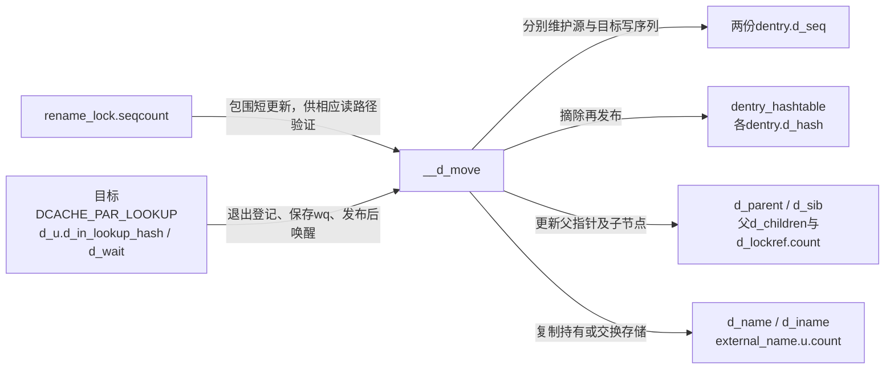
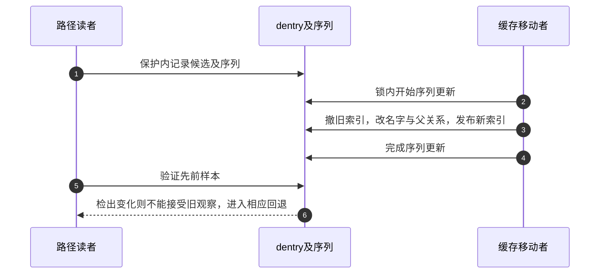

# 第22章\_缓存名称移动与读侧序列交接

本页把 [名称修改导读](../navigation/P10_名称修改怎样锁定检查与交付.md#10.1_沿修改周期区分保护与结果) 的W4落到fs/dcache.c。固定提交 `dfaf2136deb2af2e60b994421281ba42f1c087e0`；版本见 [总索引](../navigation/P01_Linux_6.12_VFS源码阅读索引.md)。这里解释缓存关系的兑现，不把d_move当成替用户执行文件系统rename的接口。

## 22.1\_全局序列只围绕缓存移动这段短更新

d_move持有rename_lock写侧后执行普通移动；d_exchange对两边应为已有非根对象的前提发出诊断，再用同一内部函数执行交换。该锁与跨目录的s_vfs_rename_mutex不同，不能将其临界区延伸到可能睡眠的文件系统方法。

```c
/** @brief 仓库补充阅读说明：用rename写序列保护普通缓存移动。 */
void d_move(struct dentry *dentry, struct dentry *target)
{
        /* 全局rename序列只包围短dcache更新。 */
        write_seqlock(&rename_lock);
        __d_move(dentry, target, false);
        /* 发布写侧完成，不是后端持久化。 */
        write_sequnlock(&rename_lock);
}
```

```c
/** @brief 仓库补充阅读说明：验证交换前提并用rename写序列保护缓存交换。 */
void d_exchange(struct dentry *dentry1, struct dentry *dentry2)
{
        write_seqlock(&rename_lock);

        /* 检查调用前提，告警自身不返回常规错误。 */
        WARN_ON(!dentry1->d_inode);
        WARN_ON(!dentry2->d_inode);
        WARN_ON(IS_ROOT(dentry1));
        WARN_ON(IS_ROOT(dentry2));

        /* 同一内部实现以exchange分支移动两套关系。 */
        __d_move(dentry1, dentry2, true);

        write_sequnlock(&rename_lock);
}
```

调用者还必须满足目录锁及必要跨目录保护；包装函数没有替调用者取得全部目录修改权限。RCU-walk和其他查找者按各自路径验证rename及dentry序列，不能说每个读者都先取得这把写侧锁。

rename_lock是dcache.c中DEFINE_SEQLOCK初始化的全局对象，在dcache.h声明给相关消费者。它与每个dentry的d_seq配合：全局序列反映缓存改名过程，局部序列验证所选候选。两个包装没有取得目录i_rwsem，因此只能在上层已经满足目录修改契约的上下文调用。

`WARN_ON(!dentry1->d_inode)`等语句只是检查前提，普通告警后仍可能继续到__d_move；其中没有“发现无效参数则返回EINVAL”的公共API约定。与之不同，`if (WARN_ON(dentry == target)) return`在诊断之外还执行功能返回。BUG_ON检查祖先关系不变量，既不能当作可恢复的用户参数检查，也不能因为关闭诊断配置就忽略调用前提。

## 22.2\_移动要同时维护名字父关系和索引

__d_move在祖先关系约束下锁相关父dentry，再锁源和目标。若目标正在并行lookup，还需进入目录发布区间并撤销进行中登记；这接上了上一模块的 [并行完成协议](P18_并行查询的登记等待与结果发布.md#18.4_目录序列把两个哈希之间的转换连接起来)。

```c
/** @brief 仓库补充阅读说明：在dentry序列内维护名字父关系子链哈希及查询完成。 */
static void __d_move(struct dentry *dentry, struct dentry *target,
                     bool exchange)
{
        struct dentry *old_parent, *p;
        wait_queue_head_t *d_wait;
        struct inode *dir = NULL;
        unsigned n;

        /* 正源是内部契约，普通告警不会自动退出。 */
        WARN_ON(!dentry->d_inode);
        /* 此处告警条件同时控制功能返回，不能删掉整个表达式。 */
        if (WARN_ON(dentry == target))
                return;

        /* 禁止把祖先作为目标形成非法关系。 */
        BUG_ON(d_ancestor(target, dentry));
        old_parent = dentry->d_parent;
        p = d_ancestor(old_parent, target);
        /* 别名接入可能遇到根源，父引用处理另走特殊路径。 */
        if (IS_ROOT(dentry)) {
                BUG_ON(p);
                spin_lock(&target->d_parent->d_lock);
        } else if (!p) {

                spin_lock(&target->d_parent->d_lock);
                spin_lock_nested(&old_parent->d_lock, DENTRY_D_LOCK_NESTED);
        } else {
                BUG_ON(p == dentry);
                spin_lock(&old_parent->d_lock);
                if (p != target)
                        spin_lock_nested(&target->d_parent->d_lock,
                                        DENTRY_D_LOCK_NESTED);
        }
        /* 父dentry锁之后再锁两个对象。 */
        spin_lock_nested(&dentry->d_lock, 2);
        spin_lock_nested(&target->d_lock, 3);

        /* 目标仍登记慢查询时，先接入目录序列与完成唤醒。 */
        if (unlikely(d_in_lookup(target))) {
                dir = target->d_parent->d_inode;
                n = start_dir_add(dir);
                d_wait = __d_lookup_unhash(target);
        }

        /* 两个候选都标记正在变化，读者需重新验证。 */
        write_seqcount_begin(&dentry->d_seq);
        write_seqcount_begin_nested(&target->d_seq, DENTRY_D_LOCK_NESTED);

        /* 撤销旧正常索引，再更新身份。 */
        if (!d_unhashed(dentry))
                ___d_drop(dentry);
        if (!d_unhashed(target))
                ___d_drop(target);

        /* 源先接入新父；普通和交换的目标处理不同。 */
        dentry->d_parent = target->d_parent;
        if (!exchange) {
                /* 转移名字内容或外置存储持有，不复制inode或文件数据。 */
                copy_name(dentry, target);
                target->d_hash.pprev = NULL;
                dentry->d_parent->d_lockref.count++;
                if (dentry != old_parent)
                        /* 递减旧父引用是功能动作，告警包装不能整体删除。 */
                        WARN_ON(!--old_parent->d_lockref.count);
        } else {
                /* 交换时目标也换父，因此两份子节点与索引都要维护。 */
                target->d_parent = old_parent;
                swap_names(dentry, target);
                if (!hlist_unhashed(&target->d_sib))
                        __hlist_del(&target->d_sib);
                hlist_add_head(&target->d_sib, &target->d_parent->d_children);
                __d_rehash(target);
                fsnotify_update_flags(target);
        }
        /* 无论哪种移动都把源放入新父的子链。 */
        if (!hlist_unhashed(&dentry->d_sib))
                __hlist_del(&dentry->d_sib);
        hlist_add_head(&dentry->d_sib, &dentry->d_parent->d_children);
        __d_rehash(dentry);
        fsnotify_update_flags(dentry);
        /* 加密配置决定此辅助是否有动作；不代替基本身份更新。 */
        fscrypt_handle_d_move(dentry);

        /* 正常索引和身份更新完成后结束两个对象序列。 */
        write_seqcount_end(&target->d_seq);
        write_seqcount_end(&dentry->d_seq);

        /* 必要时发布目录偶数并唤醒，仍持对象锁保护等待生命周期。 */
        if (dir)
                end_dir_add(dir, n, d_wait);

        /* 按实际取得的父锁集合解锁，根源不解不存在的旧父锁。 */
        if (dentry->d_parent != old_parent)
                spin_unlock(&dentry->d_parent->d_lock);
        if (dentry != old_parent)
                spin_unlock(&old_parent->d_lock);
        spin_unlock(&target->d_lock);
        spin_unlock(&dentry->d_lock);
}
```

开始两边d_seq写侧后，函数先撤销正常哈希，再修改父关系。普通移动复制目标名字到源，维护父引用和子链表，并让被替换目标保持不可正常查找；交换分支则交换名字及父关系，把两边都重新放入相应子链和哈希。这里没有把源inode复制进目标文件内容。

copy_name与swap_names还区分内联名称和外置名称存储；copy_name在需要时增加外置名称持有并延迟释放旧存储，不是无条件浅拷贝一个字符串指针。这些辅助实现保留在同一原件中，本页不展开成另一套完整实现讲解。




普通移动增加新父d_lockref.count，并在源原来非根时递减旧父计数；`WARN_ON(!--old_parent->d_lockref.count)`中的递减是真正功能动作，不能把整个告警表达式删掉。交换时双方子对象对父的持有总量重新对应，不采用普通移动那一对加减。目标在普通移动中退出正常哈希但可仍被上层持有，其父关系与子链不能简单宣称全部消失。

名字存储也有独立责任。copy_name遇外置目标时增加目标external_name.u.count并复制qstr；遇内联目标时复制到源d_iname并更新hash_len，源旧外置存储最后持有消失后kfree_rcu。swap_names遇两外置只交换指针；一外置一内联时转移外置指针并复制另一份内联文本；两内联按long单元交换缓冲区，最后都交换hash_len。BUILD_BUG_ON在编译期验证内联缓冲区适合该单元交换，不能改长度后只检查运行时结果。

fsnotify_update_flags按新父关系更新子项观察标记；fscrypt_handle_d_move在DCACHE_NOKEY_NAME存在时清除此标志；若d_revalidate恰为fscrypt_d_revalidate，再清DCACHE_OP_REVALIDATE以停用这一专用重验，CONFIG_FS_ENCRYPTION关闭时包装为空，当前配置属于后者。它们是索引身份更新旁的附加动作，不能用其配置关闭为理由删掉子链、哈希或序列维护。

## 22.3\_写侧完成与读侧接受通过序列连接

读者可能在移动前看到源父关系，在移动期间再读到别的字段；RCU只保护存续，不会把这些读自动变成同一时点快照。d_seq与rename序列检查使对应路径不能接受违反协议的组合，必要时转换或重查。



图选择读者确实跨过相关变化的情况，不表示任何rename都会让全系统全部查找重启。序列的具体消费点见 [候选验证](P16_候选读取与快速路径验证.md#16.1_返回候选时同时交出尚待验证的序列)。没有本次并发重命名追踪，返回 [名称修改导读](../navigation/P10_名称修改怎样锁定检查与交付.md#10.3_将读侧观察与修改侧完成放在同一时间线)。


## 22.4\_索引修改必须同时覆盖所有观察路径

本页三个函数中，d_move/d_exchange由dcache.h对外声明，__d_move和copy_name/swap_names只在dcache.c内部使用；原件 [dcache.c](../../linux/fs/dcache.c) 保留全部实现。___d_drop与__d_rehash分别撤下和发布正常d_hash，hlist操作维护父子链d_sib，不能对不同集合只做一次“摘链”。辅助的具体写法已在 [发布名称](P11_名称候选的建立发布与持有.md#11.4_发布结果时结束并行查询再供后续查找) 与 [解除索引](P12_名称失效与最后使用者退出.md#12.1_撤销正常名称索引不会自动释放对象) 解释；本页不再次复制其函数体。

若目标正在并行查询，__d_lookup_unhash在联合体复用前保存等待队列；end_dir_add在正常索引发布之后结束i_dir_seq并唤醒。目标d_lock直到唤醒遍历结束才释放，等待者重新取同一锁后才能返回，详见 [等待生命周期](P18_并行查询的登记等待与结果发布.md#18.3_等待者睡眠前登记并在醒来后重查)。这条分支不意味着每次普通rename都有等待队列。

更改名字或父关系的最小安全范围必须涵盖两份d_seq、全局序列、正常桶、父子链、父引用、外置文本寿命，以及进行中查询的可选完成分支。检查普通替换、交换、同父、跨父、根别名接入和内联/外置名字组合；并发读者必须按其原有验证规则看见旧关系、新关系或要求重查，不能接受混合身份。仅比较最终目录输出无法验证这一不变量，本次只完成固定源码核对。
