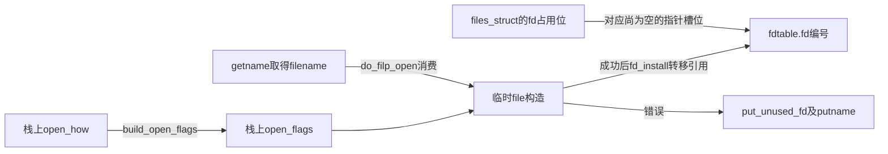
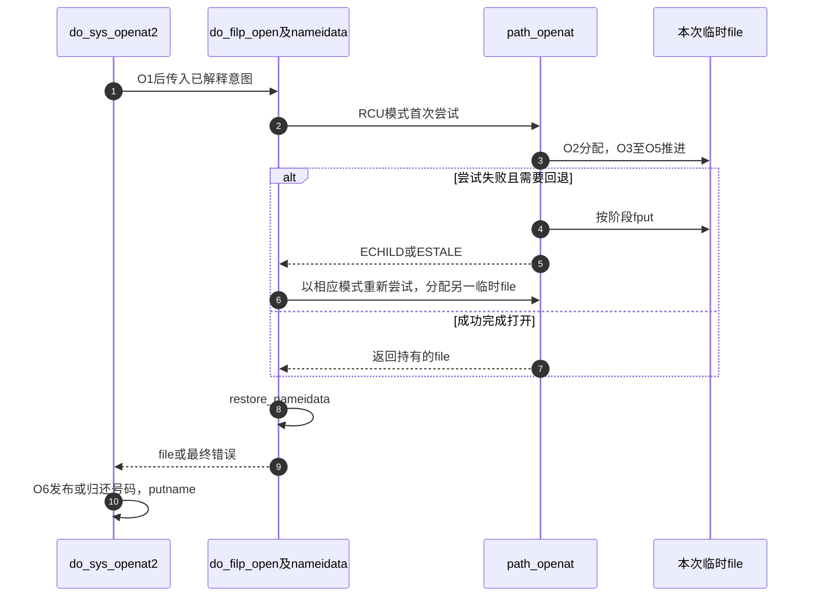

# 第23章\_打开参数与描述符发布的外层事务

外层打开事务既要把用户意图交给路径层，又要避免在file尚未完整建立时公开描述符。这里沿O0～O6核对参数规整、号码预留、路径重试和最终交付；失败时清理拥有的资源，不把它误称为撤销全部名称副作用。

| 阅读关联 | 入口 |
| --- | --- |
| 场景及阶段 | [open正文](../../../../knowledge/kernel_subsystems/vfs/P12_open状态机.md#12.3_沿一次打开追踪七个阶段) |
| 模块与其他实现簇 | [打开导读](../navigation/P11_打开请求怎样变成可发布的file.md#11.1_先区分意图构造与公开状态) |
| 版本身份 | [VFS总索引](../navigation/P01_Linux_6.12_VFS源码阅读索引.md#1.1_先固定源码身份与运行证据) |
| 固定原件 | [fs/open.c](../../linux/fs/open.c)、[fs/namei.c](../../linux/fs/namei.c)、[fs/internal.h](../../linux/fs/internal.h) |

固定提交为 `dfaf2136deb2af2e60b994421281ba42f1c087e0`。build_open_how、build_open_flags和do_filp_open的跨单元接口在fs/internal.h；do_sys_openat2和path_openat是各自文件内的static实现。open_flags是VFS内部意图对象，公开open_how来自include/uapi/linux/openat2.h，两者不是同一份ABI结构。

## 23.1\_先把用户请求分成访问创建与解析意图

旧入口先由build_open_how筛选合法位、处理O_PATH的允许组合，并在不创建时清空mode。openat2则从用户结构复制到内核局部对象，检查结构大小和新增字段规则，再进入公共校验；不能把旧入口的规整行为当成openat2对无效输入的承诺。

```c
/** @brief 仓库补充阅读说明：按旧接口约定规整打开标志和创建mode。 */
inline struct open_how build_open_how(int flags, umode_t mode)
{
        struct open_how how = {
                .flags = flags & VALID_OPEN_FLAGS,
                .mode = mode & S_IALLUGO,
        };

        /* O_PATH beats everything else. */
        /* 仓库补充：旧入口的路径句柄请求先收紧为允许的标志集合。 */
        if (how.flags & O_PATH)
                how.flags &= O_PATH_FLAGS;
        /* Modes should only be set for create-like flags. */
        if (!WILL_CREATE(how.flags))
                how.mode = 0;
        return how;
}
```

内部open_flags把“文件标志”“新对象mode”“访问检查”“末项意图”“路径约束”分开，避免某一层直接把用户位图当成另一层的控制变量。

```c
/** @brief 仓库补充阅读说明：分开保存文件标志、创建mode、访问检查和解析意图。 */
struct open_flags {
        int open_flag;
        umode_t mode;
        int acc_mode;
        int intent;
        int lookup_flags;
};
```

```c
/** @brief 仓库补充阅读说明：校验请求并拆分文件标志、访问模式与路径意图。 */
inline int build_open_flags(const struct open_how *how, struct open_flags *op)
{
        u64 flags = how->flags;
        u64 strip = __FMODE_NONOTIFY | O_CLOEXEC;
        int lookup_flags = 0;
        int acc_mode = ACC_MODE(flags);

        BUILD_BUG_ON_MSG(upper_32_bits(VALID_OPEN_FLAGS),
                         "struct open_flags doesn't yet handle flags > 32 bits");

        /*
         * Strip flags that either shouldn't be set by userspace like
         * FMODE_NONOTIFY or that aren't relevant in determining struct
         * open_flags like O_CLOEXEC.
         */
        /* 仓库补充：CLOEXEC留在原how供号码分配使用，不进入普通file打开标志。 */
        flags &= ~strip;

        /*
         * Older syscalls implicitly clear all of the invalid flags or argument
         * values before calling build_open_flags(), but openat2(2) checks all
         * of its arguments.
         */
        if (flags & ~VALID_OPEN_FLAGS)
                return -EINVAL;
        if (how->resolve & ~VALID_RESOLVE_FLAGS)
                return -EINVAL;

        /* Scoping flags are mutually exclusive. */
        if ((how->resolve & RESOLVE_BENEATH) && (how->resolve & RESOLVE_IN_ROOT))
                return -EINVAL;

        /* Deal with the mode. */
        if (WILL_CREATE(flags)) {
                if (how->mode & ~S_IALLUGO)
                        return -EINVAL;
                op->mode = how->mode | S_IFREG;
        } else {
                if (how->mode != 0)
                        return -EINVAL;
                op->mode = 0;
        }

        /*
         * Block bugs where O_DIRECTORY | O_CREAT created regular files.
         * Note, that blocking O_DIRECTORY | O_CREAT here also protects
         * O_TMPFILE below which requires O_DIRECTORY being raised.
         */
        if ((flags & (O_DIRECTORY | O_CREAT)) == (O_DIRECTORY | O_CREAT))
                return -EINVAL;

        /* Now handle the creative implementation of O_TMPFILE. */
        if (flags & __O_TMPFILE) {
                /*
                 * In order to ensure programs get explicit errors when trying
                 * to use O_TMPFILE on old kernels we enforce that O_DIRECTORY
                 * is raised alongside __O_TMPFILE.
                 */
                if (!(flags & O_DIRECTORY))
                        return -EINVAL;
                if (!(acc_mode & MAY_WRITE))
                        return -EINVAL;
        }
        if (flags & O_PATH) {
                /* O_PATH only permits certain other flags to be set. */
                if (flags & ~O_PATH_FLAGS)
                        return -EINVAL;
                acc_mode = 0;
        }

        /*
         * O_SYNC is implemented as __O_SYNC|O_DSYNC.  As many places only
         * check for O_DSYNC if the need any syncing at all we enforce it's
         * always set instead of having to deal with possibly weird behaviour
         * for malicious applications setting only __O_SYNC.
         */
        if (flags & __O_SYNC)
                flags |= O_DSYNC;

        op->open_flag = flags;

        /* O_TRUNC implies we need access checks for write permissions */
        if (flags & O_TRUNC)
                acc_mode |= MAY_WRITE;

        /* Allow the LSM permission hook to distinguish append
           access from general write access. */
        if (flags & O_APPEND)
                acc_mode |= MAY_APPEND;

        /* 仓库补充：保存访问检查模式，区别于file的生命周期标志。 */
        op->acc_mode = acc_mode;

        op->intent = flags & O_PATH ? 0 : LOOKUP_OPEN;

        if (flags & O_CREAT) {
                op->intent |= LOOKUP_CREATE;
                if (flags & O_EXCL) {
                        op->intent |= LOOKUP_EXCL;
                        flags |= O_NOFOLLOW;
                }
        }

        if (flags & O_DIRECTORY)
                lookup_flags |= LOOKUP_DIRECTORY;
        if (!(flags & O_NOFOLLOW))
                lookup_flags |= LOOKUP_FOLLOW;

        if (how->resolve & RESOLVE_NO_XDEV)
                lookup_flags |= LOOKUP_NO_XDEV;
        if (how->resolve & RESOLVE_NO_MAGICLINKS)
                lookup_flags |= LOOKUP_NO_MAGICLINKS;
        if (how->resolve & RESOLVE_NO_SYMLINKS)
                lookup_flags |= LOOKUP_NO_SYMLINKS;
        if (how->resolve & RESOLVE_BENEATH)
                lookup_flags |= LOOKUP_BENEATH;
        if (how->resolve & RESOLVE_IN_ROOT)
                lookup_flags |= LOOKUP_IN_ROOT;
        /* 仓库补充：缓存限定明确拒绝这些需要修改状态的请求。 */
        if (how->resolve & RESOLVE_CACHED) {
                /* Don't bother even trying for create/truncate/tmpfile open */
                if (flags & (O_TRUNC | O_CREAT | __O_TMPFILE))
                        return -EAGAIN;
                lookup_flags |= LOOKUP_CACHED;
        }

        op->lookup_flags = lookup_flags;
        return 0;
}
```

| 实现簇或字段 | 初始化与消费 | 对结果的影响 |
| --- | --- | --- |
| WILL_CREATE、O_PATH_FLAGS | fs/open.c的局部宏，识别创建类请求及路径句柄允许位 | 决定mode是否有意义和O_PATH可接受组合 |
| VALID_OPEN_FLAGS、VALID_RESOLVE_FLAGS | 校验公共允许位 | 未知请求拒绝，不能静默落入另一模式 |
| open_flag、mode | 公共校验后填写，path_openat及末项路径读取 | 决定file标志和后端创建参数 |
| acc_mode、ACC_MODE | 访问模式转换，追加TRUNC所需写检查及APPEND语义 | may_open及后置检查消费，不能用f_mode阶段位代替 |
| intent | OPEN、CREATE、EXCL组合，O_PATH不设普通OPEN意图 | open_last_lookups加到nameidata.flags |
| lookup_flags | FOLLOW、DIRECTORY及RESOLVE映射 | 控制整次路径解析；与最后分量意图分开 |
| O_CLOEXEC | 从内部open_flag去掉，但原how.flags保留 | 后续号码分配设置fdtable状态 |

**实现原理与修改边界**：校验只转换本次请求，还没有公开任何file。BUILD_BUG_ON_MSG检查编译期可表示范围，不替代运行时无效位检查；EAGAIN、EINVAL等是接口结果。修改某个flag的接纳规则时，须同步旧入口规整、openat2严格校验、意图转换和真正消费点，尤其检查O_CREAT与DIRECTORY、EXCL、TRUNC、RESOLVE_CACHED以及O_PATH的组合。不得为了接受一个位而只扩大VALID掩码。

## 23.2\_预留槽位与转交file分别发生在两端

do_sys_openat2先校验参数，再通过getname取得filename；这两步失败时没有预留号码。get_unused_fd_flags成功只标记槽位占用，do_filp_open才构造file；返回错误时put_unused_fd，成功时fd_install转移file持有，最后putname。

```c
/** @brief 仓库补充阅读说明：预留号码后构造file，成功发布或错误归还预留。 */
static long do_sys_openat2(int dfd, const char __user *filename,
                           struct open_how *how)
{
        struct open_flags op;
        int fd = build_open_flags(how, &op);
        struct filename *tmp;

        if (fd)
                return fd;

        tmp = getname(filename);
        if (IS_ERR(tmp))
                return PTR_ERR(tmp);

        /* 仓库补充：只预留号码，尚未向槽位发布file指针。 */
        fd = get_unused_fd_flags(how->flags);
        if (fd >= 0) {
                struct file *f = do_filp_open(dfd, tmp, &op);
                if (IS_ERR(f)) {
                        put_unused_fd(fd);
                        fd = PTR_ERR(f);
                } else {
                        /* 仓库补充：成功时把构造者持有转交描述符表。 */
                        fd_install(fd, f);
                }
        }
        putname(tmp);
        return fd;
}
```



get_unused_fd_flags、put_unused_fd和fd_install由fs/file.c定义，公开在include/linux/file.h；前两者修改分配状态，后者按RCU发布file指针并消费输入持有。其完整并发算法由下一模块展开，字段关系已见 [fdtable与files_struct](P01_描述符表与打开对象的状态归属.md#1.2_fdtable把指针数组与分配状态放在一起)。本页不把该算法复制成另一份实现。

**实现原理与修改边界**：fd_install的正常输入是已预留且为空的槽位和完整file。成功后再fput同一份已转交引用会破坏表项持有；失败时不归还预留位则泄漏号码。修改外层顺序要同时检查资源耗尽、getname失败、file构造失败、共享files_struct和CLOEXEC状态，不能只看单线程返回值。

## 23.3\_每次路径尝试拥有自己的临时file

path_openat先alloc_empty_file，再按TMPFILE、O_PATH或普通路径分流。普通路径将已有的path_init、link_path_walk、open_last_lookups与do_open串起，最后terminate_walk。成功返回还必须满足FMODE_OPENED；否则把不完整结果转成错误并fput。

```c
/** @brief 仓库补充阅读说明：为一次路径尝试分配file，并按分支完成或清理。 */
static struct file *path_openat(struct nameidata *nd,
                        const struct open_flags *op, unsigned flags)
{
        struct file *file;
        int error;

        /* 仓库补充：每次尝试取得独立的临时file。 */
        file = alloc_empty_file(op->open_flag, current_cred());
        if (IS_ERR(file))
                return file;

        if (unlikely(file->f_flags & __O_TMPFILE)) {
                error = do_tmpfile(nd, flags, op, file);
        } else if (unlikely(file->f_flags & O_PATH)) {
                error = do_o_path(nd, flags, file);
        } else {
                const char *s = path_init(nd, flags);
                while (!(error = link_path_walk(s, nd)) &&
                       (s = open_last_lookups(nd, file, op)) != NULL)
                        ;
                if (!error)
                        error = do_open(nd, file, op);
                terminate_walk(nd);
        }
        if (likely(!error)) {
                if (likely(file->f_mode & FMODE_OPENED))
                        return file;
                WARN_ON(1);
                error = -EINVAL;
        }
        /* 仓库补充：按file是否已经OPENED选择后续生命周期清理。 */
        fput(file);
        if (error == -EOPENSTALE) {
                if (flags & LOOKUP_RCU)
                        error = -ECHILD;
                else
                        error = -ESTALE;
        }
        return ERR_PTR(error);
}
```

路径起点、前导遍历与terminate_walk的唯一实现分别见 [路径起点](P13_路径起点与结果持有的交接.md#13.2_建立起点时同时确立观察或持有协议)、[前导分量](P14_前导分量与单步位置推进.md#14.1_拆分时保留最后名字而不是提前执行末项操作) 和 [退出清理](P13_路径起点与结果持有的交接.md#13.6_退出要分别处理链接资源路径引用和任务上下文)。本模块只改变末项与打开的组合责任。

**实现原理与修改边界**：路径nameidata的引用与file自己的path持有分开归还。fput可能将已打开对象交给任务退出工作或延后工作，不能把它画成必定同步完成全部release。WARN_ON检查“不报错却未打开”的内部契约，并返回EINVAL；它不是创建file的正常方法。EOPENSTALE按本次模式转换成ECHILD或ESTALE供外层重试，修改时必须保留旧尝试已经清理这一前提。

## 23.4\_模式重试不能复用上一次未完成file

do_filp_open建立nameidata，先尝试RCU路径；ECHILD改为带引用模式，ESTALE再要求重新验证。每次path_openat失败已经归还自己的file，restore_nameidata最终恢复任务嵌套上下文。

```c
/** @brief 仓库补充阅读说明：建立遍历上下文并执行有限的模式与验证重试。 */
struct file *do_filp_open(int dfd, struct filename *pathname,
                const struct open_flags *op)
{
        struct nameidata nd;
        int flags = op->lookup_flags;
        struct file *filp;

        set_nameidata(&nd, dfd, pathname, NULL);
        /* 仓库补充：先尝试快速观察，错误类型决定有限回退。 */
        filp = path_openat(&nd, op, flags | LOOKUP_RCU);
        if (unlikely(filp == ERR_PTR(-ECHILD)))
                filp = path_openat(&nd, op, flags);
        if (unlikely(filp == ERR_PTR(-ESTALE)))
                filp = path_openat(&nd, op, flags | LOOKUP_REVAL);
        restore_nameidata();
        return filp;
}
```



**实现原理与修改边界**：这是一组针对特定返回值的有限回退，不是失败就无限重来。新增错误映射时，应同时审查是否已产生名称或后端副作用、是否允许再次尝试、旧引用与链接清理是否完成。固定配置为ARM、Tiny RCU且无SMP；源码中的RCU模式不等于本次有多CPU实测。未进行目标运行、资源耗尽或重试注入。
