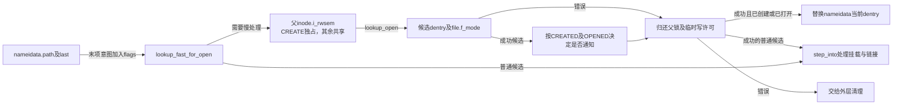
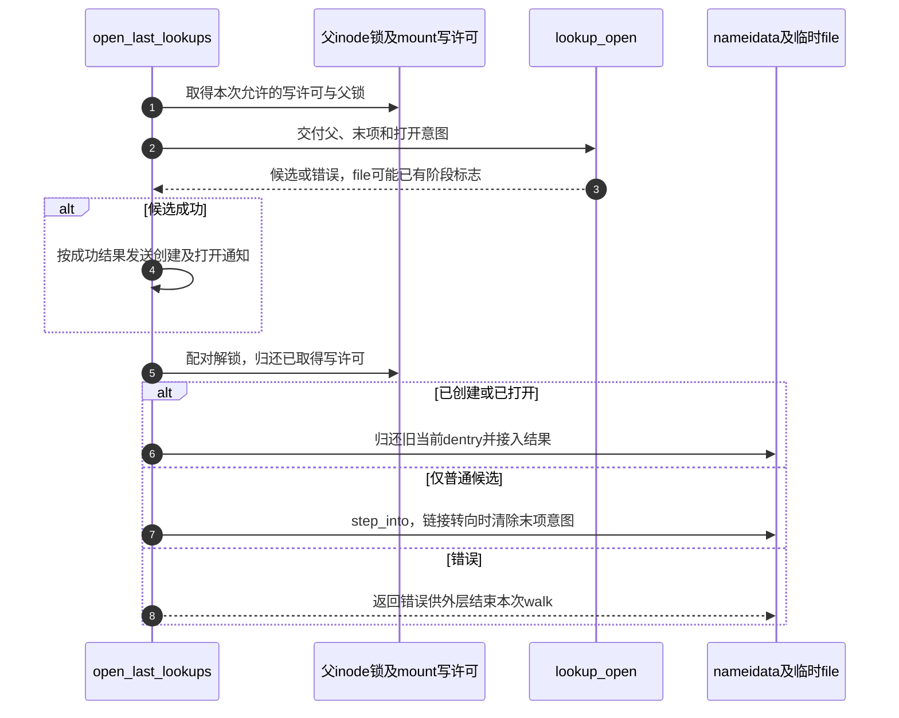

# 第24章\_打开末项的查询创建与再检查

末项处理必须同时回答“现在有什么对象”和“本次请求允许做什么”。缓存未命中不能直接创建，创建权限不足也不能在尚未确定对象是否存在时随意拒绝所有O_CREAT请求。本页把查询、创建资格和最后打开的责任拆开。

| 阅读关联 | 入口 |
| --- | --- |
| 场景与O3阶段 | [open正文](../../../../knowledge/kernel_subsystems/vfs/P12_open状态机.md#12.4_最后名称可以只查询也可以创建或组合打开) |
| 模块参与者 | [打开导读](../navigation/P11_打开请求怎样变成可发布的file.md#11.1_先区分意图构造与公开状态) |
| 身份与原件 | [总索引](../navigation/P01_Linux_6.12_VFS源码阅读索引.md#1.1_先固定源码身份与运行证据)、[fs/namei.c](../../linux/fs/namei.c) |

固定提交 `dfaf2136deb2af2e60b994421281ba42f1c087e0`；四个函数均为fs/namei.c内的static辅助，没有供驱动随意调用的公开原型。输入主要是当前nameidata、临时file和已经解释的open_flags。

## 24.1\_创建请求不能直接消费无保护的负候选

lookup_fast_for_open先处理O_CREAT与尾斜杠，O_EXCL创建直接跳过快速命中。其余调用lookup_fast；若本次允许创建而得到负候选，就放弃快速结果，要求后续在父目录保护下重新处理。

```c
/** @brief 仓库补充阅读说明：处理末项特有要求，创建负候选转交受锁保护的路径。 */
static struct dentry *lookup_fast_for_open(struct nameidata *nd, int open_flag)
{
        struct dentry *dentry;

        if (open_flag & O_CREAT) {
                if (trailing_slashes(nd))
                        return ERR_PTR(-EISDIR);

                /* Don't bother on an O_EXCL create */
                /* 仓库补充：排他创建不直接接受快速命中。 */
                if (open_flag & O_EXCL)
                        return NULL;
        }

        if (trailing_slashes(nd))
                nd->flags |= LOOKUP_FOLLOW | LOOKUP_DIRECTORY;

        dentry = lookup_fast(nd);
        if (IS_ERR_OR_NULL(dentry))
                return dentry;

        if (open_flag & O_CREAT) {
                /* Discard negative dentries. Need inode_lock to do the create */
                /* 仓库补充：负候选的创建必须移到父目录保护之下。 */
                if (!dentry->d_inode) {
                        if (!(nd->flags & LOOKUP_RCU))
                                dput(dentry);
                        dentry = NULL;
                }
        }
        return dentry;
}
```

普通lookup_fast的两种持有语义见 [快速查询](P16_候选读取与快速路径验证.md#16.2_快速查询按当前模式解释同一个返回形态)。因此这里只在非RCU模式丢弃负候选时dput：不能对一个从未取得普通引用的RCU观察指针机械执行归还。

**实现原理与修改边界**：trailing_slashes读取本次保存的末项后是否仍有斜杠，决定目录及跟随要求；不是重新扫描另一份路径。修改快速创建条件必须保留O_EXCL不接受现存名称、负结果进入父锁协议以及两种模式引用配对。否则可能把旧缓存观察当成独占创建资格。

## 24.2\_锁内查询还要区分是否真的需要创建

lookup_open先检查父目录是否存活，清除本次FMODE_CREATED，取得并验证候选。现存正候选直接返回，由后续file操作负责打开；它不必经过atomic_open。未完成候选复用并行lookup协议，完成后才能判断是否还需要创建。

```c
/** @brief 仓库补充阅读说明：区分现存候选、后端查询、创建许可与组合打开。 */
static struct dentry *lookup_open(struct nameidata *nd, struct file *file,
                                  const struct open_flags *op,
                                  bool got_write)
{
        struct mnt_idmap *idmap;
        struct dentry *dir = nd->path.dentry;
        struct inode *dir_inode = dir->d_inode;
        int open_flag = op->open_flag;
        struct dentry *dentry;
        int error, create_error = 0;
        umode_t mode = op->mode;
        DECLARE_WAIT_QUEUE_HEAD_ONSTACK(wq);

        if (unlikely(IS_DEADDIR(dir_inode)))
                return ERR_PTR(-ENOENT);

        /* 仓库补充：开始本次末项尝试，先清除旧创建阶段标记。 */
        file->f_mode &= ~FMODE_CREATED;
        dentry = d_lookup(dir, &nd->last);
        for (;;) {
                if (!dentry) {
                        dentry = d_alloc_parallel(dir, &nd->last, &wq);
                        if (IS_ERR(dentry))
                                return dentry;
                }
                if (d_in_lookup(dentry))
                        break;

                error = d_revalidate(dentry, nd->flags);
                if (likely(error > 0))
                        break;
                if (error)
                        goto out_dput;
                d_invalidate(dentry);
                dput(dentry);
                dentry = NULL;
        }
        if (dentry->d_inode) {
                /* Cached positive dentry: will open in f_op->open */
                return dentry;
        }

        if (open_flag & O_CREAT)
                audit_inode(nd->name, dir, AUDIT_INODE_PARENT);

        /*
         * Checking write permission is tricky, bacuse we don't know if we are
         * going to actually need it: O_CREAT opens should work as long as the
         * file exists.  But checking existence breaks atomicity.  The trick is
         * to check access and if not granted clear O_CREAT from the flags.
         *
         * Another problem is returing the "right" error value (e.g. for an
         * O_EXCL open we want to return EEXIST not EROFS).
         */
        if (unlikely(!got_write))
                open_flag &= ~O_TRUNC;
        idmap = mnt_idmap(nd->path.mnt);
        if (open_flag & O_CREAT) {
                if (open_flag & O_EXCL)
                        open_flag &= ~O_TRUNC;
                mode = vfs_prepare_mode(idmap, dir->d_inode, mode, mode, mode);
                if (likely(got_write))
                        create_error = may_o_create(idmap, &nd->path,
                                                    dentry, mode);
                else
                        create_error = -EROFS;
        }
        /* 仓库补充：保存创建拒绝，但仍可查询已经存在的对象。 */
        if (create_error)
                open_flag &= ~O_CREAT;
        if (dir_inode->i_op->atomic_open) {
                dentry = atomic_open(nd, dentry, file, open_flag, mode);
                if (unlikely(create_error) && dentry == ERR_PTR(-ENOENT))
                        dentry = ERR_PTR(create_error);
                return dentry;
        }

        if (d_in_lookup(dentry)) {
                struct dentry *res = dir_inode->i_op->lookup(dir_inode, dentry,
                                                             nd->flags);
                d_lookup_done(dentry);
                if (unlikely(res)) {
                        if (IS_ERR(res)) {
                                error = PTR_ERR(res);
                                goto out_dput;
                        }
                        dput(dentry);
                        dentry = res;
                }
        }

        /* Negative dentry, just create the file */
        if (!dentry->d_inode && (open_flag & O_CREAT)) {
                /* 仓库补充：此处在方法之前置位，必须结合最终返回结果判断成功。 */
                file->f_mode |= FMODE_CREATED;
                audit_inode_child(dir_inode, dentry, AUDIT_TYPE_CHILD_CREATE);
                if (!dir_inode->i_op->create) {
                        error = -EACCES;
                        goto out_dput;
                }

                error = dir_inode->i_op->create(idmap, dir_inode, dentry,
                                                mode, open_flag & O_EXCL);
                if (error)
                        goto out_dput;
        }
        if (unlikely(create_error) && !dentry->d_inode) {
                error = create_error;
                goto out_dput;
        }
        return dentry;

out_dput:
        dput(dentry);
        return ERR_PTR(error);
}
```

| 状态或辅助簇 | 谁建立并由谁消费 | 当前作用 |
| --- | --- | --- |
| dir、dir_inode、nd.last | 路径阶段建立父与最后名称，本函数读取 | 确定本次锁所保护的目录和查找键 |
| d_lookup、d_alloc_parallel、d_in_lookup | 查询或登记候选，本函数及后端接续 | 复用结果或成为同名工作者 |
| d_revalidate、d_invalidate、dput | 验证消费者判断失效并归还 | 失效可重查，真实错误返回 |
| got_write、create_error、open_flag | 调用者传写许可，本函数保存错误并收紧创建意图 | 允许先确定是否真的缺失，避免错误拒绝现存对象 |
| mode、idmap、vfs_prepare_mode | 父挂载及新对象参数生成 | 按身份映射、权限和类型规则准备创建 |
| FMODE_CREATED | 本函数在普通create之前置位 | 是阶段标记；只有成功返回时才能据此处理创建结果 |
| dir_inode.i_op.lookup/create/atomic_open | 后端安装方法，本函数按候选与能力分流 | 实际查询、创建或组合打开 |

候选验证及登记已在 [并行查询](P18_并行查询的登记等待与结果发布.md#18.2_先查正常结果再争取进行中登记) 与 [重新验证](P16_候选读取与快速路径验证.md#16.2_快速查询按当前模式解释同一个返回形态) 唯一展开。这里新增的关键判断是：创建不被允许时先清除传给后端的O_CREAT，但保留create_error；若最终对象存在仍可继续，最终缺失才返回保存的创建错误。

普通分支直接调用i_op.create，而不是再调用vfs_create；相关检查已由本路径安排，通知由上层open_last_lookups处理。不能仅凭函数名把上一章的vfs_create调用链机械套过来。

**实现原理与修改边界**：父目录锁由调用者提供，O_CREAT时必须独占。等待队列wq是本次查询的栈对象，不可让后端在函数退出后继续保存它。修改创建分流要同时核对正候选、负候选、后端替代dentry、验证失效、权限或只读错误优先级和FMODE_CREATED失败残留；不能把这个标志单独作为成功证明。audit调用记录审计上下文，本次配置未启用CONFIG_AUDIT，不能声称这些调用已产生审计日志。

## 24.3\_创建资格包含路径钩子身份表示和父权限

may_o_create先执行路径mknod安全钩子，再检查身份映射、父目录写及搜索权限，最后执行inode创建安全钩子。它只确认本路径的创建资格，不分配inode，也不完成file打开。

```c
/** @brief 仓库补充阅读说明：按父挂载身份检查创建权限和安全钩子。 */
static int may_o_create(struct mnt_idmap *idmap,
                        const struct path *dir, struct dentry *dentry,
                        umode_t mode)
{
        int error = security_path_mknod(dir, dentry, mode, 0);
        if (error)
                return error;

        /* 仓库补充：身份必须能由此父挂载与文件系统表示。 */
        if (!fsuidgid_has_mapping(dir->dentry->d_sb, idmap))
                return -EOVERFLOW;

        error = inode_permission(idmap, dir->dentry->d_inode,
                                 MAY_WRITE | MAY_EXEC);
        if (error)
                return error;

        return security_inode_create(dir->dentry->d_inode, dentry, mode);
}
```

CONFIG_SECURITY的可选钩子实现与普通inode_permission不是一回事：即使部分钩子退化为空操作，父目录权限检查也仍在该链中。当前工作配置未启用CONFIG_SECURITY，正文所举后置安全拒绝属于启用相应策略时的条件分支，不是当前配置的实测。配置分支可查 [security.h](../../linux/include/linux/security.h)；同理，未启用审计时的空辅助可查 [audit.h](../../linux/include/linux/audit.h)，不能把源码出现audit调用当成日志已经产生。

**实现原理与修改边界**：idmap必须来自实际父挂载，不能随意替换成无映射视图。新增创建限制应决定它属于路径策略、身份表示、普通权限还是inode策略，并保证拒绝信息能经过create_error机制正确返回。不能用删除一个钩子来解决回调错误。

## 24.4\_末项调用者配对锁通知与位置推进

open_last_lookups将intent加入当前flags，特殊点分量走已有路径规则。快速查询未给出候选时，创建请求先完成RCU持有转换；申请写许可后，O_CREAT取父独占锁，其余慢查询取共享锁，调用lookup_open。

```c
/** @brief 仓库补充阅读说明：在适当父锁下处理末项，配对通知与位置交接。 */
static const char *open_last_lookups(struct nameidata *nd,
                   struct file *file, const struct open_flags *op)
{
        struct dentry *dir = nd->path.dentry;
        int open_flag = op->open_flag;
        bool got_write = false;
        struct dentry *dentry;
        const char *res;

        nd->flags |= op->intent;

        if (nd->last_type != LAST_NORM) {
                if (nd->depth)
                        put_link(nd);
                return handle_dots(nd, nd->last_type);
        }

        /* We _can_ be in RCU mode here */
        dentry = lookup_fast_for_open(nd, open_flag);
        if (IS_ERR(dentry))
                return ERR_CAST(dentry);

        if (likely(dentry))
                goto finish_lookup;

        if (!(open_flag & O_CREAT)) {
                if (WARN_ON_ONCE(nd->flags & LOOKUP_RCU))
                        return ERR_PTR(-ECHILD);
        } else {
                if (nd->flags & LOOKUP_RCU) {
                        if (!try_to_unlazy(nd))
                                return ERR_PTR(-ECHILD);
                }
        }

        if (open_flag & (O_CREAT | O_TRUNC | O_WRONLY | O_RDWR)) {
                got_write = !mnt_want_write(nd->path.mnt);
                /*
                 * do _not_ fail yet - we might not need that or fail with
                 * a different error; let lookup_open() decide; we'll be
                 * dropping this one anyway.
                 */
        }
        if (open_flag & O_CREAT)
                inode_lock(dir->d_inode);
        else
                inode_lock_shared(dir->d_inode);
        /* 仓库补充：父锁已由本层按是否创建选择独占或共享。 */
        dentry = lookup_open(nd, file, op, got_write);
        /* 仓库补充：只在成功候选上解释创建和打开标志并通知。 */
        if (!IS_ERR(dentry)) {
                if (file->f_mode & FMODE_CREATED)
                        fsnotify_create(dir->d_inode, dentry);
                if (file->f_mode & FMODE_OPENED)
                        fsnotify_open(file);
        }
        if (open_flag & O_CREAT)
                inode_unlock(dir->d_inode);
        else
                inode_unlock_shared(dir->d_inode);

        if (got_write)
                mnt_drop_write(nd->path.mnt);

        if (IS_ERR(dentry))
                return ERR_CAST(dentry);

        if (file->f_mode & (FMODE_OPENED | FMODE_CREATED)) {
                dput(nd->path.dentry);
                nd->path.dentry = dentry;
                return NULL;
        }

finish_lookup:
        if (nd->depth)
                put_link(nd);
        res = step_into(nd, WALK_TRAILING, dentry);
        if (unlikely(res))
                nd->flags &= ~(LOOKUP_OPEN|LOOKUP_CREATE|LOOKUP_EXCL);
        return res;
}
```





try_to_unlazy与put_link、handle_dots和step_into分别复用 [引用交接](P17_从RCU观察交接到路径引用.md#17.4_全部必要持有取得后才退出RCU)、[链接退出](P15_符号链接的文本栈与路径跳转.md#15.4_完成或失败都要归还链接资源) 和 [位置推进](P14_前导分量与单步位置推进.md#14.3_进入候选前先处理挂载再决定是否跟随链接)。这里的WARN_ON_ONCE是检查“非创建慢路径不应仍带RCU标志”的异常输入，并返回ECHILD，不能把告警当作取得引用的功能动作。

**实现原理与修改边界**：只对非错误候选解释CREATED/OPENED并发送对应通知。改变位置替换或链接处理时，须同时检查旧dentry归还、当前mount持有、链接栈资源和intent清除，避免把前一名字的CREATE意图误用于中间链接文本。本页未进行目标并行创建、权限错误或atomic_open跟踪。
