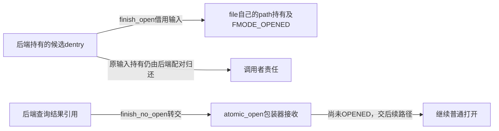
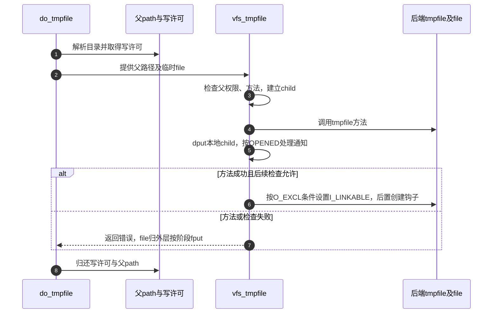

# 第25章\_组合打开与特殊路径的交接契约

不是每个打开请求都经过“普通lookup、独立create、普通open”三个调用。组合方法可能一次交付已打开file，路径句柄刻意跳过数据打开，无名称临时文件则替换普通最后名称创建。本页分别追踪它们交付什么、消费什么引用，以及回到外层时还欠哪些步骤。

| 阅读关联 | 入口 |
| --- | --- |
| 原理与特殊分支 | [open正文](../../../../knowledge/kernel_subsystems/vfs/P12_open状态机.md#12.6_路径句柄与无名称临时文件改变哪些步骤) |
| 模块状态 | [打开导读](../navigation/P11_打开请求怎样变成可发布的file.md#11.1_先区分意图构造与公开状态) |
| 固定版本 | [VFS总索引](../navigation/P01_Linux_6.12_VFS源码阅读索引.md#1.1_先固定源码身份与运行证据) |
| 原件 | [fs/namei.c](../../linux/fs/namei.c)、[fs/open.c](../../linux/fs/open.c)、[include/linux/fs.h](../../linux/include/linux/fs.h) |

固定提交 `dfaf2136deb2af2e60b994421281ba42f1c087e0`。atomic_open、do_o_path、do_tmpfile是namei.c内的static函数；finish_open、finish_no_open在include/linux/fs.h声明，vfs_tmpfile在fs/internal.h声明。函数名相近不表示引用契约相同。

## 25.1\_组合方法返回后先判断交付到了哪一步

atomic_open包装器把file.f_path.dentry设为DENTRY_NOT_SET哨兵，并预置父mount，再调用后端i_op.atomic_open。回调结束必须d_lookup_done；成功时依FMODE_OPENED区分完整打开与仅查找，并处理后端交付的替代dentry。

```c
/** @brief 仓库补充阅读说明：调用后端组合方法并按完成状态接收候选或file。 */
static struct dentry *atomic_open(struct nameidata *nd, struct dentry *dentry,
                                  struct file *file,
                                  int open_flag, umode_t mode)
{
        struct dentry *const DENTRY_NOT_SET = (void *) -1UL;
        struct inode *dir =  nd->path.dentry->d_inode;
        int error;

        if (nd->flags & LOOKUP_DIRECTORY)
                open_flag |= O_DIRECTORY;

        /* 仓库补充：哨兵用于检查后端是否真正说明了交付结果。 */
        file->f_path.dentry = DENTRY_NOT_SET;
        file->f_path.mnt = nd->path.mnt;
        error = dir->i_op->atomic_open(dir, dentry, file,
                                       open_to_namei_flags(open_flag), mode);
        /* 仓库补充：后端返回后结束本候选的进行中查询身份。 */
        d_lookup_done(dentry);
        if (!error) {
                if (file->f_mode & FMODE_OPENED) {
                        if (unlikely(dentry != file->f_path.dentry)) {
                                dput(dentry);
                                dentry = dget(file->f_path.dentry);
                        }
                } else if (WARN_ON(file->f_path.dentry == DENTRY_NOT_SET)) {
                        error = -EIO;
                } else {
                        if (file->f_path.dentry) {
                                dput(dentry);
                                dentry = file->f_path.dentry;
                        }
                        if (unlikely(d_is_negative(dentry)))
                                error = -ENOENT;
                }
        }
        if (error) {
                dput(dentry);
                dentry = ERR_PTR(error);
        }
        return dentry;
}
```

哨兵用于发现后端“成功返回却没有说明结果”的契约错误，WARN_ON随后返回EIO；它不是一个可解引用dentry。组合方法仍可能返回负候选，此包装器将相应情况转成ENOENT，错误出口归还本次候选。open_to_namei_flags只在访问模式低位满足`(flag & O_ACCMODE) == 3`时把传给后端的局部flag减1；其余原样返回，不改写用户的open_how。LOOKUP_DIRECTORY则补入后端所见的O_DIRECTORY要求。

**实现原理与修改边界**：必须同时理解返回码、FMODE_OPENED和file.f_path.dentry，单看返回0无法区分全部动作。修改后端的替代候选行为时，检查原候选的dput、结果的dget或所有权转移、d_lookup_done以及错误形态；不能只给file填一个指针却不遵守持有契约。并行查询的登记完成见 [查询完成](P18_并行查询的登记等待与结果发布.md#18.5_完成先撤销进行中身份再交付结果或重查机会)。

## 25.2\_两个finish辅助消费不同的引用

finish_open把候选写入file路径，再由do_dentry_open取得file自己的持有并完成打开；调用者输入的dentry引用并未被消耗，仍要按原契约归还。finish_no_open仅交出查询候选，这一份输入持有转交外层，调用者不再额外dput同一份。

```c
/** @brief 仓库补充阅读说明：借用输入dentry建立file自己的持有与打开状态。 */
int finish_open(struct file *file, struct dentry *dentry,
                int (*open)(struct inode *, struct file *))
{
        BUG_ON(file->f_mode & FMODE_OPENED); /* once it's opened, it's opened */

        /* 仓库补充：这里只借用候选，后续为file取得自己的持有。 */
        file->f_path.dentry = dentry;
        return do_dentry_open(file, open);
}
```

```c
/** @brief 仓库补充阅读说明：只转交查询结果引用，不完成普通打开。 */
int finish_no_open(struct file *file, struct dentry *dentry)
{
        /* 仓库补充：结果引用转交外层，本函数不设置OPENED。 */
        file->f_path.dentry = dentry;
        return 0;
}
```

| 交接对象 | finish_open | finish_no_open |
| --- | --- | --- |
| file.f_path.dentry | 指向待真正打开的候选 | 指向查询结果或NULL |
| 输入dentry引用 | 调用者仍负责自己的那份 | 转交包装器消费 |
| FMODE_OPENED | do_dentry_open成功建立相应生命周期 | 此函数不设置 |
| 后续普通open | 由结果状态决定，无须重复已经完成的打开 | 上层还要完成真正打开 |



**实现原理与修改边界**：finish_open的BUG_ON检查不得重复打开同一file，它不替后端做错误回滚。改变任一finish函数的引用消费约定必须审查所有后端调用者；仅在一个文件系统里额外增加dput可能形成双重归还。真正打开与失败清理见 [file构造](P26_file初始化与打开后失败清理.md#26.3_具体打开前取得自己的持有与操作表)。

## 25.3\_O\_PATH持有位置而跳过普通数据打开

do_o_path使用已有path_lookupat，成功后审计并调用vfs_open，再归还查找结果path。vfs_open会为file取得自己的path持有，因而归还查询持有不会使交付结果失效。

```c
/** @brief 仓库补充阅读说明：解析路径并建立路径句柄，归还临时查询持有。 */
static int do_o_path(struct nameidata *nd, unsigned flags, struct file *file)
{
        struct path path;
        int error = path_lookupat(nd, flags, &path);
        if (!error) {
                audit_inode(nd->name, path.dentry, 0);
                error = vfs_open(&path, file);
                /* 仓库补充：归还查询持有，file已在vfs_open中取得自己的持有。 */
                path_put(&path);
        }
        return error;
}
```

O_PATH在do_dentry_open内部早分支，使用empty_fops并标记FMODE_PATH与FMODE_OPENED；不会按普通数据打开执行操作表open回调。该分支不经过普通do_open，但路径解析的目录搜索、跟随及RESOLVE约束仍按路径协议执行。不能从“跳过普通数据open”推导“无需任何权限或路径检查”。

**实现原理与修改边界**：本函数的临时path与file.f_path属于不同持有，必须保持vfs_open内取引用和本函数path_put的配对。修改O_PATH允许标志或能力时同时核对参数转换、空操作表、FMODE_PATH和后续允许的fd操作；不能仅把普通读函数塞进空表就改变其语义。

## 25.4\_临时文件从目录请求建立无普通名称的对象

do_tmpfile先用目录要求解析路径，再取得挂载写许可，调用vfs_tmpfile；无论后端结果如何，都在相应出口归还写许可和临时父path。普通末项创建循环在这里被替换。

```c
/** @brief 仓库补充阅读说明：取得父目录及写许可后调用无名称临时文件路径。 */
static int do_tmpfile(struct nameidata *nd, unsigned flags,
                const struct open_flags *op,
                struct file *file)
{
        struct path path;
        int error = path_lookupat(nd, flags | LOOKUP_DIRECTORY, &path);

        if (unlikely(error))
                return error;
        /* 仓库补充：创建临时对象也需要父挂载的写入许可。 */
        error = mnt_want_write(path.mnt);
        if (unlikely(error))
                goto out;
        error = vfs_tmpfile(mnt_idmap(path.mnt), &path, file, op->mode);
        if (error)
                goto out2;
        audit_inode(nd->name, file->f_path.dentry, 0);
out2:
        mnt_drop_write(path.mnt);
out:
        path_put(&path);
        return error;
}
```

vfs_tmpfile检查父写及搜索权限和方法支持，分配内部child候选并设置file路径，再准备mode、调用后端tmpfile。child的本地引用在回调后dput；已打开file拥有自己的持有。后端可能已经设置FMODE_OPENED，打开通知和错误检查的顺序要按代码阅读。

```c
/** @brief 仓库补充阅读说明：调用后端建立临时对象，并按结果处理链接许可。 */
int vfs_tmpfile(struct mnt_idmap *idmap,
                const struct path *parentpath,
                struct file *file, umode_t mode)
{
        struct dentry *child;
        struct inode *dir = d_inode(parentpath->dentry);
        struct inode *inode;
        int error;
        int open_flag = file->f_flags;

        /* we want directory to be writable */
        error = inode_permission(idmap, dir, MAY_WRITE | MAY_EXEC);
        if (error)
                return error;
        if (!dir->i_op->tmpfile)
                return -EOPNOTSUPP;
        child = d_alloc(parentpath->dentry, &slash_name);
        if (unlikely(!child))
                return -ENOMEM;
        file->f_path.mnt = parentpath->mnt;
        file->f_path.dentry = child;
        mode = vfs_prepare_mode(idmap, dir, mode, mode, mode);
        error = dir->i_op->tmpfile(idmap, dir, file, mode);
        /* 仓库补充：归还本地候选引用，已打开file另有自己的持有。 */
        dput(child);
        if (file->f_mode & FMODE_OPENED)
                fsnotify_open(file);
        if (error)
                return error;
        /* Don't check for other permissions, the inode was just created */
        error = may_open(idmap, &file->f_path, 0, file->f_flags);
        if (error)
                return error;
        inode = file_inode(file);
        if (!(open_flag & O_EXCL)) {
                spin_lock(&inode->i_lock);
                /* 仓库补充：只有允许后续链接的分支才登记这一状态。 */
                inode->i_state |= I_LINKABLE;
                spin_unlock(&inode->i_lock);
        }
        security_inode_post_create_tmpfile(idmap, inode);
        return 0;
}
```

| 状态 | 建立与消费 | 限制 |
| --- | --- | --- |
| parentpath、dir | 目录解析取得并由本函数读取 | 是创建位置，不是最终普通文件名 |
| slash_name及child | d_alloc建立内部候选，回调后归还本地持有 | 不等价于发布一个普通可查名称 |
| file.f_path、FMODE_OPENED | 后端tmpfile方法按约定完成打开 | 回调失败仍需依据阶段清理 |
| I_LINKABLE | 非O_EXCL时在inode.i_lock下设置 | 允许进入后续链接协议，不绕过其权限和挂载限制 |
| security_inode_post_create_tmpfile | 方法成功后的安全扩展通知 | 不替代先前权限检查或返回已发布fd |



**实现原理与修改边界**：修改临时文件路径时须同时检查后端tmpfile是否真正完成打开、child的两份持有、I_LINKABLE写入锁、O_EXCL限制，以及错误时外层file清理。不能用“create一个随机名字再unlink”替换这条协议而声称可见性相同。本次配置与源码只证明分支存在；未执行目标O_TMPFILE、atomic_open或链接回填实验。
