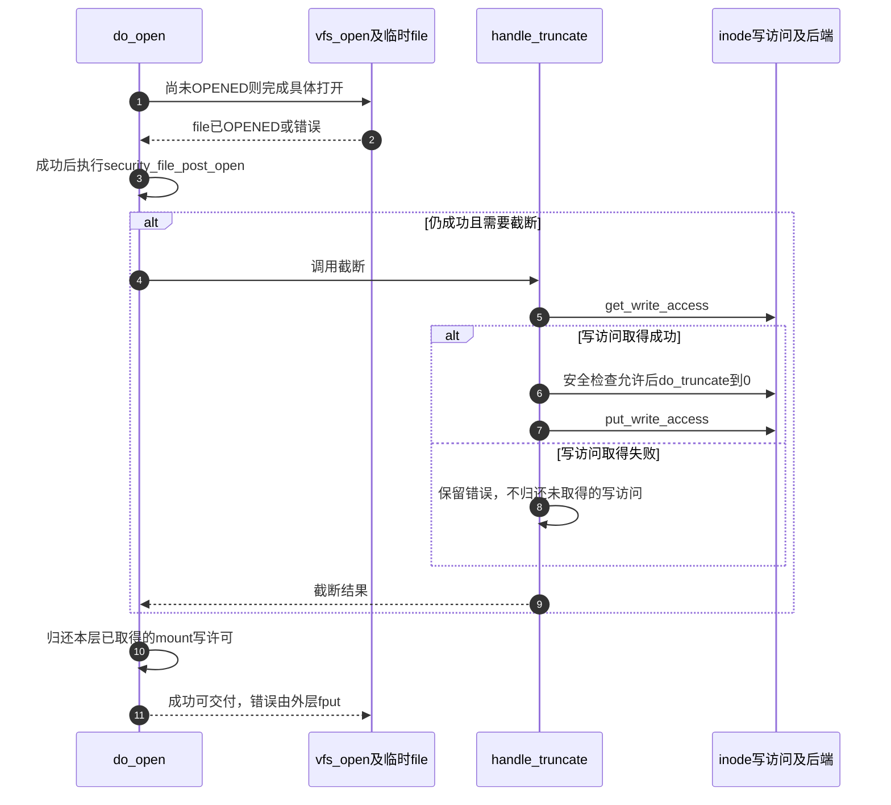

# 第26章\_file初始化与打开后失败清理

file已经分配、具体open已经返回、最终请求可以发布，是三个不同条件。本页检查O2、O4和O5各自取得的资源，特别解释为什么某些错误由本函数清理，而另一些错误要把已打开file交回外层fput。

| 阅读关联 | 入口 |
| --- | --- |
| 场景与失败边界 | [open正文](../../../../knowledge/kernel_subsystems/vfs/P12_open状态机.md#12.5_具体open之后为什么仍可能失败) |
| 模块调用关系 | [打开导读](../navigation/P11_打开请求怎样变成可发布的file.md#11.1_先区分意图构造与公开状态) |
| 身份与原件 | [总索引](../navigation/P01_Linux_6.12_VFS源码阅读索引.md#1.1_先固定源码身份与运行证据)、[fs/file_table.c](../../linux/fs/file_table.c)、[fs/open.c](../../linux/fs/open.c)、[fs/namei.c](../../linux/fs/namei.c) |

固定提交 `dfaf2136deb2af2e60b994421281ba42f1c087e0`。alloc_empty_file和vfs_open在fs/internal.h声明；其余这里展开的辅助是定义文件内使用的static函数。struct file的完整字段声明已经在 [打开对象](P01_描述符表与打开对象的状态归属.md#1.4_struct_file保存一次打开的共享状态) 展开，不再复制。

## 26.1\_分配成功只建立最初的凭据锁与引用

alloc_empty_file核对全局file数量限制；近似per-CPU计数达到阈值时再作较精确合计，避免仅凭近似值错误拒绝。通过后从filp_cachep零分配，交init_file初始化并增加数量统计；尚未得到路径或操作表。

```c
/** @brief 仓库补充阅读说明：检查系统file资源并分配尚未打开的对象。 */
struct file *alloc_empty_file(int flags, const struct cred *cred)
{
        static long old_max;
        struct file *f;
        int error;

        /*
         * Privileged users can go above max_files
         */
        if (get_nr_files() >= files_stat.max_files && !capable(CAP_SYS_ADMIN)) {
                /*
                 * percpu_counters are inaccurate.  Do an expensive check before
                 * we go and fail.
                 */
                if (percpu_counter_sum_positive(&nr_files) >= files_stat.max_files)
                        goto over;
        }

        /* 仓库补充：此分配允许睡眠，尚未取得路径或操作表。 */
        f = kmem_cache_zalloc(filp_cachep, GFP_KERNEL);
        if (unlikely(!f))
                return ERR_PTR(-ENOMEM);

        error = init_file(f, flags, cred);
        if (unlikely(error)) {
                kmem_cache_free(filp_cachep, f);
                return ERR_PTR(error);
        }

        /* 仓库补充：初始化成功后才计入已分配file统计。 */
        percpu_counter_inc(&nr_files);

        return f;

over:
        /* Ran out of filps - report that */
        if (get_nr_files() > old_max) {
                pr_info("VFS: file-max limit %lu reached\n", get_max_files());
                old_max = get_nr_files();
        }
        return ERR_PTR(-ENFILE);
}
```

```c
/** @brief 仓库补充阅读说明：初始化凭据锁与标志，最后建立初始引用。 */
static int init_file(struct file *f, int flags, const struct cred *cred)
{
        int error;

        /* 仓库补充：凭据持有属于本次file，失败或最终释放时配对归还。 */
        f->f_cred = get_cred(cred);
        error = security_file_alloc(f);
        if (unlikely(error)) {
                put_cred(f->f_cred);
                return error;
        }

        spin_lock_init(&f->f_lock);
        /*
         * Note that f_pos_lock is only used for files raising
         * FMODE_ATOMIC_POS and directories. Other files such as pipes
         * don't need it and since f_pos_lock is in a union may reuse
         * the space for other purposes. They are expected to initialize
         * the respective member when opening the file.
         */
        mutex_init(&f->f_pos_lock);
        f->f_flags = flags;
        f->f_mode = OPEN_FMODE(flags);
        /* f->f_version: 0 */

        /*
         * We're SLAB_TYPESAFE_BY_RCU so initialize f_count last. While
         * fget-rcu pattern users need to be able to handle spurious
         * refcount bumps we should reinitialize the reused file first.
         */
        /* 仓库补充：对象字段初始化后才重新建立可供读取协议识别的引用。 */
        atomic_long_set(&f->f_count, 1);
        return 0;
}
```

| 状态或辅助簇 | 初始化与消费 | 生命周期含义 |
| --- | --- | --- |
| filp_cachep、nr_files、files_stat.max_files | 启动建立slab与计数；分配检查并增加，释放归还 | 系统file资源统计，不是当前进程fd上限 |
| f_cred、get_cred/put_cred | 保存本次打开凭据，安全分配失败时立即归还 | 与后续每次调用的当前凭据不能混为一谈 |
| security_file_alloc | 初始化安全模块附属状态 | 可能拒绝；CONFIG_SECURITY关闭时对应inline返回0 |
| f_lock、f_pos_lock | 构造时初始化 | 后续状态及位置同步；位置锁并非所有文件类型都使用 |
| f_flags、f_mode、OPEN_FMODE | 从已解释的打开标志建立初始能力状态 | 此时尚没有FMODE_OPENED保证 |
| f_count | 最后初始化为1 | 构造者拥有初始持有，与slab可复用对象的读取协议配合 |

**实现原理与修改边界**：SLAB_TYPESAFE_BY_RCU意味着地址可能复用，不能仅凭“在RCU里”就认为还是原来的file；先初始化再设置f_count是该版本协议的一部分。计数合计、CAP_SYS_ADMIN例外、ENOMEM和ENFILE是不同分支；pr_info只是限制触发后的诊断，不授予资源。修改分配顺序须检查安全分配失败、凭据持有、数量统计和fget类读者；不得只把引用初始化提前以获得表面速度。

## 26.2\_普通写打开配对inode和mount的写访问

file_get_write_access先取得inode写访问，再取得file所在mount的访问；backing file还需处理其用户视图mount。后一步失败按已取得顺序归还前面的部分，不能只对最终成功状态负责。

```c
/** @brief 仓库补充阅读说明：取得inode及mount写访问，失败按已取得状态回退。 */
static inline int file_get_write_access(struct file *f)
{
        int error;

        error = get_write_access(f->f_inode);
        if (unlikely(error))
                return error;
        /* 仓库补充：后一步失败必须归还已经取得的inode写访问。 */
        error = mnt_get_write_access(f->f_path.mnt);
        if (unlikely(error))
                goto cleanup_inode;
        if (unlikely(f->f_mode & FMODE_BACKING)) {
                error = mnt_get_write_access(backing_file_user_path(f)->mnt);
                if (unlikely(error))
                        goto cleanup_mnt;
        }
        return 0;

cleanup_mnt:
        mnt_put_write_access(f->f_path.mnt);
cleanup_inode:
        put_write_access(f->f_inode);
        return error;
}
```

get_write_access与put_write_access维护inode写访问，mnt_get_write_access与mnt_put_write_access维护mount写访问；这是file持有期的访问责任，不等于末项创建周围短期使用的mnt_want_write和mnt_drop_write，也不证明已经发出存储写I/O。FMODE_BACKING是堆叠文件系统的专用打开身份，普通用户fd不可直接发布这种file。

**实现原理与修改边界**：新增一层访问持有时必须新增对应逆向失败出口，并同步put_file_access的成功生命周期归还。不要把普通file、特殊设备和backing file统一执行同一组mount put；它们实际取得的集合不同。

## 26.3\_具体打开前取得自己的持有与操作表

do_dentry_open先path_get，设置f_inode、f_mapping及写回错误样本。O_PATH直接安装empty_fops并标记路径打开；普通路径再建立读计数或写访问，取得inode.i_fop对应的模块持有，经过安全检查和租约处理后调用具体open。

```c
/** @brief 仓库补充阅读说明：建立独立路径与方法持有，区分打开前后失败清理。 */
static int do_dentry_open(struct file *f,
                          int (*open)(struct inode *, struct file *))
{
        static const struct file_operations empty_fops = {};
        struct inode *inode = f->f_path.dentry->d_inode;
        int error;

        /* 仓库补充：为file取得独立持有，不消费调用者原来的path。 */
        path_get(&f->f_path);
        f->f_inode = inode;
        f->f_mapping = inode->i_mapping;
        f->f_wb_err = filemap_sample_wb_err(f->f_mapping);
        f->f_sb_err = file_sample_sb_err(f);

        /* 仓库补充：路径句柄在此早完成，不进入普通数据open。 */
        if (unlikely(f->f_flags & O_PATH)) {
                f->f_mode = FMODE_PATH | FMODE_OPENED;
                f->f_op = &empty_fops;
                return 0;
        }

        if ((f->f_mode & (FMODE_READ | FMODE_WRITE)) == FMODE_READ) {
                i_readcount_inc(inode);
        } else if (f->f_mode & FMODE_WRITE && !special_file(inode->i_mode)) {
                error = file_get_write_access(f);
                if (unlikely(error))
                        goto cleanup_file;
                f->f_mode |= FMODE_WRITER;
        }

        /* POSIX.1-2008/SUSv4 Section XSI 2.9.7 */
        if (S_ISREG(inode->i_mode) || S_ISDIR(inode->i_mode))
                f->f_mode |= FMODE_ATOMIC_POS;

        f->f_op = fops_get(inode->i_fop);
        if (WARN_ON(!f->f_op)) {
                error = -ENODEV;
                goto cleanup_all;
        }

        error = security_file_open(f);
        if (error)
                goto cleanup_all;

        error = break_lease(file_inode(f), f->f_flags);
        if (error)
                goto cleanup_all;

        /* normally all 3 are set; ->open() can clear them if needed */
        f->f_mode |= FMODE_LSEEK | FMODE_PREAD | FMODE_PWRITE;
        if (!open)
                open = f->f_op->open;
        if (open) {
                error = open(inode, f);
                if (error)
                        goto cleanup_all;
        }
        /* 仓库补充：从这里开始，外层失败必须按打开后的生命周期退出。 */
        f->f_mode |= FMODE_OPENED;
        if ((f->f_mode & FMODE_READ) &&
             likely(f->f_op->read || f->f_op->read_iter))
                f->f_mode |= FMODE_CAN_READ;
        if ((f->f_mode & FMODE_WRITE) &&
             likely(f->f_op->write || f->f_op->write_iter))
                f->f_mode |= FMODE_CAN_WRITE;
        if ((f->f_mode & FMODE_LSEEK) && !f->f_op->llseek)
                f->f_mode &= ~FMODE_LSEEK;
        if (f->f_mapping->a_ops && f->f_mapping->a_ops->direct_IO)
                f->f_mode |= FMODE_CAN_ODIRECT;

        f->f_flags &= ~(O_CREAT | O_EXCL | O_NOCTTY | O_TRUNC);
        f->f_iocb_flags = iocb_flags(f);

        file_ra_state_init(&f->f_ra, f->f_mapping->host->i_mapping);

        if ((f->f_flags & O_DIRECT) && !(f->f_mode & FMODE_CAN_ODIRECT))
                return -EINVAL;

        /*
         * XXX: Huge page cache doesn't support writing yet. Drop all page
         * cache for this file before processing writes.
         */
        if (f->f_mode & FMODE_WRITE) {
                /*
                 * Depends on full fence from get_write_access() to synchronize
                 * against collapse_file() regarding i_writecount and nr_thps
                 * updates. Ensures subsequent insertion of THPs into the page
                 * cache will fail.
                 */
                if (filemap_nr_thps(inode->i_mapping)) {
                        struct address_space *mapping = inode->i_mapping;

                        filemap_invalidate_lock(inode->i_mapping);
                        /*
                         * unmap_mapping_range just need to be called once
                         * here, because the private pages is not need to be
                         * unmapped mapping (e.g. data segment of dynamic
                         * shared libraries here).
                         */
                        unmap_mapping_range(mapping, 0, 0, 0);
                        truncate_inode_pages(mapping, 0);
                        filemap_invalidate_unlock(inode->i_mapping);
                }
        }

        return 0;

cleanup_all:
        if (WARN_ON_ONCE(error > 0))
                error = -EINVAL;
        /* 仓库补充：早失败标签只清理本层已取得的框架资源。 */
        fops_put(f->f_op);
        put_file_access(f);
cleanup_file:
        path_put(&f->f_path);
        f->f_path.mnt = NULL;
        f->f_path.dentry = NULL;
        f->f_inode = NULL;
        return error;
}
```

vfs_open只先把输入path坐标复制进file，真正增加持有发生在上面的path_get；成功以后发送打开通知。赋值结构体本身不增加dentry和mount引用。

```c
/** @brief 仓库补充阅读说明：复制路径坐标并完成普通打开，成功发送打开通知。 */
int vfs_open(const struct path *path, struct file *file)
{
        int ret;

        /* 仓库补充：结构体赋值仅复制坐标，引用由do_dentry_open取得。 */
        file->f_path = *path;
        ret = do_dentry_open(file, NULL);
        if (!ret) {
                /*
                 * Once we return a file with FMODE_OPENED, __fput() will call
                 * fsnotify_close(), so we need fsnotify_open() here for
                 * symmetry.
                 */
                fsnotify_open(file);
        }
        return ret;
}
```


| 实现簇 | 对本次file的作用 | 需要区分的边界 |
| --- | --- | --- |
| filemap_sample_wb_err、file_sample_sb_err | 给f_wb_err、f_sb_err保存本次观察起点 | 不是清除全系统错误，也不是这里执行写回 |
| i_readcount_inc、FMODE_WRITER、put_file_access | 保存普通读或写访问责任 | 归还必须与实际取得方式配对 |
| fops_get/fops_put | 取得及归还操作表模块持有 | 函数指针存在不等于实现模块永远存续 |
| security_file_open、break_lease | 打开前安全及租约门槛 | 可失败或等待，不能放进任意自旋锁临界区 |
| FMODE_LSEEK/PREAD/PWRITE与CAN_READ/CAN_WRITE | 默认能力及按操作表修正后的能力 | 具体open可改变默认能力，不能仅凭O_RDWR推断方法齐全 |
| FMODE_OPENED | 具体open成功后进入完整退出协议；O_PATH有自己的早完成分支 | 尚未证明后置检查或fd发布成功 |
| f_iocb_flags、f_ra | 建立I/O标志及预读状态 | 不等于已经读入文件数据 |
| FMODE_CAN_ODIRECT与O_DIRECT检查 | 确认本file能否走相应直接I/O能力 | 拒绝位置在OPENED之后，走外层清理 |
| filemap_nr_thps及mapping失效操作 | 特定巨大页缓存写入限制下，锁映射、取消映射并清理页缓存 | 本配置未提供该分支实测，不能概括为所有写打开都清空缓存 |

本次未启用CONFIG_SECURITY，对应security_file_open等inline返回0；声明与关闭配置的替代定义见 [security.h原件](../../linux/include/linux/security.h)。lease路径还受文件锁配置和实际inode状态影响，本次CONFIG_FILE_LOCKING启用。WARN_ON和WARN_ON_ONCE用于发现缺失操作表或异常正错误码，并按代码返回错误；这些诊断不能替代fops_get、path_get等功能动作。

**实现原理与修改边界**：cleanup_all负责回调前或回调失败的框架资源，cleanup_file再归还path并清空指针；正常release不保证在具体open失败后调用。具体方法要自行撤销未交付的私有分配。OPENED之后的错误则保持可执行完整退出的对象，不能把它误送到只清几个字段的早失败标签。修改任何能力位或检查位置，都应测试方法不存在、回调失败、O_PATH、O_DIRECT不支持、只读写访问以及后置失败。

## 26.4\_打开许可与后置检查保持不同时间点

may_open检查候选和类型，再检查普通inode权限、append-only和NOATIME限制。字符与块设备还受mount设备访问限制；目录和普通文件对写、执行和截断有不同处理，不能把同一个flag位图无条件用于所有对象类型。

```c
/** @brief 仓库补充阅读说明：按对象类型与访问意图检查打开资格。 */
static int may_open(struct mnt_idmap *idmap, const struct path *path,
                    int acc_mode, int flag)
{
        struct dentry *dentry = path->dentry;
        struct inode *inode = dentry->d_inode;
        int error;

        /* 仓库补充：负候选不能作为普通打开对象。 */
        if (!inode)
                return -ENOENT;

        switch (inode->i_mode & S_IFMT) {
        case S_IFLNK:
                return -ELOOP;
        case S_IFDIR:
                if (acc_mode & MAY_WRITE)
                        return -EISDIR;
                if (acc_mode & MAY_EXEC)
                        return -EACCES;
                break;
        case S_IFBLK:
        case S_IFCHR:
                if (!may_open_dev(path))
                        return -EACCES;
                fallthrough;
        case S_IFIFO:
        case S_IFSOCK:
                if (acc_mode & MAY_EXEC)
                        return -EACCES;
                flag &= ~O_TRUNC;
                break;
        case S_IFREG:
                if ((acc_mode & MAY_EXEC) && path_noexec(path))
                        return -EACCES;
                break;
        }

        error = inode_permission(idmap, inode, MAY_OPEN | acc_mode);
        if (error)
                return error;

        /*
         * An append-only file must be opened in append mode for writing.
         */
        /* 仓库补充：对象策略对写模式和截断提出额外约束。 */
        if (IS_APPEND(inode)) {
                if  ((flag & O_ACCMODE) != O_RDONLY && !(flag & O_APPEND))
                        return -EPERM;
                if (flag & O_TRUNC)
                        return -EPERM;
        }

        /* O_NOATIME can only be set by the owner or superuser */
        if (flag & O_NOATIME && !inode_owner_or_capable(idmap, inode))
                return -EPERM;

        return 0;
}
```

do_open先完成尚未完成的walk，再检查CREATE/EXCL、目录及sticky相关要求。新创建对象不用按现存文件再次执行同样的访问模式和截断；现存普通文件请求截断则单独取得临时写许可。may_open通过后才在尚未OPENED时调用vfs_open，然后仍有security_file_post_open及可能的handle_truncate。

```c
/** @brief 仓库补充阅读说明：连接最终候选、打开权限、真正打开及后置截断。 */
static int do_open(struct nameidata *nd,
                   struct file *file, const struct open_flags *op)
{
        struct mnt_idmap *idmap;
        int open_flag = op->open_flag;
        bool do_truncate;
        int acc_mode;
        int error;

        if (!(file->f_mode & (FMODE_OPENED | FMODE_CREATED))) {
                error = complete_walk(nd);
                if (error)
                        return error;
        }
        if (!(file->f_mode & FMODE_CREATED))
                audit_inode(nd->name, nd->path.dentry, 0);
        idmap = mnt_idmap(nd->path.mnt);
        if (open_flag & O_CREAT) {
                if ((open_flag & O_EXCL) && !(file->f_mode & FMODE_CREATED))
                        return -EEXIST;
                if (d_is_dir(nd->path.dentry))
                        return -EISDIR;
                error = may_create_in_sticky(idmap, nd,
                                             d_backing_inode(nd->path.dentry));
                if (unlikely(error))
                        return error;
        }
        if ((nd->flags & LOOKUP_DIRECTORY) && !d_can_lookup(nd->path.dentry))
                return -ENOTDIR;

        do_truncate = false;
        acc_mode = op->acc_mode;
        /* 仓库补充：成功的新建结果不再按现存文件重复截断。 */
        if (file->f_mode & FMODE_CREATED) {
                /* Don't check for write permission, don't truncate */
                open_flag &= ~O_TRUNC;
                acc_mode = 0;
        } else if (d_is_reg(nd->path.dentry) && open_flag & O_TRUNC) {
                error = mnt_want_write(nd->path.mnt);
                if (error)
                        return error;
                do_truncate = true;
        }
        error = may_open(idmap, &nd->path, acc_mode, open_flag);
        if (!error && !(file->f_mode & FMODE_OPENED))
                error = vfs_open(&nd->path, file);
        if (!error)
                error = security_file_post_open(file, op->acc_mode);
        /* 仓库补充：真正打开和后置检查通过后才执行这一截断。 */
        if (!error && do_truncate)
                error = handle_truncate(idmap, file);
        if (unlikely(error > 0)) {
                WARN_ON(1);
                error = -EINVAL;
        }
        if (do_truncate)
                mnt_drop_write(nd->path.mnt);
        return error;
}
```

| 输入与读取点 | 当前含义 |
| --- | --- |
| op.acc_mode与局部acc_mode | 保留原请求给后置检查；新建分支可把本地普通检查模式改为0 |
| op.open_flag与局部open_flag | 原请求仍存在；不能因do_dentry_open清理file.f_flags中的创建位就忘掉整个请求 |
| FMODE_CREATED | 成功的末项创建结果；避免重复截断新对象 |
| FMODE_OPENED | 原子组合分支可能已完成打开，不再重复vfs_open |
| do_truncate | 记录是否已取得这一层临时写许可 |
| complete_walk、may_create_in_sticky、d_can_lookup | 分别处理最终持有、sticky目录保护及目录类型 |

complete_walk复用 [最终合法化](P13_路径起点与结果持有的交接.md#13.3_结束验证把快速观察变成可交付结果)。sticky规则和完整访问控制由权限模块负责，本页明确其拒绝位置和结果传播，不把这些钩子省略成“已通过所有权限”。

**实现原理与修改边界**：后置检查失败时file可能早已OPENED，甚至此前已发出打开通知；普通O_CREAT还可能已经留下新名称。增加后置限制必须决定其拒绝是否允许这些副作用，并检查fput和预留fd归还。不能未经设计就在清理标签自动unlink，因为名字可能已被其他操作观察或改变，且通用打开契约没有这种补偿授权。

## 26.5\_截断在自己的写访问范围内完成

handle_truncate为目标inode取得写访问，执行截断安全检查，再以size为0调用do_truncate并请求相应时间戳和打开语义；不论后端结果如何都归还这一份写访问。do_open还负责归还外层的mount临时写许可。

```c
/** @brief 仓库补充阅读说明：在配对写访问内执行安全检查和零长度截断。 */
static int handle_truncate(struct mnt_idmap *idmap, struct file *filp)
{
        const struct path *path = &filp->f_path;
        struct inode *inode = path->dentry->d_inode;
        int error = get_write_access(inode);
        if (error)
                return error;

        error = security_file_truncate(filp);
        if (!error) {
                error = do_truncate(idmap, path->dentry, 0,
                                    ATTR_MTIME|ATTR_CTIME|ATTR_OPEN,
                                    filp);
        }
        /* 仓库补充：安全检查或后端失败也归还本层取得的写访问。 */
        put_write_access(inode);
        return error;
}
```



ATTR_MTIME、ATTR_CTIME和ATTR_OPEN是给后续属性修改的请求语义，不是已经同步到介质的证明。do_truncate与文件系统setattr的完整数据改变协议留到文件I/O及截断章节，本页没有裁剪掉这一步，而是明确其调用参数、状态位置与错误传播。

**实现原理与修改边界**：改变截断位置必须重新检查排他创建拒绝、具体open失败、新建文件、非普通文件和写许可配对。当前源码中没有恢复原文件内容的通用回滚；模拟后端错误只能说明已执行的特定路径，不能凭返回错误推断长度或介质状态完全不变。本页未执行目标后置安全、直接I/O、资源耗尽或截断故障注入。
