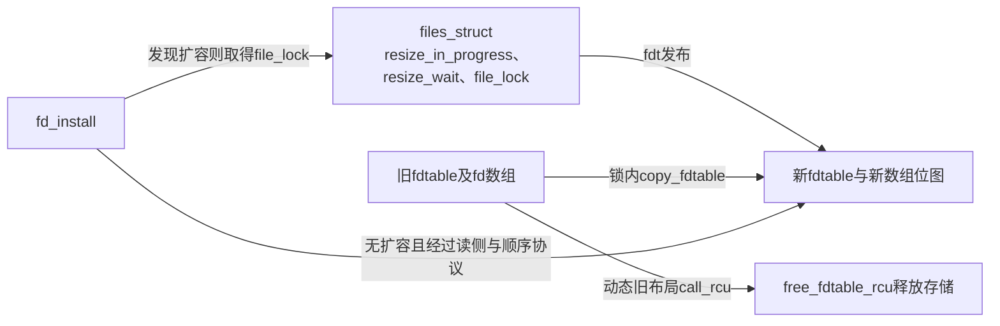
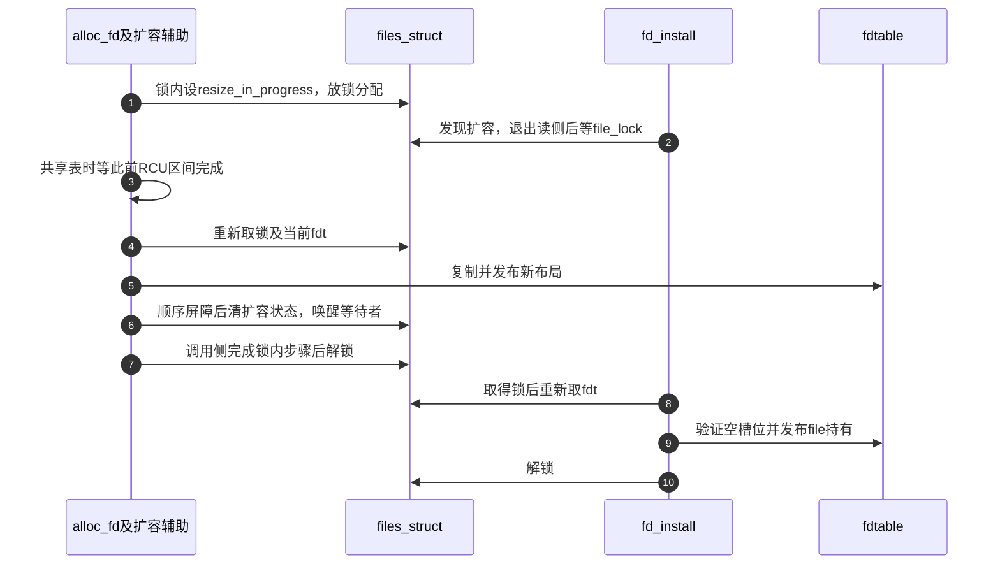

# 第27章\_描述符预留扩容与发布协议

号码分配必须先阻止其他分配者选中同一项，file初始化则可能在锁外执行。两者分开以后，扩容不能只复制一份数组就宣告完成：还要保证正在安装的指针不会落到已经废弃的布局。本页沿F0～F1追踪这段握手。

| 阅读关联 | 入口 |
| --- | --- |
| 原理与阶段 | [生命周期正文](../../../../knowledge/kernel_subsystems/vfs/P13_fd_table与file生命周期.md#13.3_表扩容为什么不能只替换数组指针) |
| 模块与版本 | [描述符导读](../navigation/P12_描述符共享查询与关闭的交接.md#12.1_沿同一生命周期区分表与file)、[总索引](../navigation/P01_Linux_6.12_VFS源码阅读索引.md#1.1_先固定源码身份与运行证据) |
| 原件 | [fs/file.c](../../linux/fs/file.c)、[fdtable.h](../../linux/include/linux/fdtable.h)、[file.h](../../linux/include/linux/file.h) |

固定提交 `dfaf2136deb2af2e60b994421281ba42f1c087e0`。get_unused_fd_flags、put_unused_fd、fd_install在file.h声明，其余摘录为fs/file.c私有辅助。结构体字段唯一说明见 [fdtable](P01_描述符表与打开对象的状态归属.md#1.2_fdtable把指针数组与分配状态放在一起) 与 [files_struct](P01_描述符表与打开对象的状态归属.md#1.3_files_struct同时承载共享与扩容协调)。

## 27.1\_分配号码只改变占用状态

get_unused_fd_flags以当前任务的RLIMIT_NOFILE作为上界，经__get_unused_fd_flags调用alloc_fd，起点为0。上界排他，因此fd等于end也拒绝。alloc_fd在file_lock下取得当前布局，从start与next_fd决定搜索起点；扩容可能释放锁，返回表示曾扩容或等待时必须重新搜索。

```c
/** @brief 仓库补充阅读说明：在锁下搜索并登记号码，可能扩容后重新开始。 */
static int alloc_fd(unsigned start, unsigned end, unsigned flags)
{
        struct files_struct *files = current->files;
        unsigned int fd;
        int error;
        struct fdtable *fdt;

        spin_lock(&files->file_lock);
repeat:
        fdt = files_fdtable(files);
        fd = start;
        if (fd < files->next_fd)
                fd = files->next_fd;

        if (fd < fdt->max_fds)
                fd = find_next_fd(fdt, fd);

        /*
         * N.B. For clone tasks sharing a files structure, this test
         * will limit the total number of files that can be opened.
         */
        error = -EMFILE;
        if (fd >= end)
                goto out;

        error = expand_files(files, fd);
        if (error < 0)
                goto out;

        /*
         * If we needed to expand the fs array we
         * might have blocked - try again.
         */
        /* 仓库补充：扩容可能放锁，必须重新取得布局和空位。 */
        if (error)
                goto repeat;

        if (start <= files->next_fd)
                files->next_fd = fd + 1;

        /* 仓库补充：这里只登记占位，file指针仍由后续安装者发布。 */
        __set_open_fd(fd, fdt);
        if (flags & O_CLOEXEC)
                __set_close_on_exec(fd, fdt);
        else
                __clear_close_on_exec(fd, fdt);
        error = fd;
#if 1
        /* Sanity check */
        if (rcu_access_pointer(fdt->fd[fd]) != NULL) {
                printk(KERN_WARNING "alloc_fd: slot %d not NULL!\n", fd);
                rcu_assign_pointer(fdt->fd[fd], NULL);
        }
#endif

out:
        spin_unlock(&files->file_lock);
        return error;
}
```

| 本实例符号 | 初始化、修改与消费 |
| --- | --- |
| files_fdtable | 读取files.fdt的受保护包装；调用者提供锁或读侧协议，宏不会替调用者加锁 |
| next_fd | init_files或dup_fd初始化为0；分配向前推进，归还较小号码可回退 |
| find_next_fd | 先用full_fds_bits跳过全满字，再在open_fds查空位；超过容量交给扩容处理 |
| __set_open_fd | 置占用位；若该字全满，同时置full_fds_bits摘要位 |
| __set_close_on_exec、__clear_close_on_exec | 按O_CLOEXEC设置这一槽位的exec状态，不改变file.f_flags |
| sysctl_nr_open | fs/file.c初始化的全局容量上限，可调整；与当前任务RLIMIT_NOFILE不是同一限制 |
| rcu_access_pointer与printk检查 | 只检查此时槽位应为空；异常分支会清空槽位，不能当成正常冲突处理或引用归还 |

表的初始布局来自init_files的静态初始化：count为1，fdt指向内嵌fdtab，数组和位图指向内嵌存储，锁及resize_wait已初始化。新复制容器由dup_fd单独初始化，见 [新表创建](P29_描述符复制与表共享的两层引用.md#29.2_复制时为非空项取得持有并放弃未完成预留)。

**实现原理与修改边界**：占位和安装之间允许暂时为空，但不能允许两个构造者拥有同一预留。改变搜索或位图布局，须同步full_fds_bits、next_fd、复制及关闭路径；扩容返回后不得继续使用旧fdt。验证至少覆盖低号回收、达到任务上限、全局上限变化及分配失败。

## 27.2\_失败归还的是号码而不是一个已安装file

put_unused_fd在锁下调用__put_unused_fd，清除占用和全满摘要，必要时回退next_fd。它不从槽位取出file并fput，因此只适合本次尚未发布的号码，不能拿来代替close。

```c
/** @brief 仓库补充阅读说明：撤销占位并让较小号码重新进入搜索范围。 */
static void __put_unused_fd(struct files_struct *files, unsigned int fd)
{
        struct fdtable *fdt = files_fdtable(files);
        /* 仓库补充：占位清理不负责从槽位取出或释放file。 */
        __clear_open_fd(fd, fdt);
        if (fd < files->next_fd)
                files->next_fd = fd;
}
```

```c
/** @brief 仓库补充阅读说明：在锁内归还本次尚未发布的号码。 */
void put_unused_fd(unsigned int fd)
{
        struct files_struct *files = current->files;
        spin_lock(&files->file_lock);
        /* 仓库补充：调用者仍拥有这份未发布的预留。 */
        __put_unused_fd(files, fd);
        spin_unlock(&files->file_lock);
}
```

__clear_open_fd清除open_fds的一位及对应full_fds_bits摘要位。它没有同时清除close_on_exec；下一次alloc_fd会明确设置或清除该位，不能把一个不占用槽位中残留的exec位当作有效打开关系。

**实现原理与修改边界**：调用者只能归还自己仍拥有的预留。若fd_install已经转移所有权，再put_unused_fd会使占用状态与已发布指针矛盾。打开失败的具体配对见 [外层事务](P23_打开参数与描述符发布的外层事务.md#23.2_预留槽位与转交file分别发生在两端)。

## 27.3\_扩容先让安装者改道再复制当前布局

expand_files先判容量和全局限制，已有扩容者时放锁等待resize_wait，再拿锁重查。它自己承担扩容时，先设resize_in_progress，进入expand_fdtable；返回后清状态并唤醒等待者。无论分配成功或失败，协调状态都要退出。

```c
/** @brief 仓库补充阅读说明：协调唯一扩容者，其他调用者等待后重查。 */
static int expand_files(struct files_struct *files, unsigned int nr)
        __releases(files->file_lock)
        __acquires(files->file_lock)
{
        struct fdtable *fdt;
        int expanded = 0;

repeat:
        fdt = files_fdtable(files);

        /* Do we need to expand? */
        if (nr < fdt->max_fds)
                return expanded;

        /* Can we expand? */
        if (nr >= sysctl_nr_open)
                return -EMFILE;

        if (unlikely(files->resize_in_progress)) {
                spin_unlock(&files->file_lock);
                expanded = 1;
                wait_event(files->resize_wait, !files->resize_in_progress);
                spin_lock(&files->file_lock);
                goto repeat;
        }

        /* All good, so we try */
        /* 仓库补充：先登记扩容，使安装者采用协调路径。 */
        files->resize_in_progress = true;
        expanded = expand_fdtable(files, nr);
        files->resize_in_progress = false;

        /* 仓库补充：唤醒只是重新检查条件的机会。 */
        wake_up_all(&files->resize_wait);
        return expanded;
}
```

```c
/** @brief 仓库补充阅读说明：等待相关安装者后复制当前布局并发布新表。 */
static int expand_fdtable(struct files_struct *files, unsigned int nr)
        __releases(files->file_lock)
        __acquires(files->file_lock)
{
        struct fdtable *new_fdt, *cur_fdt;

        spin_unlock(&files->file_lock);
        new_fdt = alloc_fdtable(nr);

        /* make sure all fd_install() have seen resize_in_progress
         * or have finished their rcu_read_lock_sched() section.
         */
        if (atomic_read(&files->count) > 1)
                synchronize_rcu();

        spin_lock(&files->file_lock);
        if (!new_fdt)
                return -ENOMEM;
        /*
         * extremely unlikely race - sysctl_nr_open decreased between the check in
         * caller and alloc_fdtable().  Cheaper to catch it here...
         */
        if (unlikely(new_fdt->max_fds <= nr)) {
                __free_fdtable(new_fdt);
                return -EMFILE;
        }
        cur_fdt = files_fdtable(files);
        BUG_ON(nr < cur_fdt->max_fds);
        /* 仓库补充：锁内复制重新取得的当前布局。 */
        copy_fdtable(new_fdt, cur_fdt);
        /* 仓库补充：发布新布局后仍须保护旧布局的读者。 */
        rcu_assign_pointer(files->fdt, new_fdt);
        if (cur_fdt != &files->fdtab)
                call_rcu(&cur_fdt->rcu, free_fdtable_rcu);
        /* coupled with smp_rmb() in fd_install() */
        smp_wmb();
        return 1;
}
```

alloc_fdtable按指针数组大小的增长档位分配布局，容量按BITS_PER_LONG对齐，并受sysctl_nr_open限制；file数组单独分配，open_fds、close_on_exec、full_fds_bits位于另一块存储。该辅助只分配，copy_fdtable在锁内复制当前指针和位图并清新尾部；不是在分配时冻结原表快照。释放锁期间可能发生变化，所以返回后重新files_fdtable。

共享容器时的synchronize_rcu等待此前安装临界区退出，后来的安装者因resize_in_progress转到锁路径。复制完成后rcu_assign_pointer发布新fdt；旧动态表经free_fdtable_rcu调用__free_fdtable，释放指针数组、位图存储和表头。内嵌fdtab不按动态对象单独释放。RCU通用算法见 [RCU总索引](../../rcu/navigation/P01_Linux_6.12_RCU源码总阅读索引.md#1.4_模块概念导读入口)，这里解释VFS实例与安装者的配对。



**实现原理与修改边界**：不要把synchronize_rcu移动到复制之后；那可能漏掉仍在旧表安装的写入。不要把唤醒理解为容量成功，等待者必须再查条件。修改容量计算要同时检查整数溢出、位图对齐和上限动态降低；BUG_ON用于发现不合法的扩容关系，不负责修复它。

## 27.4\_安装把已经初始化的持有交给槽位

fd_install消费调用者交来的file引用，正常返回后由槽位承担这份持有。它不额外get_file，也不能用来覆盖已有指针。FMODE_BACKING检查拒绝不适合用户fd表的内部对象；这是告警并返回的错误契约，调用者不能把它当作正常成功安装。

```c
/** @brief 仓库补充阅读说明：向预留空槽位转交已经初始化的file持有。 */
void fd_install(unsigned int fd, struct file *file)
{
        struct files_struct *files = current->files;
        struct fdtable *fdt;

        if (WARN_ON_ONCE(unlikely(file->f_mode & FMODE_BACKING)))
                return;

        rcu_read_lock_sched();

        /* 仓库补充：发现扩容时退出读侧区间再进入锁路径。 */
        if (unlikely(files->resize_in_progress)) {
                rcu_read_unlock_sched();
                spin_lock(&files->file_lock);
                fdt = files_fdtable(files);
                BUG_ON(fdt->fd[fd] != NULL);
                rcu_assign_pointer(fdt->fd[fd], file);
                spin_unlock(&files->file_lock);
                return;
        }
        /* coupled with smp_wmb() in expand_fdtable() */
        /* 仓库补充：与扩容发布后的写屏障配对。 */
        smp_rmb();
        fdt = rcu_dereference_sched(files->fdt);
        BUG_ON(fdt->fd[fd] != NULL);
        rcu_assign_pointer(fdt->fd[fd], file);
        rcu_read_unlock_sched();
}
```

快速路径的rcu_read_lock_sched保护相关区间；看到resize_in_progress时退出该区间再取得file_lock。无扩容路径用smp_rmb与expand_fdtable发布后的smp_wmb配对，再读取fdt并安装。这里描述源代码顺序契约，不将当前单核配置外推为多核指令测试结果。BUG_ON检查目标必须为空，rcu_assign_pointer才是发布动作。



图选择扩容者先重新拿到锁的交错。也可能安装者在分配新布局期间先取得file_lock，向当时的旧表完成安装；扩容者随后拿锁复制的是包含该写入的当前表。转入锁路径不等于必然等到扩容结束，关键是安装与复制在锁下有序发生。

**实现原理与修改边界**：引用转移、预留占用和空槽位断言必须一起保留。只用普通赋值替换发布，或删掉扩容握手中的一半屏障，不能靠“file_lock大部分时候还在”补救。随树files.rst的旧式“任何更新都持锁”概括不能覆盖当前fd_install快速路径；应以本页固定函数为准。本页未执行并发扩容与安装压力测试。
