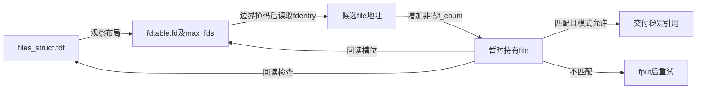
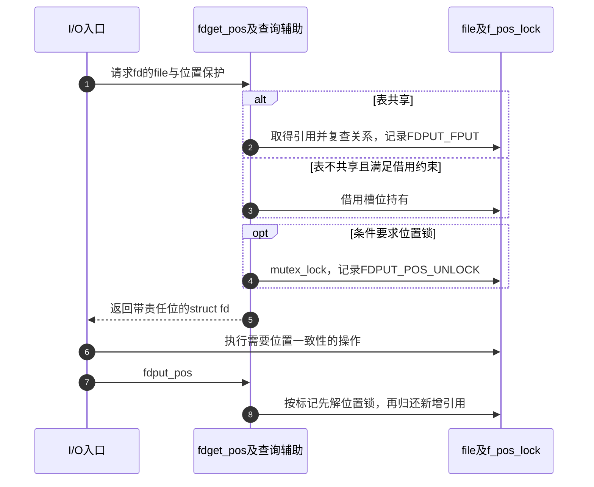

# 第28章\_描述符查询的引用验证与轻量借用

发布后的槽位仍可能被关闭、替换或随扩容迁移。查询要把一瞬间观察到的地址变成可使用的持有，并说明何时可以借用已有持有而省略计数。本页对应F2，不把RCU读侧保护直接等同于file身份稳定。

| 阅读关联 | 入口 |
| --- | --- |
| 场景 | [查询原理](../../../../knowledge/kernel_subsystems/vfs/P13_fd_table与file生命周期.md#13.4_看到file地址还不等于取得正确对象) |
| 模块与身份 | [导读](../navigation/P12_描述符共享查询与关闭的交接.md#12.2_先查发布和读取的配对再查复制)、[总索引](../navigation/P01_Linux_6.12_VFS源码阅读索引.md#1.1_先固定源码身份与运行证据) |
| 原件 | [fs/file.c](../../linux/fs/file.c)、[file.h](../../linux/include/linux/file.h)、[fdtable.h](../../linux/include/linux/fdtable.h) |

固定提交 `dfaf2136deb2af2e60b994421281ba42f1c087e0`。私有查询辅助在fs/file.c定义；fget、fdget及带raw或pos的公共包装在file.h声明。file对象存储与字段见 [file声明](P01_描述符表与打开对象的状态归属.md#1.4_struct_file保存一次打开的共享状态)，f_count最后初始化的理由见 [初始构造](P26_file初始化与打开后失败清理.md#26.1_分配成功只建立最初的凭据锁与引用)。

## 28.1\_取得引用之后还要验证槽位与表版本

__fget_files以RCU读侧包围__fget_files_rcu。后者读取fdt、定位fdentry、取得非零引用后，再检查槽位和布局指针。只有两个观察仍匹配，才读取f_mode判断是否允许这次模式。检查失败归还引用并重试，空项或被过滤模式返回NULL。

```c
/** @brief 仓库补充阅读说明：取得非零引用后复查槽位和表布局，失败重试。 */
static inline struct file *__fget_files_rcu(struct files_struct *files,
       unsigned int fd, fmode_t mask)
{
        for (;;) {
                struct file *file;
                struct fdtable *fdt = rcu_dereference_raw(files->fdt);
                struct file __rcu **fdentry;
                unsigned long nospec_mask;

                /* Mask is a 0 for invalid fd's, ~0 for valid ones */
                nospec_mask = array_index_mask_nospec(fd, fdt->max_fds);

                /*
                 * fdentry points to the 'fd' offset, or fdt->fd[0].
                 * Loading from fdt->fd[0] is always safe, because the
                 * array always exists.
                 */
                fdentry = fdt->fd + (fd & nospec_mask);

                /* Do the load, then mask any invalid result */
                file = rcu_dereference_raw(*fdentry);
                file = (void *)(nospec_mask & (unsigned long)file);
                if (unlikely(!file))
                        return NULL;

                /*
                 * Ok, we have a file pointer that was valid at
                 * some point, but it might have become stale since.
                 *
                 * We need to confirm it by incrementing the refcount
                 * and then check the lookup again.
                 *
                 * atomic_long_inc_not_zero() gives us a full memory
                 * barrier. We only really need an 'acquire' one to
                 * protect the loads below, but we don't have that.
                 */
                /* 仓库补充：先取得非零引用，再验证观察关系。 */
                if (unlikely(!atomic_long_inc_not_zero(&file->f_count)))
                        continue;

                /*
                 * Such a race can take two forms:
                 *
                 *  (a) the file ref already went down to zero and the
                 *      file hasn't been reused yet or the file count
                 *      isn't zero but the file has already been reused.
                 *
                 *  (b) the file table entry has changed under us.
                 *       Note that we don't need to re-check the 'fdt->fd'
                 *       pointer having changed, because it always goes
                 *       hand-in-hand with 'fdt'.
                 *
                 * If so, we need to put our ref and try again.
                 */
                if (unlikely(file != rcu_dereference_raw(*fdentry)) ||
                    unlikely(rcu_dereference_raw(files->fdt) != fdt)) {
                        fput(file);
                        continue;
                }

                /*
                 * This isn't the file we're looking for or we're not
                 * allowed to get a reference to it.
                 */
                /* 仓库补充：有效持有建立后才能消费对象模式。 */
                if (unlikely(file->f_mode & mask)) {
                        fput(file);
                        return NULL;
                }

                /*
                 * Ok, we have a ref to the file, and checked that it
                 * still exists.
                 */
                return file;
        }
}
```

```c
/** @brief 仓库补充阅读说明：在读侧临界区内完成查询验证，向外交付持有。 */
static struct file *__fget_files(struct files_struct *files, unsigned int fd,
                                 fmode_t mask)
{
        struct file *file;

        rcu_read_lock();
        /* 仓库补充：成功时取得的file引用可带出读侧区间。 */
        file = __fget_files_rcu(files, fd, mask);
        rcu_read_unlock();

        return file;
}
```

| 符号或条件 | 当前作用与不能替代的保证 |
| --- | --- |
| array_index_mask_nospec | 合法fd给全1掩码，越界给0；访问安全的第0项后将无效结果清零，兼顾推测执行边界 |
| rcu_dereference_raw | 按读侧规则取指针，本身不增加file引用 |
| atomic_long_inc_not_zero | 只从非零计数取得持有，成功提供这里依赖的内存顺序；失败重试 |
| *fdentry复查 | 槽位仍与所取得对象匹配，避免消费已撤销或替换的关系 |
| files.fdt复查 | 确认所查槽位仍属于当前布局，扩容改变时退回重查 |
| mask与f_mode | fget的FMODE_PATH过滤路径句柄；fget_raw用0允许该模式 |
| fput | 归还本次已经取得但不能交付的持有，不能略去 |

filp_cachep使用SLAB_TYPESAFE_BY_RCU，RCU保护不足以阻止对象地址在类型安全范围内复用。因此不能把模式检查提前到有效引用之前，也不能认为计数增加成功就必然指向最初看到的那一代对象。最终验证建立的是当前查询的一次有效结果，不承诺fd自调用开始以来从未更换。



**实现原理与修改边界**：保留“取得非零引用→复查两个指针→检查对象字段”的顺序。改动fdtable迁移、分配器类型或模式过滤时，都要同时核对发布者与读取者。应验证close/reopen复用、dup2替换和扩容交错；单线程能读出数据不足以证明这些条件。

## 28.2\_不共享表时的借用有严格使用范围

__fget_light检查files.count。只有表不共享才借用槽位原有持有；否则调用上节完整引用路径。atomic_read_acquire与另一任务put_files_struct的计数下降配对，避免读到旧槽位却误认为共享者已经全部退出。

```c
/** @brief 仓库补充阅读说明：不共享时借用，共享时取得新引用并记录归还责任。 */
static inline struct fd __fget_light(unsigned int fd, fmode_t mask)
{
        struct files_struct *files = current->files;
        struct file *file;

        /*
         * If another thread is concurrently calling close_fd() followed
         * by put_files_struct(), we must not observe the old table
         * entry combined with the new refcount - otherwise we could
         * return a file that is concurrently being freed.
         *
         * atomic_read_acquire() pairs with atomic_dec_and_test() in
         * put_files_struct().
         */
        if (likely(atomic_read_acquire(&files->count) == 1)) {
                file = files_lookup_fd_raw(files, fd);
                if (!file || unlikely(file->f_mode & mask))
                        return EMPTY_FD;
                /* 仓库补充：借用必须在受约束的本次使用范围内配对结束。 */
                return BORROWED_FD(file);
        } else {
                file = __fget_files(files, fd, mask);
                if (!file)
                        return EMPTY_FD;
                /* 仓库补充：记录稍后fdput必须归还的新引用。 */
                return CLONED_FD(file);
        }
}
```

返回的struct fd在file.h中用一个word保存对齐file指针及低位责任标志。不是用户空间的整数fd，也不是新分配了一个file。

| 包装或标记 | 输入、结果与退出责任 |
| --- | --- |
| EMPTY_FD、fd_empty | word为0表示查询无结果 |
| BORROWED_FD | 只装入指针，未新增引用；不能脱离本次受约束使用范围 |
| CLONED_FD、FDPUT_FPUT | 指针加上需要fput的低位标记，表示新增持有 |
| fd_file | 去掉责任位取file指针，不额外取得引用 |
| fdput | 仅在FDPUT_FPUT存在时fput |
| fdget、fdget_raw | 分别以FMODE_PATH和0作为过滤参数调用__fget_light |
| files_lookup_fd_raw | 要求表不共享或已有锁/RCU保护，掩码检查边界，只返回观察指针 |

借用必须在本次系统调用返回用户态前配对结束，期间不能关闭该file，也不能通过克隆改变共享前提。若需要把对象交给异步使用者，必须为其明确取得独立引用，不能把BORROWED_FD的返回值直接存下。相关约束在fs/file.c的轻量查询注释中列出，虽沿用旧fget_light命名，当前实现入口是__fget_light和fdget。

**实现原理与修改边界**：不能用“当前只有一个线程”替代files.count和操作范围条件；file还可能被不同表引用。不得丢弃返回的责任位后再凭感觉fput。验证需覆盖共享和非共享两条分支，并检查所有提前返回是否配对fdput。

## 28.3\_位置保护在引用之外增加另一份退出责任

file_needs_f_pos_lock只在FMODE_ATOMIC_POS置位且file_count大于1或操作表提供iterate_shared时要求锁。目录还要考虑稍后经其他入口取得共享file的情况，所以不能只看当下计数就认为目录位置无需保护。

```c
/** @brief 仓库补充阅读说明：在file使用之外按条件增加位置锁责任。 */
struct fd fdget_pos(unsigned int fd)
{
        struct fd f = fdget(fd);
        struct file *file = fd_file(f);

        if (file && file_needs_f_pos_lock(file)) {
                /* 仓库补充：把位置解锁责任交给fdput_pos。 */
                f.word |= FDPUT_POS_UNLOCK;
                mutex_lock(&file->f_pos_lock);
        }
        return f;
}
```

FDPUT_POS_UNLOCK表示已取得f_pos_lock；fdput_pos先调用__f_unlock_pos释放该互斥锁，再fdput归还可能新增的引用。file_count读取f_count，不是当前fd表项数量。FMODE_ATOMIC_POS由打开初始化按类型建立，见 [具体打开](P26_file初始化与打开后失败清理.md#26.3_具体打开前取得自己的持有与操作表)。



**实现原理与修改边界**：引用解决存续，f_pos_lock解决相关位置操作的串行化，二者不能互相替代。增加错误出口时保留解锁在fput之前；否则可能在对象已释放后再访问其锁。当前配置未启用SMP，但调度与共享关系仍需遵守协议；本页没有运行多线程位置或对象复用压力验证。
