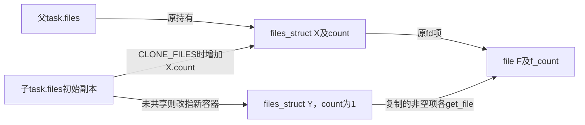
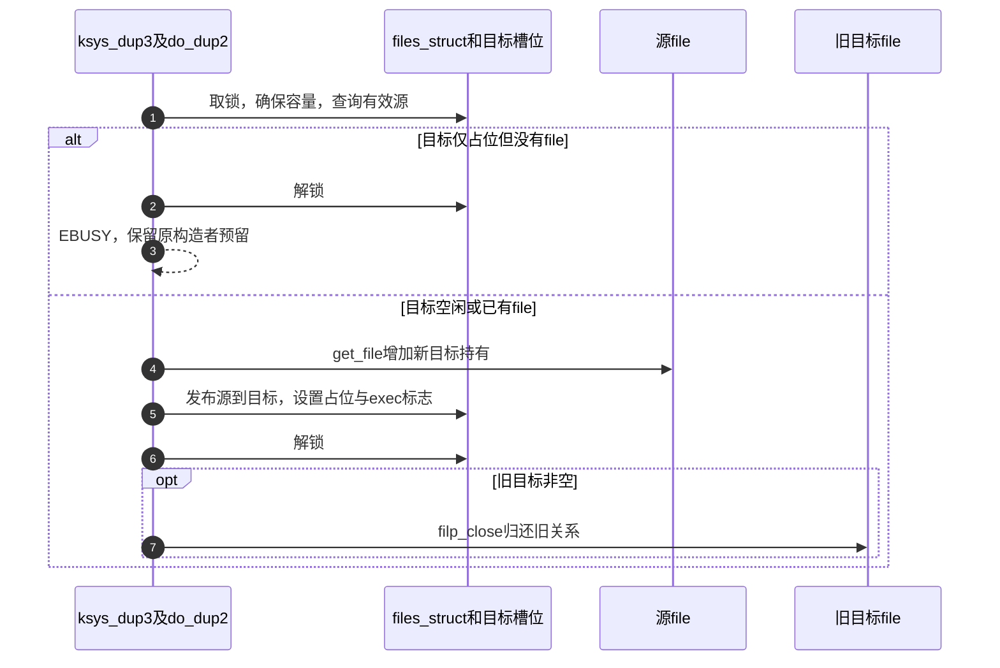

# 第29章\_描述符复制与表共享的两层引用

复制号码关系与共享容器会改变不同计数。若把两者混为一谈，退出时就可能多归还或少归还file持有；若忽略open的预留阶段，复制又可能把另一个任务的半成品当成自己的构造。本页用F2的三个入口区分这些情况。

| 阅读关联 | 入口 |
| --- | --- |
| 场景 | [两层共享](../../../../knowledge/kernel_subsystems/vfs/P13_fd_table与file生命周期.md#13.1_共享号码表与共享打开关系是两回事) |
| 模块与身份 | [导读](../navigation/P12_描述符共享查询与关闭的交接.md#12.1_沿同一生命周期区分表与file)、[总索引](../navigation/P01_Linux_6.12_VFS源码阅读索引.md#1.1_先固定源码身份与运行证据) |
| 原件 | [kernel/fork.c](../../linux/kernel/fork.c)、[fs/file.c](../../linux/fs/file.c)、[fdtable.h](../../linux/include/linux/fdtable.h) |

固定提交 `dfaf2136deb2af2e60b994421281ba42f1c087e0`。copy_files是fork.c的私有辅助，本页只展开任务创建与VFS对象交接的边界；dup_fd在fdtable.h声明，do_dup2及ksys_dup3属于file.c私有实现。完整任务创建、调度和内存复制不在本页展开。

## 29.1\_任务创建先决定共享容器还是复制槽位

copy_process先由dup_task_struct建立子任务初始副本，再调用copy_files，因此CLONE_FILES分支没有再给tsk.files赋值：该指针已来自初始复制。copy_files需要为继续共享的容器补一份引用；不共享时则另建容器替换子任务指针。

```c
/** @brief 仓库补充阅读说明：根据创建标志共享容器或复制独立表。 */
static int copy_files(unsigned long clone_flags, struct task_struct *tsk,
                      int no_files)
{
        struct files_struct *oldf, *newf;

        /*
         * A background process may not have any files ...
         */
        oldf = current->files;
        if (!oldf)
                return 0;

        if (no_files) {
                tsk->files = NULL;
                return 0;
        }

        if (clone_flags & CLONE_FILES) {
                /* 仓库补充：共享的是表容器，不是逐项复制file引用。 */
                atomic_inc(&oldf->count);
                return 0;
        }

        newf = dup_fd(oldf, NULL);
        if (IS_ERR(newf))
                return PTR_ERR(newf);

        tsk->files = newf;
        return 0;
}
```

no_files是调用侧请求不继承文件表的特殊条件，直接把子任务files置空。oldf为空也不进入普通复制。flags中的CLONE_FILES仅决定本模块是否共享容器，不能仅凭它推断整个进程创建的其他资源共享方式。



**实现原理与修改边界**：共享只增加容器count，复制才对非空file逐项取得引用。改变子任务初始化顺序时，必须同时检查CLONE_FILES分支依赖的初始指针，以及后续创建失败时put_files_struct的归还责任。不能在共享分支额外逐项get_file而不设计对应所有权。

## 29.2\_复制时为非空项取得持有并放弃未完成预留

dup_fd从files_cachep分配容器，初始化count、锁、等待队列、内嵌布局和next_fd。旧表锁保护复制过程；新表需要扩容时先放锁分配，再重取旧fdt和所需容量，避免按过时布局复制。

```c
/** @brief 仓库补充阅读说明：初始化新表并为非空槽位建立独立持有。 */
struct files_struct *dup_fd(struct files_struct *oldf, struct fd_range *punch_hole)
{
        struct files_struct *newf;
        struct file **old_fds, **new_fds;
        unsigned int open_files, i;
        struct fdtable *old_fdt, *new_fdt;
        int error;

        newf = kmem_cache_alloc(files_cachep, GFP_KERNEL);
        if (!newf)
                return ERR_PTR(-ENOMEM);

        atomic_set(&newf->count, 1);

        spin_lock_init(&newf->file_lock);
        newf->resize_in_progress = false;
        init_waitqueue_head(&newf->resize_wait);
        newf->next_fd = 0;
        new_fdt = &newf->fdtab;
        new_fdt->max_fds = NR_OPEN_DEFAULT;
        new_fdt->close_on_exec = newf->close_on_exec_init;
        new_fdt->open_fds = newf->open_fds_init;
        new_fdt->full_fds_bits = newf->full_fds_bits_init;
        new_fdt->fd = &newf->fd_array[0];

        spin_lock(&oldf->file_lock);
        old_fdt = files_fdtable(oldf);
        open_files = sane_fdtable_size(old_fdt, punch_hole);

        /*
         * Check whether we need to allocate a larger fd array and fd set.
         */
        while (unlikely(open_files > new_fdt->max_fds)) {
                spin_unlock(&oldf->file_lock);

                if (new_fdt != &newf->fdtab)
                        __free_fdtable(new_fdt);

                new_fdt = alloc_fdtable(open_files - 1);
                if (!new_fdt) {
                        error = -ENOMEM;
                        goto out_release;
                }

                /* beyond sysctl_nr_open; nothing to do */
                if (unlikely(new_fdt->max_fds < open_files)) {
                        __free_fdtable(new_fdt);
                        error = -EMFILE;
                        goto out_release;
                }

                /*
                 * Reacquire the oldf lock and a pointer to its fd table
                 * who knows it may have a new bigger fd table. We need
                 * the latest pointer.
                 */
                spin_lock(&oldf->file_lock);
                old_fdt = files_fdtable(oldf);
                open_files = sane_fdtable_size(old_fdt, punch_hole);
        }

        copy_fd_bitmaps(new_fdt, old_fdt, open_files / BITS_PER_LONG);

        old_fds = old_fdt->fd;
        new_fds = new_fdt->fd;

        for (i = open_files; i != 0; i--) {
                struct file *f = *old_fds++;
                if (f) {
                        /* 仓库补充：新表的非空槽位需要自己的file持有。 */
                        get_file(f);
                } else {
                        /*
                         * The fd may be claimed in the fd bitmap but not yet
                         * instantiated in the files array if a sibling thread
                         * is partway through open().  So make sure that this
                         * fd is available to the new process.
                         */
                        /* 仓库补充：不继承其他构造者尚未发布的预留。 */
                        __clear_open_fd(open_files - i, new_fdt);
                }
                rcu_assign_pointer(*new_fds++, f);
        }
        spin_unlock(&oldf->file_lock);

        /* clear the remainder */
        memset(new_fds, 0, (new_fdt->max_fds - open_files) * sizeof(struct file *));

        rcu_assign_pointer(newf->fdt, new_fdt);

        return newf;

out_release:
        kmem_cache_free(files_cachep, newf);
        return ERR_PTR(error);
}
```

| 辅助与状态 | 本次复制中的作用 |
| --- | --- |
| files_cachep | 任务初始化路径建立的files_struct slab缓存，由fork.c全局定义，fdtable.h声明；这里分配新容器 |
| sane_fdtable_size | 按原open_fds最后占位决定所需字对齐容量；punch_hole用于特定close_range取消共享场景缩小尾部需求，普通copy_files传NULL |
| copy_fd_bitmaps | 复制占用、exec及全满摘要位图，并清新尾部；不复制file对象 |
| get_file | 对已由旧表持有且在保护内取得的file增加f_count；不是无保护指针查询算法 |
| __clear_open_fd | 旧槽位为空时清新表占用及摘要，避免继承另一open的未完成预留 |
| rcu_assign_pointer | 发布新表的项与新容器fdt，未给已存在file重新执行open |
| ERR_PTR、IS_ERR、PTR_ERR | 用错误指针传播分配失败，不是可访问的容器 |

新表独立但file仍共享，所以双方可以分别关闭自己的fd，同时仍共享f_pos与f_flags。新表的close_on_exec位图是复制所得，此后每表可独立修改。标志实验对应的fcntl分派可在 [fs/fcntl.c原件](../../linux/fs/fcntl.c) 查到：F_GETFD/F_SETFD操作槽位exec位，F_GETFL/F_SETFL读取或修改file.f_flags；setfl只允许SETFL_MASK中的状态位，并会执行相应合法性检查，不是整字替换全部打开意图。

**实现原理与修改边界**：复制不能只memcpy指针数组，必须建立新表每个非空项的持有；但扩大同一表布局不应逐项get_file。修改punch_hole或容量逻辑时还需检查位图尾部、空槽位与新表失败释放。files.count的退出实现见 [容器最后归还](P30_描述符脱离与最后file引用的释放.md#30.5_共享容器最后退出才关闭其中全部关系)。

## 29.3\_定向替换不能抢走尚未完成的预留

ksys_dup3先检查flags、相同号码和目标上限，在file_lock下确保容量并重新读取源file。do_dup2接收已验证的源及目标号码，持锁进入，但由它负责解锁返回。

```c
/** @brief 仓库补充阅读说明：核对参数、容量及源对象后进入定向替换。 */
static int ksys_dup3(unsigned int oldfd, unsigned int newfd, int flags)
{
        int err = -EBADF;
        struct file *file;
        struct files_struct *files = current->files;

        if ((flags & ~O_CLOEXEC) != 0)
                return -EINVAL;

        if (unlikely(oldfd == newfd))
                return -EINVAL;

        if (newfd >= rlimit(RLIMIT_NOFILE))
                return -EBADF;

        spin_lock(&files->file_lock);
        err = expand_files(files, newfd);
        /* 仓库补充：扩容可能放锁，重新查询有效源。 */
        file = files_lookup_fd_locked(files, oldfd);
        if (unlikely(!file))
                goto Ebadf;
        if (unlikely(err < 0)) {
                if (err == -EMFILE)
                        goto Ebadf;
                goto out_unlock;
        }
        return do_dup2(files, file, newfd, flags);

Ebadf:
        err = -EBADF;
out_unlock:
        spin_unlock(&files->file_lock);
        return err;
}
```

```c
/** @brief 仓库补充阅读说明：拒绝未完成预留，发布新目标后锁外归还旧目标。 */
static int do_dup2(struct files_struct *files,
        struct file *file, unsigned fd, unsigned flags)
__releases(&files->file_lock)
{
        struct file *tofree;
        struct fdtable *fdt;

        /*
         * We need to detect attempts to do dup2() over allocated but still
         * not finished descriptor.  NB: OpenBSD avoids that at the price of
         * extra work in their equivalent of fget() - they insert struct
         * file immediately after grabbing descriptor, mark it larval if
         * more work (e.g. actual opening) is needed and make sure that
         * fget() treats larval files as absent.  Potentially interesting,
         * but while extra work in fget() is trivial, locking implications
         * and amount of surgery on open()-related paths in VFS are not.
         * FreeBSD fails with -EBADF in the same situation, NetBSD "solution"
         * deadlocks in rather amusing ways, AFAICS.  All of that is out of
         * scope of POSIX or SUS, since neither considers shared descriptor
         * tables and this condition does not arise without those.
         */
        fdt = files_fdtable(files);
        fd = array_index_nospec(fd, fdt->max_fds);
        tofree = fdt->fd[fd];
        /* 仓库补充：不能抢走别的open已预留但尚未发布的目标。 */
        if (!tofree && fd_is_open(fd, fdt))
                goto Ebusy;
        /* 仓库补充：在发布前为新目标建立持有。 */
        get_file(file);
        rcu_assign_pointer(fdt->fd[fd], file);
        __set_open_fd(fd, fdt);
        if (flags & O_CLOEXEC)
                __set_close_on_exec(fd, fdt);
        else
                __clear_close_on_exec(fd, fdt);
        spin_unlock(&files->file_lock);

        if (tofree)
                filp_close(tofree, files);

        return fd;

Ebusy:
        spin_unlock(&files->file_lock);
        return -EBUSY;
}
```

files_lookup_fd_locked依赖调用者持有file_lock，内部还检查边界；它没有给file额外持有。do_dup2在新目标发布前get_file，随后设置占位与CLOEXEC，解锁后才filp_close旧目标。原目标清理可能阻塞，因此不放在自旋锁内。

目标指针为空但open_fds已占用表示别的构造者正在F0，此时返回EBUSY。不是把那个号码抢来后让原构造者覆盖新file。dup2系统调用对源目标相同另有分支：查询源有效就返回原号，未完成项仍视为无有效file；dup3则拒绝相同号码。普通dup通过fget_raw取得新引用，预留任意空号后fd_install转交它，预留失败则fput。



**实现原理与修改边界**：目标替换的发布与旧对象清理是两个时间点。不能先close目标再无保护地普通dup来模拟原子替换；中间号码可能被其他线程取得。修改源查询或扩容顺序时，必须保留放锁后重查、目标预留冲突和旧引用锁外归还。当前未执行并发dup与open冲突测试。
