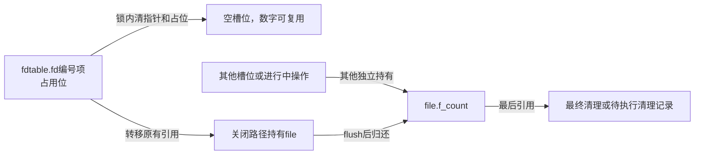
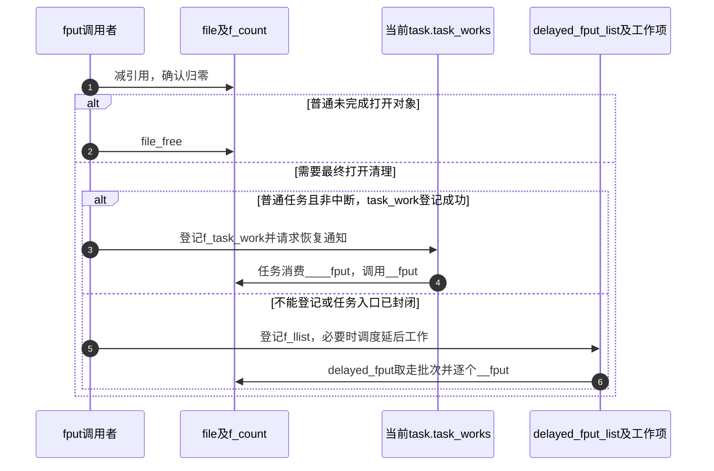

# 第30章\_描述符脱离与最后file引用的释放

关闭开始时，槽位的引用还属于fd表；撤销以后，同一份引用交给关闭路径处理。它不是重新get_file得到的临时引用。最后清理能否在当前上下文执行，又与调用入口有关。本页沿F3～F5解释这两次交接。

| 阅读关联 | 入口 |
| --- | --- |
| 场景 | [关闭与持有](../../../../knowledge/kernel_subsystems/vfs/P13_fd_table与file生命周期.md#13.5_复制和关闭各自在哪个点改变可见关系) |
| 模块与身份 | [导读](../navigation/P12_描述符共享查询与关闭的交接.md#12.3_把先撤销后清理与其他使用者放在同一时间线)、[总索引](../navigation/P01_Linux_6.12_VFS源码阅读索引.md#1.1_先固定源码身份与运行证据) |
| 原件 | [fs/file.c](../../linux/fs/file.c)、[fs/open.c](../../linux/fs/open.c)、[fs/file_table.c](../../linux/fs/file_table.c) |

固定提交 `dfaf2136deb2af2e60b994421281ba42f1c087e0`。file_close_fd与put_files_struct在fdtable.h声明，file_close_fd_locked在fs/internal.h声明，fput及__fput_sync在file.h声明，filp_close在fs.h声明；其余所示辅助为各实现文件的私有函数。系统调用close由SYSCALL_DEFINE1声明生成入口，不能按普通C同名函数推断调用链。

## 30.1\_先从表中撤销并接收那份已有引用

file_close_fd在锁内调用file_close_fd_locked。后者只对非空槽位清指针并归还号码；尚未发布的预留指针为空，不会被当作成功打开的file关闭。返回值携带原槽位那份持有，没有增加引用。

```c
/** @brief 仓库补充阅读说明：在锁内撤销有效槽位并转移原有引用。 */
struct file *file_close_fd_locked(struct files_struct *files, unsigned fd)
{
        struct fdtable *fdt = files_fdtable(files);
        struct file *file;

        lockdep_assert_held(&files->file_lock);

        if (fd >= fdt->max_fds)
                return NULL;

        fd = array_index_nospec(fd, fdt->max_fds);
        file = fdt->fd[fd];
        if (file) {
                /* 仓库补充：先撤销可查询的关系，再让号码可复用。 */
                rcu_assign_pointer(fdt->fd[fd], NULL);
                __put_unused_fd(files, fd);
        }
        return file;
}
```

```c
/** @brief 仓库补充阅读说明：取得锁后接收待关闭file，不增加引用。 */
struct file *file_close_fd(unsigned int fd)
{
        struct files_struct *files = current->files;
        struct file *file;

        spin_lock(&files->file_lock);
        /* 仓库补充：接收的是原槽位引用，后续关闭路径负责归还。 */
        file = file_close_fd_locked(files, fd);
        spin_unlock(&files->file_lock);

        return file;
}
```

array_index_nospec在通过容量检查后约束推测索引；lockdep_assert_held检查锁契约，不是加锁动作。当前配置启用PROVE_LOCKING和DEBUG_LOCK_ALLOC，检查仍不能替代正确锁序或证明所有并发路径都已经执行。__put_unused_fd的占位清理见 [号码归还](P27_描述符预留扩容与发布协议.md#27.2_失败归还的是号码而不是一个已安装file)。



**实现原理与修改边界**：不能先把占位归还而暂留指针，也不能在拿到file后额外fput两次。号码一旦可复用，后续错误恢复不能靠旧整数重新寻找原对象。验证要覆盖空项、仅预留项、有效项及其他线程已持有file的情况。

## 30.2\_用户关闭与内部关闭选择不同的最后归还方式

filp_flush先检查计数异常，再调用可选flush，并对非路径句柄执行dnotify及POSIX锁的按拥有者清理。用户close得到file后先filp_flush，再__fput_sync，最后把不可重启的内部错误转换为EINTR。

```c
/** @brief 仓库补充阅读说明：处理本次关闭的回调与按拥有者登记的状态。 */
static int filp_flush(struct file *filp, fl_owner_t id)
{
        int retval = 0;

        if (CHECK_DATA_CORRUPTION(file_count(filp) == 0,
                        "VFS: Close: file count is 0 (f_op=%ps)",
                        filp->f_op)) {
                return 0;
        }

        /* 仓库补充：关闭回调与最后file引用清理不是同一个时点。 */
        if (filp->f_op->flush)
                retval = filp->f_op->flush(filp, id);

        if (likely(!(filp->f_mode & FMODE_PATH))) {
                dnotify_flush(filp, id);
                locks_remove_posix(filp, id);
        }
        return retval;
}
```

```c
/** @brief 仓库补充阅读说明：先撤销号码，再关闭并同步归还本次持有。 */
SYSCALL_DEFINE1(close, unsigned int, fd)
{
        int retval;
        struct file *file;

        file = file_close_fd(fd);
        if (!file)
                return -EBADF;

        retval = filp_flush(file, current->files);

        /*
         * We're returning to user space. Don't bother
         * with any delayed fput() cases.
         */
        /* 仓库补充：此用户入口在最后归还时同步执行最终清理。 */
        __fput_sync(file);

        /* can't restart close syscall because file table entry was cleared */
        if (unlikely(retval == -ERESTARTSYS ||
                     retval == -ERESTARTNOINTR ||
                     retval == -ERESTARTNOHAND ||
                     retval == -ERESTART_RESTARTBLOCK))
                retval = -EINTR;

        return retval;
}
```

__fput_sync只做原子减计数，归零则直接__fput。对比内部filp_close：它filp_flush之后调用普通fput，再返回flush结果；close_fd经file_close_fd_locked撤销后也走filp_close。不能把用户close和内部close_fd画成完全相同的链。

CHECK_DATA_CORRUPTION处理计数为零的异常，按构建选项可能报告或触发更强诊断；它不是正常关闭的同步机制。flush的返回值可以成为close结果，release返回值在最终清理中不作为close错误传回。这里的flush也不是通用fsync承诺。

| 动作 | 本实例责任 |
| --- | --- |
| f_op.flush | 针对一次关闭关系的可选方法，未必是最后file引用 |
| dnotify_flush | 移除与当前关闭拥有者相关的目录通知登记 |
| locks_remove_posix | 清理该拥有者的POSIX文件锁；与最终file锁清理不同 |
| fl_owner_t id | 内部关闭传files指针作为相关拥有者身份，不是随便替换的整数pid |
| FMODE_PATH | 路径句柄跳过普通数据打开附带的这部分关闭处理 |
| ERESTART系列转换 | 槽位已经清除，不可重新执行close来“重试原file” |

**实现原理与修改边界**：任何改为异步或同步释放的选择，都需重新检查上下文是否可睡眠、锁是否仍持有和后端release依赖。不能仅因同步看起来简单就把所有fput替换为__fput_sync。close已撤销槽位后的错误也不能用重试同一号码补偿。

## 30.3\_最后引用归零后把清理交给可执行的上下文

fput的非最后归还只减计数。归零且不是OPENED或BACKING的普通未完成对象可以直接file_free；打开后的对象需要执行可能睡眠的清理。普通任务的非中断上下文优先登记task_work，其他情况或登记失败进入延后工作。

```c
/** @brief 仓库补充阅读说明：最后引用按对象阶段和上下文选择清理路径。 */
void fput(struct file *file)
{
        if (atomic_long_dec_and_test(&file->f_count)) {
                struct task_struct *task = current;

                if (unlikely(!(file->f_mode & (FMODE_BACKING | FMODE_OPENED)))) {
                        file_free(file);
                        return;
                }
                if (likely(!in_interrupt() && !(task->flags & PF_KTHREAD))) {
                        init_task_work(&file->f_task_work, ____fput);
                        /* 仓库补充：登记成功后清理由任务工作消费，不能自行再释放。 */
                        if (!task_work_add(task, &file->f_task_work, TWA_RESUME))
                                return;
                        /*
                         * After this task has run exit_task_work(),
                         * task_work_add() will fail.  Fall through to delayed
                         * fput to avoid leaking *file.
                         */
                }

                if (llist_add(&file->f_llist, &delayed_fput_list))
                        schedule_delayed_work(&delayed_fput_work, 1);
        }
}
```

```c
/** @brief 仓库补充阅读说明：从内嵌任务工作节点找回file并最终清理。 */
static void ____fput(struct callback_head *work)
{
        /* 仓库补充：内嵌节点找回原file，不增加新引用。 */
        __fput(container_of(work, struct file, f_task_work));
}
```

```c
/** @brief 仓库补充阅读说明：取走待清理批次并逐个执行最终清理。 */
static void delayed_fput(struct work_struct *unused)
{
        /* 仓库补充：取走当前批次；后续生产者可以形成新批次。 */
        struct llist_node *node = llist_del_all(&delayed_fput_list);
        struct file *f, *t;

        llist_for_each_entry_safe(f, t, node, f_llist)
                __fput(f);
}
```

| 本实例状态与辅助 | 初始化、登记与消费 |
| --- | --- |
| file.f_task_work | init_task_work设置____fput回调，task_work_add把节点加入当前task.task_works |
| TWA_RESUME | 请求任务在恢复用户态的相应路径执行；任务退出也消费待办工作，不是新建一个线程 |
| task_work_add失败 | 任务已封闭工作入口时可返回ESRCH，fput转入延后队列防止遗失清理 |
| delayed_fput_list | fs/file_table.c以LLIST_HEAD静态初始化的待清理file集合 |
| file.f_llist | 最后引用归零后用于登记，llist_add首次从空变非空时触发调度 |
| delayed_fput_work | DECLARE_DELAYED_WORK静态关联delayed_fput，schedule_delayed_work延迟参数为1个jiffy，不是完成时间上界 |
| llist_del_all与安全遍历 | worker取走一批节点，逐个__fput；新的生产者可再登记后续批次 |
| container_of | 从file内嵌回调节点恢复同一个file地址，不增加对象引用 |

task_work的登记与通知见 [task_work.c原件](../../linux/kernel/task_work.c) 和 [task_work.h](../../linux/include/linux/task_work.h)：TWA_RESUME登记后设置恢复通知，work_exited哨兵阻止退出完成后继续排入。通用工作队列的调度算法复用 [工作队列索引](../../workqueue/navigation/P01_Linux_6.12_工作队列源码总阅读索引.md#1.5_模块与唯一实现入口)，这里展开VFS队列实例，不重复框架实现。PF_KTHREAD与in_interrupt决定能否使用当前普通任务的执行路径，不是“哪个CPU最快”的选择。



**实现原理与修改边界**：归零后是待清理对象，不能因回调尚未执行就重新向外发布。f_task_work与f_llist属于同一file的生命周期安排，必须只选择一条清理路径；登记成功后不得继续自行释放。flush_delayed_fput只处理这条延后队列，不会替调用者清空任意任务的task_work；原件明确限制持锁或参与卸载的调用场景。

## 30.4\_最终清理归还file自己的依赖

__fput按保存的path、inode和mode清理打开关系。先处理通知和事件、锁、安全及异步信号，再调用具体release，最后归还操作表模块、所有者、读写访问、dentry及mount。不是对fd数字再做一次查找。

```c
/** @brief 仓库补充阅读说明：释放已打开file依赖的资源并结束对象存储。 */
static void __fput(struct file *file)
{
        struct dentry *dentry = file->f_path.dentry;
        struct vfsmount *mnt = file->f_path.mnt;
        struct inode *inode = file->f_inode;
        fmode_t mode = file->f_mode;

        if (unlikely(!(file->f_mode & FMODE_OPENED)))
                goto out;

        might_sleep();

        fsnotify_close(file);
        /*
         * The function eventpoll_release() should be the first called
         * in the file cleanup chain.
         */
        eventpoll_release(file);
        locks_remove_file(file);

        security_file_release(file);
        if (unlikely(file->f_flags & FASYNC)) {
                if (file->f_op->fasync)
                        file->f_op->fasync(-1, file, 0);
        }
        /* 仓库补充：具体打开关系最终回调，此时依赖仍被持有。 */
        if (file->f_op->release)
                file->f_op->release(inode, file);
        if (unlikely(S_ISCHR(inode->i_mode) && inode->i_cdev != NULL &&
                     !(mode & FMODE_PATH))) {
                cdev_put(inode->i_cdev);
        }
        fops_put(file->f_op);
        file_f_owner_release(file);
        put_file_access(file);
        /* 仓库补充：具体清理完成后才归还路径依赖。 */
        dput(dentry);
        if (unlikely(mode & FMODE_NEED_UNMOUNT))
                dissolve_on_fput(mnt);
        mntput(mnt);
out:
        file_free(file);
}
```

```c
/** @brief 仓库补充阅读说明：归还安全状态、统计、凭据及正确类型的存储。 */
static inline void file_free(struct file *f)
{
        security_file_free(f);
        if (likely(!(f->f_mode & FMODE_NOACCOUNT)))
                percpu_counter_dec(&nr_files);
        /* 仓库补充：归还最初构造时取得的凭据。 */
        put_cred(f->f_cred);
        if (unlikely(f->f_mode & FMODE_BACKING)) {
                path_put(backing_file_user_path(f));
                kfree(backing_file(f));
        } else {
                kmem_cache_free(filp_cachep, f);
        }
}
```

| 清理对象 | 配对关系与边界 |
| --- | --- |
| fsnotify_close、eventpoll_release | 关闭事件与事件轮询关联清理；后者在文件清理链前部执行 |
| locks_remove_file | 最后file层锁状态清理，与按关闭拥有者清POSIX锁区分 |
| security_file_release与security_file_free | 打开后释放与对象存储释放的不同阶段；本次CONFIG_SECURITY关闭，对应钩子退化 |
| FASYNC、f_op.fasync | 曾启用异步通知时撤销其登记，传-1与关闭参数0 |
| f_op.release | 具体打开关系的最终回调，不对应每一次用户close |
| cdev_put | 字符设备且非路径句柄时归还设备持有 |
| fops_put、file_f_owner_release | 分别归还操作表模块持有及file的异步信号拥有者资源 |
| put_file_access | 归还打开阶段取得的读计数或inode、mount写访问，见打开页的取得侧 |
| dput、mntput、dissolve_on_fput | 归还路径持有；NEED_UNMOUNT时处理特定未挂接挂载，见挂载生命周期 |
| nr_files、FMODE_NOACCOUNT | 参与统计的file才减全局percpu_counter；统计不决定引用是否归零 |
| f_cred与filp_cachep | 归还打开凭据，普通file回到启动建立的SLAB_TYPESAFE_BY_RCU缓存 |
| FMODE_BACKING | 内部backing_file还持有user_path，归还它并释放外包对象，不能按普通缓存对象释放 |

取得侧见 [file打开初始化](P26_file初始化与打开后失败清理.md#26.3_具体打开前取得自己的持有与操作表)，mount最后归还见 [挂载退出](P10_挂载脱离与最后引用退出.md#10.4_最后计数归还才选择真正的清理路径)。当前配置FILE_LOCKING、EPOLL、DNOTIFY启用；没有进行通知消费或锁清理跟踪，不能把源码出现对应调用当作本次已观测这些事件。

**实现原理与修改边界**：新加私有资源应明确在打开失败由谁释放，以及OPENED后的release由谁归还；两个出口不能重复释放。调整清理顺序须检查回调仍需要的inode、path、操作表和模块持有，不得提前归还其依赖。最后file退出也不能直接宣告inode或mount已释放，其他持有与缓存仍各自决定生命周期。

## 30.5\_共享容器最后退出才关闭其中全部关系

put_files_struct只在count归零时调用close_files。此时没有其他容器持有者，可直接遍历表；逐个用xchg取走非空槽位，filp_close归还其持有，并在较长遍历中允许重新调度。动态布局最后释放，内嵌布局随容器一起释放。

```c
/** @brief 仓库补充阅读说明：在最后表持有退出后遍历并归还所有非空槽位。 */
static struct fdtable *close_files(struct files_struct * files)
{
        /*
         * It is safe to dereference the fd table without RCU or
         * ->file_lock because this is the last reference to the
         * files structure.
         */
        struct fdtable *fdt = rcu_dereference_raw(files->fdt);
        unsigned int i, j = 0;

        for (;;) {
                unsigned long set;
                i = j * BITS_PER_LONG;
                if (i >= fdt->max_fds)
                        break;
                set = fdt->open_fds[j++];
                while (set) {
                        if (set & 1) {
                                /* 仓库补充：最后表持有已退出，逐项转移并关闭关系。 */
                                struct file * file = xchg(&fdt->fd[i], NULL);
                                if (file) {
                                        filp_close(file, files);
                                        cond_resched();
                                }
                        }
                        i++;
                        set >>= 1;
                }
        }

        return fdt;
}
```

```c
/** @brief 仓库补充阅读说明：只有容器计数归零才关闭表项并释放容器。 */
void put_files_struct(struct files_struct *files)
{
        /* 仓库补充：其他共享者仍在时不关闭整张表。 */
        if (atomic_dec_and_test(&files->count)) {
                struct fdtable *fdt = close_files(files);

                /* free the arrays if they are not embedded */
                if (fdt != &files->fdtab)
                        __free_fdtable(fdt);
                kmem_cache_free(files_cachep, files);
        }
}
```

exit_files先在task_lock下把任务files置空，再put_files_struct。count仍非零时不会逐项关闭，因此一个共享任务退出不会撤销其他任务仍在用的整张表。新表的对应取得侧见 [复制表](P29_描述符复制与表共享的两层引用.md#29.2_复制时为非空项取得持有并放弃未完成预留)。

**实现原理与修改边界**：close_files的无锁表访问依赖最后容器持有这一前提，不能直接复用到仍共享的表。增加提前返回时检查每个file、动态数组及files_cachep容器是否分别退出。本页未执行真实release跟踪、任务退出与延后队列故障注入。
