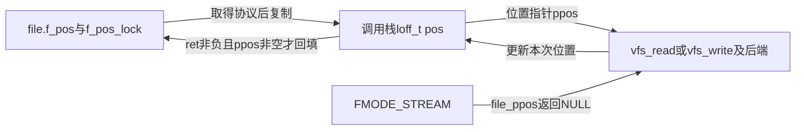
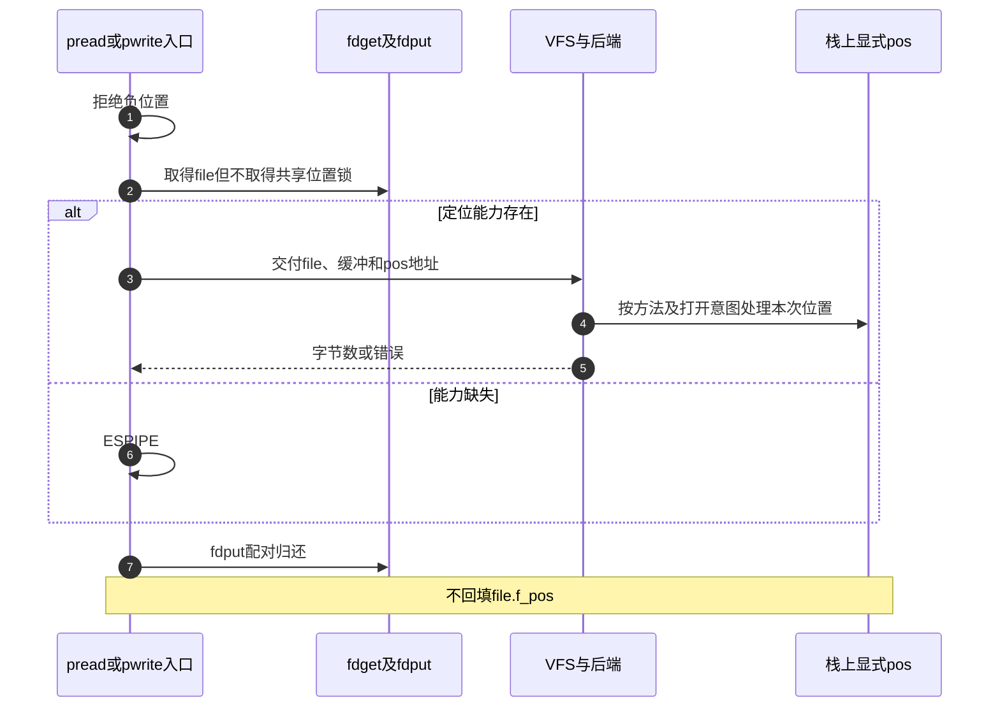

# 第31章\_读写入口的位置选择与结果回填

共享file已经存在，本次请求却不一定要修改它的位置。普通入口围绕f_pos建立保护范围，定位入口使用自己的pos。两类入口最终可调用同一个vfs_read/vfs_write，但状态归属和退出责任不同。

| 阅读关联 | 入口 |
| --- | --- |
| 场景 | [位置与缓冲](../../../../knowledge/kernel_subsystems/vfs/P14_VFS_read_write分派.md#14.4_共享位置显式位置与流式对象分别处理) |
| 模块与身份 | [读写导读](../navigation/P13_读写请求的位置缓冲与结果交接.md#13.1_把请求状态放回一次同步周期)、[总索引](../navigation/P01_Linux_6.12_VFS源码阅读索引.md#1.1_先固定源码身份与运行证据) |
| 原件 | [fs/read_write.c](../../linux/fs/read_write.c)、[file.h](../../linux/include/linux/file.h)、[fs.h](../../linux/include/linux/fs.h) |

固定提交 `dfaf2136deb2af2e60b994421281ba42f1c087e0`。四个ksys辅助在include/linux/syscalls.h声明、fs/read_write.c定义，系统调用宏包装转入它们；公共file查询在file.h声明，VFS读写接口在fs.h声明。参数中的__user是用户地址空间标记，不能据此认为用户缓冲已被固定或复制。

## 31.1\_普通入口先把共享位置变成本次局部位置

ksys_read和ksys_write都先fdget_pos。file_ppos对FMODE_STREAM返回NULL，其他情况返回file.f_pos地址；入口把非空位置复制到栈上pos，再传给VFS。返回非负时才回填共享位置，最后fdput_pos。

```c
/** @brief 仓库补充阅读说明：取得file与位置保护，以局部位置执行读后按结果回填。 */
ssize_t ksys_read(unsigned int fd, char __user *buf, size_t count)
{
        struct fd f = fdget_pos(fd);
        ssize_t ret = -EBADF;

        if (fd_file(f)) {
                loff_t pos, *ppos = file_ppos(fd_file(f));
                if (ppos) {
                        pos = *ppos;
                        /* 仓库补充：后端修改本次局部位置，不在任意中途直接提交共享位置。 */
                        ppos = &pos;
                }
                ret = vfs_read(fd_file(f), buf, count, ppos);
                /* 仓库补充：只有符合结果条件才回填共享f_pos。 */
                if (ret >= 0 && ppos)
                        fd_file(f)->f_pos = pos;
                fdput_pos(f);
        }
        return ret;
}
```

```c
/** @brief 仓库补充阅读说明：在同一位置保护范围内执行写和位置提交。 */
ssize_t ksys_write(unsigned int fd, const char __user *buf, size_t count)
{
        struct fd f = fdget_pos(fd);
        ssize_t ret = -EBADF;

        if (fd_file(f)) {
                loff_t pos, *ppos = file_ppos(fd_file(f));
                if (ppos) {
                        pos = *ppos;
                        ppos = &pos;
                }
                /* 仓库补充：位置锁或借用责任仍由当前入口持有。 */
                ret = vfs_write(fd_file(f), buf, count, ppos);
                if (ret >= 0 && ppos)
                        fd_file(f)->f_pos = pos;
                /* 仓库补充：错误或正常结果都要配对退出。 */
                fdput_pos(f);
        }

        return ret;
}
```

fdget_pos的引用、借用和位置锁责任见 [查询实现](P28_描述符查询的引用验证与轻量借用.md#28.3_位置保护在引用之外增加另一份退出责任)。fd_file去除返回值的责任位；fdput_pos先按标记解锁再归还新增持有。无有效file时保留EBADF，不使用未初始化pos。



**实现原理与修改边界**：不能先解位置锁再回填，也不能在后端负错误时无条件提交局部位置。零结果仍属于非负，是否改变局部位置取决于具体方法，不能把外层条件擅自改成ret大于0。流式分支没有位置指针，不得无条件解引用它。

## 31.2\_显式位置不回填共享位置但仍受打开意图约束

ksys_pread64与ksys_pwrite64先拒绝负pos，再fdget。它们检查FMODE_PREAD或FMODE_PWRITE，支持时把自己的pos地址传给VFS，结束后fdput。没有把pos写回file.f_pos，也不为共享位置调用fdget_pos。

```c
/** @brief 仓库补充阅读说明：使用本次显式位置，不回填共享f_pos。 */
ssize_t ksys_pread64(unsigned int fd, char __user *buf, size_t count,
                     loff_t pos)
{
        struct fd f;
        ssize_t ret = -EBADF;

        if (pos < 0)
                return -EINVAL;

        /* 仓库补充：显式位置不需要取得共享f_pos的互斥锁。 */
        f = fdget(fd);
        if (fd_file(f)) {
                ret = -ESPIPE;
                if (fd_file(f)->f_mode & FMODE_PREAD)
                        ret = vfs_read(fd_file(f), buf, count, &pos);
                fdput(f);
        }

        return ret;
}
```

```c
/** @brief 仓库补充阅读说明：核对定位能力后以局部显式位置执行写。 */
ssize_t ksys_pwrite64(unsigned int fd, const char __user *buf,
                      size_t count, loff_t pos)
{
        struct fd f;
        ssize_t ret = -EBADF;

        if (pos < 0)
                return -EINVAL;

        f = fdget(fd);
        if (fd_file(f)) {
                ret = -ESPIPE;
                if (fd_file(f)->f_mode & FMODE_PWRITE)
                        /* 仓库补充：传的是参数副本地址，后面没有共享位置回填。 */
                        ret = vfs_write(fd_file(f), buf, count, &pos);
                fdput(f);
        }

        return ret;
}
```

FMODE_PREAD/PWRITE是打开建立的能力位，某些流式对象会清除它们；缺少能力时返回ESPIPE。这里的64表示接口使用的偏移宽度，并不表示本章改用了ARM64；本次源码核对载体仍是ARM，具体系统调用参数拆装还受体系结构与兼容入口影响，本页只展开公共ksys层。

显式位置不会清除file的追加意图。同步kiocb从file.f_iocb_flags继承IOCB_APPEND；采用generic_write_checks_count的后端会把非零写请求的ki_pos改到i_size_read的文件尾，再检查长度限制。这发生在后端处理阶段，不是ksys_pwrite64回填共享位置。因此实验不带O_APPEND，不能从“未修改f_pos”推导任意标志组合都按给定偏移写。同步构造见 [迭代请求](P33_同步迭代请求与向量缓冲区的交接.md#33.1_文件位置与内存范围分别保存)。



**实现原理与修改边界**：明确位置只移除了共享偏移的竞争，不使同一inode的数据区自动互斥。改动能力位或追加规则时，应同时审查打开初始化、kiocb标志、后端写检查以及显式位置测试。本页没有定位写与追加并发实验。
