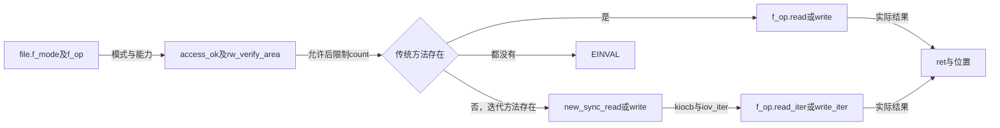
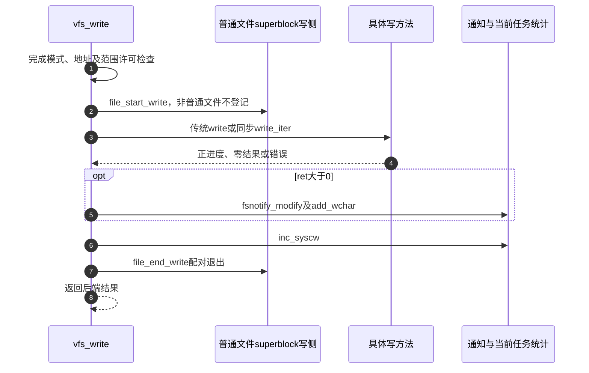

# 第32章\_读写资格检查与文件操作分派

同一个file可能允许读而不允许写，也可能是不能按普通数据接口使用的路径句柄。分派先核对本次访问资格和参数，再选方法；选到方法后仍可能出现数据故障或短进度。这里解释I1与I3之间的交接，不把前置检查当成后端成功保证。

| 阅读关联 | 入口 |
| --- | --- |
| 场景 | [分派顺序](../../../../knowledge/kernel_subsystems/vfs/P14_VFS_read_write分派.md#14.3_分派顺序取决于进入的是哪类接口) |
| 模块与身份 | [导读](../navigation/P13_读写请求的位置缓冲与结果交接.md#13.2_按入口区分位置与方法选择)、[总索引](../navigation/P01_Linux_6.12_VFS源码阅读索引.md#1.1_先固定源码身份与运行证据) |
| 原件 | [fs/read_write.c](../../linux/fs/read_write.c)、[fs.h](../../linux/include/linux/fs.h)、[fsnotify.h](../../linux/include/linux/fsnotify.h) |

固定提交 `dfaf2136deb2af2e60b994421281ba42f1c087e0`。rw_verify_area、vfs_read与vfs_write在fs/read_write.c定义并由fs.h声明，供相应内核入口调用；它们的参数包含用户指针，不能把内核缓冲强转成用户地址后套用。

## 32.1\_范围检查与访问许可发生在数据方法之前

rw_verify_area把READ/WRITE映射为MAY_READ/MAY_WRITE，检查count能否表示为有效有符号长度，并在ppos非空时检查位置与加法边界。unsigned_offsets读取file的无符号偏移能力，决定如何解释负的loff_t位模式；不是忽略所有溢出。

```c
/** @brief 仓库补充阅读说明：检查长度位置边界并执行本次访问许可钩子。 */
int rw_verify_area(int read_write, struct file *file, const loff_t *ppos, size_t count)
{
        int mask = read_write == READ ? MAY_READ : MAY_WRITE;
        int ret;

        if (unlikely((ssize_t) count < 0))
                return -EINVAL;

        if (ppos) {
                loff_t pos = *ppos;

                if (unlikely(pos < 0)) {
                        if (!unsigned_offsets(file))
                                return -EINVAL;
                        if (count >= -pos) /* both values are in 0..LLONG_MAX */
                                return -EOVERFLOW;
                } else if (unlikely((loff_t) (pos + count) < 0)) {
                        if (!unsigned_offsets(file))
                                return -EINVAL;
                }
        }

        /* 仓库补充：数据方法之前的本次访问许可检查。 */
        ret = security_file_permission(file, mask);
        if (ret)
                return ret;

        return fsnotify_file_area_perm(file, mask, ppos, count);
}
```

security_file_permission是访问时安全钩子，本次CONFIG_SECURITY关闭时对应替代定义不执行实际LSM策略拒绝。fsnotify_file_area_perm是访问前的权限事件入口，和成功后的fsnotify_access/modify不同；FANOTIFY_ACCESS_PERMISSIONS分支可以触发读访问许可事件，当前FANOTIFY未启用，对应辅助返回0。其锁依赖检查也不代表已经取得冻结保护。

vfs_read/write稍后展示的access_ok只检查用户地址范围。固定ARM [uaccess.h](../../linux/arch/arm/include/asm/uaccess.h) 引入 [通用access_ok](../../linux/include/asm-generic/access_ok.h)，在本次MMU配置下比较size和地址是否落在用户范围内，避免范围加法越界。它没有遍历页表验证所有页面，也没有完成实际copy；后端触碰内存时仍可失败。通用非MMU或分离地址空间配置另有退化条件，不把本结论硬编码成所有平台的同一指令序列。

**实现原理与修改边界**：保留范围、权限与数据执行的顺序，不把访问权限事件挪进已经取得冻结写保护的区间。改变长度上限时要同时检查有符号转换、位置相加和用户缓冲范围。返回0只表示本层检查允许继续，不给后端提供免于故障的保证。

## 32.2\_标量读写先检查传统方法再适配迭代接口

vfs_read/write分别核对打开模式FMODE_READ/WRITE和方法能力FMODE_CAN_READ/WRITE，然后检查用户范围、rw_verify_area并限制单次MAX_RW_COUNT。后端选择明确先看.read/.write，没有才进入同步迭代适配。

```c
/** @brief 仓库补充阅读说明：核对读资格后优先传统方法，再尝试迭代适配。 */
ssize_t vfs_read(struct file *file, char __user *buf, size_t count, loff_t *pos)
{
        ssize_t ret;

        if (!(file->f_mode & FMODE_READ))
                return -EBADF;
        if (!(file->f_mode & FMODE_CAN_READ))
                return -EINVAL;
        if (unlikely(!access_ok(buf, count)))
                return -EFAULT;

        ret = rw_verify_area(READ, file, pos, count);
        if (ret)
                return ret;
        if (count > MAX_RW_COUNT)
                count =  MAX_RW_COUNT;

        /* 仓库补充：标量入口优先传统read，不是优先read_iter。 */
        if (file->f_op->read)
                ret = file->f_op->read(file, buf, count, pos);
        else if (file->f_op->read_iter)
                ret = new_sync_read(file, buf, count, pos);
        else
                ret = -EINVAL;
        /* 仓库补充：正进度才进入这一访问通知与字节统计分支。 */
        if (ret > 0) {
                fsnotify_access(file);
                add_rchar(current, ret);
        }
        inc_syscr(current);
        return ret;
}
```

```c
/** @brief 仓库补充阅读说明：在配对写侧保护中分派，并按实际进度通知记账。 */
ssize_t vfs_write(struct file *file, const char __user *buf, size_t count, loff_t *pos)
{
        ssize_t ret;

        if (!(file->f_mode & FMODE_WRITE))
                return -EBADF;
        if (!(file->f_mode & FMODE_CAN_WRITE))
                return -EINVAL;
        if (unlikely(!access_ok(buf, count)))
                return -EFAULT;

        ret = rw_verify_area(WRITE, file, pos, count);
        if (ret)
                return ret;
        if (count > MAX_RW_COUNT)
                count =  MAX_RW_COUNT;
        /* 仓库补充：普通文件登记冻结写侧保护，后面必须配对退出。 */
        file_start_write(file);
        /* 仓库补充：标量写入口同样先检查传统方法。 */
        if (file->f_op->write)
                ret = file->f_op->write(file, buf, count, pos);
        else if (file->f_op->write_iter)
                ret = new_sync_write(file, buf, count, pos);
        else
                ret = -EINVAL;
        if (ret > 0) {
                fsnotify_modify(file);
                add_wchar(current, ret);
        }
        inc_syscw(current);
        file_end_write(file);
        return ret;
}
```

| 状态或辅助 | 本层实际含义 |
| --- | --- |
| FMODE_READ/WRITE | 打开请求得到的访问模式，缺少时EBADF |
| FMODE_CAN_READ/WRITE | 打开阶段根据操作表建立的能力，缺少时EINVAL |
| MAX_RW_COUNT | 固定单次传输上限，超过则缩短count；不是承诺后端一定传满 |
| new_sync_read/write | 把用户单缓冲适配为同步kiocb和iov_iter，不异步保存栈对象 |
| ret | 内核字节数或负错误；后端返回值决定通知和统计分支 |
| EXPORT_SYMBOL | 标记内核模块可链接符号，不改变调用者的参数或上下文契约 |

模式建立见 [具体打开](P26_file初始化与打开后失败清理.md#26.3_具体打开前取得自己的持有与操作表)，同步适配见 [栈上请求](P33_同步迭代请求与向量缓冲区的交接.md#33.2_栈上的同步请求必须在返回前完成)。如果传统方法与迭代方法同时安装，标量路径选择传统方法；不能用向量路径的优先级反推这里。



**实现原理与修改边界**：前置失败直接返回，不能漏掉外层已取得的file或位置责任；本层不拥有这些外层资源。改变方法优先级会改变同时提供两组方法的对象行为，必须审查具体操作表，不能只因为新接口更通用就调换顺序。

## 32.3\_写侧保护通知与统计各有自己的边界

file_start_write在普通文件上调用sb_start_write，为superblock的冻结写侧协议登记；非普通文件直接返回。file_end_write按同一类型条件配对sb_end_write。vfs_write将它们围在方法调用、结果通知与统计外，因此即使方法返回错误也会归还已进入的写侧保护。



add_rchar/add_wchar记录当前任务被报告的读写字节，inc_syscr/inc_syscw记录到达本层对应结果路径的调用；前置检查直接返回时不会执行这些末尾语句。它们不是块设备实际传输量。标量读只在ret大于0时发访问事件，向量读的相应路径使用非负条件，不能凭一个统一的“成功就通知”省掉零结果差别。

冻结登记不是文件数据互斥锁，更不是fsync。真正缓存修改和长度限制还由后端或generic_write_checks等公共辅助处理；普通用户write返回字节数不能证明介质持久化。同步写返回时可归还本次写侧登记，异步提交则需要在真正完成处配对，不能照抄这段栈内生命周期。

**实现原理与修改边界**：修改错误出口必须保留写侧配对，新增通知先明确是访问前许可还是结果事件。调整计数位置会改变统计语义，应区分参数拒绝、零长度、短进度及后端失败。当前未执行冻结、通知许可或数据故障注入，本页不把静态调用位置写成运行观察。

fsnotify_file_area_perm的读取许可接入、配置退化和用户等待，见 [访问前许可](P61_fanotify许可等待与观察持有.md#61.1_先找出操作之前的许可接入点)。它与读写完成后的普通变化通知时点不同。

file_start_write采用的sb_start_write如何与冻结者互斥，见 [分级冻结准入](P66_冻结写入的分级准入.md#66.1_修改者在冻结门上取得读侧)。文件写入在这把准入门上取得共享读侧，与文件I/O方向不是同一分类。
