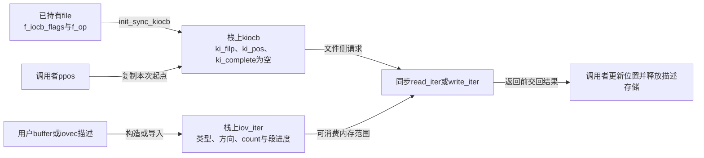
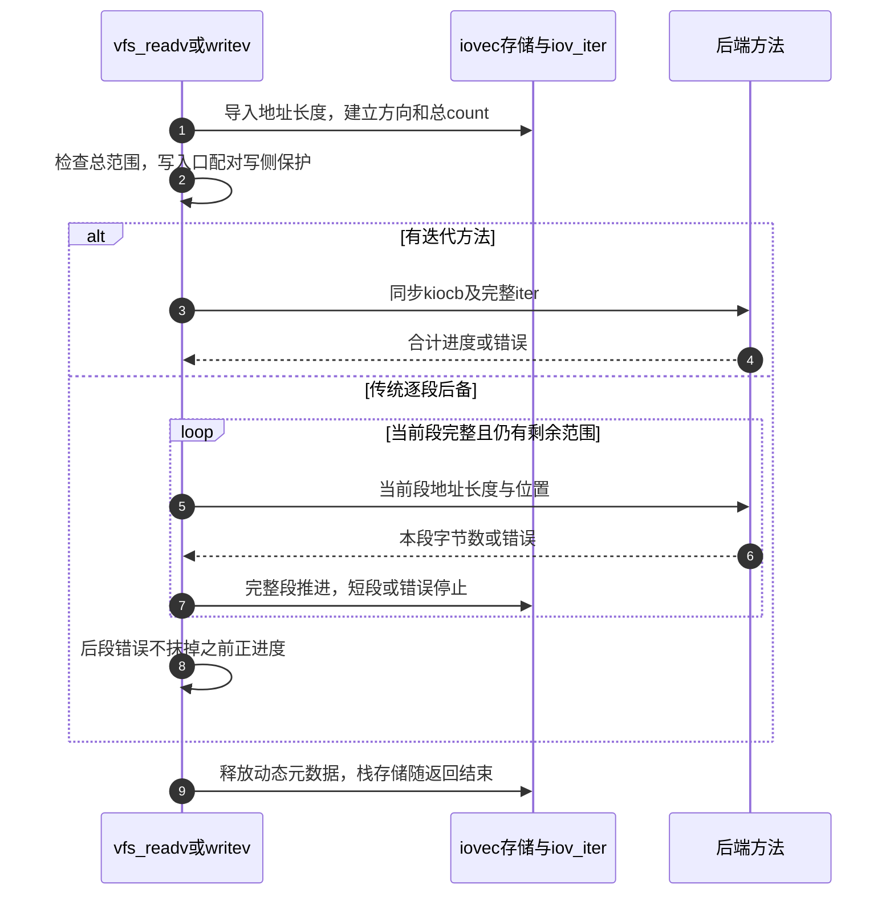

# 第33章\_同步迭代请求与向量缓冲区的交接

单个用户buffer与多个iovec段可以交给同一类迭代方法，但请求必须先说明文件位置、缓冲方向和可用范围。统一接口节省的是后端对多种参数形式的重复适配，不会自动复制数据或延长栈对象生命周期。

| 阅读关联 | 入口 |
| --- | --- |
| 场景与结果 | [缓冲进度](../../../../knowledge/kernel_subsystems/vfs/P14_VFS_read_write分派.md#14.5_缓冲进度与返回结果怎样一起解释) |
| 模块与身份 | [导读](../navigation/P13_读写请求的位置缓冲与结果交接.md#13.1_把请求状态放回一次同步周期)、[总索引](../navigation/P01_Linux_6.12_VFS源码阅读索引.md#1.1_先固定源码身份与运行证据) |
| 原件 | [fs/read_write.c](../../linux/fs/read_write.c)、[fs.h](../../linux/include/linux/fs.h)、[uio.h](../../linux/include/linux/uio.h)、[lib/iov_iter.c](../../linux/lib/iov_iter.c) |

固定提交 `dfaf2136deb2af2e60b994421281ba42f1c087e0`。同步适配和向量分派为read_write.c内的static辅助；init_sync_kiocb在fs.h内联定义，iov_iter_ubuf在uio.h内联定义。import_iovec及__import_iovec由uio.h声明，在lib/iov_iter.c定义。本文只展开用户缓冲的同步适配，页数组等其他迭代器类型保留名称坐标，不把其数据算法塞入本次调用。

## 33.1\_文件位置与内存范围分别保存

init_sync_kiocb以结构体初始化建立请求，保存file指针、从file继承的I/O标志及当前I/O优先级；未显式初始化成员为零，所以ki_complete为空，is_sync_kiocb据此识别同步请求。初始化不增加file引用，调用者仍负责其持有范围。

```c
/** @brief 仓库补充阅读说明：建立同步请求，继承file意图但不新增其引用。 */
static inline void init_sync_kiocb(struct kiocb *kiocb, struct file *filp)
{
        /* 仓库补充：未显式指定的成员为零，因此ki_complete为空。 */
        *kiocb = (struct kiocb) {
                .ki_filp = filp,
                .ki_flags = filp->f_iocb_flags,
                .ki_ioprio = get_current_ioprio(),
        };
}
```

iov_iter_ubuf记录单用户缓冲，方向与data_source对应，count为剩余字节，nr_segs为1。初始化仅保存描述；没有执行复制、固定页面或分配目标数据。WARN_ON检查方向非法位，不会把无效方向自动修好。

```c
/** @brief 仓库补充阅读说明：建立单用户缓冲描述，不复制或固定实际数据。 */
static inline void iov_iter_ubuf(struct iov_iter *i, unsigned int direction,
                        void __user *buf, size_t count)
{
        WARN_ON(direction & ~(READ | WRITE));
        /* 仓库补充：保存地址范围和方向，不发生实际数据复制。 */
        *i = (struct iov_iter) {
                .iter_type = ITER_UBUF,
                .data_source = direction,
                .ubuf = buf,
                .count = count,
                .nr_segs = 1
        };
}
```

| 本次使用的状态 | 初始化者与消费方 |
| --- | --- |
| ki_filp | 同步初始化保存已持有file，后端据此找到操作对象 |
| ki_pos | 适配器从ppos取得，后端按实际操作更新，再交回上层 |
| ki_flags | 从f_iocb_flags继承，表达追加、直接I/O、同步写等意图；部分向量接口再合并RWF请求 |
| ki_ioprio | get_current_ioprio取得当前I/O优先级提示，不是file位置或完成状态 |
| ki_complete | 同步初始化为NULL，不能随意留下后台完成工作 |
| iter_type、ubuf或__iov | 区分单用户缓冲与向量描述，后端通过迭代辅助访问 |
| data_source | write对应ITER_SOURCE，read对应ITER_DEST，以缓冲的数据方向为准 |
| iov_offset、nr_segs、count | 记录当前段内进度、剩余段及剩余总量，iov_iter_count读取count |



**实现原理与修改边界**：请求初始化不取得file持有，也不取得用户缓冲所有权。若把调用改成可排队异步，需要另行设计请求、迭代描述、元数据和实际缓冲的生命期，不能只把ki_complete填成函数指针就宣布改造完成。改变方向应同时核对后端复制方向和用户地址权限。

## 33.2\_栈上的同步请求必须在返回前完成

new_sync_read/write构造上述两个栈对象，设置ki_pos，然后调用对应迭代方法。返回-EIOCBQUEUED意味着后端说“排队后再完成”，与这段栈对象生命周期不相容，所以用BUG_ON检查该契约。

```c
/** @brief 仓库补充阅读说明：用栈对象适配同步迭代读并回传本次位置。 */
static ssize_t new_sync_read(struct file *filp, char __user *buf, size_t len, loff_t *ppos)
{
        struct kiocb kiocb;
        struct iov_iter iter;
        ssize_t ret;

        init_sync_kiocb(&kiocb, filp);
        kiocb.ki_pos = (ppos ? *ppos : 0);
        iov_iter_ubuf(&iter, ITER_DEST, buf, len);

        ret = filp->f_op->read_iter(&kiocb, &iter);
        /* 仓库补充：不能让后台完成继续使用即将退出的栈请求。 */
        BUG_ON(ret == -EIOCBQUEUED);
        if (ppos)
                *ppos = kiocb.ki_pos;
        return ret;
}
```

```c
/** @brief 仓库补充阅读说明：用栈对象适配同步迭代写，正进度时回传位置。 */
static ssize_t new_sync_write(struct file *filp, const char __user *buf, size_t len, loff_t *ppos)
{
        struct kiocb kiocb;
        struct iov_iter iter;
        ssize_t ret;

        init_sync_kiocb(&kiocb, filp);
        kiocb.ki_pos = (ppos ? *ppos : 0);
        iov_iter_ubuf(&iter, ITER_SOURCE, (void __user *)buf, len);

        ret = filp->f_op->write_iter(&kiocb, &iter);
        BUG_ON(ret == -EIOCBQUEUED);
        /* 仓库补充：这里回传本次位置，外层另行决定共享位置提交。 */
        if (ret > 0 && ppos)
                *ppos = kiocb.ki_pos;
        return ret;
}
```

两个适配器的局部位置回传条件并不完全相同：read只要ppos存在就复制ki_pos，write要求ret大于0。普通ksys入口还在外层按非负结果决定是否回填file.f_pos，见 [位置提交](P31_读写入口的位置选择与结果回填.md#31.1_普通入口先把共享位置变成本次局部位置)。不能只看到适配器修改了局部ppos就说共享位置已经提交。

BUG_ON是错误契约诊断，不会等待后台工作完成，也不会为栈对象延寿。同步方法仍可以在调用期间睡眠等待实际I/O；“同步”指本次请求完成责任在返回前闭合，不等于整个函数不能阻塞。

**实现原理与修改边界**：改变回传条件要同时核对外层共享位置提交、显式位置和零/负结果。不能把-EIOCBQUEUED包装成普通正字节数，也不能把参数中的局部地址交给返回后才运行的任务。本页不展开异步提交者自己的请求分配算法。

## 33.3\_向量入口先导入描述再选择后端

vfs_readv/writev在栈上准备UIO_FASTIOV个iovec和iov_iter，然后import_iovec。导入复制并检查的是地址/长度元数据，实际缓冲内容仍由后端读取或写入。较多段时导入可分配动态元数据，调用方结束时kfree(iov)。

```c
/** @brief 仓库补充阅读说明：导入向量元数据，优先迭代方法并配对清理。 */
static ssize_t vfs_readv(struct file *file, const struct iovec __user *vec,
                         unsigned long vlen, loff_t *pos, rwf_t flags)
{
        struct iovec iovstack[UIO_FASTIOV];
        struct iovec *iov = iovstack;
        struct iov_iter iter;
        size_t tot_len;
        ssize_t ret = 0;

        if (!(file->f_mode & FMODE_READ))
                return -EBADF;
        if (!(file->f_mode & FMODE_CAN_READ))
                return -EINVAL;

        ret = import_iovec(ITER_DEST, vec, vlen, ARRAY_SIZE(iovstack), &iov,
                           &iter);
        if (ret < 0)
                return ret;

        tot_len = iov_iter_count(&iter);
        if (!tot_len)
                goto out;

        ret = rw_verify_area(READ, file, pos, tot_len);
        if (ret < 0)
                goto out;

        /* 仓库补充：向量入口和标量入口的优先级不同。 */
        if (file->f_op->read_iter)
                ret = do_iter_readv_writev(file, &iter, pos, READ, flags);
        else
                ret = do_loop_readv_writev(file, &iter, pos, READ, flags);
out:
        if (ret >= 0)
                fsnotify_access(file);
        /* 仓库补充：只释放导入者交出的动态元数据；栈路径这里为NULL。 */
        kfree(iov);
        return ret;
}
```

```c
/** @brief 仓库补充阅读说明：导入向量并在写侧保护内执行，结束后归还元数据。 */
static ssize_t vfs_writev(struct file *file, const struct iovec __user *vec,
                          unsigned long vlen, loff_t *pos, rwf_t flags)
{
        struct iovec iovstack[UIO_FASTIOV];
        struct iovec *iov = iovstack;
        struct iov_iter iter;
        size_t tot_len;
        ssize_t ret = 0;

        if (!(file->f_mode & FMODE_WRITE))
                return -EBADF;
        if (!(file->f_mode & FMODE_CAN_WRITE))
                return -EINVAL;

        ret = import_iovec(ITER_SOURCE, vec, vlen, ARRAY_SIZE(iovstack), &iov,
                           &iter);
        if (ret < 0)
                return ret;

        tot_len = iov_iter_count(&iter);
        if (!tot_len)
                goto out;

        ret = rw_verify_area(WRITE, file, pos, tot_len);
        if (ret < 0)
                goto out;

        /* 仓库补充：范围检查成功后才进入写侧保护。 */
        file_start_write(file);
        if (file->f_op->write_iter)
                ret = do_iter_readv_writev(file, &iter, pos, WRITE, flags);
        else
                ret = do_loop_readv_writev(file, &iter, pos, WRITE, flags);
        if (ret > 0)
                fsnotify_modify(file);
        /* 仓库补充：后端错误也必须配对退出。 */
        file_end_write(file);
out:
        kfree(iov);
        return ret;
}
```

| 辅助与条件 | 本次责任 |
| --- | --- |
| UIO_FASTIOV、ARRAY_SIZE(iovstack) | 决定可使用的栈上元数据容量，不是总数据字节上限 |
| import_iovec | 根据in_compat_syscall选择原生或兼容元数据读取，转入__import_iovec |
| tot_len为0 | 不调用数据后端；读入口仍按非负结果走访问通知条件，写入口直接清理元数据 |
| rw_verify_area | 针对导入后的总范围检查，含义见前一实现页 |
| .read_iter/.write_iter | 向量入口优先使用；没有才调用传统逐段后备 |
| kfree(iov) | 归还导入者交出的动态元数据，NULL时无操作；不能直接释放原始栈数组 |

导入如何区分栈存储和堆存储，是这段清理能够统一写kfree的原因。__import_iovec在使用调用者提供的栈数组时把*iovp置NULL，但迭代器仍指向有效的栈元数据；采用动态数组时则把其地址留给调用者归还。

```c
/** @brief 仓库补充阅读说明：检查并构造用户缓冲迭代描述，明确栈与动态元数据的归还语义。 */
ssize_t __import_iovec(int type, const struct iovec __user *uvec,
                 unsigned nr_segs, unsigned fast_segs, struct iovec **iovp,
                 struct iov_iter *i, bool compat)
{
        ssize_t total_len = 0;
        unsigned long seg;
        struct iovec *iov;

        /* 仓库补充：单段直接建立UBUF描述，无需保留动态向量数组。 */
        if (nr_segs == 1)
                return __import_iovec_ubuf(type, uvec, iovp, i, compat);

        iov = iovec_from_user(uvec, nr_segs, fast_segs, *iovp, compat);
        if (IS_ERR(iov)) {
                *iovp = NULL;
                return PTR_ERR(iov);
        }

        /*
         * According to the Single Unix Specification we should return EINVAL if
         * an element length is < 0 when cast to ssize_t or if the total length
         * would overflow the ssize_t return value of the system call.
         *
         * Linux caps all read/write calls to MAX_RW_COUNT, and avoids the
         * overflow case.
         */
        for (seg = 0; seg < nr_segs; seg++) {
                ssize_t len = (ssize_t)iov[seg].iov_len;

                if (!access_ok(iov[seg].iov_base, len)) {
                        if (iov != *iovp)
                                kfree(iov);
                        *iovp = NULL;
                        return -EFAULT;
                }

                if (len > MAX_RW_COUNT - total_len) {
                        len = MAX_RW_COUNT - total_len;
                        iov[seg].iov_len = len;
                }
                total_len += len;
        }

        iov_iter_init(i, type, iov, nr_segs, total_len);
        /* 仓库补充：栈存储仍由iter引用，但不交给调用者kfree。 */
        if (iov == *iovp)
                *iovp = NULL;
        else
                *iovp = iov;
        return total_len;
}
```

单段时__import_iovec_ubuf先把*iovp置NULL，按原生或兼容布局读取一个iovec，再import_ubuf裁剪MAX_RW_COUNT、检查用户范围并建立ITER_UBUF。多段iovec_from_user先检查段数上限，需要时分配数组，copy_iovec_from_user或兼容辅助读取地址和长度并拒绝有符号解释为负的长度；复制失败时释放自己分配的数组。之后本函数逐段access_ok并限制总量，最后iov_iter_init建立ITER_IOVEC。

这些描述检查不预先读取全部数据，也不保证后续访问不会故障。当前ARM配置使用原生接口；兼容布局属于源码中的条件路径，没有执行兼容系统调用验证。原生与兼容指针宽度不可通过强制转换随意混用。

**实现原理与修改边界**：必须保持iovp的归还语义与iter引用的存储同时有效。修改单段优化、段数或长度限制时，检查栈/堆两条正常路径和每个失败出口；不能把iovp为NULL误读成没有缓冲描述，也不能在后端返回前释放动态iovec。

## 33.4\_迭代方法与传统逐段后备怎样报告进度

do_iter_readv_writev构造同步kiocb，先kiocb_set_rw_flags核对本次flags，再设置位置并调用迭代方法。kiocb_set_rw_flags拒绝不支持位、APPEND与NOAPPEND冲突等组合，NOWAIT和原子写还要对应能力；它不是把任意用户位直接当成后端已支持。

```c
/** @brief 仓库补充阅读说明：验证请求标志后使用同步kiocb调用迭代方法。 */
static ssize_t do_iter_readv_writev(struct file *filp, struct iov_iter *iter,
                loff_t *ppos, int type, rwf_t flags)
{
        struct kiocb kiocb;
        ssize_t ret;

        init_sync_kiocb(&kiocb, filp);
        /* 仓库补充：合并请求标志前核对组合与对象能力。 */
        ret = kiocb_set_rw_flags(&kiocb, flags, type);
        if (ret)
                return ret;
        kiocb.ki_pos = (ppos ? *ppos : 0);

        if (type == READ)
                ret = filp->f_op->read_iter(&kiocb, iter);
        else
                ret = filp->f_op->write_iter(&kiocb, iter);
        BUG_ON(ret == -EIOCBQUEUED);
        if (ppos)
                *ppos = kiocb.ki_pos;
        return ret;
}
```

传统后备do_loop_readv_writev按当前段地址及长度逐次调用.read/.write。ret累加已完成字节；后段返回负值时，只有尚无正进度才将其作为整个调用结果。短段立即停止，完整段才iov_iter_advance后进入下一段。

```c
/** @brief 仓库补充阅读说明：逐段调用传统方法，保留先前正进度并在短段停止。 */
static ssize_t do_loop_readv_writev(struct file *filp, struct iov_iter *iter,
                loff_t *ppos, int type, rwf_t flags)
{
        ssize_t ret = 0;

        if (flags & ~RWF_HIPRI)
                return -EOPNOTSUPP;

        while (iov_iter_count(iter)) {
                ssize_t nr;

                if (type == READ) {
                        nr = filp->f_op->read(filp, iter_iov_addr(iter),
                                                iter_iov_len(iter), ppos);
                } else {
                        nr = filp->f_op->write(filp, iter_iov_addr(iter),
                                                iter_iov_len(iter), ppos);
                }

                if (nr < 0) {
                        /* 仓库补充：已有正进度时不让后段错误抹去累计结果。 */
                        if (!ret)
                                ret = nr;
                        break;
                }
                ret += nr;
                /* 仓库补充：短段立即结束本次调用，不盲目进入下一段。 */
                if (nr != iter_iov_len(iter))
                        break;
                iov_iter_advance(iter, nr);
        }

        return ret;
}
```

iter_iov_addr与iter_iov_len把当前元数据及iov_offset组合成可传给传统方法的范围；iov_iter_advance减少count并推进段与段内偏移。这里允许的请求flags仅限后备代码列出的RWF_HIPRI，其余返回EOPNOTSUPP，不代表后备实现获得了全部迭代能力。当前短段结束时无需继续推进这个即将退出的内部迭代器，不能由此推导通用迭代器消费函数都可不更新进度。



fsnotify_access、fsnotify_modify和写侧配对沿用 [分派责任](P32_读写资格检查与文件操作分派.md#32.3_写侧保护通知与统计各有自己的边界)。这里讨论同步向量调用；带独立kiocb的异步入口必须让完成路径负责相应写侧退出，不能复制本页的栈内归还时机。

**实现原理与修改边界**：改动累加、短段终止或错误处理时，要用“首段失败”“前段成功后失败”“首段短传输”“零总量”分别验证。避免把已报告的正进度重传一遍，也不能把一个后端错误当作之前数据的自动回滚。本页没有用户地址故障、异步完成或向量并发压力实测。
