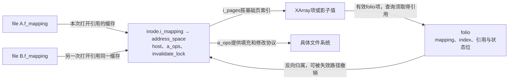
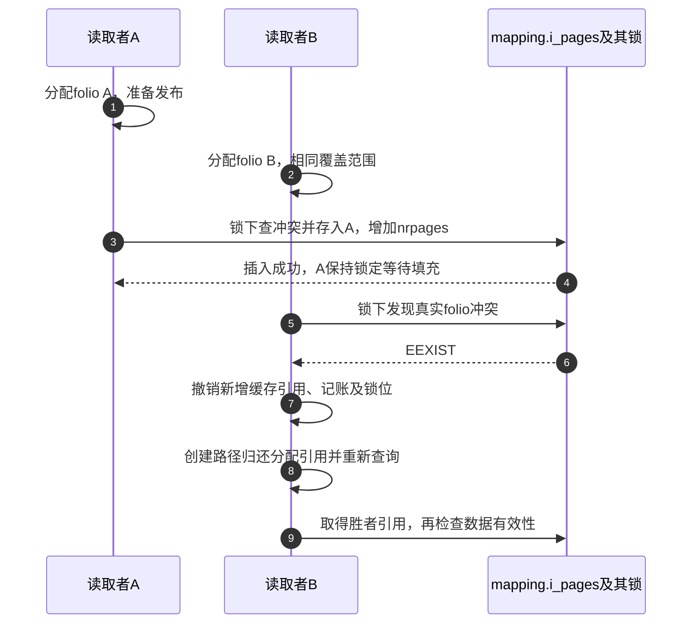

# 第34章\_页缓存归属索引与竞争插入

两个读取者同时发现文件偏移没有缓存，不能靠各自分配成功就认为自己取得了该偏移的权威内容。还要在共享索引中决定谁发布，并让查询者取得可继续使用的引用。本页展开C0～C1，数据有效性由下一页处理。

| 阅读关联 | 入口 |
| --- | --- |
| 问题与状态 | [页缓存正文](../../../../knowledge/kernel_subsystems/vfs/P15_address_space_folio与页缓存.md#15.2_共享索引与folio的几组独立状态) |
| 模块与版本 | [页缓存导读](../navigation/P14_页缓存的数据有效性与修改交接.md#14.1_把共享缓存与单次请求分开追踪)、[总索引](../navigation/P01_Linux_6.12_VFS源码阅读索引.md#1.1_先固定源码身份与运行证据) |
| 固定原件 | [fs.h](../../linux/include/linux/fs.h)、[inode.c](../../linux/fs/inode.c)、[filemap.c](../../linux/mm/filemap.c)、[pagemap.h](../../linux/include/linux/pagemap.h) |

固定提交 `dfaf2136deb2af2e60b994421281ba42f1c087e0`。两个插入函数在pagemap.h声明、filemap.c定义；批量读取辅助为filemap.c内的static函数。这里展开页缓存对XArray的使用协议，XArray内部节点分配和平衡算法不属于本页；通用查询与对象引用边界可对照 [XArray查询](../../kref/source_explanations/lib/xarray.c.md#1.1_查询内部读侧窗口在返回前结束)。

## 34.1\_mapping把共享对象与偏移索引连起来

普通文件inode内嵌i_data。inode_init_once经__address_space_init_once初始化i_pages、映射树和私有链表锁；inode_init_always_gfp在对象用于当前inode时设置host、空a_ops、标志、错误初值、分配属性及invalidate_lock，并将i_mapping指向i_data。具体文件系统随后装入自己的a_ops。open的do_dentry_open把inode->i_mapping交给file->f_mapping，见 [打开对象建立](P26_file初始化与打开后失败清理.md#26.3_具体打开前取得自己的持有与操作表)。这些是不同生命周期阶段，不能只把一个指针赋值当成整个缓存初始化。

| 当前实例状态 | 保存位置与读写职责 |
| --- | --- |
| host、a_ops | address_space内；inode初始化与文件系统设置，读写路径找到inode及后端回调 |
| i_pages | address_space内的XArray；索引单位为基础页，插入/删除改变成员关系，查询按偏移定位 |
| nrpages | 在i_pages锁保护下按基础页数记账，不是folio对象个数 |
| folio.mapping、index | 插入者建立反向归属和起始索引；截断等路径可撤销归属，持有引用不保证一直属于原mapping |
| folio引用 | 查询者、页缓存等分别承担；只有持有有效引用才能离开读侧保护继续使用 |
| invalidate_lock | 协调缓存填充和文件偏移到后端块映射的失效，不替代XArray修改锁 |
| folio锁与有效位 | 协调内容准备及完成，查到指针不自动取得锁或有效数据 |
| f_ra | 每个file的预读历史；缓存本身仍由共享mapping组织 |



folio可覆盖一个或多个连续基础页，index是起始基础页编号。xa_is_value识别的影子值记录回收历史等信息，不是可以复制的folio；看到非空项也要先识别类型。当前正文不假定本配置实际分配了大folio。

**实现原理与修改边界**：初始化、成员关系、引用、内容有效性分别建立。若增加mapping字段或改变folio粒度，必须同步检查构造/复用、index对齐、nrpages单位、失效路径及文件系统回调，不能只改查询端的移位量。

## 34.2\_插入者在共享索引中决出归属

filemap_add_folio先进行内存控制组记账，设置新folio的锁定位，再进入真正索引插入。成功后进行工作集与LRU管理；失败时撤销记账和本次设置的锁位，调用者仍负责归还自己的分配引用。

```c
/** @brief 仓库补充阅读说明：建立计费和锁定状态，插入成功后接入回收管理。 */
int filemap_add_folio(struct address_space *mapping, struct folio *folio,
                                pgoff_t index, gfp_t gfp)
{
        void *shadow = NULL;
        int ret;

        /* 仓库补充：记账失败时尚未发布到缓存。 */
        ret = mem_cgroup_charge(folio, NULL, gfp);
        if (ret)
                return ret;

        __folio_set_locked(folio);
        ret = __filemap_add_folio(mapping, folio, index, gfp, &shadow);
        if (unlikely(ret)) {
                mem_cgroup_uncharge(folio);
                __folio_clear_locked(folio);
        } else {
                /*
                 * The folio might have been evicted from cache only
                 * recently, in which case it should be activated like
                 * any other repeatedly accessed folio.
                 * The exception is folios getting rewritten; evicting other
                 * data from the working set, only to cache data that will
                 * get overwritten with something else, is a waste of memory.
                 */
                WARN_ON_ONCE(folio_test_active(folio));
                if (!(gfp & __GFP_WRITE) && shadow)
                        workingset_refault(folio, shadow);
                folio_add_lru(folio);
        }
        return ret;
}
```

__filemap_add_folio先为缓存增加相应引用并设置mapping/index，再在XArray锁下检查重叠范围。存在真实folio时返回EEXIST；影子值可按粒度拆分后替换。节点分配可能失败，因此代码退出自旋锁分配或重试，而不是持锁执行任意可睡眠工作。

```c
/** @brief 仓库补充阅读说明：在索引锁下核对冲突并发布，失败回滚缓存引用。 */
noinline int __filemap_add_folio(struct address_space *mapping,
                struct folio *folio, pgoff_t index, gfp_t gfp, void **shadowp)
{
        XA_STATE(xas, &mapping->i_pages, index);
        void *alloced_shadow = NULL;
        int alloced_order = 0;
        bool huge;
        long nr;

        VM_BUG_ON_FOLIO(!folio_test_locked(folio), folio);
        VM_BUG_ON_FOLIO(folio_test_swapbacked(folio), folio);
        VM_BUG_ON_FOLIO(folio_order(folio) < mapping_min_folio_order(mapping),
                        folio);
        mapping_set_update(&xas, mapping);

        VM_BUG_ON_FOLIO(index & (folio_nr_pages(folio) - 1), folio);
        xas_set_order(&xas, index, folio_order(folio));
        huge = folio_test_hugetlb(folio);
        nr = folio_nr_pages(folio);

        gfp &= GFP_RECLAIM_MASK;
        /* 仓库补充：先建立缓存引用，失败路径必须撤销。 */
        folio_ref_add(folio, nr);
        folio->mapping = mapping;
        folio->index = xas.xa_index;

        for (;;) {
                int order = -1, split_order = 0;
                void *entry, *old = NULL;

                xas_lock_irq(&xas);
                xas_for_each_conflict(&xas, entry) {
                        old = entry;
                        if (!xa_is_value(entry)) {
                                xas_set_err(&xas, -EEXIST);
                                goto unlock;
                        }
                        /*
                         * If a larger entry exists,
                         * it will be the first and only entry iterated.
                         */
                        if (order == -1)
                                order = xas_get_order(&xas);
                }

                /* entry may have changed before we re-acquire the lock */
                if (alloced_order && (old != alloced_shadow || order != alloced_order)) {
                        xas_destroy(&xas);
                        alloced_order = 0;
                }

                if (old) {
                        if (order > 0 && order > folio_order(folio)) {
                                /* How to handle large swap entries? */
                                BUG_ON(shmem_mapping(mapping));
                                if (!alloced_order) {
                                        split_order = order;
                                        goto unlock;
                                }
                                xas_split(&xas, old, order);
                                xas_reset(&xas);
                        }
                        if (shadowp)
                                *shadowp = old;
                }

                /* 仓库补充：真实项冲突已排除，在索引锁内发布。 */
                xas_store(&xas, folio);
                if (xas_error(&xas))
                        goto unlock;

                mapping->nrpages += nr;

                /* hugetlb pages do not participate in page cache accounting */
                if (!huge) {
                        __lruvec_stat_mod_folio(folio, NR_FILE_PAGES, nr);
                        if (folio_test_pmd_mappable(folio))
                                __lruvec_stat_mod_folio(folio,
                                                NR_FILE_THPS, nr);
                }

unlock:
                xas_unlock_irq(&xas);

                /* split needed, alloc here and retry. */
                if (split_order) {
                        xas_split_alloc(&xas, old, split_order, gfp);
                        if (xas_error(&xas))
                                goto error;
                        alloced_shadow = old;
                        alloced_order = split_order;
                        xas_reset(&xas);
                        continue;
                }

                if (!xas_nomem(&xas, gfp))
                        break;
        }

        if (xas_error(&xas))
                goto error;

        trace_mm_filemap_add_to_page_cache(folio);
        return 0;
error:
        folio->mapping = NULL;
        /* Leave page->index set: truncation relies upon it */
        folio_put_refs(folio, nr);
        return xas_error(&xas);
}
```

| 符号簇 | 本次作用与边界 |
| --- | --- |
| XA_STATE、xas_set_order | 在调用栈建立索引游标，记录新folio覆盖的基础页范围 |
| xas_lock_irq、xas_unlock_irq | 保护冲突检查、发布和nrpages；不同于folio内容锁 |
| xas_for_each_conflict、xa_is_value | 拒绝重叠真实缓存项，识别允许替换的影子信息 |
| xas_split_alloc、xas_split、xas_nomem | 处理较大影子项及索引节点内存，退出锁后准备再复查，不能沿用旧观察 |
| folio_ref_add、folio_put_refs | 建立或撤销缓存承担的基础页计数；失败不消费调用者原始引用 |
| mem_cgroup_charge/uncharge | 当前MEMCG开启，记账失败可阻止插入；成功插入后不能随意撤销对应计费 |
| workingset_refault、folio_add_lru | 维护回收策略；不是把数据标为uptodate，也不提交读取 |
| VM_BUG_ON_FOLIO、WARN_ON_ONCE | 检查锁定、类型、对齐或活动状态等不变量，不能代替正常同步；当前DEBUG_VM关闭 |
| trace与ALLOW_ERROR_INJECTION | 观测和故障注入标记，不建立缓存成员或引用 |

错误路径清除folio->mapping并撤销新增缓存引用，保留index供相关截断逻辑使用。因此“index还有旧值”不能作为仍在缓存中的证据。hugetlb分支跳过一般页缓存统计，不能将nrpages、folio数与所有内存统计当成相同量。



**实现原理与修改边界**：成功发布必须对应缓存引用和计数，失败必须回滚本次增加的部分。改变冲突处理时同时验证真实项、影子项、分配失败和重试窗口；不能把EEXIST当成读取失败永久退出，也不能把失败候选当成已发布对象交给后端。

## 34.3\_查询取得引用后仍要复查索引

filemap_get_read_batch在RCU保护内遍历，先排除重试项、异常值及不适合继续处理的兄弟项，再folio_try_get取得引用。随后xas_reload验证该位置仍对应同一folio；若变化，归还引用、重置游标重试。

```c
/** @brief 仓库补充阅读说明：取得引用后复查索引身份，建立本次持有批次。 */
static void filemap_get_read_batch(struct address_space *mapping,
                pgoff_t index, pgoff_t max, struct folio_batch *fbatch)
{
        XA_STATE(xas, &mapping->i_pages, index);
        struct folio *folio;

        rcu_read_lock();
        for (folio = xas_load(&xas); folio; folio = xas_next(&xas)) {
                if (xas_retry(&xas, folio))
                        continue;
                if (xas.xa_index > max || xa_is_value(folio))
                        break;
                if (xa_is_sibling(folio))
                        break;
                if (!folio_try_get(folio))
                        goto retry;

                /* 仓库补充：取得引用后重新验证索引身份。 */
                if (unlikely(folio != xas_reload(&xas)))
                        goto put_folio;

                if (!folio_batch_add(fbatch, folio))
                        break;
                if (!folio_test_uptodate(folio))
                        break;
                if (folio_test_readahead(folio))
                        break;
                xas_advance(&xas, folio_next_index(folio) - 1);
                continue;
put_folio:
                folio_put(folio);
retry:
                xas_reset(&xas);
        }
        rcu_read_unlock();
}
```

fbatch是调用栈上的folio_batch，保存已取得引用的指针，批次后续退出时逐一folio_put。folio_batch_add返回容量状态；批次遇到尚未uptodate或带预读标志的folio就停止继续收集，让调用者先解决最后这一项的问题。xas_advance跨过当前大folio已覆盖的索引，避免将同一对象当成多个独立缓存页。

RCU避免索引遍历期间相关内存过早失效，但不会替调用者持有folio；try_get成功也不足以证明索引身份没变。重新验证的是查询交接时的成员关系，后续仍可能遇到truncate，因此下页在取得内容锁后继续检查mapping。

**实现原理与修改边界**：引用取得、索引复查和失败归还不可拆散。修改批次终止条件时同步检查调用者对最后一项、容量和引用数量的假设；不能把返回批次中每一项都当作数据已有效，更不能因有RCU就删除folio引用。当前只有源码核对，未执行多核同索引竞争或分配失败注入。
