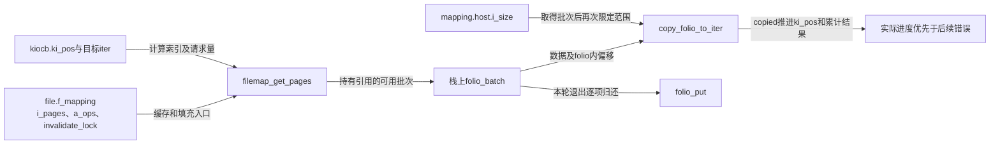
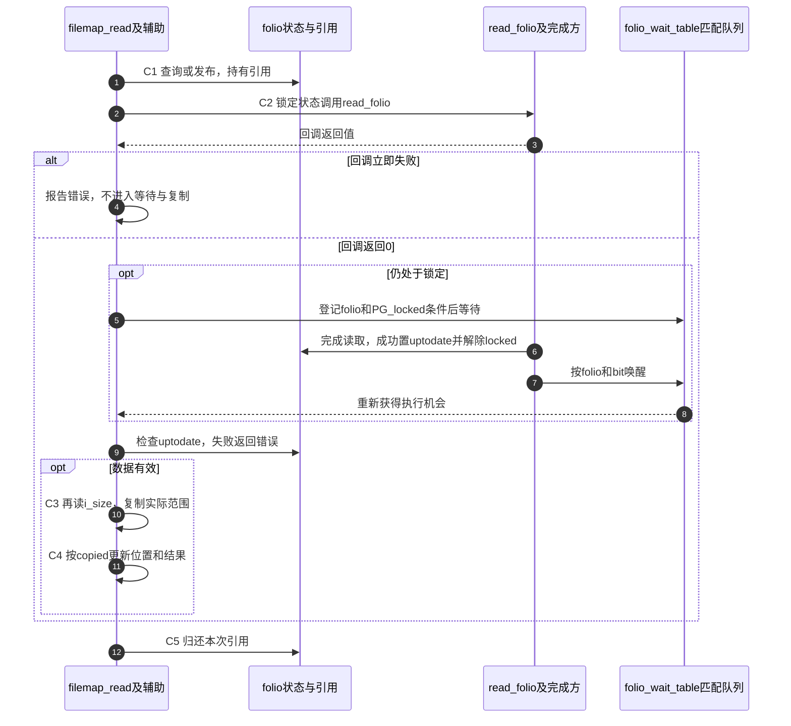

# 第35章\_缓存读的填充等待与有效范围

缓存索引解决了“哪个folio代表这段文件”，还没有解决“现在能否从它复制”。本页沿C1～C5追踪普通缓存读，把未命中、正在填充、截断重试和部分进度放回同一个请求。

| 阅读关联 | 入口 |
| --- | --- |
| 问题与时序 | [缓存读正文](../../../../knowledge/kernel_subsystems/vfs/P15_address_space_folio与页缓存.md#15.3_一次缓存读如何从索引走到用户缓冲) |
| 模块与身份 | [导读](../navigation/P14_页缓存的数据有效性与修改交接.md#14.1_把共享缓存与单次请求分开追踪)、[总索引](../navigation/P01_Linux_6.12_VFS源码阅读索引.md#1.1_先固定源码身份与运行证据) |
| 原件 | [filemap.c](../../linux/mm/filemap.c)、[pagemap.h](../../linux/include/linux/pagemap.h)、[page-flags.h](../../linux/include/linux/page-flags.h)、[VFS接口说明](../../linux/Documentation/filesystems/vfs.rst) |

固定提交 `dfaf2136deb2af2e60b994421281ba42f1c087e0`。filemap_read在fs.h声明，folio_end_read在pagemap.h声明；其余本页函数为filemap.c内部辅助。前者可供文件系统迭代读使用，不能由此推断所有.read_iter都调用它。普通同步请求不设置IOCB_WAITQ，本页解释条件分支的责任，不宣称已执行异步等待测试。

## 35.1\_读入口把批次与实际复制进度连接起来

filemap_read先限制最大文件范围，建立栈上fbatch，然后按当前位置取得缓存批次。确认数据可用后再次读i_size，才计算本次可复制的范围；否则并发缩短文件时，可能把folio尾部的内容误当成仍属于文件的字节。

```c
/** @brief 仓库补充阅读说明：按有效内容和当前长度复制，保留实际进度并归还批次。 */
ssize_t filemap_read(struct kiocb *iocb, struct iov_iter *iter,
                ssize_t already_read)
{
        struct file *filp = iocb->ki_filp;
        struct file_ra_state *ra = &filp->f_ra;
        struct address_space *mapping = filp->f_mapping;
        struct inode *inode = mapping->host;
        struct folio_batch fbatch;
        int i, error = 0;
        bool writably_mapped;
        loff_t isize, end_offset;
        loff_t last_pos = ra->prev_pos;

        if (unlikely(iocb->ki_pos >= inode->i_sb->s_maxbytes))
                return 0;
        if (unlikely(!iov_iter_count(iter)))
                return 0;

        iov_iter_truncate(iter, inode->i_sb->s_maxbytes - iocb->ki_pos);
        folio_batch_init(&fbatch);

        do {
                cond_resched();

                /*
                 * If we've already successfully copied some data, then we
                 * can no longer safely return -EIOCBQUEUED. Hence mark
                 * an async read NOWAIT at that point.
                 */
                if ((iocb->ki_flags & IOCB_WAITQ) && already_read)
                        iocb->ki_flags |= IOCB_NOWAIT;

                if (unlikely(iocb->ki_pos >= i_size_read(inode)))
                        break;

                error = filemap_get_pages(iocb, iter->count, &fbatch, false);
                if (error < 0)
                        break;

                /*
                 * i_size must be checked after we know the pages are Uptodate.
                 *
                 * Checking i_size after the check allows us to calculate
                 * the correct value for "nr", which means the zero-filled
                 * part of the page is not copied back to userspace (unless
                 * another truncate extends the file - this is desired though).
                 */
                /* 仓库补充：得到有效批次后再次限定文件长度。 */
                isize = i_size_read(inode);
                if (unlikely(iocb->ki_pos >= isize))
                        goto put_folios;
                end_offset = min_t(loff_t, isize, iocb->ki_pos + iter->count);

                /*
                 * Once we start copying data, we don't want to be touching any
                 * cachelines that might be contended:
                 */
                writably_mapped = mapping_writably_mapped(mapping);

                /*
                 * When a read accesses the same folio several times, only
                 * mark it as accessed the first time.
                 */
                if (!pos_same_folio(iocb->ki_pos, last_pos - 1,
                                    fbatch.folios[0]))
                        folio_mark_accessed(fbatch.folios[0]);

                for (i = 0; i < folio_batch_count(&fbatch); i++) {
                        struct folio *folio = fbatch.folios[i];
                        size_t fsize = folio_size(folio);
                        size_t offset = iocb->ki_pos & (fsize - 1);
                        size_t bytes = min_t(loff_t, end_offset - iocb->ki_pos,
                                             fsize - offset);
                        size_t copied;

                        if (end_offset < folio_pos(folio))
                                break;
                        if (i > 0)
                                folio_mark_accessed(folio);
                        /*
                         * If users can be writing to this folio using arbitrary
                         * virtual addresses, take care of potential aliasing
                         * before reading the folio on the kernel side.
                         */
                        if (writably_mapped)
                                flush_dcache_folio(folio);

                        copied = copy_folio_to_iter(folio, offset, bytes, iter);

                        /* 仓库补充：以实际复制量推进，不使用计划字节数。 */
                        already_read += copied;
                        iocb->ki_pos += copied;
                        last_pos = iocb->ki_pos;

                        if (copied < bytes) {
                                error = -EFAULT;
                                break;
                        }
                }
put_folios:
                for (i = 0; i < folio_batch_count(&fbatch); i++)
                        folio_put(fbatch.folios[i]);
                folio_batch_init(&fbatch);
        } while (iov_iter_count(iter) && iocb->ki_pos < isize && !error);

        file_accessed(filp);
        ra->prev_pos = last_pos;
        return already_read ? already_read : error;
}
```

| 参与状态与辅助 | 读写作用 |
| --- | --- |
| ki_pos、iter.count | 请求状态；copy_folio_to_iter按实际复制推进缓冲，外层按copied推进文件位置 |
| fbatch | 本次取得的folio引用集合，每轮put_folios逐个归还并重新初始化 |
| i_size、s_maxbytes | 分别限制当前文件长度和文件系统最大可表示范围，两者不能互换 |
| f_ra.prev_pos、folio_mark_accessed | 记录访问及回收策略，不能证明数据已经复制或写回 |
| mapping_writably_mapped、flush_dcache_folio | 为可能存在可写映射的体系结构缓存别名处理提供入口；不是设备持久化刷新 |
| already_read与error | 保留之前已完成字节；没有进度才返回负错误 |
| file_accessed | 访问时间等文件访问处理，不等于字节复制本身 |
| cond_resched、fatal_signal相关分支 | 长路径调度和中断条件，不能把本函数当成不可睡眠函数 |

这段复制不普遍持有folio内容锁直至整个read返回，也没有提供任意并发写者下的事务快照。引用负责对象存续，范围复查负责该次长度边界，数据竞争语义还取决于具体文件操作及调用者同步。



**实现原理与修改边界**：i_size复查必须位于数据有效性判断之后；字节统计必须使用copied，不能使用原请求长度。调整退出条件要覆盖初始EOF、部分复制后EFAULT、并发缩短、已有already_read以及每条批次归还路径。

## 35.2\_未命中先尝试预读再竞争创建

filemap_get_pages先调用 [批次查询](P34_页缓存归属索引与竞争插入.md#34.3_查询取得引用后仍要复查索引)。没有缓存时先尝试同步预读，再查询；仍无项才在允许阻塞的分支单独创建。预读使用file的f_ra历史、向共享mapping发布数据，并不是每个file拥有自己的缓存副本。

```c
/** @brief 仓库补充阅读说明：连接批次查询、预读、创建和最后一项的有效性处理。 */
static int filemap_get_pages(struct kiocb *iocb, size_t count,
                struct folio_batch *fbatch, bool need_uptodate)
{
        struct file *filp = iocb->ki_filp;
        struct address_space *mapping = filp->f_mapping;
        struct file_ra_state *ra = &filp->f_ra;
        pgoff_t index = iocb->ki_pos >> PAGE_SHIFT;
        pgoff_t last_index;
        struct folio *folio;
        unsigned int flags;
        int err = 0;

        /* "last_index" is the index of the page beyond the end of the read */
        last_index = DIV_ROUND_UP(iocb->ki_pos + count, PAGE_SIZE);
retry:
        if (fatal_signal_pending(current))
                return -EINTR;

        filemap_get_read_batch(mapping, index, last_index - 1, fbatch);
        if (!folio_batch_count(fbatch)) {
                if (iocb->ki_flags & IOCB_NOIO)
                        return -EAGAIN;
                if (iocb->ki_flags & IOCB_NOWAIT)
                        flags = memalloc_noio_save();
                page_cache_sync_readahead(mapping, ra, filp, index,
                                last_index - index);
                if (iocb->ki_flags & IOCB_NOWAIT)
                        memalloc_noio_restore(flags);
                filemap_get_read_batch(mapping, index, last_index - 1, fbatch);
        }
        if (!folio_batch_count(fbatch)) {
                if (iocb->ki_flags & (IOCB_NOWAIT | IOCB_WAITQ))
                        return -EAGAIN;
                err = filemap_create_folio(filp, mapping, iocb->ki_pos, fbatch);
                if (err == AOP_TRUNCATED_PAGE)
                        goto retry;
                return err;
        }

        folio = fbatch->folios[folio_batch_count(fbatch) - 1];
        if (folio_test_readahead(folio)) {
                err = filemap_readahead(iocb, filp, mapping, folio, last_index);
                if (err)
                        goto err;
        }
        if (!folio_test_uptodate(folio)) {
                if ((iocb->ki_flags & IOCB_WAITQ) &&
                    folio_batch_count(fbatch) > 1)
                        iocb->ki_flags |= IOCB_NOWAIT;
                err = filemap_update_page(iocb, mapping, count, folio,
                                          need_uptodate);
                if (err)
                        goto err;
        }

        trace_mm_filemap_get_pages(mapping, index, last_index - 1);
        return 0;
err:
        if (err < 0)
                folio_put(folio);
        /* 仓库补充：最后一项出错时仍保留前面的可用批次。 */
        if (likely(--fbatch->nr))
                return 0;
        if (err == AOP_TRUNCATED_PAGE)
                goto retry;
        return err;
}
```

最后一个folio可能带预读标志或未uptodate。filemap_readahead通过DEFINE_READAHEAD建立本次控制描述，再page_cache_async_ra推动后续范围；它遇到IOCB_NOIO会拒绝。IOCB_NOWAIT与NOIO不能画成同一个开关：本实现的NOWAIT未命中仍可在memalloc_noio_save/restore范围尝试预读，之后不允许创建等待式补读。NOIO则更早拒绝发起该预读。

| 关键分支 | 结果与引用责任 |
| --- | --- |
| 当前任务有fatal signal | 返回EINTR，不继续建立新批次 |
| 空批次且NOIO | EAGAIN，不发起新读取 |
| 预读后仍空且NOWAIT或WAITQ | EAGAIN；普通阻塞路径才进入创建辅助 |
| 最后一项需要更新 | 先完成或重试该项，不能将未有效内容直接交给复制 |
| 最后一项失败但前面有项 | 移除最后一项，保留前面已有的可用批次，让上层报告进度 |
| AOP_TRUNCATED_PAGE | 内部重新查询信号，不是直接交给应用的errno；引用归还由产生该结果的路径完成 |

```c
/** @brief 仓库补充阅读说明：按mapping粒度分配和发布，冲突时重新查询。 */
static int filemap_create_folio(struct file *file,
                struct address_space *mapping, loff_t pos,
                struct folio_batch *fbatch)
{
        struct folio *folio;
        int error;
        unsigned int min_order = mapping_min_folio_order(mapping);
        pgoff_t index;

        folio = filemap_alloc_folio(mapping_gfp_mask(mapping), min_order);
        if (!folio)
                return -ENOMEM;

        /*
         * Protect against truncate / hole punch. Grabbing invalidate_lock
         * here assures we cannot instantiate and bring uptodate new
         * pagecache folios after evicting page cache during truncate
         * and before actually freeing blocks.  Note that we could
         * release invalidate_lock after inserting the folio into
         * the page cache as the locked folio would then be enough to
         * synchronize with hole punching. But there are code paths
         * such as filemap_update_page() filling in partially uptodate
         * pages or ->readahead() that need to hold invalidate_lock
         * while mapping blocks for IO so let's hold the lock here as
         * well to keep locking rules simple.
         */
        filemap_invalidate_lock_shared(mapping);
        index = (pos >> (PAGE_SHIFT + min_order)) << min_order;
        error = filemap_add_folio(mapping, folio, index,
                        mapping_gfp_constraint(mapping, GFP_KERNEL));
        /* 仓库补充：其他发布者胜出时转换为重新查询。 */
        if (error == -EEXIST)
                error = AOP_TRUNCATED_PAGE;
        if (error)
                goto error;

        error = filemap_read_folio(file, mapping->a_ops->read_folio, folio);
        if (error)
                goto error;

        filemap_invalidate_unlock_shared(mapping);
        folio_batch_add(fbatch, folio);
        return 0;
error:
        filemap_invalidate_unlock_shared(mapping);
        folio_put(folio);
        return error;
}
```

创建辅助按mapping最小folio阶数分配并对齐基础页索引，取得invalidate_lock共享侧后插入。EEXIST转换为重新查询，因为另一个发布者可能先成功。失败时归还当前分配引用；成功加入fbatch后由上层归还。缓存自身的引用与此引用分别记账。

invalidate_lock共享侧覆盖从发布到填充：防止失效方已经清掉缓存、尚未释放旧块映射的窗口中，读取者又根据旧映射装入内容。这个锁不让两个正常填充者互斥；相同索引的发布由XArray冲突规则解决。

**实现原理与修改边界**：修改预读与创建顺序要同时保持IOCB标志边界和失败引用责任。尤其不能在AOP_TRUNCATED_PAGE分支再次folio_put，或把最后一项错误直接抹掉此前可用批次。预读算法内部如何决定窗口大小由内存管理策略负责，本页只解释调用参数、发布和回退协议。

## 35.3\_等待填充之后必须重新检查有效性

filemap_update_page先取得invalidate_lock共享侧，再尝试folio锁。普通等待路径取得锁失败时，先退出mapping共享锁，再folio_put_wait_locked释放当前引用并等待原填充者，随后返回重新查询信号；不能带着陈旧成员身份直接继续复制。

```c
/** @brief 仓库补充阅读说明：在失效协调中取得内容锁，检查归属并填充或重试。 */
static int filemap_update_page(struct kiocb *iocb,
                struct address_space *mapping, size_t count,
                struct folio *folio, bool need_uptodate)
{
        int error;

        if (iocb->ki_flags & IOCB_NOWAIT) {
                if (!filemap_invalidate_trylock_shared(mapping))
                        return -EAGAIN;
        } else {
                filemap_invalidate_lock_shared(mapping);
        }

        if (!folio_trylock(folio)) {
                error = -EAGAIN;
                if (iocb->ki_flags & (IOCB_NOWAIT | IOCB_NOIO))
                        goto unlock_mapping;
                if (!(iocb->ki_flags & IOCB_WAITQ)) {
                        filemap_invalidate_unlock_shared(mapping);
                        /*
                         * This is where we usually end up waiting for a
                         * previously submitted readahead to finish.
                         */
                        /* 仓库补充：这一等待路径归还当前引用，随后必须重新查询。 */
                        folio_put_wait_locked(folio, TASK_KILLABLE);
                        return AOP_TRUNCATED_PAGE;
                }
                error = __folio_lock_async(folio, iocb->ki_waitq);
                if (error)
                        goto unlock_mapping;
        }

        error = AOP_TRUNCATED_PAGE;
        /* 仓库补充：锁定之后仍须检查是否已被移出缓存。 */
        if (!folio->mapping)
                goto unlock;

        error = 0;
        if (filemap_range_uptodate(mapping, iocb->ki_pos, count, folio,
                                   need_uptodate))
                goto unlock;

        error = -EAGAIN;
        if (iocb->ki_flags & (IOCB_NOIO | IOCB_NOWAIT | IOCB_WAITQ))
                goto unlock;

        error = filemap_read_folio(iocb->ki_filp, mapping->a_ops->read_folio,
                        folio);
        goto unlock_mapping;
unlock:
        folio_unlock(folio);
unlock_mapping:
        filemap_invalidate_unlock_shared(mapping);
        if (error == AOP_TRUNCATED_PAGE)
                folio_put(folio);
        return error;
}
```

拿到folio锁以后，mapping已经撤销就解锁、归还引用并重新查。仍有归属时先检查所需范围：整个folio有效可直接使用；某些文件系统提供局部有效性判断，允许本次范围有效而全folio尚未uptodate。需要整个folio有效的调用方则不能走局部例外。

```c
/** @brief 仓库补充阅读说明：区分整个folio有效与后端提供的局部有效范围。 */
static bool filemap_range_uptodate(struct address_space *mapping,
                loff_t pos, size_t count, struct folio *folio,
                bool need_uptodate)
{
        if (folio_test_uptodate(folio))
                return true;
        /* pipes can't handle partially uptodate pages */
        /* 仓库补充：要求整个folio有效时不能使用局部有效例外。 */
        if (need_uptodate)
                return false;
        if (!mapping->a_ops->is_partially_uptodate)
                return false;
        if (mapping->host->i_blkbits >= folio_shift(folio))
                return false;

        if (folio_pos(folio) > pos) {
                count -= folio_pos(folio) - pos;
                pos = 0;
        } else {
                pos -= folio_pos(folio);
        }

        return mapping->a_ops->is_partially_uptodate(folio, pos, count);
}
```

is_partially_uptodate属于a_ops回调，由文件系统解释子块有效状态；其偏移是folio内偏移。i_blkbits及folio_shift用于判断子块和folio粒度，不能把“局部有效”解释成任意忽略未初始化字节。

```c
/** @brief 仓库补充阅读说明：提交填充后等待锁解除，并检查有效状态。 */
static int filemap_read_folio(struct file *file, filler_t filler,
                struct folio *folio)
{
        bool workingset = folio_test_workingset(folio);
        unsigned long pflags;
        int error;

        /* Start the actual read. The read will unlock the page. */
        if (unlikely(workingset))
                psi_memstall_enter(&pflags);
        error = filler(file, folio);
        if (unlikely(workingset))
                psi_memstall_leave(&pflags);
        if (error)
                return error;

        /* 仓库补充：回调返回成功不等于异步填充已经结束。 */
        error = folio_wait_locked_killable(folio);
        if (error)
                return error;
        if (folio_test_uptodate(folio))
                return 0;
        if (file)
                shrink_readahead_size_eio(&file->f_ra);
        return -EIO;
}
```

filler在这里通常是a_ops->read_folio。调用前folio已锁定；后端可以同步完成，也可以提交I/O后返回。返回0只表明该回调没有立即报错，filemap_read_folio还要等待锁解除，再检查uptodate。完成仍无有效数据时返回EIO并缩小该file的预读规模；等待被致命信号打断也会返回相应错误。

PSI的memstall进入/退出只记录工作集相关等待压力，当前CONFIG_PSI关闭，不承担完成握手。IOCB_WAITQ分支使用ki_waitq和__folio_lock_async，允许登记异步等待；它有不同的请求生命期，不可套用上一章栈上同步kiocb的返回规则。

**实现原理与修改边界**：等待、重新查询、锁与引用归还是一组协议。改为继续使用原folio时，必须重新证明引用和mapping身份；不能只删掉一次重查。改变局部有效判定时，要核对文件系统子块单位、请求起点、need_uptodate及读错误路径。

## 35.4\_完成方更新状态再唤醒对应等待者

folio_end_read供完成方在全部读取结束后使用：成功则同时改变uptodate和locked，失败只解除locked；随后在存在等待者时唤醒PG_locked对应等待。它要求入参仍锁定且尚未uptodate，不能对已经完成的folio重复调用。

```c
/** @brief 仓库补充阅读说明：完成方发布有效结果、解除锁定位并唤醒匹配等待者。 */
void folio_end_read(struct folio *folio, bool success)
{
        unsigned long mask = 1 << PG_locked;

        /* Must be in bottom byte for x86 to work */
        BUILD_BUG_ON(PG_uptodate > 7);
        VM_BUG_ON_FOLIO(!folio_test_locked(folio), folio);
        VM_BUG_ON_FOLIO(folio_test_uptodate(folio), folio);

        /* 仓库补充：失败也必须解锁，但不发布uptodate。 */
        if (likely(success))
                mask |= 1 << PG_uptodate;
        if (folio_xor_flags_has_waiters(folio, mask))
                folio_wake_bit(folio, PG_locked);
}
```

| 状态或辅助 | 初始化、修改与消费 |
| --- | --- |
| PG_locked、PG_uptodate | 前者表明内容操作尚未交接，后者表明全folio内容有效；完成方修改，读者分别等待及核查 |
| folio_xor_flags_has_waiters | page-flags.h中的完成侧标志辅助，在持锁协议下修改指定低位并返回是否有等待者；不适用于可在不持folio锁时改变的dirty位 |
| folio_wait_table | filemap.c内256个哈希等待队列，pagecache_init初始化；按folio地址散列选队列 |
| 等待记录与wait_page_key | 用folio指针和bit编号区分条件；不同folio可落在同一队列，不能只按哈希桶认定完成 |
| folio_wait_locked_killable | pagemap.h先检查锁位，必要时进入可被致命信号打断的位等待；持有引用时才可使用该等待契约 |
| folio_wake_bit | 在队列锁下按key唤醒匹配等待者，并维护waiters提示；唤醒后读者仍检查实际条件 |
| BUILD_BUG_ON、VM_BUG_ON_FOLIO | 前者编译期核对位布局，后者检查运行不变量；当前DEBUG_VM关闭，不能把它当成自动修复错误状态的机制 |

等待使用睡眠和定向唤醒，不要求CPU循环读锁位。普通等待队列机制见 [模块导读](../../waiting_notification/navigation/P02_Linux_6.12_普通等待队列模块源码概念导读.md#2.3_等待侧调用链)，本实例额外用folio和bit筛选同桶等待者。folio_end_read允许进程或中断上下文调用，不允许NMI；这里不展开体系结构位操作指令。



**实现原理与修改边界**：状态发布必须早于等待者据此继续，唤醒不能代替有效位。加入新等待条件须同时检查初始化、哈希匹配、锁位更新、失败解除和引用范围；不能将正常完成重复调用，也不能把dirty位加入这个完成侧异或掩码。当前未执行I/O错误、信号中断或并发truncate实测。
