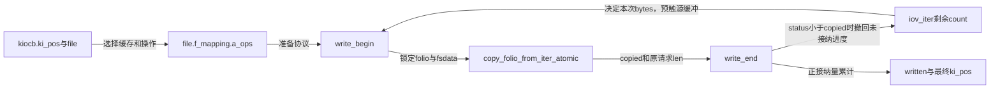
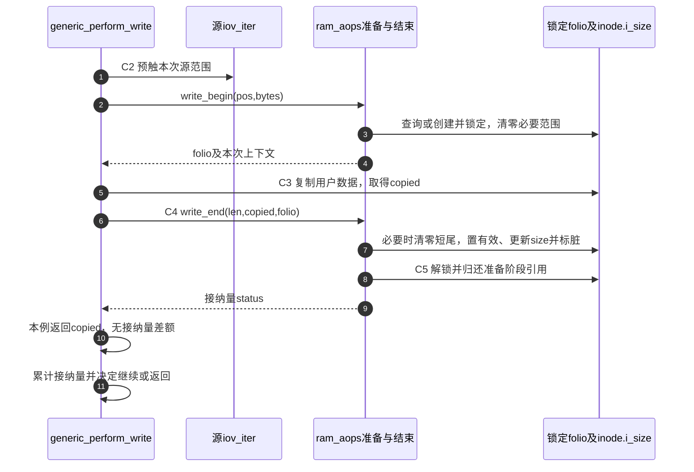

# 第36章\_缓冲写的准备接纳与标脏

把用户字节复制到folio还不是这次写入的全部工作。文件系统要先准备可修改范围，再决定接纳多少字节，更新长度和脏状态，并归还准备阶段取得的资源。本页沿C2～C5区分“尝试复制”和“实际接纳”。

| 阅读关联 | 入口 |
| --- | --- |
| 场景与后续问题 | [缓冲写正文](../../../../knowledge/kernel_subsystems/vfs/P15_address_space_folio与页缓存.md#15.5_缓冲写为什么要先准备再接纳) |
| 模块与身份 | [导读](../navigation/P14_页缓存的数据有效性与修改交接.md#14.1_把共享缓存与单次请求分开追踪)、[总索引](../navigation/P01_Linux_6.12_VFS源码阅读索引.md#1.1_先固定源码身份与运行证据) |
| 原件 | [filemap.c](../../linux/mm/filemap.c)、[libfs.c](../../linux/fs/libfs.c)、[page-writeback.c](../../linux/mm/page-writeback.c)、[VFS接口说明](../../linux/Documentation/filesystems/vfs.rst) |

固定提交 `dfaf2136deb2af2e60b994421281ba42f1c087e0`。generic_perform_write和simple_write_begin在fs.h声明；simple_write_end为libfs.c内部函数，通过同文件ram_aops暴露。folio_mark_dirty由mm.h声明、page-writeback.c定义。本页选ram_aops说明最小状态交接，它的文件数据保存在内存，不能拿它代表磁盘文件系统的分配、日志和持久化实现。

## 36.1\_通用循环以接纳量提交进度

generic_perform_write从file->f_mapping取得a_ops，以当前位置和迭代器剩余范围确定本次块量。先处理用户缓冲缺页，再让write_begin返回锁定folio；这样避免持有目标folio锁后，源缓冲缺页又等待同一个对象产生死锁。预触页不等于永久固定用户页面，所以实际复制仍可能短传输。

```c
/** @brief 仓库补充阅读说明：区分计划、复制和接纳量，配对准备与结束。 */
ssize_t generic_perform_write(struct kiocb *iocb, struct iov_iter *i)
{
        struct file *file = iocb->ki_filp;
        loff_t pos = iocb->ki_pos;
        struct address_space *mapping = file->f_mapping;
        const struct address_space_operations *a_ops = mapping->a_ops;
        size_t chunk = mapping_max_folio_size(mapping);
        long status = 0;
        ssize_t written = 0;

        do {
                struct folio *folio;
                size_t offset;          /* Offset into folio */
                size_t bytes;           /* Bytes to write to folio */
                size_t copied;          /* Bytes copied from user */
                void *fsdata = NULL;

                bytes = iov_iter_count(i);
retry:
                offset = pos & (chunk - 1);
                bytes = min(chunk - offset, bytes);
                balance_dirty_pages_ratelimited(mapping);

                /*
                 * Bring in the user page that we will copy from _first_.
                 * Otherwise there's a nasty deadlock on copying from the
                 * same page as we're writing to, without it being marked
                 * up-to-date.
                 */
                if (unlikely(fault_in_iov_iter_readable(i, bytes) == bytes)) {
                        status = -EFAULT;
                        break;
                }

                if (fatal_signal_pending(current)) {
                        status = -EINTR;
                        break;
                }

                status = a_ops->write_begin(file, mapping, pos, bytes,
                                                &folio, &fsdata);
                if (unlikely(status < 0))
                        break;

                offset = offset_in_folio(folio, pos);
                if (bytes > folio_size(folio) - offset)
                        bytes = folio_size(folio) - offset;

                if (mapping_writably_mapped(mapping))
                        flush_dcache_folio(folio);

                copied = copy_folio_from_iter_atomic(folio, offset, bytes, i);
                flush_dcache_folio(folio);

                /* 仓库补充：准备成功后必须通过结束方法确定接纳量。 */
                status = a_ops->write_end(file, mapping, pos, bytes, copied,
                                                folio, fsdata);
                if (unlikely(status != copied)) {
                        /* 仓库补充：撤回未接纳的描述进度，不是恢复内存旧内容。 */
                        iov_iter_revert(i, copied - max(status, 0L));
                        if (unlikely(status < 0))
                                break;
                }
                cond_resched();

                if (unlikely(status == 0)) {
                        /*
                         * A short copy made ->write_end() reject the
                         * thing entirely.  Might be memory poisoning
                         * halfway through, might be a race with munmap,
                         * might be severe memory pressure.
                         */
                        if (chunk > PAGE_SIZE)
                                chunk /= 2;
                        if (copied) {
                                bytes = copied;
                                goto retry;
                        }
                } else {
                        pos += status;
                        written += status;
                }
        } while (iov_iter_count(i));

        if (!written)
                return status;
        iocb->ki_pos += written;
        return written;
}
```

| 符号与参数 | 作用和修改约束 |
| --- | --- |
| chunk、bytes、offset | 分别是尝试的最大folio块量、本次范围和folio内偏移；write_begin返回的实际folio还会再次限制bytes |
| balance_dirty_pages_ratelimited | 在进入本次修改前按脏页压力节流，不能因为“只写缓存”就认为本函数不会等待 |
| fault_in_iov_iter_readable | 尝试让源范围可读；返回值与bytes比较判断本次完全未能预触，仍须处理随后复制失败 |
| write_begin、folio、fsdata | 成功交出锁定且可修改的folio及文件系统私有上下文，失败时不调用write_end |
| copy_folio_from_iter_atomic | 尝试复制并推进iter；名字中的atomic不表示整次write是不可分割事务 |
| write_end的status | 文件系统最终接纳量，可能小于copied；负责结束准备阶段的资源范围 |
| iov_iter_revert | 撤回尚未被接纳部分的迭代进度，不是把已经写入内存的字节自动恢复为旧内容 |
| flush_dcache_folio | 体系结构数据缓存一致性入口，不是块设备flush或持久化保证 |
| written、pos、ki_pos | 循环按正接纳量推进局部位置与累计量，有进度才将总量交回请求位置 |

write_end返回0时，代码可能降低尝试块量，并在已有copied时缩小本次范围重试。若此前已有正进度，之后错误不会抹掉它；没有进度才返回status。fatal_signal_pending与cond_resched保留可中断/调度机会。不得把这一循环改写成“write_begin成功后总能完成最初bytes”。



**实现原理与修改边界**：bytes、copied、status是三种量。改变复制或回退时同时检查零复制、部分复制、write_end拒绝、信号和已有正进度；任何write_begin成功路径都必须按后端契约结束，不能提前返回遗留folio锁或fsdata。

## 36.2\_ram\_aops怎样兑现最小准备和结束协议

ram_aops是libfs.c定义的常量操作表：read_folio指向simple_read_folio，write_begin/end指向下面两个辅助，dirty_folio指向noop_dirty_folio，没有磁盘写回方法。simple_read_folio把新内容清零、标有效并解锁。这套组合用于ramfs式内存数据，不能把它的清零规则用于覆盖已有磁盘内容。

```c
/** @brief 仓库补充阅读说明：为零填充内存文件取得锁定folio并准备未写区间。 */
int simple_write_begin(struct file *file, struct address_space *mapping,
                        loff_t pos, unsigned len,
                        struct folio **foliop, void **fsdata)
{
        struct folio *folio;

        folio = __filemap_get_folio(mapping, pos / PAGE_SIZE, FGP_WRITEBEGIN,
                        mapping_gfp_mask(mapping));
        if (IS_ERR(folio))
                return PTR_ERR(folio);

        /* 仓库补充：将锁定folio及其退出责任交给本次写协议。 */
        *foliop = folio;

        if (!folio_test_uptodate(folio) && (len != folio_size(folio))) {
                size_t from = offset_in_folio(folio, pos);

                folio_zero_segments(folio, 0, from,
                                from + len, folio_size(folio));
        }
        return 0;
}
```

__filemap_get_folio以FGP_WRITEBEGIN查找或创建：该标志组合包括取得folio锁、写意图、允许创建及稳定写条件。失败为错误指针，IS_ERR/PTR_ERR负责传播；成功的*foliop带着调用方需要结束的持有范围。新folio尚未有效、此次不是整folio覆盖时，辅助将本次写区间之外清零，防止把未初始化内容暴露为文件数据。

```c
/** @brief 仓库补充阅读说明：接纳内存文件修改，更新有效状态与长度并解锁归还。 */
static int simple_write_end(struct file *file, struct address_space *mapping,
                        loff_t pos, unsigned len, unsigned copied,
                        struct folio *folio, void *fsdata)
{
        struct inode *inode = folio->mapping->host;
        loff_t last_pos = pos + copied;

        /* zero the stale part of the folio if we did a short copy */
        if (!folio_test_uptodate(folio)) {
                if (copied < len) {
                        size_t from = offset_in_folio(folio, pos);

                        folio_zero_range(folio, from + copied, len - copied);
                }
                folio_mark_uptodate(folio);
        }
        /*
         * No need to use i_size_read() here, the i_size
         * cannot change under us because we hold the i_mutex.
         */
        if (last_pos > inode->i_size)
                i_size_write(inode, last_pos);

        /* 仓库补充：本例后端标脏后仍要解锁并归还准备引用。 */
        folio_mark_dirty(folio);
        folio_unlock(folio);
        folio_put(folio);

        return copied;
}
```

若实际复制比预期短且folio尚未有效，结束辅助将未填满的目标尾段清零，再标记有效。last_pos超过原长度时更新i_size，随后标脏、解锁、归还引用，返回copied。本例没有另外使用fsdata，并不意味着其他文件系统可以忽略它。

原件注释仍使用i_mutex这个旧名称；本版本inode中的相关写操作串行化锁为i_rwsem。调用者要遵守写与截断互斥条件，不能照旧注释寻找不存在的字段。此辅助没有为i_size变化调用mark_inode_dirty，磁盘文件系统不能直接套用它并假定元数据已登记持久化。



**实现原理与修改边界**：这套辅助只能与适配的零填充读取语义配合。移植到存储文件系统时必须重新设计旧数据保留、空间分配、元数据脏登记、写回和错误传播，不能只更换a_ops表名。修改短复制处理要保证所有可见字节都有定义，同时维持解锁和引用归还。

## 36.3\_标脏按mapping的后端协议执行

folio_mark_dirty先找到当前mapping，清理可能残留的reclaim提示，再分派dirty_folio。没有mapping时使用noop_dirty_folio；调用期间不能让folio被截断，一般可用folio锁满足这一约束，其他路径必须有自己的等效保护。

```c
/** @brief 仓库补充阅读说明：按mapping后端协议标脏，不保证设备写回完成。 */
bool folio_mark_dirty(struct folio *folio)
{
        struct address_space *mapping = folio_mapping(folio);

        if (likely(mapping)) {
                /*
                 * readahead/folio_deactivate could remain
                 * PG_readahead/PG_reclaim due to race with folio_end_writeback
                 * About readahead, if the folio is written, the flags would be
                 * reset. So no problem.
                 * About folio_deactivate, if the folio is redirtied,
                 * the flag will be reset. So no problem. but if the
                 * folio is used by readahead it will confuse readahead
                 * and make it restart the size rampup process. But it's
                 * a trivial problem.
                 */
                if (folio_test_reclaim(folio))
                        folio_clear_reclaim(folio);
                /* 仓库补充：具体标脏动作由当前mapping的方法决定。 */
                return mapping->a_ops->dirty_folio(mapping, folio);
        }

        return noop_dirty_folio(mapping, folio);
}
```

noop_dirty_folio使用folio_test_set_dirty改变脏位，返回是否新变脏，不安排设备写回。存储文件系统的dirty_folio还可能维护块粒度脏信息、i_pages的DIRTY搜索标记及inode的脏记录。单一folio位、索引搜索标记、inode登记是不同层次，不能凭函数名推断所有实现都执行相同动作。

Dirty与Writeback可同时存在：某轮写回仍在进行时，新的修改又需要后续写回；当前轮结束不能顺手抹掉新修改的责任。回写开始、完成、重新标脏和错误序列由 [写回章节](../../../../knowledge/kernel_subsystems/vfs/P16_writeback_fsync与错误传播.md) 继续展开。这里的成功返回只建立本次内存修改和后端接纳结论。

**实现原理与修改边界**：改变标脏入口须同步核对mapping存续、dirty_folio具体实现、写回重脏及inode元数据；不能把noop当成“什么也不做”，也不能把脏位清零当成数据已经持久化。未执行目标Linux编译、复制故障注入或写回期间重新修改的运行验证。
