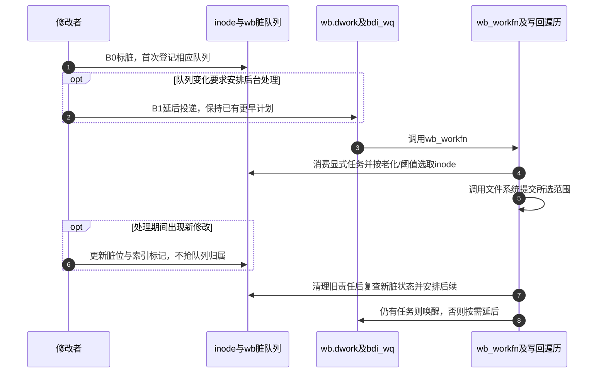

# 第37章\_脏状态登记与写回调度

修改者已经把内容写入folio，但后台执行者不能扫描所有进程的调用栈寻找这些修改。它需要可检索的脏状态、按inode汇聚的队列，以及适当的工作调度。本页沿B0～B1建立这些承载位置，再说明一轮处理如何避免漏掉并发重脏。

| 阅读关联 | 入口 |
| --- | --- |
| 背景与周期 | [写回正文](../../../../knowledge/kernel_subsystems/vfs/P16_writeback_fsync与错误传播.md#16.2_一次修改怎样变成可发现的写回责任) |
| 模块与版本 | [写回导读](../navigation/P15_写回提交完成与错误观察.md#15.1_沿同一周期区分责任与结果)、[总索引](../navigation/P01_Linux_6.12_VFS源码阅读索引.md#1.1_先固定源码身份与运行证据) |
| 原件 | [page-writeback.c](../../linux/mm/page-writeback.c)、[fs-writeback.c](../../linux/fs/fs-writeback.c)、[backing-dev.c](../../linux/mm/backing-dev.c)、[backing-dev-defs.h](../../linux/include/linux/backing-dev-defs.h) |

固定提交 `dfaf2136deb2af2e60b994421281ba42f1c087e0`。__folio_mark_dirty在pagemap.h声明，filemap_dirty_folio在writeback.h声明；__mark_inode_dirty在fs.h声明；wb_workfn通过backing-dev.h供backing-dev.c初始化工作项，两个static辅助只在fs-writeback.c内使用。通用工作队列执行机制由 [工作队列总索引](../../workqueue/navigation/P01_Linux_6.12_工作队列源码总阅读索引.md) 承担，本页只展开wb实例的状态、投递条件和消费过程。

## 37.1\_从folio脏位汇聚到inode待处理状态

上一页的 [folio_mark_dirty](P36_缓冲写的准备接纳与标脏.md#36.3_标脏按mapping的后端协议执行) 分派到具体dirty_folio。本页以filemap_dirty_folio为例：首次设置folio脏位后，维护mapping的索引标记和统计，再以I_DIRTY_PAGES登记inode。已经脏的folio可以快速返回，但调用者必须满足与截断隔离的契约。

```c
/** @brief 仓库补充阅读说明：首次置脏后汇聚到mapping及inode。 */
bool filemap_dirty_folio(struct address_space *mapping, struct folio *folio)
{
        folio_memcg_lock(folio);
        /* 仓库补充：首次置脏后汇聚到mapping及inode。 */
        if (folio_test_set_dirty(folio)) {
                folio_memcg_unlock(folio);
                return false;
        }

        __folio_mark_dirty(folio, mapping, !folio_test_private(folio));
        folio_memcg_unlock(folio);

        if (mapping->host) {
                /* !PageAnon && !swapper_space */
                __mark_inode_dirty(mapping->host, I_DIRTY_PAGES);
        }
        return true;
}
```

```c
/** @brief 仓库补充阅读说明：在索引锁下登记DIRTY标记与记账。 */
void __folio_mark_dirty(struct folio *folio, struct address_space *mapping,
                             int warn)
{
        unsigned long flags;

        xa_lock_irqsave(&mapping->i_pages, flags);
        if (folio->mapping) {   /* Race with truncate? */
                WARN_ON_ONCE(warn && !folio_test_uptodate(folio));
                /* 仓库补充：在索引锁下登记DIRTY标记与记账。 */
                folio_account_dirtied(folio, mapping);
                __xa_set_mark(&mapping->i_pages, folio_index(folio),
                                PAGECACHE_TAG_DIRTY);
        }
        xa_unlock_irqrestore(&mapping->i_pages, flags);
}
```

folio_memcg_lock/unlock使相应记账与folio所属内存控制组变更协调；当前MEMCG开启。XArray锁保护对成员及DIRTY搜索标记的操作，folio_account_dirtied记录新增脏页量。WARN_ON_ONCE检查特定调用约束下的数据有效性，不负责把内容变成有效。统计、搜索标记和脏位是不同状态，不能因它们通常一起更新就视为同一个字段。

| 层次 | 状态地址与消费者 |
| --- | --- |
| 数据对象 | folio中的Dirty位，表示该对象有修改责任 |
| 文件内索引 | mapping->i_pages的PAGECACHE_TAG_DIRTY，使写回可按标记选取范围 |
| 文件对象 | inode->i_state的I_DIRTY_PAGES，汇聚文件数据的待处理状态 |
| 后端队列 | inode->i_io_list挂到所属wb的b_dirty等链表，按工作策略选取inode |
| 调度对象 | wb->dwork与work_list，工作队列执行者取出任务并消费脏队列 |


**实现原理与修改边界**：改变首次标脏判定必须同时维护位、索引标记、计数和inode登记。不能只设置folio位而让后台搜索看不到它，也不能把重复标脏反复计为新增脏页。此路径不适用于用noop_dirty_folio实现且没有设备写回的内存文件。

## 37.2\_第一次登记怎样安排后续工作

__mark_inode_dirty区分inode元数据、数据页和纯时间戳变化。元数据脏登记可能先调用super_operations.dirty_inode，让文件系统处理自己的元数据或日志；仅I_DIRTY_PAGES不经过该回调。随后通过无锁快速检查及i_lock下复查决定是否增加状态。

```c
/** @brief 仓库补充阅读说明：登记inode责任，并按队列归属安排后续写回。 */
void __mark_inode_dirty(struct inode *inode, int flags)
{
        struct super_block *sb = inode->i_sb;
        int dirtytime = 0;
        struct bdi_writeback *wb = NULL;

        trace_writeback_mark_inode_dirty(inode, flags);

        if (flags & I_DIRTY_INODE) {
                /*
                 * Inode timestamp update will piggback on this dirtying.
                 * We tell ->dirty_inode callback that timestamps need to
                 * be updated by setting I_DIRTY_TIME in flags.
                 */
                if (inode->i_state & I_DIRTY_TIME) {
                        spin_lock(&inode->i_lock);
                        if (inode->i_state & I_DIRTY_TIME) {
                                inode->i_state &= ~I_DIRTY_TIME;
                                flags |= I_DIRTY_TIME;
                        }
                        spin_unlock(&inode->i_lock);
                }

                /*
                 * Notify the filesystem about the inode being dirtied, so that
                 * (if needed) it can update on-disk fields and journal the
                 * inode.  This is only needed when the inode itself is being
                 * dirtied now.  I.e. it's only needed for I_DIRTY_INODE, not
                 * for just I_DIRTY_PAGES or I_DIRTY_TIME.
                 */
                trace_writeback_dirty_inode_start(inode, flags);
                if (sb->s_op->dirty_inode)
                        sb->s_op->dirty_inode(inode,
                                flags & (I_DIRTY_INODE | I_DIRTY_TIME));
                trace_writeback_dirty_inode(inode, flags);

                /* I_DIRTY_INODE supersedes I_DIRTY_TIME. */
                flags &= ~I_DIRTY_TIME;
        } else {
                /*
                 * Else it's either I_DIRTY_PAGES, I_DIRTY_TIME, or nothing.
                 * (We don't support setting both I_DIRTY_PAGES and I_DIRTY_TIME
                 * in one call to __mark_inode_dirty().)
                 */
                dirtytime = flags & I_DIRTY_TIME;
                WARN_ON_ONCE(dirtytime && flags != I_DIRTY_TIME);
        }

        /*
         * Paired with smp_mb() in __writeback_single_inode() for the
         * following lockless i_state test.  See there for details.
         */
        smp_mb();

        if ((inode->i_state & flags) == flags)
                return;

        spin_lock(&inode->i_lock);
        if ((inode->i_state & flags) != flags) {
                const int was_dirty = inode->i_state & I_DIRTY;

                inode_attach_wb(inode, NULL);

                /* 仓库补充：登记inode责任，并按队列归属安排后续写回。 */
                inode->i_state |= flags;

                /*
                 * Grab inode's wb early because it requires dropping i_lock and we
                 * need to make sure following checks happen atomically with dirty
                 * list handling so that we don't move inodes under flush worker's
                 * hands.
                 */
                if (!was_dirty) {
                        wb = locked_inode_to_wb_and_lock_list(inode);
                        spin_lock(&inode->i_lock);
                }

                /*
                 * If the inode is queued for writeback by flush worker, just
                 * update its dirty state. Once the flush worker is done with
                 * the inode it will place it on the appropriate superblock
                 * list, based upon its state.
                 */
                if (inode->i_state & I_SYNC_QUEUED)
                        goto out_unlock;

                /*
                 * Only add valid (hashed) inodes to the superblock's
                 * dirty list.  Add blockdev inodes as well.
                 */
                if (!S_ISBLK(inode->i_mode)) {
                        if (inode_unhashed(inode))
                                goto out_unlock;
                }
                if (inode->i_state & I_FREEING)
                        goto out_unlock;

                /*
                 * If the inode was already on b_dirty/b_io/b_more_io, don't
                 * reposition it (that would break b_dirty time-ordering).
                 */
                if (!was_dirty) {
                        struct list_head *dirty_list;
                        bool wakeup_bdi = false;

                        inode->dirtied_when = jiffies;
                        if (dirtytime)
                                inode->dirtied_time_when = jiffies;

                        if (inode->i_state & I_DIRTY)
                                dirty_list = &wb->b_dirty;
                        else
                                dirty_list = &wb->b_dirty_time;

                        wakeup_bdi = inode_io_list_move_locked(inode, wb,
                                                               dirty_list);

                        spin_unlock(&wb->list_lock);
                        spin_unlock(&inode->i_lock);
                        trace_writeback_dirty_inode_enqueue(inode);

                        /*
                         * If this is the first dirty inode for this bdi,
                         * we have to wake-up the corresponding bdi thread
                         * to make sure background write-back happens
                         * later.
                         */
                        if (wakeup_bdi &&
                            (wb->bdi->capabilities & BDI_CAP_WRITEBACK))
                                wb_wakeup_delayed(wb);
                        return;
                }
        }
out_unlock:
        if (wb)
                spin_unlock(&wb->list_lock);
        spin_unlock(&inode->i_lock);
}
```

首次变脏时需要取得所属wb的列表锁，与inode状态一起处理队列归属。已由写回执行者接管的I_SYNC_QUEUED对象只更新状态，由执行者结束时重新安排队列；已经在脏队列上的对象不因每次写入都搬到队尾，否则会破坏时间顺序。未散列的非块设备inode及正在释放的inode也不能被当成普通新任务加入。

| 辅助或状态 | 本实例的意义 |
| --- | --- |
| inode_attach_wb、locked_inode_to_wb_and_lock_list | 建立或取得inode对应的写回实例，按锁顺序取得队列保护；不能在迁移窗口仅凭旧wb指针操作链表 |
| b_dirty、b_io、b_more_io、b_dirty_time | 分别承载待写、当前选中、仍需处理及仅时间戳脏的inode；由list_lock保护 |
| work_list、dwork、work_lock | 承载显式工作和延后执行；与inode队列锁承担不同职责 |
| dirtied_when、dirtied_time_when | 首次脏登记的时间依据，供老化策略判断，不是承诺完成的截止时间 |
| I_SYNC_QUEUED | 表明队列责任由写回执行者接管，不等于设备I/O已完成 |
| I_DIRTY_INODE、I_DIRTY_PAGES、I_DIRTY_TIME | 元数据、数据和延后时间戳责任；本函数不允许任意混合所有组合 |
| smp_mb与快速测试 | 和消费侧清理/复查协议配对，避免并发更新被双方同时忽略；不能替换成只看一次普通变量 |

wb_init在mm/backing-dev.c将wb清零，初始化上述链表、锁及计数，并用INIT_DELAYED_WORK把dwork连接到wb_workfn。backing_dev_info内嵌根wb；源码还具有CONFIG_CGROUP_WRITEBACK下的独立实例和引用分支。当前BLK_CGROUP未开启，不能把控制组写回路径写成当前环境的运行结果。

```c
/** @brief 仓库补充阅读说明：在实例仍注册时投递延后工作。 */
static void wb_wakeup_delayed(struct bdi_writeback *wb)
{
        unsigned long timeout;

        timeout = msecs_to_jiffies(dirty_writeback_interval * 10);
        spin_lock_irq(&wb->work_lock);
        /* 仓库补充：在实例仍注册时投递延后工作。 */
        if (test_bit(WB_registered, &wb->state))
                queue_delayed_work(bdi_wq, &wb->dwork, timeout);
        spin_unlock_irq(&wb->work_lock);
}
```

wb_wakeup_delayed按dirty_writeback_interval换算延后时间，在work_lock下确认WB_registered，再向bdi_wq投递dwork。queue_delayed_work不会为了新的脏写把已经更早排好的执行一再推迟。这里安排的是后续处理机会，不承诺到时所有数据已经持久化。

**实现原理与修改边界**：新增唤醒点要核对是否已有工作、WB_registered生命期和队列责任；修改首次变脏条件时保持时间顺序与I_SYNC_QUEUED交接。不能笼统描述为“每次写都会唤醒一个线程”，也不能说“标脏完全没有通知”。

## 37.3\_工作执行者同时消费任务与检查策略

wb_workfn从delayed_work找回wb。通常反复执行wb_do_writeback直到显式工作列表为空；救援工作线程且实例仍注册时使用有界批量，避免长期占用紧急执行资源。末尾还有任务就再次唤醒，仍有脏数据且周期检查开启则安排延后运行。

```c
/** @brief 仓库补充阅读说明：消费写回工作并按剩余责任再次调度。 */
void wb_workfn(struct work_struct *work)
{
        struct bdi_writeback *wb = container_of(to_delayed_work(work),
                                                struct bdi_writeback, dwork);
        long pages_written;

        set_worker_desc("flush-%s", bdi_dev_name(wb->bdi));

        if (likely(!current_is_workqueue_rescuer() ||
                   !test_bit(WB_registered, &wb->state))) {
                /*
                 * The normal path.  Keep writing back @wb until its
                 * work_list is empty.  Note that this path is also taken
                 * if @wb is shutting down even when we're running off the
                 * rescuer as work_list needs to be drained.
                 */
                do {
                        pages_written = wb_do_writeback(wb);
                        trace_writeback_pages_written(pages_written);
                } while (!list_empty(&wb->work_list));
        } else {
                /*
                 * bdi_wq can't get enough workers and we're running off
                 * the emergency worker.  Don't hog it.  Hopefully, 1024 is
                 * enough for efficient IO.
                 */
                pages_written = writeback_inodes_wb(wb, 1024,
                                                    WB_REASON_FORKER_THREAD);
                trace_writeback_pages_written(pages_written);
        }

        /* 仓库补充：消费写回工作并按剩余责任再次调度。 */
        if (!list_empty(&wb->work_list))
                wb_wakeup(wb);
        else if (wb_has_dirty_io(wb) && dirty_writeback_interval)
                wb_wakeup_delayed(wb);
}
```

wb_do_writeback在WB_writeback_running范围内先消费work_list，再检查全量启动请求、周期老化及后台阈值。wb_writeback根据工作范围选择inode，经过writeback_sb_inodes等路径进入单inode处理。这些函数消费的是前述状态和队列，不是靠轮询每个进程的write返回值来发现脏数据。内存压力下的balance_dirty_pages路径还可主动启动后台处理并限制写入速度。



**实现原理与修改边界**：工作列表空不等于所有inode干净，执行函数返回也不等于全部设备完成。改变循环或救援分支时检查显式任务完成通知、剩余脏数据再调度和实例关闭；通用worker管理的锁与生命期不在VFS复制一套实现。

## 37.4\_清理旧责任之后怎样保住并发重脏

__writeback_single_inode要求调用者先建立I_SYNC责任，并在结束后由调用者完成相应状态与队列交接。它先do_writepages；某些WB_SYNC_ALL路径还等待数据，以便元数据修改不抢在数据完成前处理。sync整体操作另有外层完成协议，因此for_sync分支不同。

```c
/** @brief 仓库补充阅读说明：处理数据与元数据，清旧责任后复查并发新脏状态。 */
static int
__writeback_single_inode(struct inode *inode, struct writeback_control *wbc)
{
        struct address_space *mapping = inode->i_mapping;
        long nr_to_write = wbc->nr_to_write;
        unsigned dirty;
        int ret;

        WARN_ON(!(inode->i_state & I_SYNC));

        trace_writeback_single_inode_start(inode, wbc, nr_to_write);

        ret = do_writepages(mapping, wbc);

        /*
         * Make sure to wait on the data before writing out the metadata.
         * This is important for filesystems that modify metadata on data
         * I/O completion. We don't do it for sync(2) writeback because it has a
         * separate, external IO completion path and ->sync_fs for guaranteeing
         * inode metadata is written back correctly.
         */
        if (wbc->sync_mode == WB_SYNC_ALL && !wbc->for_sync) {
                int err = filemap_fdatawait(mapping);
                if (ret == 0)
                        ret = err;
        }

        /*
         * If the inode has dirty timestamps and we need to write them, call
         * mark_inode_dirty_sync() to notify the filesystem about it and to
         * change I_DIRTY_TIME into I_DIRTY_SYNC.
         */
        if ((inode->i_state & I_DIRTY_TIME) &&
            (wbc->sync_mode == WB_SYNC_ALL ||
             time_after(jiffies, inode->dirtied_time_when +
                        dirtytime_expire_interval * HZ))) {
                trace_writeback_lazytime(inode);
                mark_inode_dirty_sync(inode);
        }

        /*
         * Get and clear the dirty flags from i_state.  This needs to be done
         * after calling writepages because some filesystems may redirty the
         * inode during writepages due to delalloc.  It also needs to be done
         * after handling timestamp expiration, as that may dirty the inode too.
         */
        spin_lock(&inode->i_lock);
        dirty = inode->i_state & I_DIRTY;
        /* 仓库补充：处理数据与元数据，清旧责任后复查并发新脏状态。 */
        inode->i_state &= ~dirty;

        /*
         * Paired with smp_mb() in __mark_inode_dirty().  This allows
         * __mark_inode_dirty() to test i_state without grabbing i_lock -
         * either they see the I_DIRTY bits cleared or we see the dirtied
         * inode.
         *
         * I_DIRTY_PAGES is always cleared together above even if @mapping
         * still has dirty pages.  The flag is reinstated after smp_mb() if
         * necessary.  This guarantees that either __mark_inode_dirty()
         * sees clear I_DIRTY_PAGES or we see PAGECACHE_TAG_DIRTY.
         */
        smp_mb();

        if (mapping_tagged(mapping, PAGECACHE_TAG_DIRTY))
                inode->i_state |= I_DIRTY_PAGES;
        else if (unlikely(inode->i_state & I_PINNING_NETFS_WB)) {
                if (!(inode->i_state & I_DIRTY_PAGES)) {
                        inode->i_state &= ~I_PINNING_NETFS_WB;
                        wbc->unpinned_netfs_wb = true;
                        dirty |= I_PINNING_NETFS_WB; /* Cause write_inode */
                }
        }

        spin_unlock(&inode->i_lock);

        /* Don't write the inode if only I_DIRTY_PAGES was set */
        if (dirty & ~I_DIRTY_PAGES) {
                int err = write_inode(inode, wbc);
                if (ret == 0)
                        ret = err;
        }
        wbc->unpinned_netfs_wb = false;
        trace_writeback_single_inode(inode, wbc, nr_to_write);
        return ret;
}
```

这里清理inode的I_DIRTY状态必须晚于writepages，因为文件系统处理延迟分配时可能再次把inode标脏。清理后经屏障，再检查mapping的DIRTY搜索标记，必要时重新置I_DIRTY_PAGES。这与登记侧屏障构成协议：要么登记侧看见已经清除的inode位并重新登记，要么消费侧看见新的索引标记并保留责任。

mark_inode_dirty_sync将需要兑现的延后时间戳转成元数据脏责任；write_inode仅在不止数据页脏时处理元数据。I_PINNING_NETFS_WB和unpinned_netfs_wb维护网络文件系统钉住写回状态的交接，本页不将其解释成本地ext4路径一定发生的动作。trace记录过程，WARN检查调用前置状态，二者不代替I_SYNC协议。

**实现原理与修改边界**：不得把清脏和重查合并成“写完清零”，也不能将屏障删除而仅保留i_lock下赋值。改动时同时核对登记侧、延迟分配重脏、时间戳、网络钉住、调用方的I_SYNC结束及队列重排。当前没有多核重脏、控制组迁移或压力运行证据。
