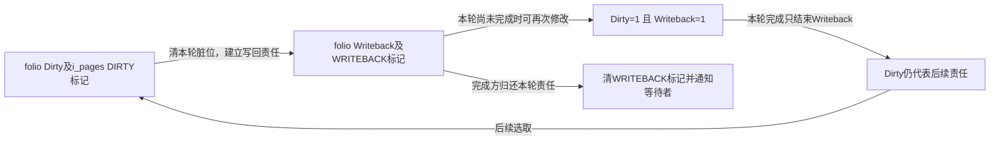
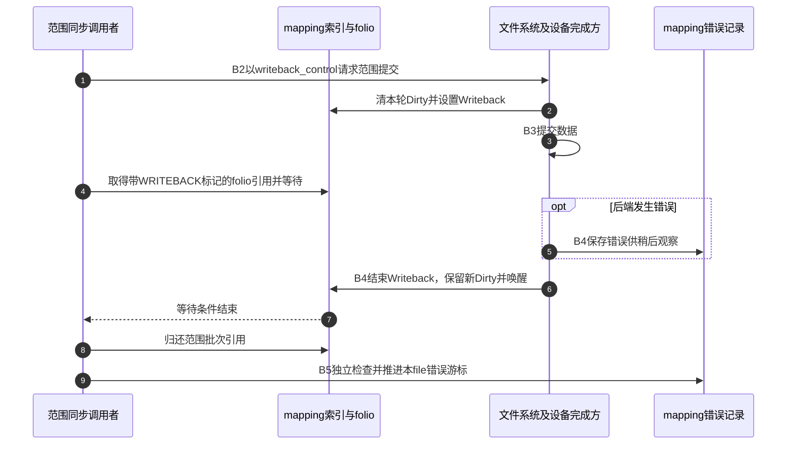

# 第38章\_写回标记与范围完成等待

选中了脏folio之后，还要区分“这轮已经取走的修改责任”和“后面又产生的新修改”，并使等待者知道这轮何时结束。本页沿B2～B4解释Dirty、Writeback、索引标记与完成等待，范围提交入口同时供B5同步路径使用。

| 阅读关联 | 入口 |
| --- | --- |
| 状态与过程 | [写回正文](../../../../knowledge/kernel_subsystems/vfs/P16_writeback_fsync与错误传播.md#16.3_提交与完成为什么需要独立状态) |
| 模块与版本 | [写回导读](../navigation/P15_写回提交完成与错误观察.md#15.1_沿同一周期区分责任与结果)、[总索引](../navigation/P01_Linux_6.12_VFS源码阅读索引.md#1.1_先固定源码身份与运行证据) |
| 原件 | [page-writeback.c](../../linux/mm/page-writeback.c)、[filemap.c](../../linux/mm/filemap.c)、[pagemap.h](../../linux/include/linux/pagemap.h)、[writeback.h](../../linux/include/linux/writeback.h) |

固定提交 `dfaf2136deb2af2e60b994421281ba42f1c087e0`。folio_clear_dirty_for_io和folio_end_writeback在pagemap.h声明，__folio_start_writeback在page-flags.h声明，__folio_end_writeback在mm/internal.h声明。范围写入口__filemap_fdatawrite_range在pagemap.h声明，do_writepages在writeback.h声明；__filemap_fdatawait_range则是filemap.c内部辅助。当前页不展开文件系统组装bio与块设备驱动完成算法，只固定它们必须兑现的状态协议。

## 38.1\_把本轮责任从Dirty交给Writeback

folio_clear_dirty_for_io要求folio已锁定。对可写回mapping，它先将相关页表脏信息汇入folio及文件系统脏状态，再清除folio脏位并减少待写统计。此时不立即清除i_pages中的DIRTY搜索标记，因为随后建立Writeback时还要与再次变脏协调。

```c
/** @brief 仓库补充阅读说明：清除本轮脏位并调整统计，保留后续写回交接。 */
bool folio_clear_dirty_for_io(struct folio *folio)
{
        struct address_space *mapping = folio_mapping(folio);
        bool ret = false;

        VM_BUG_ON_FOLIO(!folio_test_locked(folio), folio);

        if (mapping && mapping_can_writeback(mapping)) {
                struct inode *inode = mapping->host;
                struct bdi_writeback *wb;
                struct wb_lock_cookie cookie = {};

                /*
                 * Yes, Virginia, this is indeed insane.
                 *
                 * We use this sequence to make sure that
                 *  (a) we account for dirty stats properly
                 *  (b) we tell the low-level filesystem to
                 *      mark the whole folio dirty if it was
                 *      dirty in a pagetable. Only to then
                 *  (c) clean the folio again and return 1 to
                 *      cause the writeback.
                 *
                 * This way we avoid all nasty races with the
                 * dirty bit in multiple places and clearing
                 * them concurrently from different threads.
                 *
                 * Note! Normally the "folio_mark_dirty(folio)"
                 * has no effect on the actual dirty bit - since
                 * that will already usually be set. But we
                 * need the side effects, and it can help us
                 * avoid races.
                 *
                 * We basically use the folio "master dirty bit"
                 * as a serialization point for all the different
                 * threads doing their things.
                 */
                if (folio_mkclean(folio))
                        folio_mark_dirty(folio);
                /*
                 * We carefully synchronise fault handlers against
                 * installing a dirty pte and marking the folio dirty
                 * at this point.  We do this by having them hold the
                 * page lock while dirtying the folio, and folios are
                 * always locked coming in here, so we get the desired
                 * exclusion.
                 */
                wb = unlocked_inode_to_wb_begin(inode, &cookie);
                /* 仓库补充：清除本轮脏位并调整统计，保留后续写回交接。 */
                if (folio_test_clear_dirty(folio)) {
                        long nr = folio_nr_pages(folio);
                        lruvec_stat_mod_folio(folio, NR_FILE_DIRTY, -nr);
                        zone_stat_mod_folio(folio, NR_ZONE_WRITE_PENDING, -nr);
                        wb_stat_mod(wb, WB_RECLAIMABLE, -nr);
                        ret = true;
                }
                unlocked_inode_to_wb_end(inode, &cookie);
                return ret;
        }
        return folio_test_clear_dirty(folio);
}
```

folio_mkclean处理相关映射的脏与可写状态，不能解释成把数据内容清零。unlocked_inode_to_wb_begin/end取得适合本次记账的wb并配对结束；不同层的统计按基础页数更新。这里的VM_BUG_ON_FOLIO检查前置锁定要求，不能代替调用方取得锁。

```c
/** @brief 仓库补充阅读说明：建立当前轮写回位、搜索标记和统计。 */
void __folio_start_writeback(struct folio *folio, bool keep_write)
{
        long nr = folio_nr_pages(folio);
        struct address_space *mapping = folio_mapping(folio);
        int access_ret;

        VM_BUG_ON_FOLIO(folio_test_writeback(folio), folio);

        folio_memcg_lock(folio);
        if (mapping && mapping_use_writeback_tags(mapping)) {
                XA_STATE(xas, &mapping->i_pages, folio_index(folio));
                struct inode *inode = mapping->host;
                struct backing_dev_info *bdi = inode_to_bdi(inode);
                unsigned long flags;
                bool on_wblist;

                xas_lock_irqsave(&xas, flags);
                xas_load(&xas);
                folio_test_set_writeback(folio);

                on_wblist = mapping_tagged(mapping, PAGECACHE_TAG_WRITEBACK);

                xas_set_mark(&xas, PAGECACHE_TAG_WRITEBACK);
                if (bdi->capabilities & BDI_CAP_WRITEBACK_ACCT) {
                        struct bdi_writeback *wb = inode_to_wb(inode);

                        wb_stat_mod(wb, WB_WRITEBACK, nr);
                        if (!on_wblist)
                                wb_inode_writeback_start(wb);
                }

                /*
                 * We can come through here when swapping anonymous
                 * folios, so we don't necessarily have an inode to
                 * track for sync.
                 */
                if (mapping->host && !on_wblist)
                        sb_mark_inode_writeback(mapping->host);
                /* 仓库补充：建立当前轮写回位、搜索标记和统计。 */
                if (!folio_test_dirty(folio))
                        xas_clear_mark(&xas, PAGECACHE_TAG_DIRTY);
                if (!keep_write)
                        xas_clear_mark(&xas, PAGECACHE_TAG_TOWRITE);
                xas_unlock_irqrestore(&xas, flags);
        } else {
                folio_test_set_writeback(folio);
        }

        lruvec_stat_mod_folio(folio, NR_WRITEBACK, nr);
        zone_stat_mod_folio(folio, NR_ZONE_WRITE_PENDING, nr);
        folio_memcg_unlock(folio);

        access_ret = arch_make_folio_accessible(folio);
        /*
         * If writeback has been triggered on a page that cannot be made
         * accessible, it is too late to recover here.
         */
        VM_BUG_ON_FOLIO(access_ret != 0, folio);
}
```

__folio_start_writeback在索引锁下设置Writeback及对应搜索标记。若folio此时没有重新变脏，才清DIRTY标记；keep_write决定是否保留TOWRITE标记。前者记录待处理修改，后者用于选定待写范围，不能因为名称相近就合成一个标志。

| 符号与层次 | 当前责任 |
| --- | --- |
| mapping_can_writeback、mapping_use_writeback_tags | 分别决定是否有后端写回能力及是否维护索引写回标记；不是所有mapping都相同 |
| folio Dirty与Writeback | 前者可再次设置，后者跟踪当前轮完成，二者可以同时为1 |
| PAGECACHE_TAG_DIRTY/WRITEBACK/TOWRITE | 为范围搜索提供不同条件，不是三份可以任意清除的冗余副本 |
| wb_stat_mod、lruvec/zone统计 | 记录待写和正在写的量，单位是基础页；不证明设备完成 |
| wb_inode_writeback_start、sb_mark_inode_writeback | 在该mapping首次出现写回标记时登记inode，供后续整体等待与统计使用 |
| arch_make_folio_accessible | 写回标记建立后的体系结构可访问性钩子；本页不推导其指令实现，也不把它当成设备持久化刷新 |



文件系统暂不能提交某folio时，需要遵守重新标脏及解锁等退出协议，而不能仅清Dirty后丢弃它。folio_redirty_for_writepage调整相关记账并调用标脏路径，是这种拒绝本轮写出的辅助；它不代表设备已成功接收数据。

**实现原理与修改边界**：清脏、设置Writeback及处理搜索标记必须同时核对重脏窗口。改变keep_write或位清除顺序时验证新修改不会被当前轮完成抹掉，并保持统计、inode登记和失败归还配对。不能用一个“完成即Clean”枚举替代这些状态。

## 38.2\_范围提交描述请求而不是直接等待设备

__filemap_fdatawrite_range用栈上的writeback_control描述范围、同步模式及待写量，范围结束字节包含在请求内。随后filemap_fdatawrite_wbc检查mapping是否适合写回、关联本次inode记账，调用do_writepages并配对脱离。

```c
/** @brief 仓库补充阅读说明：建立范围写回控制描述，交给通用分派。 */
int __filemap_fdatawrite_range(struct address_space *mapping, loff_t start,
                                loff_t end, int sync_mode)
{
        /* 仓库补充：建立范围写回控制描述，交给通用分派。 */
        struct writeback_control wbc = {
                .sync_mode = sync_mode,
                .nr_to_write = LONG_MAX,
                .range_start = start,
                .range_end = end,
        };

        return filemap_fdatawrite_wbc(mapping, &wbc);
}
```

```c
/** @brief 仓库补充阅读说明：按后端方法和同步模式提交，处理内存不足重试。 */
int do_writepages(struct address_space *mapping, struct writeback_control *wbc)
{
        int ret;
        struct bdi_writeback *wb;

        if (wbc->nr_to_write <= 0)
                return 0;
        wb = inode_to_wb_wbc(mapping->host, wbc);
        wb_bandwidth_estimate_start(wb);
        while (1) {
                if (mapping->a_ops->writepages) {
                        ret = mapping->a_ops->writepages(mapping, wbc);
                } else if (mapping->a_ops->writepage) {
                        ret = writeback_use_writepage(mapping, wbc);
                } else {
                        /* deal with chardevs and other special files */
                        ret = 0;
                }
                /* 仓库补充：按后端方法和同步模式提交，处理内存不足重试。 */
                if (ret != -ENOMEM || wbc->sync_mode != WB_SYNC_ALL)
                        break;

                /*
                 * Lacking an allocation context or the locality or writeback
                 * state of any of the inode's pages, throttle based on
                 * writeback activity on the local node. It's as good a
                 * guess as any.
                 */
                reclaim_throttle(NODE_DATA(numa_node_id()),
                        VMSCAN_THROTTLE_WRITEBACK);
        }
        /*
         * Usually few pages are written by now from those we've just submitted
         * but if there's constant writeback being submitted, this makes sure
         * writeback bandwidth is updated once in a while.
         */
        if (time_is_before_jiffies(READ_ONCE(wb->bw_time_stamp) +
                                   BANDWIDTH_INTERVAL))
                wb_update_bandwidth(wb);
        return ret;
}
```

writeback_control的nr_to_write限制本次目标量，WB_SYNC_ALL表示完整性同步请求，相比后台WB_SYNC_NONE有更强的等待和处理要求，但不能单凭do_writepages返回就推断整个持久化协议已经结束。文件系统仍通过a_ops->writepages执行批量处理；只有旧writepage入口时使用逐页适配，没有方法的特殊对象可直接返回0。

| 辅助与条件 | 本次影响 |
| --- | --- |
| inode_to_wb_wbc、wbc_attach/detach | 给本次请求建立相应写回实例与统计关系，不改变用户fd身份 |
| wb_bandwidth_estimate_start、wb_update_bandwidth | 维护吞吐估计，不能替代完成或错误检查 |
| ENOMEM且WB_SYNC_ALL | 节流后重试本次提交；后台模式或其他错误不会沿相同重试分支 |
| reclaim_throttle | 根据本节点写回活动等待内存压力缓解；不是固定等待几个设备时钟 |
| writeback_use_writepage | 适配仅有旧单页回调的后端，不等于所有文件系统都使用同一bio布局 |

**实现原理与修改边界**：修改范围或同步模式时检查结束字节的包含关系、零预算、内存不足重试及后端方法能力。不能把统计返回量当成全部数据已写入非易失介质，也不能把WB_SYNC_ALL改名为“自动完成fsync”。

## 38.3\_完成方先结束本轮状态再唤醒

__folio_end_writeback清除Writeback位和索引WRITEBACK标记，减少正在写的统计；当mapping已无写回项时结束相关inode登记。它没有清除新Dirty位，也没有错误码参数：具体后端必须另外登记写回错误。

```c
/** @brief 仓库补充阅读说明：结束当前轮标记和统计，不清除新产生的脏责任。 */
bool __folio_end_writeback(struct folio *folio)
{
        long nr = folio_nr_pages(folio);
        struct address_space *mapping = folio_mapping(folio);
        bool ret;

        folio_memcg_lock(folio);
        if (mapping && mapping_use_writeback_tags(mapping)) {
                struct inode *inode = mapping->host;
                struct backing_dev_info *bdi = inode_to_bdi(inode);
                unsigned long flags;

                xa_lock_irqsave(&mapping->i_pages, flags);
                /* 仓库补充：结束当前轮标记和统计，不清除新产生的脏责任。 */
                ret = folio_xor_flags_has_waiters(folio, 1 << PG_writeback);
                __xa_clear_mark(&mapping->i_pages, folio_index(folio),
                                        PAGECACHE_TAG_WRITEBACK);
                if (bdi->capabilities & BDI_CAP_WRITEBACK_ACCT) {
                        struct bdi_writeback *wb = inode_to_wb(inode);

                        wb_stat_mod(wb, WB_WRITEBACK, -nr);
                        __wb_writeout_add(wb, nr);
                        if (!mapping_tagged(mapping, PAGECACHE_TAG_WRITEBACK))
                                wb_inode_writeback_end(wb);
                }

                if (mapping->host && !mapping_tagged(mapping,
                                                     PAGECACHE_TAG_WRITEBACK))
                        sb_clear_inode_writeback(mapping->host);

                xa_unlock_irqrestore(&mapping->i_pages, flags);
        } else {
                ret = folio_xor_flags_has_waiters(folio, 1 << PG_writeback);
        }

        lruvec_stat_mod_folio(folio, NR_WRITEBACK, -nr);
        zone_stat_mod_folio(folio, NR_ZONE_WRITE_PENDING, -nr);
        node_stat_mod_folio(folio, NR_WRITTEN, nr);
        folio_memcg_unlock(folio);

        return ret;
}
```

外层folio_end_writeback维护回收提示，并在清位和唤醒期间临时增加folio引用。写回状态本身并不单独持有一份folio引用，截断协议会等待Writeback结束；但一旦位清除，其他释放路径可能继续，因此唤醒之前的临时引用不能省略。

```c
/** @brief 仓库补充阅读说明：以临时引用保护清位和唤醒之间的生命期。 */
void folio_end_writeback(struct folio *folio)
{
        VM_BUG_ON_FOLIO(!folio_test_writeback(folio), folio);

        /*
         * folio_test_clear_reclaim() could be used here but it is an
         * atomic operation and overkill in this particular case. Failing
         * to shuffle a folio marked for immediate reclaim is too mild
         * a gain to justify taking an atomic operation penalty at the
         * end of every folio writeback.
         */
        if (folio_test_reclaim(folio)) {
                folio_clear_reclaim(folio);
                folio_rotate_reclaimable(folio);
        }

        /*
         * Writeback does not hold a folio reference of its own, relying
         * on truncation to wait for the clearing of PG_writeback.
         * But here we must make sure that the folio is not freed and
         * reused before the folio_wake_bit().
         */
        /* 仓库补充：以临时引用保护清位和唤醒之间的生命期。 */
        folio_get(folio);
        if (__folio_end_writeback(folio))
                folio_wake_bit(folio, PG_writeback);
        acct_reclaim_writeback(folio);
        folio_put(folio);
}
```

folio_wake_bit使用 [folio与bit匹配的等待队列](P35_缓存读的填充等待与有效范围.md#35.4_完成方更新状态再唤醒对应等待者)，这里等待条件为PG_writeback。folio_rotate_reclaimable和acct_reclaim_writeback属于回收处理，不能被解释为设备写回成功。完成函数可在进程或中断上下文执行，等待方则必须遵守可睡眠上下文要求。

**实现原理与修改边界**：清位、索引标记、统计和唤醒要与开始函数配对；临时引用必须覆盖唤醒。错误后也要结束本轮责任，但必须先在适当范围保存错误，见 [错误登记](P40_写回错误序列与每file观察.md#40.2_后端如何登记可跨调用保存的错误)。重复调用结束函数或提前清Writeback会破坏引用与等待协议。

## 38.4\_等待者按写回标记持有并等待范围

__filemap_fdatawait_range将字节范围转成基础页索引，按PAGECACHE_TAG_WRITEBACK取得带引用的批次，逐项folio_wait_writeback，最后归还整批引用。循环中的cond_resched给其他任务执行机会，不是通过忙等猜设备何时结束。

```c
/** @brief 仓库补充阅读说明：按写回标记持有folio并等待，配对释放批次。 */
static void __filemap_fdatawait_range(struct address_space *mapping,
                                     loff_t start_byte, loff_t end_byte)
{
        pgoff_t index = start_byte >> PAGE_SHIFT;
        pgoff_t end = end_byte >> PAGE_SHIFT;
        struct folio_batch fbatch;
        unsigned nr_folios;

        folio_batch_init(&fbatch);

        while (index <= end) {
                unsigned i;

                nr_folios = filemap_get_folios_tag(mapping, &index, end,
                                PAGECACHE_TAG_WRITEBACK, &fbatch);

                if (!nr_folios)
                        break;

                for (i = 0; i < nr_folios; i++) {
                        struct folio *folio = fbatch.folios[i];

                        /* 仓库补充：按写回标记持有folio并等待，配对释放批次。 */
                        folio_wait_writeback(folio);
                }
                folio_batch_release(&fbatch);
                cond_resched();
        }
}
```



等待结束只说明选定写回条件已解除；有没有错误、元数据是否完成、设备缓存是否需要刷新，都不是这一无返回错误值的内部等待辅助能单独回答的。file_write_and_wait_range把提交、等待和每file错误检查组合起来，而完整fsync继续交给文件系统。

**实现原理与修改边界**：等待期间必须持有folio，并在所有退出路径归还批次。改变搜索标记或范围推进时检查遗漏、重复和并发重脏；不能把等待返回当作错误记录已消费。当前没有实际设备完成、截断等待或重脏竞争的运行验证。
