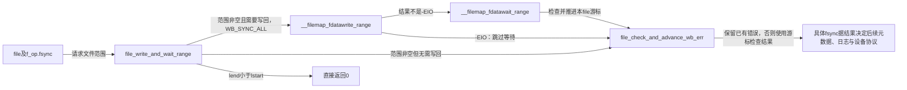
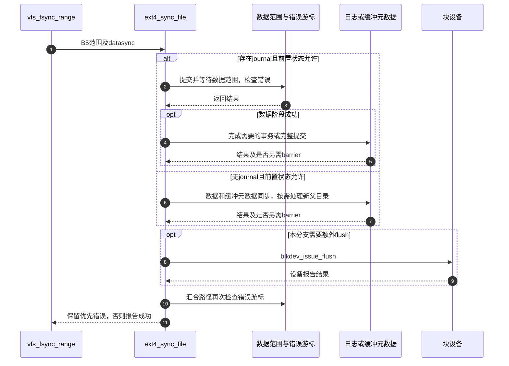

# 第39章\_同步入口与文件系统持久化

等待文件数据写回结束以后，还可能留下inode元数据、日志事务和设备缓存需要完成。fsync不能仅等同于清除folio的Writeback位。本页以VFS入口和本版本ext4实现连接B5，说明通用层如何把范围和同步要求交给具体后端。

| 阅读关联 | 入口 |
| --- | --- |
| 问题与接口选择 | [fsync正文](../../../../knowledge/kernel_subsystems/vfs/P16_writeback_fsync与错误传播.md#16.4_fsync怎样把数据元数据与后端完成连起来) |
| 模块与版本 | [写回导读](../navigation/P15_写回提交完成与错误观察.md#15.1_沿同一周期区分责任与结果)、[总索引](../navigation/P01_Linux_6.12_VFS源码阅读索引.md#1.1_先固定源码身份与运行证据) |
| 原件 | [sync.c](../../linux/fs/sync.c)、[filemap.c](../../linux/mm/filemap.c)、[ext4/fsync.c](../../linux/fs/ext4/fsync.c)、[ext4.h](../../linux/fs/ext4/ext4.h)、[buffer.c](../../linux/fs/buffer.c) |

固定提交 `dfaf2136deb2af2e60b994421281ba42f1c087e0`。vfs_fsync及范围入口、file_write_and_wait_range在fs.h声明；do_fsync是sync.c内部辅助；ext4_sync_file由ext4.h声明，同文件的journal与nojournal辅助为static。当前配置启用EXT4_FS、JBD2，但没有实际挂载参数或设备缓存观测，不能据此断言当前文件采用哪种日志模式。

## 39.1\_系统调用先取得file再交给其同步方法

fsync系统调用传datasync=0，fdatasync传1；do_fsync取得本次file持有范围，调用vfs_fsync后配对fdput。号码无效时返回EBADF，内部负错误在用户C接口转换为-1和errno。

```c
/** @brief 仓库补充阅读说明：取得file持有范围并配对调用同步方法。 */
static int do_fsync(unsigned int fd, int datasync)
{
        struct fd f = fdget(fd);
        int ret = -EBADF;

        if (fd_file(f)) {
                ret = vfs_fsync(fd_file(f), datasync);
                /* 仓库补充：取得file持有范围并配对调用同步方法。 */
                fdput(f);
        }
        return ret;
}
```

```c
/** @brief 仓库补充阅读说明：将整个文件范围交给范围同步接口。 */
int vfs_fsync(struct file *file, int datasync)
{
        /* 仓库补充：将整个文件范围交给范围同步接口。 */
        return vfs_fsync_range(file, 0, LLONG_MAX, datasync);
}
```

```c
/** @brief 仓库补充阅读说明：检查同步能力，传递范围与必要元数据要求。 */
int vfs_fsync_range(struct file *file, loff_t start, loff_t end, int datasync)
{
        struct inode *inode = file->f_mapping->host;

        /* 仓库补充：检查同步能力，传递范围与必要元数据要求。 */
        if (!file->f_op->fsync)
                return -EINVAL;
        if (!datasync && (inode->i_state & I_DIRTY_TIME))
                mark_inode_dirty_sync(inode);
        return file->f_op->fsync(file, start, end, datasync);
}
```

vfs_fsync用0到LLONG_MAX选择全文件范围。范围入口若没有f_op->fsync就返回EINVAL；完整fsync还将需要兑现的I_DIRTY_TIME转为元数据脏责任。随后调用具体方法，VFS不直接猜测每个文件系统有哪些日志和设备flush要求。

| 传递内容 | 保证与边界 |
| --- | --- |
| file | 固定本次打开对象及操作表，持有规则复用描述符查询协议 |
| start/end | 包含结束字节的文件范围；不是一个任意设备扇区范围 |
| datasync | 允许略过恢复数据不需要的元数据；文件长度等必要元数据仍须同步 |
| f_op->fsync | 文件系统负责把同步要求兑现成自己的数据、元数据与后端完成协议 |
| 返回0 | 该方法报告本次要求成功；不能忽略此前已经报告的写回失败或设备自身的契约限制 |

**实现原理与修改边界**：不能用一次filemap等待替换所有fsync方法。添加新后端方法时明确必要元数据、目录项、错误消费及设备完成条件；不能将fdatasync实现成完全跳过inode长度更新。

## 39.2\_数据范围同步同时检查延后错误

file_write_and_wait_range在mapping需要写回时提交WB_SYNC_ALL范围请求，随后等待相关写回；即使提交发生某些错误，仍可能已有部分提交需要等完。EIO分支按当前代码特别跳过等待。无论此前是否真的提交，都继续检查并推进这个file的错误游标。

```c
/** @brief 仓库补充阅读说明：组合提交、完成等待与每file错误观察。 */
int file_write_and_wait_range(struct file *file, loff_t lstart, loff_t lend)
{
        int err = 0, err2;
        struct address_space *mapping = file->f_mapping;

        if (lend < lstart)
                return 0;

        if (mapping_needs_writeback(mapping)) {
                err = __filemap_fdatawrite_range(mapping, lstart, lend,
                                                 WB_SYNC_ALL);
                /* See comment of filemap_write_and_wait() */
                if (err != -EIO)
                        __filemap_fdatawait_range(mapping, lstart, lend);
        }
        /* 仓库补充：组合提交、完成等待与每file错误观察。 */
        err2 = file_check_and_advance_wb_err(file);
        if (!err)
                err = err2;
        return err;
}
```

这里的mapping_needs_writeback处理是否需要进入范围路径；提交和等待分别见 [范围提交](P38_写回标记与范围完成等待.md#38.2_范围提交描述请求而不是直接等待设备) 与 [范围等待](P38_写回标记与范围完成等待.md#38.4_等待者按写回标记持有并等待范围)。已经有提交错误时保留该错误，否则采用延后错误检查结果，不能让后一次成功覆盖前一次失败。

名字相近的filemap_write_and_wait_range使用mapping和旧错误标志检查，不使用本次file游标。它们的观察范围和错误消费语义不同，不能仅凭参数看起来可转换就机械替换。每file检查见 [错误观察](P40_写回错误序列与每file观察.md#40.3_检查者怎样推进自己的观察进度)。



**实现原理与修改边界**：调整等待条件时必须保留部分提交、EIO特殊处理和后置错误检查。错误游标推进可能已经消费一个历史错误，因此调用方必须保存并报告返回值，不能丢弃后再次检查到0就报告整个操作成功。

## 39.3\_ext4按日志配置选择不同的完成路径

ext4_sync_file先拒绝强制关闭的文件系统，检查当前任务没有开放日志句柄，再按只读状态及是否存在journal选择路径。下列代码保留分支，是为了明确实现边界，而不是宣称本次机器执行了所有分支。

```c
/** @brief 仓库补充阅读说明：按文件系统状态连接数据、日志、设备flush和错误检查。 */
int ext4_sync_file(struct file *file, loff_t start, loff_t end, int datasync)
{
        int ret = 0, err;
        bool needs_barrier = false;
        struct inode *inode = file->f_mapping->host;

        if (unlikely(ext4_forced_shutdown(inode->i_sb)))
                return -EIO;

        ASSERT(ext4_journal_current_handle() == NULL);

        trace_ext4_sync_file_enter(file, datasync);

        if (sb_rdonly(inode->i_sb)) {
                /* Make sure that we read updated s_ext4_flags value */
                smp_rmb();
                if (ext4_forced_shutdown(inode->i_sb))
                        ret = -EROFS;
                goto out;
        }

        if (!EXT4_SB(inode->i_sb)->s_journal) {
                ret = ext4_fsync_nojournal(file, start, end, datasync,
                                           &needs_barrier);
                if (needs_barrier)
                        goto issue_flush;
                goto out;
        }

        ret = file_write_and_wait_range(file, start, end);
        if (ret)
                goto out;

        /*
         *  The caller's filemap_fdatawrite()/wait will sync the data.
         *  Metadata is in the journal, we wait for proper transaction to
         *  commit here.
         */
        ret = ext4_fsync_journal(inode, datasync, &needs_barrier);

issue_flush:
        if (needs_barrier) {
                err = blkdev_issue_flush(inode->i_sb->s_bdev);
                if (!ret)
                        ret = err;
        }
out:
        err = file_check_and_advance_wb_err(file);
        /* 仓库补充：按文件系统状态连接数据、日志、设备flush和错误检查。 */
        if (ret == 0)
                ret = err;
        trace_ext4_sync_file_exit(inode, ret);
        return ret;
}
```

有journal时先完成数据范围，再按文件类型和所需事务完成日志。没有journal时使用缓冲元数据同步辅助并处理新目录关系。needs_barrier说明本轮是否还需要额外设备flush；已有错误优先保留。正常汇合的out路径再次检查本file错误游标，捕获数据同步之后可能登记的新错误。

```c
/** @brief 仓库补充阅读说明：按所需事务和对象类型确定日志提交及额外barrier。 */
static int ext4_fsync_journal(struct inode *inode, bool datasync,
                             bool *needs_barrier)
{
        struct ext4_inode_info *ei = EXT4_I(inode);
        journal_t *journal = EXT4_SB(inode->i_sb)->s_journal;
        tid_t commit_tid = datasync ? ei->i_datasync_tid : ei->i_sync_tid;

        /*
         * Fastcommit does not really support fsync on directories or other
         * special files. Force a full commit.
         */
        /* 仓库补充：按所需事务和对象类型确定日志提交及额外barrier。 */
        if (!S_ISREG(inode->i_mode))
                return ext4_force_commit(inode->i_sb);

        if (journal->j_flags & JBD2_BARRIER &&
            !jbd2_trans_will_send_data_barrier(journal, commit_tid))
                *needs_barrier = true;

        return ext4_fc_commit(journal, commit_tid);
}
```

journal分支用datasync选择ext4_inode_info的i_datasync_tid或i_sync_tid，以所需事务为目标。非普通文件强制完整提交；普通文件可使用ext4_fc_commit。JBD2_BARRIER与事务是否会发送数据barrier共同决定是否需要额外flush，不能简化成“每次fsync都无条件发设备flush”或“有日志就不需要设备缓存处理”。

```c
/** @brief 仓库补充阅读说明：组合缓冲元数据与特定父目录同步，交回flush要求。 */
static int ext4_fsync_nojournal(struct file *file, loff_t start, loff_t end,
                                int datasync, bool *needs_barrier)
{
        struct inode *inode = file->f_inode;
        int ret;

        ret = generic_buffers_fsync_noflush(file, start, end, datasync);
        if (!ret)
                ret = ext4_sync_parent(inode);
        /* 仓库补充：组合缓冲元数据与特定父目录同步，交回flush要求。 */
        if (test_opt(inode->i_sb, BARRIER))
                *needs_barrier = true;

        return ret;
}
```

generic_buffers_fsync_noflush先调用数据范围同步，再同步mapping关联的元数据缓冲，按I_DIRTY_ALL及I_DIRTY_DATASYNC决定inode元数据处理，最后再次检查错误。它的名字明确不承担最后设备flush。ext4_sync_parent处理特定NEWENTRY状态下的新父目录链，不能推广为任意文件系统中fsync(file)必然持久化所有名称操作。

| 辅助与状态 | 本实现的角色 |
| --- | --- |
| EXT4_I、EXT4_SB | 从通用对象定位ext4私有inode及superblock状态，不是重新查找文件 |
| s_journal、commit_tid | 确定日志存在性及本次需完成的事务范围，具体事务创建由ext4/JBD2负责 |
| ext4_force_commit、ext4_fc_commit | 兑现相应日志提交等待；不能当作通用VFS回调 |
| test_opt BARRIER、JBD2_BARRIER | 具体挂载和journal状态，配置编译进JBD2不等于运行时选项已确认 |
| blkdev_issue_flush | 请求设备侧缓存完成边界，与CPU的flush_dcache_folio不同 |
| ASSERT、trace | 检查当前任务句柄条件、记录过程，不负责提交或修复日志 |
| sb_rdonly、ext4_forced_shutdown | 只读与强制关闭分支；只读路径的屏障配对用于读取相关状态，不是设备数据刷新 |



**实现原理与修改边界**：数据、元数据、日志事务和设备flush是不同完成条件。修改任一分支时检查早退、已有错误保留、事务ID选择、非普通文件、只读/关闭状态及最终错误观察。这里没有断电恢复、真实journal模式或设备barrier运行验证，不能将静态调用链当作硬件可靠性证明。
