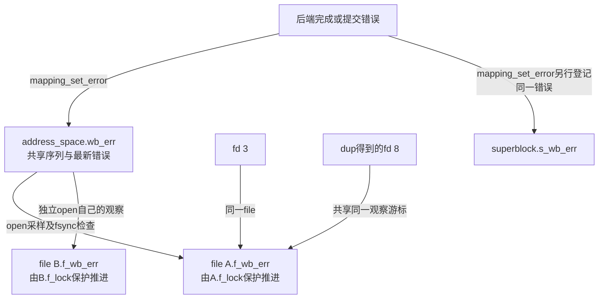
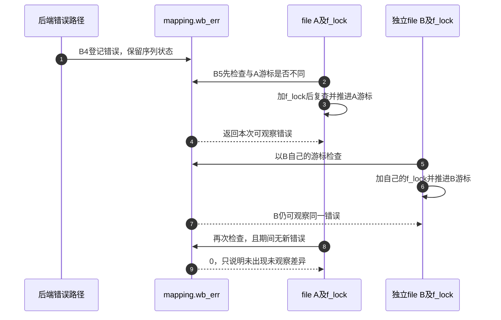

# 第40章\_写回错误序列与每file观察

write已经返回后，后端仍可能失败。错误既不能只放在即将退出的工作线程栈上，也不能让第一个fsync把全局错误清掉，导致其他打开者完全看不到。本页沿B4～B5解释共享错误记录与每个file的观察游标。

| 阅读关联 | 入口 |
| --- | --- |
| 场景与边界 | [延后错误正文](../../../../knowledge/kernel_subsystems/vfs/P16_writeback_fsync与错误传播.md#16.5_延后错误怎样交给每个打开者) |
| 模块与身份 | [写回导读](../navigation/P15_写回提交完成与错误观察.md#15.1_沿同一周期区分责任与结果)、[总索引](../navigation/P01_Linux_6.12_VFS源码阅读索引.md#1.1_先固定源码身份与运行证据) |
| 原件 | [pagemap.h](../../linux/include/linux/pagemap.h)、[filemap.c](../../linux/mm/filemap.c)、[errseq.h](../../linux/include/linux/errseq.h)、[errseq.c](../../linux/lib/errseq.c)、[errseq说明](../../linux/Documentation/core-api/errseq.rst) |

固定提交 `dfaf2136deb2af2e60b994421281ba42f1c087e0`。mapping_set_error与采样包装在pagemap.h内联定义；__filemap_set_wb_err在pagemap.h声明、filemap.c定义；file_check_and_advance_wb_err在fs.h声明、filemap.c定义。errseq四个通用接口在errseq.h声明、lib/errseq.c定义，本页展开其在VFS的字段实例与调用契约，不复制通用原子更新函数体。

## 40.1\_共享记录与观察游标分别保存

address_space.wb_err保存这个缓存的错误序列；file.f_wb_err保存一次打开已经观察到的位置。前者在inode初始化时清零，后者在do_dentry_open建立f_mapping后采样，见 [file初始化](P26_file初始化与打开后失败清理.md#26.3_具体打开前取得自己的持有与操作表)。同一file的观察更新由f_lock串行化。

```c
/** @brief 仓库补充阅读说明：为打开对象建立相对于共享错误记录的观察起点。 */
static inline errseq_t filemap_sample_wb_err(struct address_space *mapping)
{
        /* 仓库补充：为打开对象建立相对于共享错误记录的观察起点。 */
        return errseq_sample(&mapping->wb_err);
}
```

errseq_t是32位无符号值。当前MAX_ERRNO对应低12位错误码，位12为SEEN标记，高19位构成计数部分。它不是错误链表，也不保存每次失败的写入偏移、提交者或次数；多个未观察错误可以覆盖成最新错误，有限计数还存在回绕碰撞边界。

| 通用接口 | 本实例依赖的契约 |
| --- | --- |
| errseq_set | 接收负错误码，拒绝0及越界值；覆盖错误部分，旧值已被观察时才推进计数，并清除SEEN |
| errseq_sample | 读取初始游标；共享记录尚未SEEN时返回0，使新观察者仍可能看见此前未确认的错误 |
| errseq_check | 比较共享值与游标，变化时返回当前错误；不推进游标、不标记已观察 |
| errseq_check_and_advance | 取得当前值、尝试标SEEN，并推进调用方游标；游标的并发修改由调用者串行化 |

因此不能把采样简化成“直接复制当前数字并忽略所有历史错误”。新open可能看到一个在open之前产生但尚未被观察的错误；已经被观察的旧错误则由采样游标界定。错误码为负的接口形式与共享字段中的正错误部分也不同。



图中fd只是号码，dup没有复制file，因此也没有复制f_wb_err。独立open通常建立另一个file，才有另一个观察游标。不同观察者得知错误，不等于它们都亲自造成了该错误。

**实现原理与修改边界**：新增观察者必须明确游标初始化点、保存位置和共享范围。把游标移到fd槽位会改变dup、fork共享及关闭语义，不能只修改一个fsync入口；不能把errseq当成逐次错误计数器或错误归因日志。

## 40.2\_后端如何登记可跨调用保存的错误

mapping_set_error对0直接返回，对负错误同时登记mapping的wb_err、所属superblock的s_wb_err，以及供旧调用者使用的AS_ENOSPC或AS_EIO标志。不同记录服务不同范围的观察，不能因保留旧标志就认为file游标没有作用。

```c
/** @brief 仓库补充阅读说明：保存mapping、superblock与旧标志层的错误。 */
static inline void mapping_set_error(struct address_space *mapping, int error)
{
        /* 仓库补充：保存mapping、superblock与旧标志层的错误。 */
        if (likely(!error))
                return;

        /* Record in wb_err for checkers using errseq_t based tracking */
        __filemap_set_wb_err(mapping, error);

        /* Record it in superblock */
        if (mapping->host)
                errseq_set(&mapping->host->i_sb->s_wb_err, error);

        /* Record it in flags for now, for legacy callers */
        if (error == -ENOSPC)
                set_bit(AS_ENOSPC, &mapping->flags);
        else
                set_bit(AS_EIO, &mapping->flags);
}
```

```c
/** @brief 仓库补充阅读说明：通过错误序列登记并记录观测事件。 */
void __filemap_set_wb_err(struct address_space *mapping, int err)
{
        /* 仓库补充：通过错误序列登记并记录观测事件。 */
        errseq_t eseq = errseq_set(&mapping->wb_err, err);

        trace_filemap_set_wb_err(mapping, eseq);
}
```

__filemap_set_wb_err调用errseq_set后只额外记录trace。errseq_set使用原子比较更新共享值，重试处理并发写者；它不获得每个file的f_lock。共享值更新与各观察者游标更新本来就是两种所有权，不能用同一把file锁保护所有后端完成方。

superblock记录供更广范围同步检查使用，不代替本页的每file游标。AS_ENOSPC只对应空间不足，其他负错误在旧标志层归到AS_EIO；errseq层仍保留自身可编码的错误码。一次错误登记也不自动唤醒所有fsync调用者，完成等待由写回状态协议承担。

**实现原理与修改边界**：后端发生写回失败必须在其完成协议中保存错误，不能只清Writeback并唤醒。改变登记位置要保证等待者完成检查前可观察到错误，并检查mapping存续、superblock范围和旧调用方；不能把成功路径传0当成清除历史错误。

## 40.3\_检查者怎样推进自己的观察进度

file_check_and_advance_wb_err先READ_ONCE取得file游标，再用errseq_check判断是否有变化。常见无变化路径不拿f_lock；有变化才在锁内重新读取游标、检查并推进。这个复查防止两个共享同一file的任务同时按旧游标重复更新，或让游标倒退。

```c
/** @brief 仓库补充阅读说明：在必要时加file锁，串行推进共享file的观察游标。 */
int file_check_and_advance_wb_err(struct file *file)
{
        int err = 0;
        errseq_t old = READ_ONCE(file->f_wb_err);
        struct address_space *mapping = file->f_mapping;

        /* Locklessly handle the common case where nothing has changed */
        if (errseq_check(&mapping->wb_err, old)) {
                /* Something changed, must use slow path */
                /* 仓库补充：在必要时加file锁，串行推进共享file的观察游标。 */
                spin_lock(&file->f_lock);
                old = file->f_wb_err;
                err = errseq_check_and_advance(&mapping->wb_err,
                                                &file->f_wb_err);
                trace_file_check_and_advance_wb_err(file, old);
                spin_unlock(&file->f_lock);
        }

        /*
         * We're mostly using this function as a drop in replacement for
         * filemap_check_errors. Clear AS_EIO/AS_ENOSPC to emulate the effect
         * that the legacy code would have had on these flags.
         */
        clear_bit(AS_EIO, &mapping->flags);
        clear_bit(AS_ENOSPC, &mapping->flags);
        return err;
}
```

errseq_check_and_advance尝试把观察到的值标成SEEN，即使这次比较交换没有成功，也可推进到基于所观察旧值构造的游标并报告其错误。原因是失败可能来自另一个观察者已标SEEN，也可能来自写者登记了新值；新的差异仍由后续检查处理。这里不提供“整个共享错误记录永远冻结到检查结束”的保证。

函数最后清理旧AS_EIO/AS_ENOSPC标志，以维持旧错误检查行为；这不会把所有独立file的f_wb_err都推进。trace记录观察过程，READ_ONCE防止不合适的重复访问，但它本身不是共享游标更新的互斥锁。



**实现原理与修改边界**：检查返回0只说明本次观察没有新的差异，不证明前次失败数据已被修复。修改快速路径、锁或游标存储时验证dup共享、独立open、检查期间新错误及有限计数回绕；不应靠反复fsync直到0把曾报告的错误当作消失。当前未执行故障注入或多个共享file检查者的运行验证。
