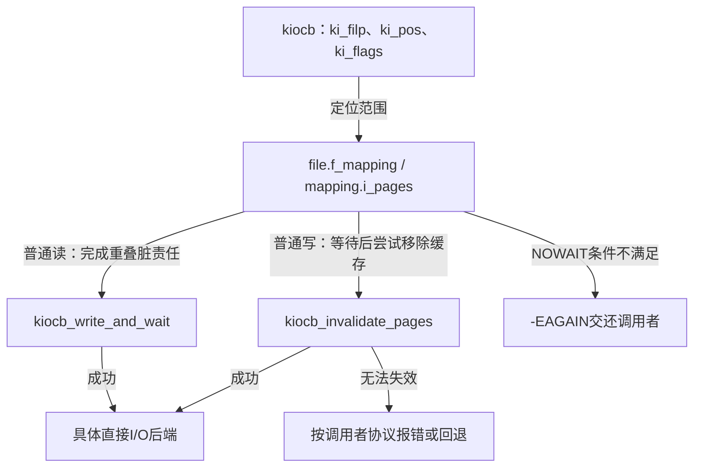
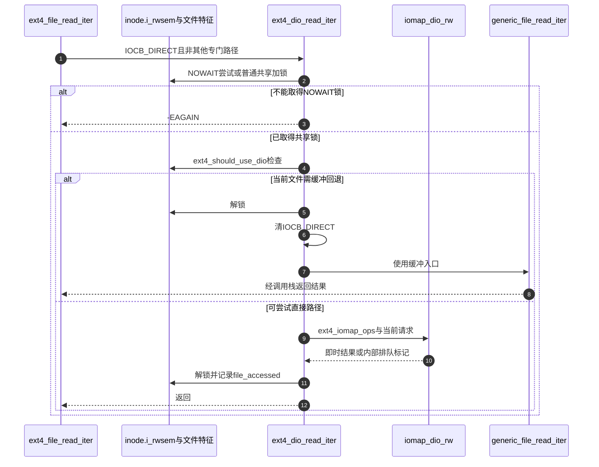

# 第41章\_直接IO的缓存交接与实现入口

直接访问后端之前，同一范围可能仍有脏缓存；访问之后，也可能已有新缓存进入。这个边界既影响正确性，也决定错误、等待和回退。本页追踪D1，并把通用a_ops->direct_IO路径与ext4的iomap入口分开，避免因为文件同名就把两套实现串在一起。

| 阅读关联 | 入口 |
| --- | --- |
| 机制与实验 | [直接I/O正文](../../../../knowledge/kernel_subsystems/vfs/P17_Direct_IO与异步完成.md#17.2_绕开缓存以后为什么仍要与缓存交接) |
| 模块与版本 | [直接I/O导读](../navigation/P16_直接IO请求与完成责任.md#16.1_先分清请求对象与执行上下文)、[总索引](../navigation/P01_Linux_6.12_VFS源码阅读索引.md#1.1_先固定源码身份与运行证据) |
| 原件 | [filemap.c](../../linux/mm/filemap.c)、[pagemap.h](../../linux/include/linux/pagemap.h)、[ext4/file.c](../../linux/fs/ext4/file.c)、[ext4/inode.c](../../linux/fs/ext4/inode.c) |

固定提交 `dfaf2136deb2af2e60b994421281ba42f1c087e0`。四个缓存准备/完成辅助在pagemap.h声明、filemap.c定义；generic_file_read_iter和generic_file_direct_write在fs.h声明。ext4_should_use_dio、ext4_dio_read_iter是file.c内部函数，ext4_dio_alignment由ext4.h声明、inode.c定义。本页只展开ext4读入口的选择，写入口的区间分配与日志处理属于ext4后端契约，不把通用写函数误标为ext4实际调用者。

## 41.1\_提交以前先处理同范围缓存

kiocb_write_and_wait服务直接读的缓存交接：普通路径先提交并等待该范围已有写回；NOWAIT路径若发现必须等待的写回责任就返回EAGAIN。写路径还必须失效旧缓存，因此NOWAIT只要范围内已有页就可能拒绝，比只检查脏责任更严格。

```c
/** @brief 仓库补充阅读说明：检查范围已有写回责任，按NOWAIT或等待路径交接。 */
int kiocb_write_and_wait(struct kiocb *iocb, size_t count)
{
        /* 仓库补充：检查范围已有写回责任，按NOWAIT或等待路径交接。 */
        struct address_space *mapping = iocb->ki_filp->f_mapping;
        loff_t pos = iocb->ki_pos;
        loff_t end = pos + count - 1;

        if (iocb->ki_flags & IOCB_NOWAIT) {
                if (filemap_range_needs_writeback(mapping, pos, end))
                        return -EAGAIN;
                return 0;
        }

        return filemap_write_and_wait_range(mapping, pos, end);
}
```

```c
/** @brief 仓库补充阅读说明：写前先协调写回，再尝试移除缓存。 */
int filemap_invalidate_pages(struct address_space *mapping,
                             loff_t pos, loff_t end, bool nowait)
{
        /* 仓库补充：写前先协调写回，再尝试移除缓存。 */
        int ret;

        if (nowait) {
                /* we could block if there are any pages in the range */
                if (filemap_range_has_page(mapping, pos, end))
                        return -EAGAIN;
        } else {
                ret = filemap_write_and_wait_range(mapping, pos, end);
                if (ret)
                        return ret;
        }

        /*
         * After a write we want buffered reads to be sure to go to disk to get
         * the new data.  We invalidate clean cached page from the region we're
         * about to write.  We do this *before* the write so that we can return
         * without clobbering -EIOCBQUEUED from ->direct_IO().
         */
        return invalidate_inode_pages2_range(mapping, pos >> PAGE_SHIFT,
                                             end >> PAGE_SHIFT);
}
```

```c
/** @brief 仓库补充阅读说明：将kiocb的字节范围传给缓存失效辅助。 */
int kiocb_invalidate_pages(struct kiocb *iocb, size_t count)
{
        /* 仓库补充：将kiocb的字节范围传给缓存失效辅助。 */
        struct address_space *mapping = iocb->ki_filp->f_mapping;

        return filemap_invalidate_pages(mapping, iocb->ki_pos,
                                        iocb->ki_pos + count - 1,
                                        iocb->ki_flags & IOCB_NOWAIT);
}
```

filemap_invalidate_pages先在允许阻塞时完成范围写回，再用invalidate_inode_pages2_range失效缓存。它没有把所有访问者都锁住；调用者仍须兑现文件系统范围与修改的串行化规则。位置取自ki_pos，count来自当前迭代器；调用前需已完成范围/溢出检查，不能直接把未经检查的用户长度塞进这个辅助。

| 符号或实现簇 | 状态、调用与边界 |
| --- | --- |
| ki_pos、count、end | 字节范围，结束字节包含在请求内；页索引由PAGE_SHIFT换算，不把字节数直接当页号 |
| filemap_range_needs_writeback | 查询范围是否存在需要写回协调的页状态，NOWAIT据此拒绝等待；不是性能估计 |
| filemap_range_has_page | 查询范围是否已有缓存页，写前NOWAIT因此可以拒绝，即使页是干净的 |
| filemap_write_and_wait_range | 组合范围提交、完成等待及mapping旧错误标志检查；它不推进每file的f_wb_err，区别见 [第39章](P39_同步入口与文件系统持久化.md#39.2_数据范围同步同时检查延后错误) |
| invalidate_inode_pages2_range | 尝试卸载映射并移除范围缓存，不能移除的对象可导致失败；不意味着任意mmap并发都被永久排除 |
| mapping与i_pages | 共享索引与folio成员规则沿用 [第34章](P34_页缓存归属索引与竞争插入.md#34.1_mapping把共享对象与偏移索引连起来)，本页不复制XArray算法 |



**实现原理与修改边界**：读准备不能直接删掉等待，否则后端可能落后于脏缓存。写准备不能把失效失败一概当作成功。修改NOWAIT判断时同时复核“已有页”与“需要写回”的不同条件、空范围调用约束和错误消费，不能只改一个返回码。

## 41.2\_通用读写入口如何表达回退

generic_file_read_iter只在IOCB_DIRECT置位时先进入a_ops->direct_IO。返回非负长度才推进ki_pos；未异步排队时将迭代器回退到可报告进度。若还有剩余数据、不是DAX、也未到EOF，才由filemap_read完成剩余缓冲读取。

```c
/** @brief 仓库补充阅读说明：区分直接读取与剩余缓冲读取，维护可报告进度。 */
ssize_t
generic_file_read_iter(struct kiocb *iocb, struct iov_iter *iter)
{
        /* 仓库补充：区分直接读取与剩余缓冲读取，维护可报告进度。 */
        size_t count = iov_iter_count(iter);
        ssize_t retval = 0;

        if (!count)
                return 0; /* skip atime */

        if (iocb->ki_flags & IOCB_DIRECT) {
                struct file *file = iocb->ki_filp;
                struct address_space *mapping = file->f_mapping;
                struct inode *inode = mapping->host;

                retval = kiocb_write_and_wait(iocb, count);
                if (retval < 0)
                        return retval;
                file_accessed(file);

                retval = mapping->a_ops->direct_IO(iocb, iter);
                if (retval >= 0) {
                        iocb->ki_pos += retval;
                        count -= retval;
                }
                if (retval != -EIOCBQUEUED)
                        iov_iter_revert(iter, count - iov_iter_count(iter));

                /*
                 * Btrfs can have a short DIO read if we encounter
                 * compressed extents, so if there was an error, or if
                 * we've already read everything we wanted to, or if
                 * there was a short read because we hit EOF, go ahead
                 * and return.  Otherwise fallthrough to buffered io for
                 * the rest of the read.  Buffered reads will not work for
                 * DAX files, so don't bother trying.
                 */
                if (retval < 0 || !count || IS_DAX(inode))
                        return retval;
                if (iocb->ki_pos >= i_size_read(inode))
                        return retval;
        }

        return filemap_read(iocb, iter, retval);
}
```

这里负值包含内部-EIOCBQUEUED，不能把它变成缓冲续读。成功但短读也不一定意味着EOF，注释中的压缩区间就是需回退的具体背景。filemap_read的内容有效性与实际复制只在 [第35章](P35_缓存读的填充等待与有效范围.md#35.1_读入口把批次与实际复制进度连接起来) 展开。

generic_file_direct_write在写前失效返回EBUSY时用0向上层表达缓冲回退机会，其他错误原样返回。直接后端正返回时，先做写后失效尝试，再推进位置，并在非块设备扩展时更新i_size、登记inode脏责任。异步排队后不在此处回退迭代器。

```c
/** @brief 仓库补充阅读说明：按失效与后端结果处理回退、位置及元数据。 */
ssize_t
generic_file_direct_write(struct kiocb *iocb, struct iov_iter *from)
{
        /* 仓库补充：按失效与后端结果处理回退、位置及元数据。 */
        struct address_space *mapping = iocb->ki_filp->f_mapping;
        size_t write_len = iov_iter_count(from);
        ssize_t written;

        /*
         * If a page can not be invalidated, return 0 to fall back
         * to buffered write.
         */
        written = kiocb_invalidate_pages(iocb, write_len);
        if (written) {
                if (written == -EBUSY)
                        return 0;
                return written;
        }

        written = mapping->a_ops->direct_IO(iocb, from);

        /*
         * Finally, try again to invalidate clean pages which might have been
         * cached by non-direct readahead, or faulted in by get_user_pages()
         * if the source of the write was an mmap'ed region of the file
         * we're writing.  Either one is a pretty crazy thing to do,
         * so we don't support it 100%.  If this invalidation
         * fails, tough, the write still worked...
         *
         * Most of the time we do not need this since dio_complete() will do
         * the invalidation for us. However there are some file systems that
         * do not end up with dio_complete() being called, so let's not break
         * them by removing it completely.
         *
         * Noticeable example is a blkdev_direct_IO().
         *
         * Skip invalidation for async writes or if mapping has no pages.
         */
        if (written > 0) {
                struct inode *inode = mapping->host;
                loff_t pos = iocb->ki_pos;

                kiocb_invalidate_post_direct_write(iocb, written);
                pos += written;
                write_len -= written;
                if (pos > i_size_read(inode) && !S_ISBLK(inode->i_mode)) {
                        i_size_write(inode, pos);
                        mark_inode_dirty(inode);
                }
                iocb->ki_pos = pos;
        }
        if (written != -EIOCBQUEUED)
                iov_iter_revert(from, write_len - iov_iter_count(from));
        return written;
}
```

```c
/** @brief 仓库补充阅读说明：写后再次尝试失效，失败转交错误登记与诊断。 */
void kiocb_invalidate_post_direct_write(struct kiocb *iocb, size_t count)
{
        /* 仓库补充：写后再次尝试失效，失败转交错误登记与诊断。 */
        struct address_space *mapping = iocb->ki_filp->f_mapping;

        if (mapping->nrpages &&
            invalidate_inode_pages2_range(mapping,
                        iocb->ki_pos >> PAGE_SHIFT,
                        (iocb->ki_pos + count - 1) >> PAGE_SHIFT))
                dio_warn_stale_pagecache(iocb->ki_filp);
}
```

写后失效失败调用dio_warn_stale_pagecache，名称虽有warn，实际先向mapping->wb_err登记EIO，再执行限速日志。它不改写本次正长度，但后续错误观察可以发现失败；也不建立互斥或修复数据。文件长度与inode脏责任不是O_DIRECT自动绕开的元数据。

```c
/** @brief 仓库补充阅读说明：先登记mapping错误，再执行限速日志。 */
static void dio_warn_stale_pagecache(struct file *filp)
{
        /* 仓库补充：先登记mapping错误，再执行限速日志。 */
        static DEFINE_RATELIMIT_STATE(_rs, 86400 * HZ, DEFAULT_RATELIMIT_BURST);
        char pathname[128];
        char *path;

        errseq_set(&filp->f_mapping->wb_err, -EIO);
        if (__ratelimit(&_rs)) {
                path = file_path(filp, pathname, sizeof(pathname));
                if (IS_ERR(path))
                        path = "(unknown)";
                pr_crit("Page cache invalidation failure on direct I/O.  Possible data corruption due to collision with buffered I/O!\n");
                pr_crit("File: %s PID: %d Comm: %.20s\n", path, current->pid,
                        current->comm);
        }
}
```

函数内部静态_rs由DEFINE_RATELIMIT_STATE建立限速状态，间隔86400*HZ、突发量DEFAULT_RATELIMIT_BURST；__ratelimit查询并更新该状态，只约束日志频率。errseq_set在限速判断之前，因此日志被抑制不代表错误未登记。pathname是栈上诊断缓冲，file_path失败只降级显示unknown；current的pid和comm也只是诊断身份。共享错误序列的功能语义见 [第40章](P40_写回错误序列与每file观察.md#40.2_后端如何登记可跨调用保存的错误)，此处并未调用mapping_set_error，因此不能推断同样更新了superblock或所有旧错误标志。

| 关键符号 | 本页中的责任 |
| --- | --- |
| a_ops->direct_IO | 当前通用入口选择的后端方法，须满足kiocb与迭代器完成协议；不是所有文件系统都走这条成员 |
| iov_iter_count、iov_iter_revert | 保存尚待处理范围并撤回超出可报告进度的消耗；它们不撤销已经写入介质的数据 |
| file_accessed | 接入访问时间等访问记账，不是数据完成通知 |
| IS_DAX、S_ISBLK | DAX不做普通缓冲读回退；块设备不按普通文件扩展i_size |
| i_size_read/write、mark_inode_dirty | 更新可见文件长度并登记元数据责任，写回规则见 [第37章](P37_脏状态登记与写回调度.md#37.1_从folio脏位汇聚到inode待处理状态) |
| dio_warn_stale_pagecache | 先登记mapping的EIO，再限速输出诊断；不是只在DEBUG配置开启时才登记错误 |

**实现原理与修改边界**：0、正长度、普通负错误与-EIOCBQUEUED是四种不同控制结果。修改回退逻辑必须同时检查ki_pos、迭代器剩余量、EOF、DAX和异步所有权，避免重复处理已经完成的范围。写后失效的位置也不能早于后端必要的区间转换。

## 41.3\_ext4怎样选择iomap入口

ext4_dio_alignment的0表示当前文件特征不支持这条直接路径，1表示继续使用iomap默认要求，其他值给出额外对齐约束。1绝不是“随意地址和长度都合法”。本版本禁用FS_ENCRYPTION和FS_VERITY不等于禁用所有判断：数据日志和内联数据仍有自己的分支。

```c
/** @brief 仓库补充阅读说明：将文件特征转换为直接路径能力与对齐要求。 */
u32 ext4_dio_alignment(struct inode *inode)
{
        /* 仓库补充：将文件特征转换为直接路径能力与对齐要求。 */
        if (fsverity_active(inode))
                return 0;
        if (ext4_should_journal_data(inode))
                return 0;
        if (ext4_has_inline_data(inode))
                return 0;
        if (IS_ENCRYPTED(inode)) {
                if (!fscrypt_dio_supported(inode))
                        return 0;
                return i_blocksize(inode);
        }
        return 1; /* use the iomap defaults */
}
```

```c
/** @brief 仓库补充阅读说明：按文件能力与额外对齐决定是否尝试直接路径。 */
static bool ext4_should_use_dio(struct kiocb *iocb, struct iov_iter *iter)
{
        /* 仓库补充：按文件能力与额外对齐决定是否尝试直接路径。 */
        struct inode *inode = file_inode(iocb->ki_filp);
        u32 dio_align = ext4_dio_alignment(inode);

        if (dio_align == 0)
                return false;

        if (dio_align == 1)
                return true;

        return IS_ALIGNED(iocb->ki_pos | iov_iter_alignment(iter), dio_align);
}
```

```c
/** @brief 仓库补充阅读说明：共享锁下决定直接读或清标志后缓冲回退。 */
static ssize_t ext4_dio_read_iter(struct kiocb *iocb, struct iov_iter *to)
{
        /* 仓库补充：共享锁下决定直接读或清标志后缓冲回退。 */
        ssize_t ret;
        struct inode *inode = file_inode(iocb->ki_filp);

        if (iocb->ki_flags & IOCB_NOWAIT) {
                if (!inode_trylock_shared(inode))
                        return -EAGAIN;
        } else {
                inode_lock_shared(inode);
        }

        if (!ext4_should_use_dio(iocb, to)) {
                inode_unlock_shared(inode);
                /*
                 * Fallback to buffered I/O if the operation being performed on
                 * the inode is not supported by direct I/O. The IOCB_DIRECT
                 * flag needs to be cleared here in order to ensure that the
                 * direct I/O path within generic_file_read_iter() is not
                 * taken.
                 */
                iocb->ki_flags &= ~IOCB_DIRECT;
                return generic_file_read_iter(iocb, to);
        }

        ret = iomap_dio_rw(iocb, to, &ext4_iomap_ops, NULL, 0, NULL, 0);
        inode_unlock_shared(inode);

        file_accessed(iocb->ki_filp);
        return ret;
}
```

ext4_file_read_iter先处理关闭状态与空请求，CONFIG_FS_DAX且对象为DAX时走独立路径，否则IOCB_DIRECT才选择上述函数。读入口取得inode的共享i_rwsem；NOWAIT锁失败返回EAGAIN。决定回退时先解锁、清IOCB_DIRECT，再交给generic_file_read_iter，避免它再次进入旧direct_IO成员；决定直接读时使用ext4_iomap_ops调用iomap_dio_rw，之后解锁并记录访问。



ext4写入口另有共享/独占锁选择、非对齐写与扩展检查、未写区间转换、必要强制等待和缓冲尾部回退，不能用本页读锁推断其写锁。具体写入口仍在原件ext4/file.c；本页证明的是“ext4可直接进入iomap，不能假设必经generic_file_direct_write”。本次主线从iomap共同请求开始继续。

**实现原理与修改边界**：改变ext4_should_use_dio会同时影响读写入口和用户可观察的EINVAL/回退行为，应与ext4_getattr报告的STATX_DIOALIGN一致复核。改变回退时不能遗留IOCB_DIRECT；改变锁粒度须检查写、truncate、内联数据变化及异步返回后谁继续保护状态。关闭FS_DAX只移除对应编译分支，不能把DAX算法并入普通DIO。

ext4_file_read_iter的完整入口及先于空请求的shutdown判断，见 [停止服务后的读入口](P69_设备失效与文件系统停止服务.md#69.2_停止服务位如何改变后续入口)。本篇继续负责直接IO分派之后的缓存与锁交接。
