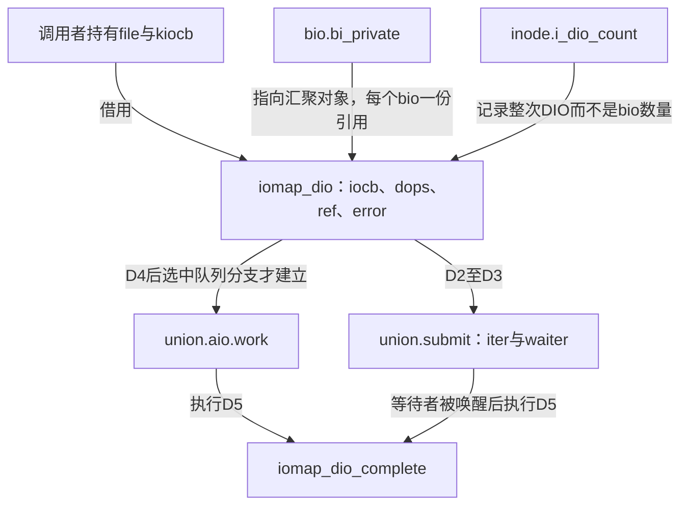
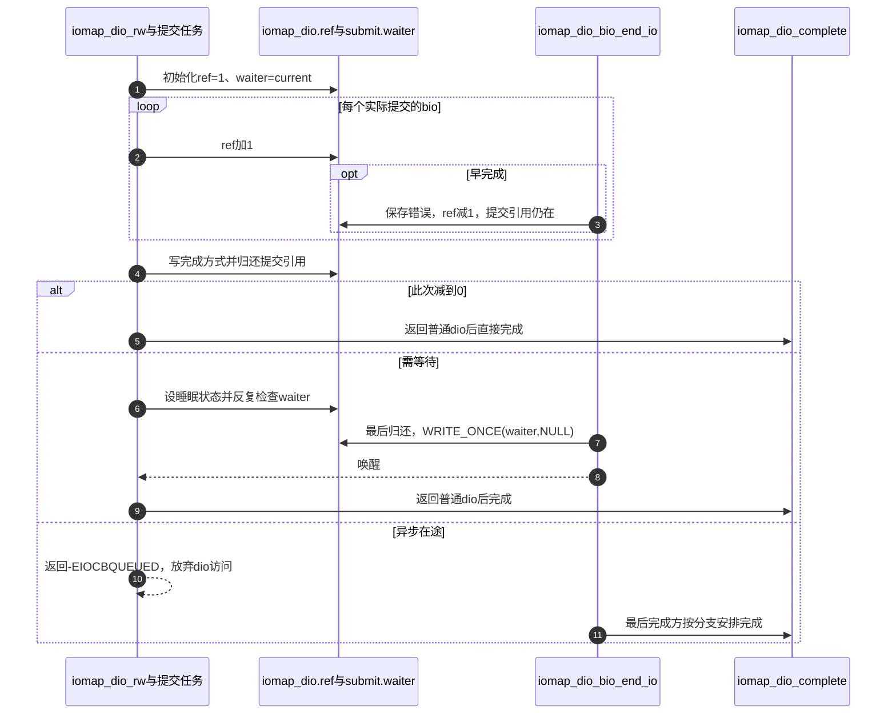

# 第42章\_iomap直接IO的请求建立与提交

文件范围已获准进入直接路径，仍不能马上把一个bio当成整次请求。提交循环可以产生多个子请求，而早先的子请求随时可能完成。本页沿D2～D4建立iomap_dio的生命期，再说明谁得到D5的完成权。

| 阅读关联 | 入口 |
| --- | --- |
| 机制 | [请求责任正文](../../../../knowledge/kernel_subsystems/vfs/P17_Direct_IO与异步完成.md#17.3_一个请求为什么需要独立的完成责任) |
| 模块与版本 | [直接I/O导读](../navigation/P16_直接IO请求与完成责任.md#16.1_先分清请求对象与执行上下文)、[总索引](../navigation/P01_Linux_6.12_VFS源码阅读索引.md#1.1_先固定源码身份与运行证据) |
| 原件 | [iomap/direct-io.c](../../linux/fs/iomap/direct-io.c)、[iomap.h](../../linux/include/linux/iomap.h)、[fs.h](../../linux/include/linux/fs.h)、[iter.c](../../linux/fs/iomap/iter.c) |

固定提交 `dfaf2136deb2af2e60b994421281ba42f1c087e0`。__iomap_dio_rw、iomap_dio_rw与完成接口在iomap.h声明；struct iomap_dio只在direct-io.c定义，外部持有不透明指针。CONFIG_FS_IOMAP由文件系统选入，fs/iomap/Makefile在CONFIG_BLOCK下编译direct-io.o；本次配置两者均启用。AIO和IO_URING也启用，但本页不能由此证明运行时实际走了它们。

## 42.1\_请求容器怎样保存跨上下文状态

iocb和iter由调用者提供；iomap分配自己的dio保存子请求汇聚。它不在这里自动get_file，也不复制用户内容，所以外层仍要保证file、kiocb和缓冲区的有效期。同步适配的栈上kiocb见 [第33章](P33_同步迭代请求与向量缓冲区的交接.md#33.2_栈上的同步请求必须在返回前完成)；异步调用者必须使用适合其回调寿命的请求存储。

```c
/** @brief 仓库补充阅读说明：保存一次DIO的汇聚状态，提交与异步工作成员分阶段复用。 */
struct iomap_dio {
        struct kiocb            *iocb;
        const struct iomap_dio_ops *dops;
        loff_t                  i_size;
        loff_t                  size;
        /* 仓库补充：提交责任与每个bio责任共同决定完成权。 */
        atomic_t                ref;
        unsigned                flags;
        int                     error;
        size_t                  done_before;
        bool                    wait_for_completion;

        union {
                /* used during submission and for synchronous completion: */
                struct {
                        struct iov_iter         *iter;
                        struct task_struct      *waiter;
                } submit;

                /* used for aio completion: */
                struct {
                        struct work_struct      work;
                } aio;
        };
};
```

| 字段或状态 | 初值、写入者与消费方 |
| --- | --- |
| iocb、dops | 建立时借用请求和后端操作表；完成阶段调用end_io及ki_complete，表和对象不能先失效 |
| i_size、size、done_before | i_size取开始时长度，size由本轮迭代累计，done_before由部分操作的调用者传入；完成时限EOF并合并可报告长度 |
| ref | 初值1是提交责任，每个提交bio增加，bio完成与提交结束各自减少；最后归还者决定后续路径 |
| error | 初值0，提交或完成错误用cmpxchg保存首次非零结果；本轮错误，不是mapping的跨调用errseq |
| flags | 初值0，按读写、同步与后端区间逐步收紧完成能力；不能仅在入口判断一次后永不复查 |
| wait_for_completion | 在提交引用归还前写入；最后bio据此选择清waiter并唤醒还是异步交接 |
| submit.iter、submit.waiter | 提交阶段借用iter，waiter初值current；同步最后完成把waiter写NULL，提交者以此为等待条件 |
| aio.work | 与submit成员重叠的union，只在提交责任已结束且确定异步工作队列路径时初始化；不能提交途中改写覆盖iter |



**实现原理与修改边界**：union能复用的前提是提交路径不再需要iter。添加新的异步分支时，首先确定它何时接管唯一完成责任、是否覆盖submit存储、是否仍访问调用者栈，以及哪一方释放dio；不能仅新增一个回调字段。

## 42.2\_提交引用封住子请求提前完成的窗口

__iomap_dio_rw先检查空请求，再分配并初始化dio。读路径检查EOF、按用户目标页设置脏处理标志并协调已有缓存；写路径准备同步标志、范围失效以及可能需要的完成工作队列。这些准备失败发生在inode_dio_begin之前，直接释放dio，不去减少尚未增加的inode计数。

代码保留全部执行语句，裁去部分上游长注释；仓库补充说明见中文注释与下文。

```c
/** @brief 仓库补充阅读说明：建立提交责任，完成拆分后决定等待或异步交接。 */
struct iomap_dio *
__iomap_dio_rw(struct kiocb *iocb, struct iov_iter *iter,
                const struct iomap_ops *ops, const struct iomap_dio_ops *dops,
                unsigned int dio_flags, void *private, size_t done_before)
{
        struct inode *inode = file_inode(iocb->ki_filp);
        struct iomap_iter iomi = {
                .inode          = inode,
                .pos            = iocb->ki_pos,
                .len            = iov_iter_count(iter),
                .flags          = IOMAP_DIRECT,
                .private        = private,
        };
        bool wait_for_completion =
                is_sync_kiocb(iocb) || (dio_flags & IOMAP_DIO_FORCE_WAIT);
        struct blk_plug plug;
        struct iomap_dio *dio;
        loff_t ret = 0;

        trace_iomap_dio_rw_begin(iocb, iter, dio_flags, done_before);

        if (!iomi.len)
                return NULL;

        dio = kmalloc(sizeof(*dio), GFP_KERNEL);
        if (!dio)
                return ERR_PTR(-ENOMEM);

        dio->iocb = iocb;
        /* 仓库补充：保留提交引用，防止已提交bio提前结束整个请求。 */
        atomic_set(&dio->ref, 1);
        dio->size = 0;
        dio->i_size = i_size_read(inode);
        dio->dops = dops;
        dio->error = 0;
        dio->flags = 0;
        dio->done_before = done_before;

        dio->submit.iter = iter;
        dio->submit.waiter = current;

        if (iocb->ki_flags & IOCB_NOWAIT)
                iomi.flags |= IOMAP_NOWAIT;

        if (iov_iter_rw(iter) == READ) {

                dio->flags |= IOMAP_DIO_INLINE_COMP;

                if (iomi.pos >= dio->i_size)
                        goto out_free_dio;

                if (user_backed_iter(iter))
                        dio->flags |= IOMAP_DIO_DIRTY;

                ret = kiocb_write_and_wait(iocb, iomi.len);
                if (ret)
                        goto out_free_dio;
        } else {
                iomi.flags |= IOMAP_WRITE;
                dio->flags |= IOMAP_DIO_WRITE;

                if (iocb->ki_flags & IOCB_DIO_CALLER_COMP)
                        dio->flags |= IOMAP_DIO_CALLER_COMP;

                if (dio_flags & IOMAP_DIO_OVERWRITE_ONLY) {
                        ret = -EAGAIN;
                        if (iomi.pos >= dio->i_size ||
                            iomi.pos + iomi.len > dio->i_size)
                                goto out_free_dio;
                        iomi.flags |= IOMAP_OVERWRITE_ONLY;
                }

                if (iocb_is_dsync(iocb)) {
                        dio->flags |= IOMAP_DIO_NEED_SYNC;

                        if (!(iocb->ki_flags & IOCB_SYNC))
                                dio->flags |= IOMAP_DIO_WRITE_THROUGH;
                }

                ret = kiocb_invalidate_pages(iocb, iomi.len);
                if (ret) {
                        if (ret != -EAGAIN) {
                                trace_iomap_dio_invalidate_fail(inode, iomi.pos,
                                                                iomi.len);
                                ret = -ENOTBLK;
                        }
                        goto out_free_dio;
                }

                if (!wait_for_completion && !inode->i_sb->s_dio_done_wq) {
                        ret = sb_init_dio_done_wq(inode->i_sb);
                        if (ret < 0)
                                goto out_free_dio;
                }
        }

        inode_dio_begin(inode);

        blk_start_plug(&plug);
        while ((ret = iomap_iter(&iomi, ops)) > 0) {
                iomi.processed = iomap_dio_iter(&iomi, dio);

                iocb->ki_flags &= ~IOCB_HIPRI;
        }

        blk_finish_plug(&plug);

        if (iov_iter_rw(iter) == READ && iomi.pos >= dio->i_size)
                iov_iter_revert(iter, iomi.pos - dio->i_size);

        if (ret == -EFAULT && dio->size && (dio_flags & IOMAP_DIO_PARTIAL)) {
                if (!(iocb->ki_flags & IOCB_NOWAIT))
                        wait_for_completion = true;
                ret = 0;
        }

        if (ret == -ENOTBLK) {
                wait_for_completion = true;
                ret = 0;
        }
        if (ret < 0)
                iomap_dio_set_error(dio, ret);

        if (dio->flags & IOMAP_DIO_WRITE_THROUGH)
                dio->flags &= ~IOMAP_DIO_NEED_SYNC;

        /* 仓库补充：先确定最后完成方应当唤醒还是异步接管。 */
        dio->wait_for_completion = wait_for_completion;
        if (!atomic_dec_and_test(&dio->ref)) {
                if (!wait_for_completion) {
                        trace_iomap_dio_rw_queued(inode, iomi.pos, iomi.len);
                        /* 仓库补充：返回后不得再解引用可能已被完成方释放的dio。 */
                        return ERR_PTR(-EIOCBQUEUED);
                }

                for (;;) {
                        set_current_state(TASK_UNINTERRUPTIBLE);
                        if (!READ_ONCE(dio->submit.waiter))
                                break;

                        blk_io_schedule();
                }
                __set_current_state(TASK_RUNNING);
        }

        return dio;

out_free_dio:
        kfree(dio);
        if (ret)
                return ERR_PTR(ret);
        return NULL;
}
```

从inode_dio_begin开始，一次操作已登记为在途。blk_start_plug/blk_finish_plug为块请求批处理划定范围，不是互斥锁，也不表示设备已经完成。iomap_iter由文件系统提供的ops取得区间，iomap_dio_iter处理本段并把进度交回iomi.processed；循环必须走到迭代器报告结束或错误，使其有机会执行iomap_end等收尾，不能在中途随意break。

提交引用保证循环过程中ref不会因所有已发bio完成而降至0。循环结束后先确定wait_for_completion，再归还该引用：若已经为最后一份，提交者持有完成权；否则同步提交者睡眠等待waiter变NULL，异步提交者返回ERR_PTR(-EIOCBQUEUED)。在这个仍有在途责任的异步分支中，从减引用以后起就不能再访问dio，而不是等到return以后才开始限制。回调可能在函数真正返回以前发生，外层必须同时支持这个交错。

| 控制分支或辅助 | 在这次请求中的意义 |
| --- | --- |
| is_sync_kiocb | fs.h以ki_complete是否为NULL判断；不是看O_DIRECT，也不是看IOCB_DSYNC |
| IOMAP_DIO_FORCE_WAIT | 即使存在异步回调也要求本次等待，供后端不能把状态留到返回后的情况使用 |
| IOMAP_DIO_OVERWRITE_ONLY | 拒绝越过原i_size，并把不分配、不补零等要求交给映射层；无法满足时可返回EAGAIN |
| IOCB_NOWAIT、IOMAP_NOWAIT | 向缓存准备与映射层传递不等待约束；它不等于异步回调，也不保证所有路径不分配 |
| IOMAP_DIO_PARTIAL、done_before | 已有进展后遇EFAULT时允许报告一段，再由外层处理缺页并继续；非NOWAIT时强制等本段，最终结果合并已完成量 |
| -ENOTBLK | 当前内部协议中的缓冲回退信号；已提交部分时强制等待，转换成可报告进度，由上层接手剩余数据 |
| IOMAP_DIO_WRITE_THROUGH、NEED_SYNC | 先乐观尝试数据直达保证，各bio若不满足则清标志；只有最终仍保持WRITE_THROUGH时才省后置同步 |
| sb_init_dio_done_wq | 为可能异步收尾的写请求按需建立superblock工作队列，初始化竞争见 [第44章](P44_iomap直接IO的完成汇聚与通知.md#44.3_后处理工作队列与inode计数各管一层) |
| set_current_state与READ_ONCE(waiter) | 先建立可睡眠状态，再检查完成条件，blk_io_schedule等待，退出恢复TASK_RUNNING；不是固定睡若干毫秒 |
| trace_iomap_* | 记录入口、排队或失效失败事件；不持有请求引用，不建立完成保证，未启用或未采集不能当运行证据 |

读取i_size后会在适当位置回退超过EOF的迭代量，完成阶段仍检查可报告读长度。输入迭代器的进度不是后端设备完成数；不能把iomi.processed、dio.size和最后返回值合并成一个字段。

**实现原理与修改边界**：不可提前删除提交引用，不能在异步减引用之后读取dio，也不能在inode_dio_begin之前的错误出口调用inode_dio_end。改变部分I/O或回退分支时检查已提交bio、iter进度、强制等待与done_before，否则可能重复传输或错误归还生命期。

## 42.3\_包装入口只完成仍归自己所有的请求

__iomap_dio_rw返回NULL代表无需进一步完成；错误指针携带失败或排队协议；普通dio指针代表提交方现在拥有D5完成责任。iomap_dio_rw按这三类结果分派。

代码保留全部执行语句，裁去部分上游长注释；仓库补充说明见中文注释与下文。

```c
/** @brief 仓库补充阅读说明：只对仍归提交者所有的请求执行最终完成。 */
ssize_t
iomap_dio_rw(struct kiocb *iocb, struct iov_iter *iter,
                const struct iomap_ops *ops, const struct iomap_dio_ops *dops,
                unsigned int dio_flags, void *private, size_t done_before)
{
        /* 仓库补充：只对仍归提交者所有的请求执行最终完成。 */
        struct iomap_dio *dio;

        dio = __iomap_dio_rw(iocb, iter, ops, dops, dio_flags, private,
                             done_before);
        if (IS_ERR_OR_NULL(dio))
                return PTR_ERR_OR_ZERO(dio);
        return iomap_dio_complete(dio);
}
```



这里只给出引用与完成权，不声称所有bio释放发生在用户通知之前。具体完成回调可能先交回结果，再结束bio自身的页持有清理；清理路径必须只使用仍有效的局部信息。完整顺序见 [最后bio的分派](P44_iomap直接IO的完成汇聚与通知.md#44.1_最后一个bio决定怎样继续收尾)。

**实现原理与修改边界**：NULL、ERR_PTR和普通指针不可混淆；尤其不能把-EIOCBQUEUED当作普通失败后立即释放外层异步请求。新增上层调用者必须列清kiocb回调约定、同步返回和异步通知谁负责关闭引用，并检查同步请求不会把栈地址交给未结束的回调。
