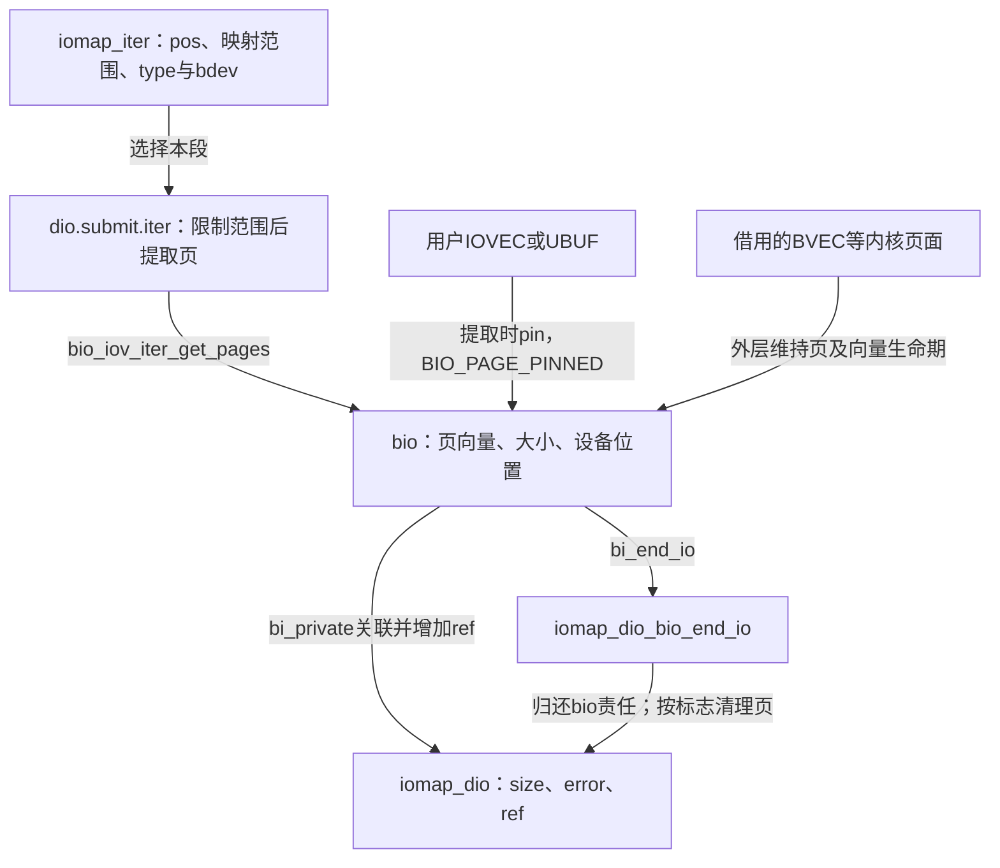
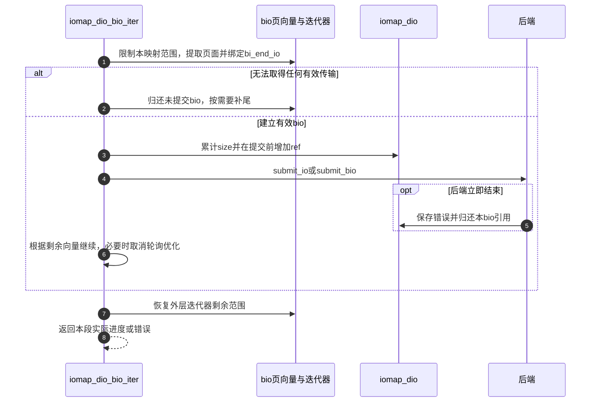

# 第43章\_iomap直接IO的数据映射与bio组装

一个文件字节范围不一定对应一个连续设备范围，也不一定已经分配存储。D3要先解释文件系统交回的映射，再决定补零、复制还是组装bio。本页把映射类型、用户页面与块层请求连起来，不把“直接”理解成无条件把地址送给设备。

| 阅读关联 | 入口 |
| --- | --- |
| 机制 | [直接路径正文](../../../../knowledge/kernel_subsystems/vfs/P17_Direct_IO与异步完成.md#17.3_一个请求为什么需要独立的完成责任) |
| 模块与版本 | [模块导读](../navigation/P16_直接IO请求与完成责任.md#16.1_先分清请求对象与执行上下文)、[总索引](../navigation/P01_Linux_6.12_VFS源码阅读索引.md#1.1_先固定源码身份与运行证据) |
| 原件 | [direct-io.c](../../linux/fs/iomap/direct-io.c)、[iomap.h](../../linux/include/linux/iomap.h)、[bio.c](../../linux/block/bio.c)、[bio.h](../../linux/include/linux/bio.h)、[iov_iter.c](../../linux/lib/iov_iter.c)、[设计说明](../../linux/Documentation/filesystems/iomap/design.rst) |

固定提交 `dfaf2136deb2af2e60b994421281ba42f1c087e0`。本页的iomap_dio_*辅助均是direct-io.c内部实现，公共bio入口声明在bio.h，迭代器提取声明在uio.h。代码依赖FS_IOMAP与BLOCK；本次配置均开启。页固定、DMA映射与实际设备驱动各有自己的算法，本页核对本请求调用它们的所有权契约，不把体系结构缓存维护细节臆造进来。

## 43.1\_映射类型先决定需要做什么

iomap_iter通过文件系统的iomap_begin取得一段文件范围映射，必要时通过iomap_end交回阶段进度。iomap保存offset/length、type、flags、bdev和设备addr等信息；本页只消费其输出，不在VFS中复制ext4的extent查找与分配算法。

代码保留全部执行语句，裁去部分上游长注释；仓库补充说明见中文注释与下文。

```c
/** @brief 仓库补充阅读说明：按映射类型选择补零、内联复制或bio。 */
static loff_t iomap_dio_iter(const struct iomap_iter *iter,
                struct iomap_dio *dio)
{
        /* 仓库补充：按映射类型选择补零、内联复制或bio。 */
        switch (iter->iomap.type) {
        case IOMAP_HOLE:
                if (WARN_ON_ONCE(dio->flags & IOMAP_DIO_WRITE))
                        return -EIO;
                return iomap_dio_hole_iter(iter, dio);
        case IOMAP_UNWRITTEN:
                if (!(dio->flags & IOMAP_DIO_WRITE))
                        return iomap_dio_hole_iter(iter, dio);
                return iomap_dio_bio_iter(iter, dio);
        case IOMAP_MAPPED:
                return iomap_dio_bio_iter(iter, dio);
        case IOMAP_INLINE:
                return iomap_dio_inline_iter(iter, dio);
        case IOMAP_DELALLOC:

                pr_warn_ratelimited("Direct I/O collision with buffered writes! File: %pD4 Comm: %.20s\n",
                                    dio->iocb->ki_filp, current->comm);
                return -EIO;
        default:
                WARN_ON_ONCE(1);
                return -EIO;
        }
}
```

| 映射类型 | 当前处理与边界 |
| --- | --- |
| IOMAP_HOLE | 读路径用零填目标范围；若写请求收到未分配的洞，WARN并返回EIO，映射层应先兑现写入分配 |
| IOMAP_UNWRITTEN | 读取仍表现为零；写入进入bio路径并记录完成后需要的转换责任 |
| IOMAP_MAPPED | 已有设备映射，进入bio路径 |
| IOMAP_INLINE | 数据放在映射提供的内联存储中，直接复制，并按写入结果更新长度及脏责任 |
| IOMAP_DELALLOC | 直接路径看到延迟分配，可能由与mmap写的交错造成；限速告警并返回EIO，不假装已有设备地址 |

```c
/** @brief 仓库补充阅读说明：向读取目标补零并记录实际进度。 */
static loff_t iomap_dio_hole_iter(const struct iomap_iter *iter,
                struct iomap_dio *dio)
{
        /* 仓库补充：向读取目标补零并记录实际进度。 */
        loff_t length = iov_iter_zero(iomap_length(iter), dio->submit.iter);

        dio->size += length;
        if (!length)
                return -EFAULT;
        return length;
}
```

```c
/** @brief 仓库补充阅读说明：按内联映射复制并更新必要元数据。 */
static loff_t iomap_dio_inline_iter(const struct iomap_iter *iomi,
                struct iomap_dio *dio)
{
        /* 仓库补充：按内联映射复制并更新必要元数据。 */
        const struct iomap *iomap = &iomi->iomap;
        struct iov_iter *iter = dio->submit.iter;
        void *inline_data = iomap_inline_data(iomap, iomi->pos);
        loff_t length = iomap_length(iomi);
        loff_t pos = iomi->pos;
        size_t copied;

        if (WARN_ON_ONCE(!iomap_inline_data_valid(iomap)))
                return -EIO;

        if (dio->flags & IOMAP_DIO_WRITE) {
                loff_t size = iomi->inode->i_size;

                if (pos > size)
                        memset(iomap_inline_data(iomap, size), 0, pos - size);
                copied = copy_from_iter(inline_data, length, iter);
                if (copied) {
                        if (pos + copied > size)
                                i_size_write(iomi->inode, pos + copied);
                        mark_inode_dirty(iomi->inode);
                }
        } else {
                copied = copy_to_iter(inline_data, length, iter);
        }
        dio->size += copied;
        if (!copied)
                return -EFAULT;
        return copied;
}
```

hole辅助用iov_iter_zero写目标缓冲区，实际长度加入dio.size，完全无进展时返回EFAULT。inline辅助校验内联范围；写越过旧长度时先填中间空隙，复制成功后更新i_size并登记inode脏状态。它们说明DIO的“完成量”不等于“设备传输了多少字节”。

iomap_inline_data及valid辅助由iomap.h提供，使用映射的内联指针与偏移；copy_to_iter/copy_from_iter可短复制，i_size_write与mark_inode_dirty仍遵循文件元数据协议。WARN_ON_ONCE用于暴露后端违反类型/范围契约，负错误才是控制流结果；关闭或未看到告警不能证明错误分支不存在。

**实现原理与修改边界**：添加映射类型必须同时定义读写意义、是否需要真实bio、如何报告部分进度、是否产生元数据责任。不能把洞读取都改成设备零块读取，也不能把UNWRITTEN当成已经对用户可见的初始化内容。

## 43.2\_为已映射范围建立有生命期的bio

进入bio路径后，文件偏移、段长度及迭代器地址范围需要满足设备要求。文件系统可以提出更严格的约束，不能用这里的块设备检查替代所有上层检查。随后把迭代器暂时限制在当前映射范围，逐bio取得页并更新实际进度，结束时恢复外层剩余范围。

代码保留全部执行语句，裁去部分上游长注释；仓库补充说明见中文注释与下文。

```c
/** @brief 仓库补充阅读说明：限制当前映射范围，组装页面并提交bio，保留尾块补零。 */
static loff_t iomap_dio_bio_iter(const struct iomap_iter *iter,
                struct iomap_dio *dio)
{
        const struct iomap *iomap = &iter->iomap;
        struct inode *inode = iter->inode;
        unsigned int fs_block_size = i_blocksize(inode), pad;
        loff_t length = iomap_length(iter);
        loff_t pos = iter->pos;
        blk_opf_t bio_opf;
        struct bio *bio;
        bool need_zeroout = false;
        bool use_fua = false;
        int nr_pages, ret = 0;
        size_t copied = 0;
        size_t orig_count;

        if ((pos | length) & (bdev_logical_block_size(iomap->bdev) - 1) ||
            !bdev_iter_is_aligned(iomap->bdev, dio->submit.iter))
                return -EINVAL;

        if (iomap->type == IOMAP_UNWRITTEN) {
                dio->flags |= IOMAP_DIO_UNWRITTEN;
                need_zeroout = true;
        }

        if (iomap->flags & IOMAP_F_SHARED)
                dio->flags |= IOMAP_DIO_COW;

        if (iomap->flags & IOMAP_F_NEW) {
                need_zeroout = true;
        } else if (iomap->type == IOMAP_MAPPED) {

                if (!(iomap->flags & (IOMAP_F_SHARED|IOMAP_F_DIRTY)) &&
                    (dio->flags & IOMAP_DIO_WRITE_THROUGH) &&
                    (bdev_fua(iomap->bdev) || !bdev_write_cache(iomap->bdev)))
                        use_fua = true;
                else if (dio->flags & IOMAP_DIO_NEED_SYNC)
                        dio->flags &= ~IOMAP_DIO_CALLER_COMP;
        }

        orig_count = iov_iter_count(dio->submit.iter);
        iov_iter_truncate(dio->submit.iter, length);

        if (!iov_iter_count(dio->submit.iter))
                goto out;

        if (need_zeroout ||
            ((dio->flags & IOMAP_DIO_NEED_SYNC) && !use_fua) ||
            ((dio->flags & IOMAP_DIO_WRITE) && pos >= i_size_read(inode)))
                dio->flags &= ~IOMAP_DIO_CALLER_COMP;

        if (!(dio->flags & (IOMAP_DIO_INLINE_COMP|IOMAP_DIO_CALLER_COMP)))
                dio->iocb->ki_flags &= ~IOCB_HIPRI;

        if (need_zeroout) {

                pad = pos & (fs_block_size - 1);

                ret = iomap_dio_zero(iter, dio, pos - pad, pad);
                if (ret)
                        goto out;
        }

        bio_opf = iomap_dio_bio_opflags(dio, iomap, use_fua);

        nr_pages = bio_iov_vecs_to_alloc(dio->submit.iter, BIO_MAX_VECS);
        do {
                size_t n;
                if (dio->error) {
                        iov_iter_revert(dio->submit.iter, copied);
                        copied = ret = 0;
                        goto out;
                }

                bio = iomap_dio_alloc_bio(iter, dio, nr_pages, bio_opf);
                fscrypt_set_bio_crypt_ctx(bio, inode, pos >> inode->i_blkbits,
                                          GFP_KERNEL);
                bio->bi_iter.bi_sector = iomap_sector(iomap, pos);
                bio->bi_write_hint = inode->i_write_hint;
                bio->bi_ioprio = dio->iocb->ki_ioprio;
                bio->bi_private = dio;
                bio->bi_end_io = iomap_dio_bio_end_io;

                /* 仓库补充：取得本bio所需页面，失败仍进入尾部补零处理。 */
                ret = bio_iov_iter_get_pages(bio, dio->submit.iter);
                if (unlikely(ret)) {

                        bio_put(bio);
                        goto zero_tail;
                }

                n = bio->bi_iter.bi_size;
                if (dio->flags & IOMAP_DIO_WRITE) {
                        task_io_account_write(n);
                } else {
                        if (dio->flags & IOMAP_DIO_DIRTY)
                                bio_set_pages_dirty(bio);
                }

                /* 仓库补充：累计本轮数据进度；最终结果还受错误与EOF约束。 */
                dio->size += n;
                copied += n;

                nr_pages = bio_iov_vecs_to_alloc(dio->submit.iter,
                                                 BIO_MAX_VECS);

                if (nr_pages)
                        dio->iocb->ki_flags &= ~IOCB_HIPRI;
                iomap_dio_submit_bio(iter, dio, bio, pos);
                pos += n;
        } while (nr_pages);

zero_tail:
        if (need_zeroout ||
            ((dio->flags & IOMAP_DIO_WRITE) && pos >= i_size_read(inode))) {

                pad = pos & (fs_block_size - 1);
                if (pad)
                        ret = iomap_dio_zero(iter, dio, pos,
                                             fs_block_size - pad);
        }
out:

        iov_iter_reexpand(dio->submit.iter, orig_count - copied);
        if (copied)
                return copied;
        return ret;
}
```

这段循环没有把用户指针原样塞给设备。bio_iov_iter_get_pages建立bio页向量：用户IOVEC/UBUF会取得pin；BVEC等内核来源可以借用已有页/向量，调用者必须继续持有。bio中的BIO_PAGE_PINNED标记决定后续释放方式，本版本bio_release_pages只在该标记成立时进入解除固定路径。不能把旧注释提到的NO_PAGE_REF当作本版本释放函数实际检查的分支。



| 实现簇 | 在本操作中的契约与状态副作用 |
| --- | --- |
| bdev_logical_block_size、bdev_iter_is_aligned | 核对文件段和内存迭代器是否满足块设备对齐；失败在本段返回EINVAL |
| iov_iter_truncate/reexpand | 临时缩小本映射可消费范围，结束后按copied恢复剩余量；不能把整个请求剩余量永久裁掉 |
| bio_iov_vecs_to_alloc、BIO_MAX_VECS | 估算可装入一个bio的页向量上限，容量不足会继续拆分，不能推断一个DIO只有一个bio |
| bio_iov_iter_get_pages | 从迭代器提取页并推进范围，可取得部分页；失败处理必须配对页与bio所有权，不能据函数名猜只是查询 |
| bi_sector、bi_write_hint、bi_ioprio | 分别给出设备位置与提示/优先级；优先级提示不改变完成计数的正确性 |
| bi_private、bi_end_io | 绑定dio和完成入口；由完成方保存结果并归还本bio的引用 |
| fscrypt_set_bio_crypt_ctx | 将加密上下文附着到bio的接入点；本次FS_ENCRYPTION关闭，不宣称实际加密传输 |
| IOMAP_DIO_DIRTY | 对用户目标内存的直接读，提前标脏并在完成时复查；不是被读取文件页缓存变脏 |
| task_io_account_write | 任务写入记账，不是设备成功计数 |
| IOCB_HIPRI | 单bio且支持相应完成方式时才可保留轮询优化；拆分或需要其他收尾会清除，不能据输入标志断言走轮询 |

取页失败后仍可能需要补齐最后一个文件块的未写部分，因此代码转到zero_tail，不能只bio_put后立即返回，留下向mmap暴露旧内容的尾部。dio.error已存在时撤回本段copied对应的迭代进度；这不撤销已发生的设备写入。返回值仍按当前copied优先级和具体分支判断，不能把部分成功概括成全范围未动。

**实现原理与修改边界**：改变页向量容量、取页或迭代器调整时，核对部分取得、对齐修剪、页pin/借用差异、所有bio的释放与尾块补零。不能把延后页面清理当作应用可提前复用数据，也不能随意删掉未写区间转换后置的缓存失效。

## 43.3\_补零和同步标志会改变完成要求

新分配或未写区间的部分块写入，需要处理头尾未覆盖部分，否则旧介质内容可能被当作文件数据读出。zero_page是本文件的静态页指针，启动初始化通过fs_initcall分配清零的64KiB容量；IOMAP_ZERO_PAGE_ORDER由页大小换算阶数。它是本实现共享的补零来源，不是每个请求的用户缓冲区。

```c
/** @brief 仓库补充阅读说明：启动时建立共享补零来源。 */
static int __init iomap_dio_init(void)
{
        /* 仓库补充：启动时建立共享补零来源。 */
        zero_page = alloc_pages(GFP_KERNEL | __GFP_ZERO,
                                IOMAP_ZERO_PAGE_ORDER);

        if (!zero_page)
                return -ENOMEM;

        return 0;
}
```

```c
/** @brief 仓库补充阅读说明：补零bio同样绑定并持有本次请求。 */
static int iomap_dio_zero(const struct iomap_iter *iter, struct iomap_dio *dio,
                loff_t pos, unsigned len)
{
        /* 仓库补充：补零bio同样绑定并持有本次请求。 */
        struct inode *inode = file_inode(dio->iocb->ki_filp);
        struct bio *bio;

        if (!len)
                return 0;
        /*
         * Max block size supported is 64k
         */
        if (WARN_ON_ONCE(len > IOMAP_ZERO_PAGE_SIZE))
                return -EINVAL;

        bio = iomap_dio_alloc_bio(iter, dio, 1, REQ_OP_WRITE | REQ_SYNC | REQ_IDLE);
        fscrypt_set_bio_crypt_ctx(bio, inode, pos >> inode->i_blkbits,
                                  GFP_KERNEL);
        bio->bi_iter.bi_sector = iomap_sector(&iter->iomap, pos);
        bio->bi_private = dio;
        bio->bi_end_io = iomap_dio_bio_end_io;

        __bio_add_page(bio, zero_page, len, 0);
        iomap_dio_submit_bio(iter, dio, bio, pos);
        return 0;
}
```

零长度补零直接返回。非零路径核对长度不超出零页容量，建立写bio、绑定设备偏移、dio与完成函数，再提交；补零bio同样取得并归还请求引用。初始化分配失败返回ENOMEM，不能在说明中默认内存始终足够。

```c
/** @brief 仓库补充阅读说明：按读写与FUA能力设置块请求标志。 */
static inline blk_opf_t iomap_dio_bio_opflags(struct iomap_dio *dio,
                const struct iomap *iomap, bool use_fua)
{
        /* 仓库补充：按读写与FUA能力设置块请求标志。 */
        blk_opf_t opflags = REQ_SYNC | REQ_IDLE;

        if (!(dio->flags & IOMAP_DIO_WRITE))
                return REQ_OP_READ;

        opflags |= REQ_OP_WRITE;
        if (use_fua)
                opflags |= REQ_FUA;
        else
                dio->flags &= ~IOMAP_DIO_WRITE_THROUGH;

        return opflags;
}
```

IOMAP_DIO_WRITE_THROUGH表示尝试用每段的设备保证覆盖所需数据同步，不满足的bio会清除此标志。只有纯数据映射、无需共享/脏元数据处理且设备能力允许时才选FUA；必要后处理、补零或扩展会收紧CALLER_COMP等完成能力。REQ_SYNC是块层请求分类标志，不自动等同于O_SYNC的完整用户契约。

FUA表示该次写入需要满足相应的稳定介质要求；设备无易失写缓存时也可能不必追加flush。本页只解释代码如何提出要求，没有验证实际设备是否兑现。需要后置同步时由最终完成阶段连接generic_write_sync，见 [第44章](P44_iomap直接IO的完成汇聚与通知.md#44.2_最终完成先兑现后端再交回结果)。

**实现原理与修改边界**：修改补零范围时要同时覆盖头部、短I/O尾部、越过EOF和UNWRITTEN转换；改变FUA判断必须复核每个bio是否都满足条件，不能只因为第一个bio可直达就省整个请求的同步。

## 43.4\_真正提交之前必须先登记完成引用

bio分配选择后端可选的bio_set，否则使用通用分配器。submit_io可以由文件系统覆盖，但它必须最终归还本bio的完成责任；默认进入submit_bio。

```c
/** @brief 仓库补充阅读说明：按后端资源池或默认方式分配bio。 */
static struct bio *iomap_dio_alloc_bio(const struct iomap_iter *iter,
                struct iomap_dio *dio, unsigned short nr_vecs, blk_opf_t opf)
{
        /* 仓库补充：按后端资源池或默认方式分配bio。 */
        if (dio->dops && dio->dops->bio_set)
                return bio_alloc_bioset(iter->iomap.bdev, nr_vecs, opf,
                                        GFP_KERNEL, dio->dops->bio_set);
        return bio_alloc(iter->iomap.bdev, nr_vecs, opf, GFP_KERNEL);
}
```

```c
/** @brief 仓库补充阅读说明：提交前先增加引用，防止快速完成抢先结束。 */
static void iomap_dio_submit_bio(const struct iomap_iter *iter,
                struct iomap_dio *dio, struct bio *bio, loff_t pos)
{
        /* 仓库补充：提交前先增加引用，防止快速完成抢先结束。 */
        struct kiocb *iocb = dio->iocb;

        atomic_inc(&dio->ref);

        /* Sync dio can't be polled reliably */
        if ((iocb->ki_flags & IOCB_HIPRI) && !is_sync_kiocb(iocb)) {
                bio_set_polled(bio, iocb);
                WRITE_ONCE(iocb->private, bio);
        }

        if (dio->dops && dio->dops->submit_io)
                dio->dops->submit_io(iter, bio, pos);
        else
                submit_bio(bio);
}
```

atomic_inc在实际提交之前。设备可以很快完成，若反过来先提交再增加ref，完成方就可能错误地认为请求已经无人持有。同步kiocb不按此处轮询协议登记；异步HIPRI分支设置bio轮询属性并以WRITE_ONCE保存iocb.private，完成路径按协议清理或重新用作延后完成数据。



**实现原理与修改边界**：后端覆盖submit_io时必须保留bi_private/bi_end_io协议，若加自己的私有信息和回调，要在自身后处理后调用iomap_dio_bio_end_io。改变轮询或private用途要与调用者延后完成分支同步检查，不能同时把同一指针解释成bio与dio。
