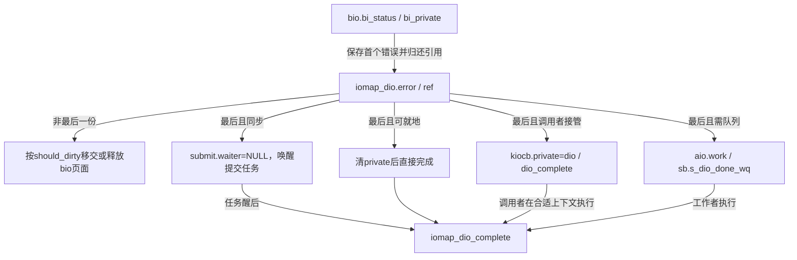
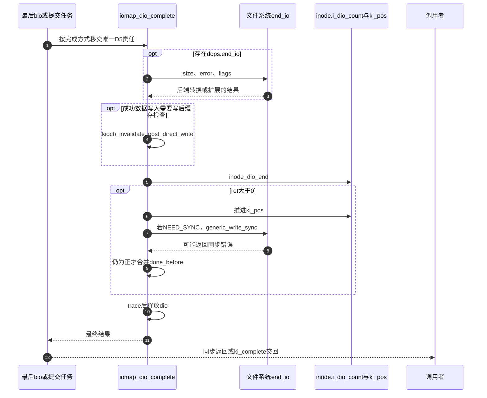

# 第44章\_iomap直接IO的完成汇聚与通知

最后一个设备请求结束，只说明子请求责任可以汇聚，还可能留下文件系统区间转换、缓存检查与同步。D4必须选择能够执行这些动作的上下文，D5再把结果交给调用者。本页把错误、引用、唤醒、工作项和inode计数分别定位，避免把一次回调当成所有对象已经释放。

| 阅读关联 | 入口 |
| --- | --- |
| 机制 | [完成方式正文](../../../../knowledge/kernel_subsystems/vfs/P17_Direct_IO与异步完成.md#17.4_同步等待与异步回调怎样共享结果) |
| 模块与版本 | [模块导读](../navigation/P16_直接IO请求与完成责任.md#16.1_先分清请求对象与执行上下文)、[总索引](../navigation/P01_Linux_6.12_VFS源码阅读索引.md#1.1_先固定源码身份与运行证据) |
| 原件 | [iomap/direct-io.c](../../linux/fs/iomap/direct-io.c)、[fs.h](../../linux/include/linux/fs.h)、[inode.c](../../linux/fs/inode.c)、[super.c](../../linux/fs/super.c)、[bio.c](../../linux/block/bio.c) |

固定提交 `dfaf2136deb2af2e60b994421281ba42f1c087e0`。iomap_dio_bio_end_io与iomap_dio_complete由iomap.h声明，错误与工作辅助为本文件内部函数。inode计数包装及generic_write_sync在fs.h内联，等待接口在fs.h声明、inode.c定义；sb_init_dio_done_wq由fs/internal.h声明、super.c定义。当前FS_IOMAP、BLOCK启用，源码中的异步和轮询分支仅是实现覆盖，不是运行轨迹。

## 44.1\_最后一个bio决定怎样继续收尾

提交方和不同bio完成方都可能报告错误，iomap_dio_set_error用cmpxchg只把初值0替换为第一个错误。bio完成先转换bi_status并保存结果，再归还自身引用；尚非最后责任时只处理本bio的页面清理。

```c
/** @brief 仓库补充阅读说明：只保存本次请求遇到的第一个非零错误。 */
static inline void iomap_dio_set_error(struct iomap_dio *dio, int ret)
{
        /* 仓库补充：只保存本次请求遇到的第一个非零错误。 */
        cmpxchg(&dio->error, 0, ret);
}
```

```c
/** @brief 仓库补充阅读说明：归还bio责任，最后完成方选择后续上下文。 */
void iomap_dio_bio_end_io(struct bio *bio)
{
        struct iomap_dio *dio = bio->bi_private;
        bool should_dirty = (dio->flags & IOMAP_DIO_DIRTY);
        struct kiocb *iocb = dio->iocb;

        if (bio->bi_status)
                iomap_dio_set_error(dio, blk_status_to_errno(bio->bi_status));
        /* 仓库补充：先归还本bio引用；非最后责任不接管最终完成。 */
        if (!atomic_dec_and_test(&dio->ref))
                goto release_bio;

        /*
         * Synchronous dio, task itself will handle any completion work
         * that needs after IO. All we need to do is wake the task.
         */
        if (dio->wait_for_completion) {
                struct task_struct *waiter = dio->submit.waiter;

                /* 仓库补充：先发布等待条件结束，再唤醒提交任务。 */
                WRITE_ONCE(dio->submit.waiter, NULL);
                blk_wake_io_task(waiter);
                goto release_bio;
        }

        /*
         * Flagged with IOMAP_DIO_INLINE_COMP, we can complete it inline
         */
        if (dio->flags & IOMAP_DIO_INLINE_COMP) {
                WRITE_ONCE(iocb->private, NULL);
                iomap_dio_complete_work(&dio->aio.work);
                goto release_bio;
        }

        /*
         * If this dio is flagged with IOMAP_DIO_CALLER_COMP, then schedule
         * our completion that way to avoid an async punt to a workqueue.
         */
        if (dio->flags & IOMAP_DIO_CALLER_COMP) {
                /* only polled IO cares about private cleared */
                iocb->private = dio;
                iocb->dio_complete = iomap_dio_deferred_complete;

                /*
                 * Invoke ->ki_complete() directly. We've assigned our
                 * dio_complete callback handler, and since the issuer set
                 * IOCB_DIO_CALLER_COMP, we know their ki_complete handler will
                 * notice ->dio_complete being set and will defer calling that
                 * handler until it can be done from a safe task context.
                 *
                 * Note that the 'res' being passed in here is not important
                 * for this case. The actual completion value of the request
                 * will be gotten from dio_complete when that is run by the
                 * issuer.
                 */
                /* 仓库补充：此处0只是延后执行交接，不是最终传输结果。 */
                iocb->ki_complete(iocb, 0);
                goto release_bio;
        }

        /*
         * Async DIO completion that requires filesystem level completion work
         * gets punted to a work queue to complete as the operation may require
         * more IO to be issued to finalise filesystem metadata changes or
         * guarantee data integrity.
         */
        INIT_WORK(&dio->aio.work, iomap_dio_complete_work);
        queue_work(file_inode(iocb->ki_filp)->i_sb->s_dio_done_wq,
                        &dio->aio.work);
release_bio:
        if (should_dirty) {
                bio_check_pages_dirty(bio);
        } else {
                bio_release_pages(bio, false);
                bio_put(bio);
        }
}
```

最后一份引用归还后分为四种去向，顺序有意义。

| 条件 | 实际动作 | 谁执行最终收尾 |
| --- | --- | --- |
| wait_for_completion | 取waiter，写NULL，再blk_wake_io_task | 被唤醒的提交任务 |
| IOMAP_DIO_INLINE_COMP | 清iocb.private，就地调用完成包装 | 当前完成上下文；只有允许这种收尾的请求才可置此标志 |
| IOMAP_DIO_CALLER_COMP | private改存dio，安装dio_complete，再调用ki_complete(iocb,0) | 已声明支持此协议的调用者在安全任务上下文中延后执行 |
| 其他异步请求 | 初始化aio.work并投递superblock完成队列 | 工作队列执行者 |

CALLER_COMP分支传给ki_complete的0只是触发交接的占位值，最终结果由dio_complete取得；不能把它向用户报告成“成功传输0字节”。private此前可能曾保存用于轮询的bio，现在用途发生改变，调用者必须按协议辨别。

release_bio并不总先于ki_complete。函数进入时已把should_dirty等必要信息保存为局部变量，因此dio甚至外层kiocb可能已经在通知链中释放，后续页面清理不能重新解引用它们。应区分“数据访问已经结束，可以通知”与“内核最后的pin/记账清理已经结束”。

若should_dirty成立，bio_check_pages_dirty接管bio：页面仍脏时直接解除固定并归还bio；若已有页变干净，会挂到bio_dirty_list，由bio_dirty_work在进程上下文重新标脏并释放。这个列表、锁和工作项属于block/bio.c的通用页清理框架，本请求只负责在正确位置交出bio，不复制该框架算法。非DIRTY分支执行bio_release_pages与bio_put；解除pin依据BIO_PAGE_PINNED，不对借用内核页一概put。



**实现原理与修改边界**：新增完成分支前核对是否可能睡眠、是否需额外I/O、调用者是否声明支持、private当前存什么，以及最后引用归谁。错误保存必须先于完成可见；不能在可能释放dio的调用后继续访问dio，也不能把通知顺序改成无条件先等待所有通用页清理工作。

## 44.2\_最终完成先兑现后端再交回结果

iomap_dio_complete先调用dops->end_io。后端可以转换未写区间、处理扩展或返回错误。只有在这些动作之后进行写后缓存失效，才能避免缓冲读提前把未转换区间的零内容缓存下来。

```c
/** @brief 仓库补充阅读说明：先兑现后端收尾，再处理位置、同步与结果。 */
ssize_t iomap_dio_complete(struct iomap_dio *dio)
{
        const struct iomap_dio_ops *dops = dio->dops;
        struct kiocb *iocb = dio->iocb;
        loff_t offset = iocb->ki_pos;
        ssize_t ret = dio->error;

        if (dops && dops->end_io)
                /* 仓库补充：后端区间转换等动作必须先于写后缓存失效。 */
                ret = dops->end_io(iocb, dio->size, ret, dio->flags);

        if (likely(!ret)) {
                ret = dio->size;
                /* check for short read */
                if (offset + ret > dio->i_size &&
                    !(dio->flags & IOMAP_DIO_WRITE))
                        ret = dio->i_size - offset;
        }

        /*
         * Try again to invalidate clean pages which might have been cached by
         * non-direct readahead, or faulted in by get_user_pages() if the source
         * of the write was an mmap'ed region of the file we're writing.  Either
         * one is a pretty crazy thing to do, so we don't support it 100%.  If
         * this invalidation fails, tough, the write still worked...
         *
         * And this page cache invalidation has to be after ->end_io(), as some
         * filesystems convert unwritten extents to real allocations in
         * ->end_io() when necessary, otherwise a racing buffer read would cache
         * zeros from unwritten extents.
         */
        if (!dio->error && dio->size && (dio->flags & IOMAP_DIO_WRITE))
                kiocb_invalidate_post_direct_write(iocb, dio->size);

        /* 仓库补充：结束inode级DIO登记，不等于外层通知已经返回。 */
        inode_dio_end(file_inode(iocb->ki_filp));

        if (ret > 0) {
                iocb->ki_pos += ret;

                /*
                 * If this is a DSYNC write, make sure we push it to stable
                 * storage now that we've written data.
                 */
                if (dio->flags & IOMAP_DIO_NEED_SYNC)
                        ret = generic_write_sync(iocb, ret);
                if (ret > 0)
                        ret += dio->done_before;
        }
        trace_iomap_dio_complete(iocb, dio->error, ret);
        /* 仓库补充：此后只能使用保存的局部结果。 */
        kfree(dio);
        return ret;
}
```

ret先取dio.error，但end_io存在时会用其返回结果覆盖；不能把后端回调约定当成普通void通知。没有错误且后端没有返回实际长度时用dio.size，读操作再限制到开始快照i_size；实际返回可能与提交量不同。

随后inode_dio_end结束此操作的inode级在途登记。正进度推进ki_pos，需要时调用generic_write_sync，仍为正时加入done_before，最后记录trace并释放dio。因此inode计数归零不等于所有调用者都已经返回，更不能当作每次fsync均完成的证据。

```c
/** @brief 仓库补充阅读说明：同步语义同时考虑请求与inode属性。 */
static inline bool iocb_is_dsync(const struct kiocb *iocb)
{
        /* 仓库补充：同步语义同时考虑请求与inode属性。 */
        return (iocb->ki_flags & IOCB_DSYNC) ||
                IS_SYNC(iocb->ki_filp->f_mapping->host);
}
```

```c
/** @brief 仓库补充阅读说明：以已推进的位置构造同步范围，保留同步错误。 */
static inline ssize_t generic_write_sync(struct kiocb *iocb, ssize_t count)
{
        /* 仓库补充：以已推进的位置构造同步范围，保留同步错误。 */
        if (iocb_is_dsync(iocb)) {
                int ret = vfs_fsync_range(iocb->ki_filp,
                                iocb->ki_pos - count, iocb->ki_pos - 1,
                                (iocb->ki_flags & IOCB_SYNC) ? 0 : 1);
                if (ret)
                        return ret;
        }

        return count;
}
```

iocb_is_dsync同时考虑请求标志与inode同步属性。generic_write_sync依赖ki_pos已推进，用“当前位置减本次长度”组成范围；IOCB_SYNC选择完整fsync，否则选择datasync。同步错误会替换正长度作为返回值，但已经发生的写入和位置推进不会因此自动回滚。范围同步分派在 [第39章](P39_同步入口与文件系统持久化.md#39.1_系统调用先取得file再交给其同步方法) 唯一展开。

```c
/** @brief 仓库补充阅读说明：调用者延后完成通道交回最终结果。 */
static ssize_t iomap_dio_deferred_complete(void *data)
{
        /* 仓库补充：调用者延后完成通道交回最终结果。 */
        return iomap_dio_complete(data);
}
```

```c
/** @brief 仓库补充阅读说明：保存外层请求指针后完成并通知。 */
static void iomap_dio_complete_work(struct work_struct *work)
{
        /* 仓库补充：保存外层请求指针后完成并通知。 */
        struct iomap_dio *dio = container_of(work, struct iomap_dio, aio.work);
        struct kiocb *iocb = dio->iocb;

        iocb->ki_complete(iocb, iomap_dio_complete(dio));
}
```

deferred包装接收此前保存在private的dio，返回最终结果。work包装通过container_of取回嵌入aio.work的dio，先保存iocb指针，再完成并通知；iomap_dio_complete会释放dio，所以不能在它之后又从dio取iocb。container_of只是从成员地址恢复容器，不增加生命期引用。



**实现原理与修改边界**：不能把缓存失效移到end_io之前；不能把inode_dio_end移动到只处理成功的分支；不能在generic_write_sync之前忘记推进ki_pos。修改结果合并时分别检查短读、部分请求done_before、后端正返回和同步失败，避免把已修改数据误描述成事务回滚。

## 44.3\_后处理工作队列与inode计数各管一层

superblock的s_dio_done_wq起初随对象零初始化为NULL。第一次需要异步写收尾时按需分配队列，名称含s_id；并发建立时用cmpxchg发布唯一实例，竞争失败者销毁自己刚分配的队列。WQ_MEM_RECLAIM表达回收场景的前进要求，不表示每个inode独占一条线程。

```c
/** @brief 仓库补充阅读说明：原子发布按需建立的完成队列，清理竞争失败实例。 */
int sb_init_dio_done_wq(struct super_block *sb)
{
        /* 仓库补充：原子发布按需建立的完成队列，清理竞争失败实例。 */
        struct workqueue_struct *old;
        struct workqueue_struct *wq = alloc_workqueue("dio/%s",
                                                      WQ_MEM_RECLAIM, 0,
                                                      sb->s_id);
        if (!wq)
                return -ENOMEM;
        /*
         * This has to be atomic as more DIOs can race to create the workqueue
         */
        old = cmpxchg(&sb->s_dio_done_wq, NULL, wq);
        /* Someone created workqueue before us? Free ours... */
        if (old)
                destroy_workqueue(wq);
        return 0;
}
```

INIT_WORK在选择队列完成分支时把dio.aio.work绑定iomap_dio_complete_work。queue_work只负责投递，不能当作当前任务已执行了后处理。superblock关闭路径在完成相应停用流程时destroy_workqueue并清指针，不能在仍可能提交的状态下手动释放队列。通用工作队列的执行与取消见 [工作队列总索引](../../workqueue/navigation/P01_Linux_6.12_工作队列源码总阅读索引.md#1.3_三条模块分支)，本页只展开这个superblock实例的建立、投递与生命期。

inode.i_dio_count由inode_init_always初始化为0。每次请求开始加1，完成减1，最后变0时wake_up_var唤醒以该变量地址为键的等待者；它统计DIO请求，不统计bio或file引用。

```c
/** @brief 仓库补充阅读说明：一次直接请求开始时增加inode级计数。 */
static inline void inode_dio_begin(struct inode *inode)
{
        /* 仓库补充：一次直接请求开始时增加inode级计数。 */
        atomic_inc(&inode->i_dio_count);
}
```

```c
/** @brief 仓库补充阅读说明：最后请求结束时唤醒对应变量的等待者。 */
static inline void inode_dio_end(struct inode *inode)
{
        /* 仓库补充：最后请求结束时唤醒对应变量的等待者。 */
        if (atomic_dec_and_test(&inode->i_dio_count))
                wake_up_var(&inode->i_dio_count);
}
```

```c
/** @brief 仓库补充阅读说明：查询inode是否仍有在途直接请求。 */
bool inode_dio_finished(const struct inode *inode)
{
        /* 仓库补充：查询inode是否仍有在途直接请求。 */
        return atomic_read(&inode->i_dio_count) == 0;
}
```

```c
/** @brief 仓库补充阅读说明：在调用方排除新请求的前提下等待计数归零。 */
void inode_dio_wait(struct inode *inode)
{
        /* 仓库补充：在调用方排除新请求的前提下等待计数归零。 */
        wait_var_event(&inode->i_dio_count, inode_dio_finished(inode));
}
```

inode_dio_wait通过wait_var_event等待计数归零，调用方必须另外阻止不合时宜的新请求进入，否则刚看到0又能出现新请求。原件注释仍使用旧名称i_mutex，本版本常见协调落点是inode.i_rwsem；不能据旧注释发明当前结构中不存在的锁。inode_dio_begin上方原件注释也误写了完成语气，当前实际函数体是增加计数，必须按代码与调用位置识别其开始职责。

| 状态或检查 | 保存位置与影响 |
| --- | --- |
| 单次完成责任 | dio.ref与wait_for_completion，决定本次请求谁继续D5 |
| inode范围协调 | inode.i_dio_count与变量等待队列，供截断等操作等待当前DIO阶段结束 |
| 异步后处理调度 | sb.s_dio_done_wq与dio.aio.work，提供可执行后端收尾的上下文 |
| 诊断事件 | trace、WARN与限速消息，只提供相应检查或观测；不能代替上述计数、锁及唤醒 |
| 当前配置 | FS_IOMAP/BLOCK启用，AIO/IO_URING启用，FS_ENCRYPTION/FS_VERITY关闭；不据此推断具体文件模式、设备缓存或轮询轨迹 |

**实现原理与修改边界**：修改队列初始化须保留并发发布和失败实例清理；修改inode计数须逐一检查开始失败、普通完成、异步完成与等待者排除新请求的锁。不能用队列是否为空替代DIO计数，也不能用DIO计数归零证明设备持久化或所有用户通知已经完成。
