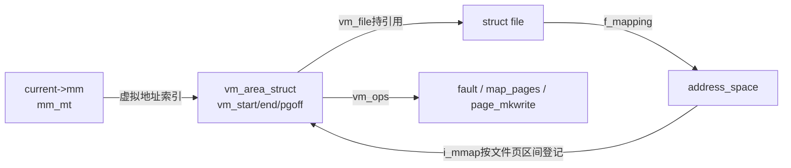
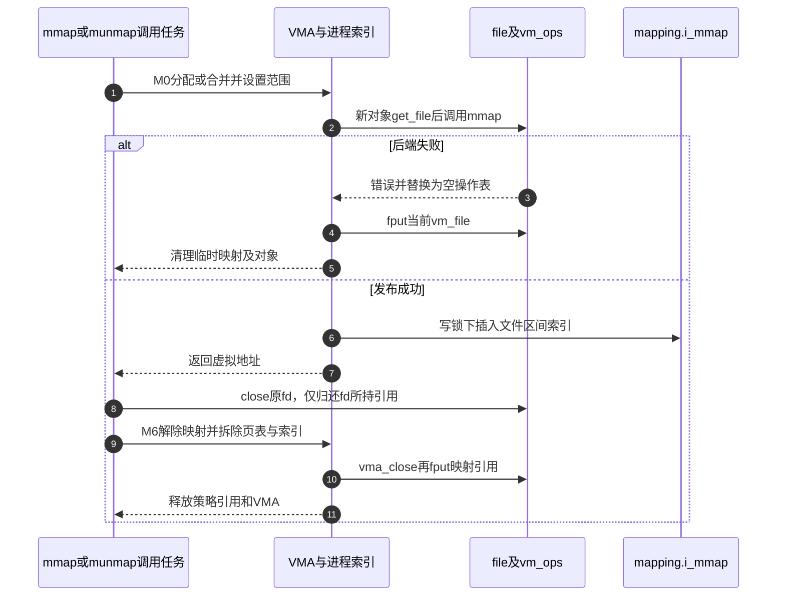

# 第45章\_文件映射的发布与引用归还

mmap返回以后，原fd可以关闭，但后续缺页仍须找到文件。本篇沿M0与M6追踪新VMA如何取得后备对象、发布到两个查询结构，再在拆除后归还引用。固定Linux 6.12.20提交 `dfaf2136deb2af2e60b994421281ba42f1c087e0`；以下摘录保留函数执行语句，删去上游长注释，由标识为仓库补充的中文说明解释。

| 关联入口 | 阅读任务 |
| --- | --- |
| [总索引](../navigation/P01_Linux_6.12_VFS源码阅读索引.md) | 定位版本与实现所有权 |
| [映射导读](../navigation/P17_文件映射的缺页与状态交接.md#17.1_沿一次映射访问找到状态落点) | 串起M0～M6 |
| [知识正文](../../../../knowledge/kernel_subsystems/vfs/P18_文件mmap与page_fault.md#18.2_映射关系与已经装好的页表是两件事) | 理解为何需要独立生命期 |

## 45.1\_新VMA先取得后备文件再发布

`mm/mmap.c::__mmap_region`由同文件的`mmap_region`调用，外层完成地址、权限及共享可写计数协调，当前进程的mmap写锁保护拓扑修改。它先处理重叠区、尝试合并；因此一次mmap不保证新建一个VMA。下面保留整个函数，阅读重点是新VMA路径中的`get_file → mmap_file → vma_iter_store → vma_link_file`以及相应回滚，其他分支的角色见符号表。

```c
/** @brief 仓库补充阅读说明：先尝试合并；新VMA取得文件引用、调用后端并发布，失败按实际vm_file回滚。 */
static unsigned long __mmap_region(struct file *file, unsigned long addr,
                unsigned long len, vm_flags_t vm_flags, unsigned long pgoff,
                struct list_head *uf)
{
        /* 仓库补充：先尝试合并；新VMA取得文件引用、调用后端并发布，失败按实际vm_file回滚。 */
        struct mm_struct *mm = current->mm;
        struct vm_area_struct *vma = NULL;
        pgoff_t pglen = PHYS_PFN(len);
        unsigned long charged = 0;
        struct vma_munmap_struct vms;
        struct ma_state mas_detach;
        struct maple_tree mt_detach;
        unsigned long end = addr + len;
        int error;
        VMA_ITERATOR(vmi, mm, addr);
        VMG_STATE(vmg, mm, &vmi, addr, end, vm_flags, pgoff);
        vmg.file = file;
        vma = vma_find(&vmi, end);
        init_vma_munmap(&vms, &vmi, vma, addr, end, uf,  false);
        if (vma) {
                mt_init_flags(&mt_detach, vmi.mas.tree->ma_flags & MT_FLAGS_LOCK_MASK);
                mt_on_stack(mt_detach);
                mas_init(&mas_detach, &mt_detach,  0);
                error = vms_gather_munmap_vmas(&vms, &mas_detach);
                if (error)
                        goto gather_failed;
                vmg.next = vms.next;
                vmg.prev = vms.prev;
                vma = NULL;
        } else {
                vmg.next = vma_iter_next_rewind(&vmi, &vmg.prev);
        }
        if (!may_expand_vm(mm, vm_flags, pglen - vms.nr_pages)) {
                error = -ENOMEM;
                goto abort_munmap;
        }
        if (accountable_mapping(file, vm_flags)) {
                charged = pglen;
                charged -= vms.nr_accounted;
                if (charged) {
                        error = security_vm_enough_memory_mm(mm, charged);
                        if (error)
                                goto abort_munmap;
                }
                vms.nr_accounted = 0;
                vm_flags |= VM_ACCOUNT;
                vmg.flags = vm_flags;
        }
        vms_clean_up_area(&vms, &mas_detach);
        vma = vma_merge_new_range(&vmg);
        if (vma)
                goto expanded;
        vma = vm_area_alloc(mm);
        if (!vma) {
                error = -ENOMEM;
                goto unacct_error;
        }
        vma_iter_config(&vmi, addr, end);
        vma_set_range(vma, addr, end, pgoff);
        vm_flags_init(vma, vm_flags);
        vma->vm_page_prot = vm_get_page_prot(vm_flags);
        if (vma_iter_prealloc(&vmi, vma)) {
                error = -ENOMEM;
                goto free_vma;
        }
        if (file) {
                /* 仓库补充：文件描述符以后关闭时，VMA仍持有自己的file引用。 */
                vma->vm_file = get_file(file);
                error = mmap_file(file, vma);
                if (error)
                        goto unmap_and_free_file_vma;
                WARN_ON_ONCE(addr != vma->vm_start);
                VM_WARN_ON_ONCE(vm_flags != vma->vm_flags &&
                                !(vm_flags & VM_MAYWRITE) &&
                                (vma->vm_flags & VM_MAYWRITE));
                vma_iter_config(&vmi, addr, end);
                if (unlikely(vm_flags != vma->vm_flags && vmg.prev)) {
                        struct vm_area_struct *merge;
                        vmg.flags = vma->vm_flags;
                        merge = vma_merge_new_range(&vmg);
                        if (merge) {
                                fput(vma->vm_file);
                                vm_area_free(vma);
                                vma = merge;
                                vm_flags = vma->vm_flags;
                                goto file_expanded;
                        }
                        if (vmg_nomem(&vmg)) {
                                mas_preallocate(&vmi.mas, vma,
                                                GFP_KERNEL|__GFP_NOFAIL);
                        }
                }
                vm_flags = vma->vm_flags;
        } else if (vm_flags & VM_SHARED) {
                error = shmem_zero_setup(vma);
                if (error)
                        goto free_iter_vma;
        } else {
                vma_set_anonymous(vma);
        }
#ifdef CONFIG_SPARC64
        WARN_ON_ONCE(!arch_validate_flags(vm_flags));
#endif
        vma_start_write(vma);
        vma_iter_store(&vmi, vma);
        mm->map_count++;
        vma_link_file(vma);
        khugepaged_enter_vma(vma, vma->vm_flags);
file_expanded:
        file = vma->vm_file;
        ksm_add_vma(vma);
expanded:
        perf_event_mmap(vma);
        vms_complete_munmap_vmas(&vms, &mas_detach);
        vm_stat_account(mm, vm_flags, pglen);
        if (vm_flags & VM_LOCKED) {
                if ((vm_flags & VM_SPECIAL) || vma_is_dax(vma) ||
                                        is_vm_hugetlb_page(vma) ||
                                        vma == get_gate_vma(current->mm))
                        vm_flags_clear(vma, VM_LOCKED_MASK);
                else
                        mm->locked_vm += pglen;
        }
        if (file)
                uprobe_mmap(vma);
        vm_flags_set(vma, VM_SOFTDIRTY);
        vma_set_page_prot(vma);
        return addr;
unmap_and_free_file_vma:
        fput(vma->vm_file);
        vma->vm_file = NULL;
        vma_iter_set(&vmi, vma->vm_end);
        unmap_region(&vmi.mas, vma, vmg.prev, vmg.next);
free_iter_vma:
        vma_iter_free(&vmi);
free_vma:
        vm_area_free(vma);
unacct_error:
        if (charged)
                vm_unacct_memory(charged);
abort_munmap:
        vms_abort_munmap_vmas(&vms, &mas_detach);
gather_failed:
        return error;
}
```

`vm_file`保存的是后端最终选择的文件。驱动的mmap回调允许更换它并归还原file，合并与错误出口必须对当前`vma->vm_file`执行fput。不能把“最初参数file”当作不可变的回收目标。`vma_iter_store`发布到进程的Maple Tree；`vma_link_file`另登记到文件mapping的区间树，两者支持不同方向的查询。

| 符号簇及位置 | 初始化、写读与边界 |
| --- | --- |
| `vm_area_struct`，`include/linux/mm_types.h` | `vm_area_alloc`分配；`vma_set_range`设置起止地址和文件页偏移，`vm_flags_init`与页保护构造器设置许可；缺页读取`vm_file/vm_ops/vm_pgoff` |
| `VMA_ITERATOR`在`include/linux/mm_types.h`、`VMG_STATE`在`mm/vma.h` | 栈上初始化迭代与合并上下文；`vma_merge_new_range`可能返回已扩展VMA。通用Maple算法由[Maple Tree专题](../../maple_tree/大纲.md)维护，本篇只负责VMA发布时序 |
| `vms/mas_detach/mt_detach` | 本次替换操作暂存重叠VMA；gather收集、clean先清PTE、complete完成旧区拆除、abort回滚；不能在旧VMA仍被反向映射遍历时提前释放 |
| `may_expand_vm/accountable_mapping/security_vm_enough_memory_mm` | 检查虚拟空间及私有可写映射的内存承诺；`charged`记录新增承诺，失败用`vm_unacct_memory`归还，不代表这里已分配全部文件页 |
| `vma_iter_prealloc/free`、`mas_preallocate` | 为发布准备树节点；回调已改变状态而合并需补内存时使用NOFAIL，不能把它扩展为任意缺页都不得失败 |
| `shmem_zero_setup/vma_set_anonymous` | 无file的共享/私有匿名分支，本篇文件映射主线不进入；保留它们以显式限定file分支 |
| `khugepaged_enter_vma/ksm_add_vma` | 向大页、同页合并机制登记当前VMA；不是普通文件页在此已经驻留。具体扫描与合并算法不在本簇展开 |
| `vm_stat_account/locked_vm/VM_SOFTDIRTY/vma_set_page_prot` | 更新地址空间计数、锁定额度、软件脏追踪和最终页保护；这些是功能状态，不能一概称日志 |
| `perf_event_mmap/uprobe_mmap` | 向性能事件及用户探针机制公布映射变化；不承担file引用与PTE安装 |
| `WARN_ON_ONCE/VM_WARN_ON_ONCE` | 检查回调不得擅改起始地址或扩大禁止的可写许可；告警不修复违规回调。SPARC64检查只在相应配置中编译；本次ARM不进入 |



**可修改性：** 最小局部修改先限定在回调校验或发布条件，必须同时检查早期合并、回调后合并、新对象发布和全部错误标签。增加file引用不能只补get而遗漏fput；移动旧区PTE拆除会影响truncate的反向遍历。验证应覆盖映射失败、可合并相邻区域、回调替换file以及关闭fd后继续访问。

## 45.2\_操作表决定以后由谁接住缺页

回调不是在mmap时把所有数据读入。`mm/internal.h::mmap_file`通过`call_mmap`调用`file->f_op->mmap`，失败后把`vm_ops`换为全局只读空表`vma_dummy_vm_ops`，防止对半初始化对象继续执行钩子。后者定义在`mm/init-mm.c`，在`include/linux/mm.h`声明，零初始化表示没有可调用操作。

```c
/** @brief 仓库补充阅读说明：后端拒绝映射后换为空操作表，阻止继续调用不一致对象的钩子。 */
static inline int mmap_file(struct file *file, struct vm_area_struct *vma)
{
        /* 仓库补充：后端拒绝映射后换为空操作表，阻止继续调用不一致对象的钩子。 */
        int err = call_mmap(file, vma);
        if (likely(!err))
                return 0;
        vma->vm_ops = &vma_dummy_vm_ops;
        return err;
}
```

`generic_file_mmap`位于`mm/filemap.c`并声明于`include/linux/fs.h`；MMU路径要求mapping提供`read_folio`，然后设置静态`generic_file_vm_ops`。此表以`filemap_fault/filemap_map_pages/filemap_page_mkwrite`分别接收单次缺页、相邻已有页映射和共享写准备。`file_accessed`更新访问时间，不等于数据已经读取。无MMU构建的同名入口返回`-ENOSYS`。

```c
/** @brief 仓库补充阅读说明：验证页读入能力，更新时间并选择通用文件映射操作表。 */
int generic_file_mmap(struct file *file, struct vm_area_struct *vma)
{
        /* 仓库补充：验证页读入能力，更新时间并选择通用文件映射操作表。 */
        struct address_space *mapping = file->f_mapping;
        if (!mapping->a_ops->read_folio)
                return -ENOEXEC;
        file_accessed(file);
        vma->vm_ops = &generic_file_vm_ops;
        return 0;
}
```

ext4普通页缓存映射只复用前两个回调，写准备是`ext4_page_mkwrite`，不能把通用操作表当作所有文件系统的实现。`ext4_file_mmap`是`fs/ext4/file.c`私有函数，由静态`ext4_file_operations.mmap`引用。强制关闭直接失败；`daxdev_mapping_supported`校验同步映射能力；`IS_DAX`决定选DAX表或普通表。本次DAX未启用，不能据此讲解DAX数据路径。

```c
/** @brief 仓库补充阅读说明：拒绝强制关闭或不支持的映射，再按DAX属性选择操作表。 */
static int ext4_file_mmap(struct file *file, struct vm_area_struct *vma)
{
        /* 仓库补充：拒绝强制关闭或不支持的映射，再按DAX属性选择操作表。 */
        struct inode *inode = file->f_mapping->host;
        struct dax_device *dax_dev = EXT4_SB(inode->i_sb)->s_daxdev;
        if (unlikely(ext4_forced_shutdown(inode->i_sb)))
                return -EIO;
        if (!daxdev_mapping_supported(vma, dax_dev))
                return -EOPNOTSUPP;
        file_accessed(file);
        if (IS_DAX(file_inode(file))) {
                vma->vm_ops = &ext4_dax_vm_ops;
                vm_flags_set(vma, VM_HUGEPAGE);
        } else {
                vma->vm_ops = &ext4_file_vm_ops;
        }
        return 0;
}
```

| 接口 | 输入和交接 | 唯一实现位置 |
| --- | --- | --- |
| `fault` | 按vmf页偏移取得文件页或返回重试/错误 | [缓存验证](P46_文件缺页的缓存验证与重试.md#46.2_页面存在以后仍要核对归属与EOF) |
| `map_pages` | fault-around尝试映射附近已就绪页，可能绕过单页fault回调 | [页表安装的分流边界](P47_文件页到进程页表的安装.md#47.1_缺失PTE先分清读取和两种写入) |
| `page_mkwrite` | 允许页成为共享可写之前，让后端准备写入并与失效协调 | [通用写准备](P49_共享映射的写入准备与脏页登记.md#49.1_让文件系统先准备可写页面)；ext4回调独立负责自己的块和日志约束，不能用通用函数替代 |

**可修改性：** 更换操作表必须成组核查fault、map_pages、page_mkwrite的锁/引用返回契约；特别是`VM_FAULT_LOCKED`意味着MM后续需要解锁页面。失败后继续调用原操作表会破坏初始化边界。

## 45.3\_两棵索引与最后一份文件引用分别收尾

`mm/vma.c::vma_link_file`在`mm/vma.h`声明，取得`mapping->i_mmap_rwsem`写侧再调用文件私有的`__vma_link_file`。内部用`vma_interval_tree_insert`按文件页偏移登记VMA，并为shared-maywrite映射维护可写计数；`flush_dcache_mmap_lock/unlock`是架构缓存维护协调钩子，不能删作普通日志。

```c
/** @brief 仓库补充阅读说明：取得文件mapping的区间树写锁后发布VMA反向关系。 */
void vma_link_file(struct vm_area_struct *vma)
{
        /* 仓库补充：取得文件mapping的区间树写锁后发布VMA反向关系。 */
        struct file *file = vma->vm_file;
        struct address_space *mapping;
        if (file) {
                mapping = file->f_mapping;
                i_mmap_lock_write(mapping);
                __vma_link_file(vma, mapping);
                i_mmap_unlock_write(mapping);
        }
}
```

```c
/** @brief 仓库补充阅读说明：登记共享可写计数并把VMA插入mapping的文件区间树。 */
static void __vma_link_file(struct vm_area_struct *vma,
                            struct address_space *mapping)
{
        /* 仓库补充：登记共享可写计数并把VMA插入mapping的文件区间树。 */
        if (vma_is_shared_maywrite(vma))
                mapping_allow_writable(mapping);
        flush_dcache_mmap_lock(mapping);
        vma_interval_tree_insert(vma, &mapping->i_mmap);
        flush_dcache_mmap_unlock(mapping);
}
```

M6先由上层munmap流程拆除页表、进程索引和文件区间登记，才进入`remove_vma`。`remove_vma`不是一个独立的“删除所有映射”接口；它只完成已经拆下对象的后端close、file引用、NUMA策略引用及VMA内存归还。`might_sleep`检查上下文，真正生命周期动作是后面的调用。

```c
/** @brief 仓库补充阅读说明：结束后端VMA上下文后替换操作表，防止重复钩子调用。 */
static inline void vma_close(struct vm_area_struct *vma)
{
        /* 仓库补充：结束后端VMA上下文后替换操作表，防止重复钩子调用。 */
        if (vma->vm_ops && vma->vm_ops->close) {
                vma->vm_ops->close(vma);
                vma->vm_ops = &vma_dummy_vm_ops;
        }
}
```

```c
/** @brief 仓库补充阅读说明：在上层完成拆除后归还文件和策略引用，最后释放VMA。 */
void remove_vma(struct vm_area_struct *vma, bool unreachable)
{
        /* 仓库补充：在上层完成拆除后归还文件和策略引用，最后释放VMA。 */
        might_sleep();
        vma_close(vma);
        if (vma->vm_file)
                fput(vma->vm_file);
        mpol_put(vma_policy(vma));
        if (unreachable)
                __vm_area_free(vma);
        else
                vm_area_free(vma);
}
```



`vma_close`在`mm/internal.h`内联；`remove_vma`在`mm/vma.h`声明。`mpol_put`归还VMA策略引用。`unreachable=true`允许直接`__vm_area_free`；否则调用`kernel/fork.c::vm_area_free`，在PER_VMA_LOCK配置下经RCU延后释放，本次关闭该配置则直接释放；它们不替代页表与区间树的上层拆除。**可修改性：** 调整末尾回收顺序时必须保留close调用期间可访问file的条件，并验证拆分/合并VMA带来的额外引用配对。关闭最后一个fd并不等于最后一个VMA也已消失。
