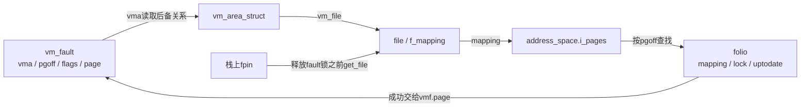
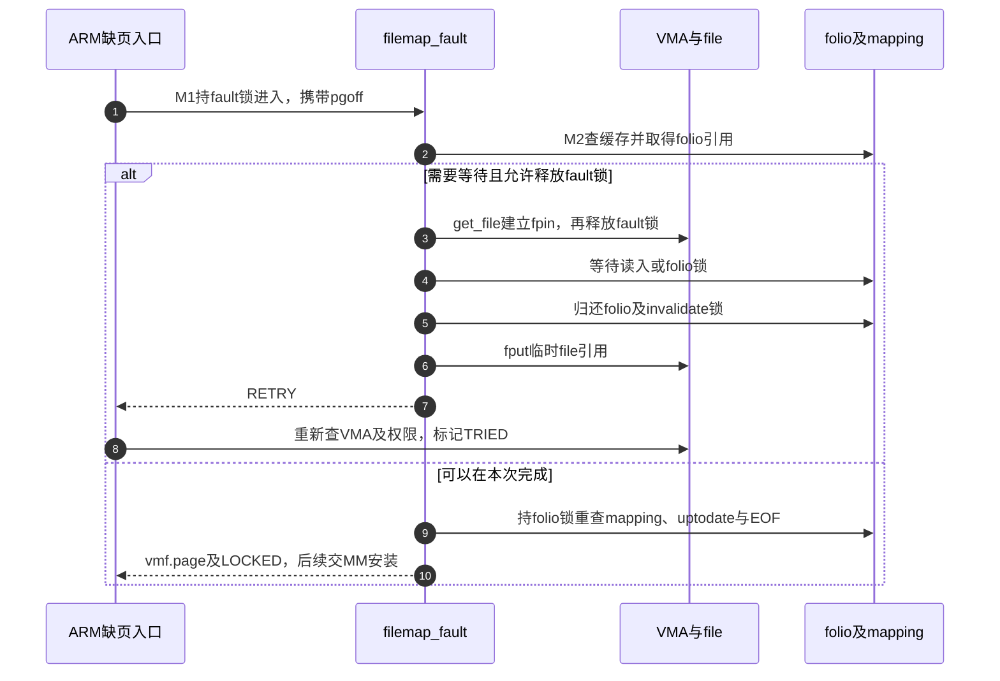

# 第46章\_文件缺页的缓存验证与重试

本篇追踪M2：fault回调必须交出仍属于目标文件、内容可用且未越过EOF的页面。查到缓存对象只是起点；等待期间VMA或文件大小可能变化。版本固定Linux 6.12.20提交 `dfaf2136deb2af2e60b994421281ba42f1c087e0`。摘录保留执行语句、替换上游注释为仓库阅读说明。

| 入口 | 关系 |
| --- | --- |
| [总索引](../navigation/P01_Linux_6.12_VFS源码阅读索引.md) | 固定证据与其他实现 |
| [映射导读](../navigation/P17_文件映射的缺页与状态交接.md#17.2_按重试与安装边界阅读实现) | 从M1走到M4 |
| [正文的首次访问](../../../../knowledge/kernel_subsystems/vfs/P18_文件mmap与page_fault.md#18.3_第一次访问为什么可能睡眠和重试) | 缓存对象与页表的区别 |

原件：[mm/filemap.c](../../linux/mm/filemap.c)、[mm/internal.h](../../linux/mm/internal.h)、[include/linux/mm.h](../../linux/include/linux/mm.h)、[arch/arm/mm/fault.c](../../linux/arch/arm/mm/fault.c)；身份与对象摘要见 [源码基线](../../linux/SOURCE_BASELINE.md#1.297_文件映射的缺页与状态交接)。

## 46.1\_等待文件页之前先决定保留哪种生命期

`mm/internal.h::maybe_unlock_mmap_for_io`只在允许首次重试且没有RETRY_NOWAIT时主动释放fault锁。先`get_file`得到fpin，后`release_fault_lock`，保证I/O期间file及mapping还活着；这份引用 **没有保护原VMA**。重试必须重新查VMA及访问许可。

```c
/** @brief 仓库补充阅读说明：先保住file，再释放fault锁；file引用不能保证原VMA继续存在。 */
static inline struct file *maybe_unlock_mmap_for_io(struct vm_fault *vmf,
                                                    struct file *fpin)
{
        /* 仓库补充：先保住file，再释放fault锁；file引用不能保证原VMA继续存在。 */
        int flags = vmf->flags;
        if (fpin)
                return fpin;
        if (fault_flag_allow_retry_first(flags) &&
            !(flags & FAULT_FLAG_RETRY_NOWAIT)) {
                fpin = get_file(vmf->vma->vm_file);
                release_fault_lock(vmf);
        }
        return fpin;
}
```

`release_fault_lock`在`include/linux/mm.h`按`FAULT_FLAG_VMA_LOCK`释放VMA读锁或mm的mmap读锁。`CONFIG_PER_VMA_LOCK`要求ARCH支持、MMU和SMP；本次SMP关闭，因此编译配置不启用该快路径。保留它的源码契约用于解释其他构建，不能把本机配置冒充所有ARM运行情况。

`lock_folio_maybe_drop_mmap`是`mm/filemap.c`私有辅助。trylock成功不释放fault锁；RETRY_NOWAIT争用时立即返回0且保留锁；可睡眠路径才尝试pin/drop。KILLABLE等待被信号打断时，如果尚未通过fpin释放锁，它会自己调用release_fault_lock再返回。

```c
/** @brief 仓库补充阅读说明：先尝试锁页，按等待与重试标志决定是否保住file后释放fault锁。 */
static int lock_folio_maybe_drop_mmap(struct vm_fault *vmf, struct folio *folio,
                                     struct file **fpin)
{
        /* 仓库补充：先尝试锁页，按等待与重试标志决定是否保住file后释放fault锁。 */
        if (folio_trylock(folio))
                return 1;
        if (vmf->flags & FAULT_FLAG_RETRY_NOWAIT)
                return 0;
        *fpin = maybe_unlock_mmap_for_io(vmf, *fpin);
        if (vmf->flags & FAULT_FLAG_KILLABLE) {
                if (__folio_lock_killable(folio)) {
                        if (*fpin == NULL)
                                release_fault_lock(vmf);
                        return 0;
                }
        } else
                __folio_lock(folio);
        return 1;
}
```

| 状态及位置 | 谁改变、谁消费 |
| --- | --- |
| `vm_fault.flags`，`include/linux/mm.h` | 外层缺页设置WRITE、ALLOW_RETRY、TRIED、KILLABLE等，内部据此选择等待；标志定义在`include/linux/mm_types.h`，不是errno |
| `fpin`栈变量 | maybe_unlock先取得file引用；filemap_fault的重试出口fput，不能用它继续访问失效VMA |
| folio引用和锁 | 查找取得引用以免对象消失，trylock/lock串行化内容与归属检查；引用、锁各自成对归还 |
| `VM_FAULT_RETRY` | 交还外层重新定位；RETRY_NOWAIT特例仍持锁，不能凭结果名独断锁状态 |
| `VM_FAULT_COMPLETED` | 其他写故障路径已完成且释放fault锁；不同于这里要求重新查找的RETRY |



**可修改性：** 移动锁释放位置必须同步检查所有后续VMA解引用、fpin的fput以及信号中断出口。验证需要人为延迟read_folio、并发munmap/截断与RETRY_NOWAIT争用，单次顺利读入不能覆盖这些边界。

## 46.2\_页面存在以后仍要核对归属与EOF

`filemap_fault`声明于`include/linux/mm.h`，在`mm/filemap.c`定义，由VMA的fault回调使用。它先按`DIV_ROUND_UP(i_size, PAGE_SIZE)`拒绝完整越过文件末尾的页，再查缓存。未命中会启动预读、在mapping的invalidate共享锁下创建/取得folio；拿到folio锁后再次检查`folio->mapping`、uptodate和EOF。最后只设置`vmf->page`并返回LOCKED，普通PTE由[MM安装](P47_文件页到进程页表的安装.md#47.2_拿到文件页以后在PTE锁下再次确认)完成。

```c
/** @brief 仓库补充阅读说明：取得并验证文件页；返回锁定页面或者按责任清理后重试，不在此安装普通PTE。 */
vm_fault_t filemap_fault(struct vm_fault *vmf)
{
        /* 仓库补充：取得并验证文件页；返回锁定页面或者按责任清理后重试，不在此安装普通PTE。 */
        int error;
        struct file *file = vmf->vma->vm_file;
        struct file *fpin = NULL;
        struct address_space *mapping = file->f_mapping;
        struct inode *inode = mapping->host;
        pgoff_t max_idx, index = vmf->pgoff;
        struct folio *folio;
        vm_fault_t ret = 0;
        bool mapping_locked = false;
        max_idx = DIV_ROUND_UP(i_size_read(inode), PAGE_SIZE);
        if (unlikely(index >= max_idx))
                return VM_FAULT_SIGBUS;
        trace_mm_filemap_fault(mapping, index);
        folio = filemap_get_folio(mapping, index);
        if (likely(!IS_ERR(folio))) {
                if (!(vmf->flags & FAULT_FLAG_TRIED))
                        fpin = do_async_mmap_readahead(vmf, folio);
                if (unlikely(!folio_test_uptodate(folio))) {
                        filemap_invalidate_lock_shared(mapping);
                        mapping_locked = true;
                }
        } else {
                ret = filemap_fault_recheck_pte_none(vmf);
                if (unlikely(ret))
                        return ret;
                count_vm_event(PGMAJFAULT);
                count_memcg_event_mm(vmf->vma->vm_mm, PGMAJFAULT);
                ret = VM_FAULT_MAJOR;
                fpin = do_sync_mmap_readahead(vmf);
retry_find:
                if (!mapping_locked) {
                        filemap_invalidate_lock_shared(mapping);
                        mapping_locked = true;
                }
                folio = __filemap_get_folio(mapping, index,
                                          FGP_CREAT|FGP_FOR_MMAP,
                                          vmf->gfp_mask);
                if (IS_ERR(folio)) {
                        if (fpin)
                                goto out_retry;
                        filemap_invalidate_unlock_shared(mapping);
                        return VM_FAULT_OOM;
                }
        }
        if (!lock_folio_maybe_drop_mmap(vmf, folio, &fpin))
                goto out_retry;
        /* 仓库补充：拿到folio锁以后重新确认成员关系，引用存在并不等于仍属于这个文件。 */
        if (unlikely(folio->mapping != mapping)) {
                folio_unlock(folio);
                folio_put(folio);
                goto retry_find;
        }
        VM_BUG_ON_FOLIO(!folio_contains(folio, index), folio);
        if (unlikely(!folio_test_uptodate(folio))) {
                if (!mapping_locked) {
                        folio_unlock(folio);
                        folio_put(folio);
                        goto retry_find;
                }
                goto page_not_uptodate;
        }
        if (fpin) {
                folio_unlock(folio);
                goto out_retry;
        }
        if (mapping_locked)
                filemap_invalidate_unlock_shared(mapping);
        max_idx = DIV_ROUND_UP(i_size_read(inode), PAGE_SIZE);
        if (unlikely(index >= max_idx)) {
                folio_unlock(folio);
                folio_put(folio);
                return VM_FAULT_SIGBUS;
        }
        vmf->page = folio_file_page(folio, index);
        return ret | VM_FAULT_LOCKED;
page_not_uptodate:
        fpin = maybe_unlock_mmap_for_io(vmf, fpin);
        error = filemap_read_folio(file, mapping->a_ops->read_folio, folio);
        if (fpin)
                goto out_retry;
        folio_put(folio);
        if (!error || error == AOP_TRUNCATED_PAGE)
                goto retry_find;
        filemap_invalidate_unlock_shared(mapping);
        return VM_FAULT_SIGBUS;
out_retry:
        if (!IS_ERR(folio))
                folio_put(folio);
        if (mapping_locked)
                filemap_invalidate_unlock_shared(mapping);
        if (fpin)
                fput(fpin);
        return ret | VM_FAULT_RETRY;
}
```

| 实现簇 | 声明、所有权与当前实例作用 |
| --- | --- |
| `filemap_get_folio/__filemap_get_folio`、`FGP_CREAT/FGP_FOR_MMAP` | 头文件`pagemap.h`与`mm/filemap.c`，按索引取得引用；创建及缓存成员关系由[缓存对象实现](P34_页缓存归属索引与竞争插入.md#34.3_查询取得引用后仍要复查索引)唯一展开，FOR_MMAP不等于已安装页表 |
| `filemap_invalidate_lock_shared/unlock_shared` | 保护本次填充与缓存失效的交接；不替代folio锁或PTE锁。`mapping_locked`记录当前是否需要归还该锁 |
| `do_sync_mmap_readahead/do_async_mmap_readahead` | 同文件静态辅助，读`file.f_ra`及VMA顺序/随机标志，可能预读邻页并通过fpin释放fault锁；`mmap_miss`调节预测，不证明发生了多少次物理介质读 |
| `filemap_read_folio`、`AOP_TRUNCATED_PAGE` | [读入完成实现](P35_缓存读的填充等待与有效范围.md#35.3_等待填充之后必须重新检查有效性)维护内容可用性；返回截断重试标志重新查找，普通读入错误转为SIGBUS，分配失败可为OOM |
| `count_vm_event/count_memcg_event_mm`、`PGMAJFAULT` | 缺页统计及memcg统计，不是正确性锁。其计数不能直接等同磁盘命令数 |
| `VM_BUG_ON_FOLIO` | DEBUG_VM类诊断检查页范围和锁；本次DEBUG_VM未启用，功能锁与条件分支仍需正确 |
| `folio_file_page/folio_contains` | 从较大folio选出本页，保证pgoff归属；不能把folio始终当作单页 |

这里的invalidate共享锁可能在成功返回前已归还，folio锁仍由MM接手。对EOF的第二次检查必须留在锁定页面之后：只在函数开头看一次文件大小，无法覆盖等待期间的截断。

**可修改性：** 优化命中路径也必须保留mapping身份与uptodate验证；“已持引用”不允许跳过它们。调整错误映射要同时检查read_folio错误、分配OOM、EOF SIGBUS和外层重试，不能把所有失败合并成一个普通errno。

## 46.3\_重试出口与临时清空PTE的边界

页面未命中还不必然是一次需要读入的主缺页。`filemap_fault_recheck_pte_none`对VM_LOCKED且保有原PTE的情形重查槽位，避免把另一路临时清空再恢复PTE的过程当作真正缺失。无锁观察不为空就返回NOPAGE，仍空则取PTE锁再次确认；无法映射该页表也交还NOPAGE。它是功能分流，不是仅用于统计的日志。

```c
/** @brief 仓库补充阅读说明：对锁定映射重查PTE，排除另一路临时清空槽位造成的假缺失。 */
static vm_fault_t filemap_fault_recheck_pte_none(struct vm_fault *vmf)
{
        /* 仓库补充：对锁定映射重查PTE，排除另一路临时清空槽位造成的假缺失。 */
        struct vm_area_struct *vma = vmf->vma;
        vm_fault_t ret = 0;
        pte_t *ptep;
        if (!(vma->vm_flags & VM_LOCKED))
                return 0;
        if (!(vmf->flags & FAULT_FLAG_ORIG_PTE_VALID))
                return 0;
        ptep = pte_offset_map_nolock(vma->vm_mm, vmf->pmd, vmf->address,
                                     &vmf->ptl);
        if (unlikely(!ptep))
                return VM_FAULT_NOPAGE;
        if (unlikely(!pte_none(ptep_get_lockless(ptep)))) {
                ret = VM_FAULT_NOPAGE;
        } else {
                spin_lock(vmf->ptl);
                if (unlikely(!pte_none(ptep_get(ptep))))
                        ret = VM_FAULT_NOPAGE;
                spin_unlock(vmf->ptl);
        }
        pte_unmap(ptep);
        return ret;
}
```



上图是允许主动释放锁的正常重试分支，RETRY_NOWAIT和信号中断的例外见46.1。`arch/arm/mm/fault.c::do_page_fault`在普通重试路径重新执行`lock_mm_and_find_vma`，SIGBUS结果进入`BUS_ADRERR`信号路径；本篇没有把ARM异常入口外推为其他架构指令流程。

**可修改性：** 不得把临时PTE重查删成“重复检查”；并发缺页可能已经解决目标地址。验证要区分缓存未命中、锁争用、页表已被别的任务装好三种事件，否则会同时误判I/O和引用泄漏。
